# Soleil Grid Hub

A payments-to-energy platform for a prepaid solar mini-grid operator: a customer pays by mobile
money, and that payment has to become energy credit on a physical meter — reliably, exactly once,
and in a way that is auditable down to the franc. This repository is the backend for that problem
(Django, PostgreSQL, a real double-entry ledger, signed webhook ingestion) plus a demo frontend
(Next.js) that drives it end to end against a real mobile-money provider double.

It is not a finished product. It is four backend slices and a demo shell, built deliberately
slowly and tested hard, to show the parts of a fintech-adjacent system that are actually difficult:
idempotent money movement, the accounting that has to be right when a payment disagrees with
itself, and the access control that keeps staff out of customer money by construction rather than
by convention.

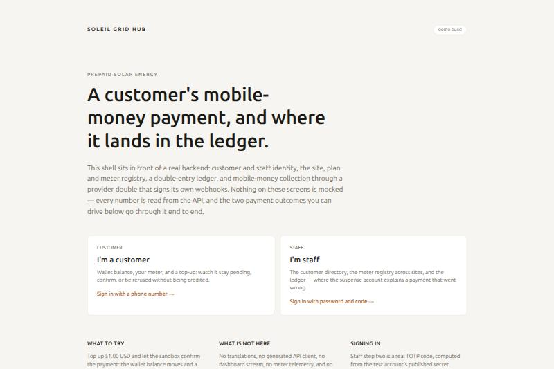

---

## What's actually here

| Area | What's built | Status |
|---|---|---|
| **Identity** | Staff login (password + TOTP/WebAuthn MFA), customer OTP login behind a proof-of-work challenge, RBAC, maker-checker approvals | Done, tested |
| **Registry** | Customers, sites, meters, plans, tariffs | Read endpoints done; writes declared for a later slice |
| **Ledger** | Double-entry accounts and transactions — wallet, provider clearing, revenue, fees, suspense, chargeback receivable | Done, tested |
| **Payments** | Top-up initiation, signed webhook ingestion, exactly-once event recording, late-credit handling, amount-mismatch routing to suspense, provider reversals, race-safe sweepers | Done, tested end to end against a real provider double |
| **Provider double** | A real mobile-money provider simulator (`tools/provider_stub`) — signs its own webhooks, programmable fault scenarios (duplicate delivery, wrong amount, stale signature, dropped collection, delayed reversal...) | Done |
| **Demo frontend** | A customer portal and a staff console, both driving the real API | Done — see [`frontend/README.md`](frontend/README.md) |
| Notifications, support desk, AI triage, reconciliation, telemetry, privacy lifecycle | Designed in `docs/plan/`, not built | Out of scope for this build |

That last row is deliberate, not an oversight: `docs/plan/` has a full eighteen-slice plan for a
production system. This repository stops after the part of that plan that is hardest to get right
— money — plus just enough identity, registry and ledger to make that part real rather than mocked.

---

## Architecture

One image, several process types, all from one codebase (`soleil/hub:dev`), behind one HAProxy
edge that routes by path — the same balancer a production deploy would use, just terminating HTTP
instead of TLS locally.

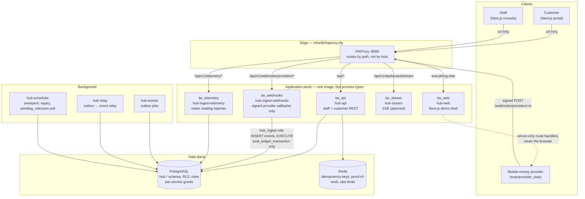

**Why a webhook pool separate from the API pool.** A burst of provider deliveries must never starve
the staff console, and the signed-webhook endpoint is the one route that is public by nature — so it
gets its own gunicorn workers, its own database role (`hub_ingest`, which can insert payment events
and call one `SECURITY DEFINER` posting function, and nothing else), and the balancer decides the
pool from the path before any other routing rule runs.

### The money path

This is the part worth reading closely — it is the one flow in the system where correctness means
something stronger than "the tests pass."

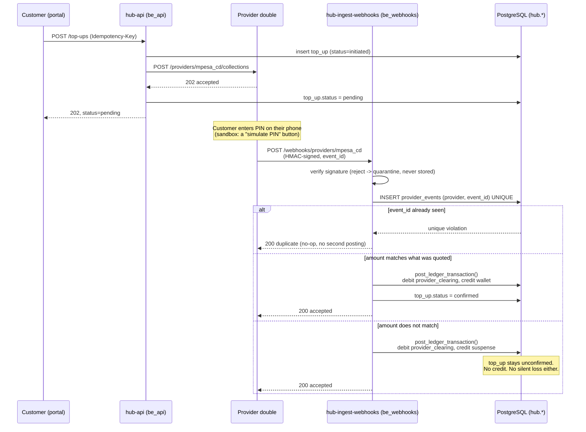

Three invariants come out of this diagram, and all three are enforced in code, not just in docs:

1. **Exactly once.** `(provider, event_id)` is a unique constraint, not an application-level check —
   fifty concurrent deliveries of the same event produce one accepted response and forty-nine
   duplicates, proven under `pytest -m concurrency` across five consecutive runs and, in the
   end-to-end suite, across four real gunicorn workers behind the real balancer.
2. **Every franc is accounted for, even when the provider disagrees with us.** A mismatched amount
   is never silently credited and never silently dropped — it lands on a `suspense` ledger account,
   still a balanced double-entry posting, waiting for a human. The observable from the customer's
   side is the pair of negatives: no confirmation, and no money.
3. **Least privilege down to the database role.** The webhook pool authenticates to PostgreSQL as
   `hub_ingest`, a role with `INSERT` on `provider_events` and `EXECUTE` on exactly one
   `SECURITY DEFINER` function — not `SELECT` on ledger balances, not any other table. A bug in this
   code cannot leak ledger data even if it tried.

### Data model (the ledger)

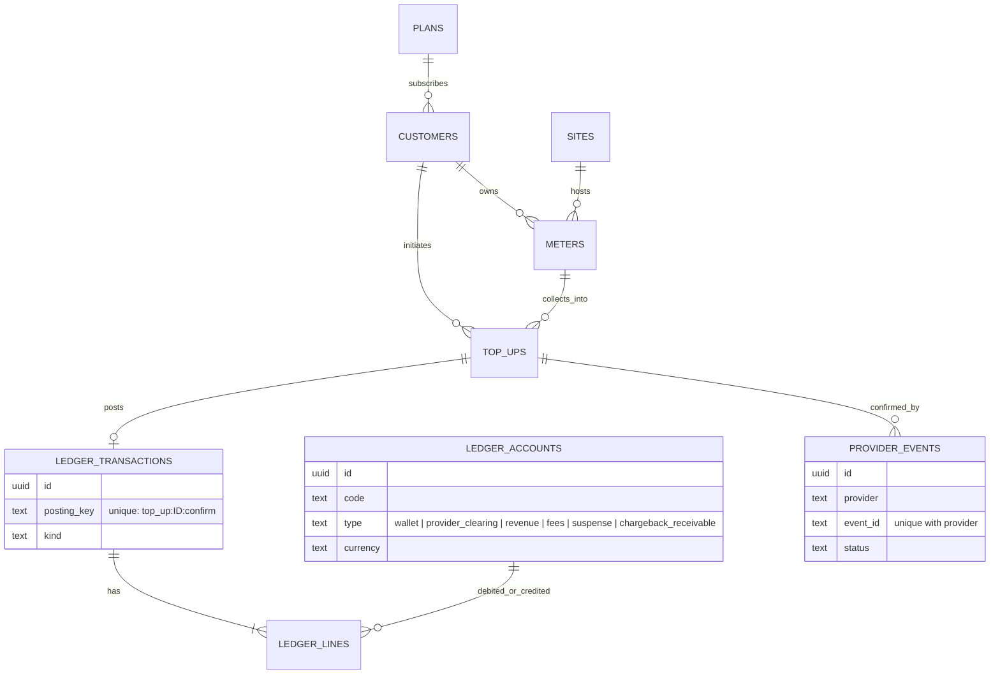

Every `LEDGER_TRANSACTIONS` row balances — `sum(debits) == sum(credits)` per currency, checked by a
database constraint, not just application code — and every posting key is unique, so the same
confirmation can never post twice even if the uniqueness check above it were ever removed.

---

## Seeing it work

### The customer side: a payment that becomes a balance, live

Sign-in is the real flow — a phone number, a client-side proof-of-work solve, a one-time code — and
the top-up is the real `POST /top-ups` the backend defines. The only thing standing in for a real
telecom is the "enter your PIN" step, which happens on the provider double instead of a phone.

| | |
|---|---|
| 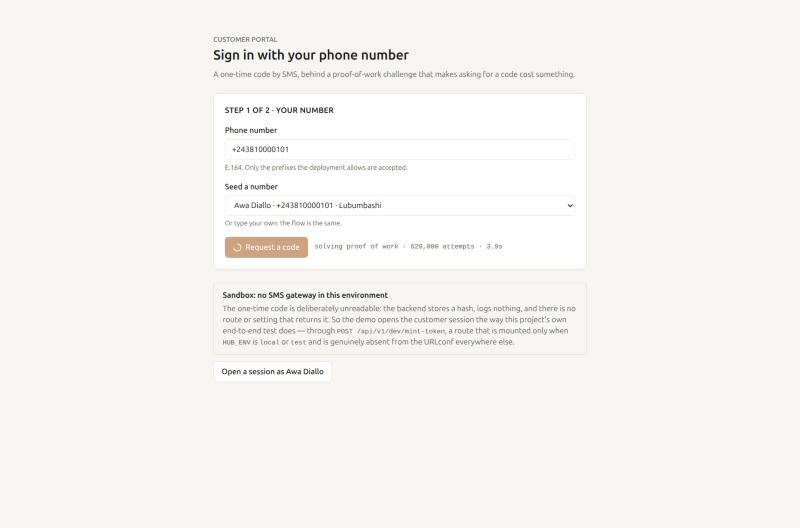 | 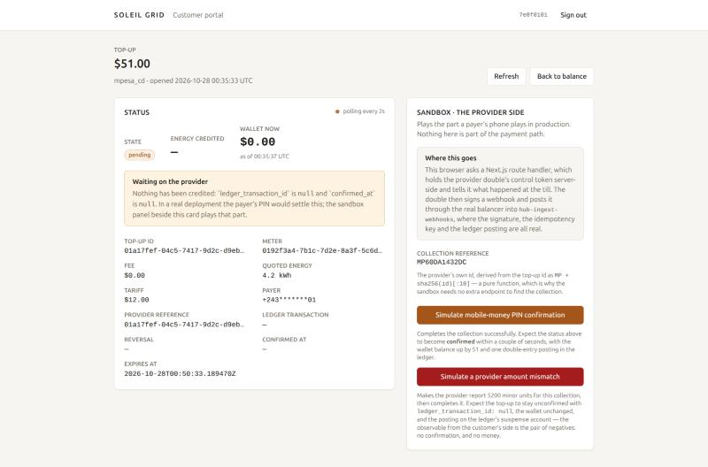 |
| Signing in costs CPU, not a CAPTCHA — a real hashcash-style challenge solved in the browser before an SMS would ever be queued. | A top-up in flight. The sandbox panel stands in for the customer's own phone; everything after this click is the production code path. |

| | |
|---|---|
| 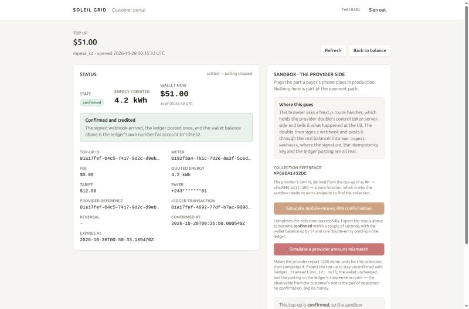 | 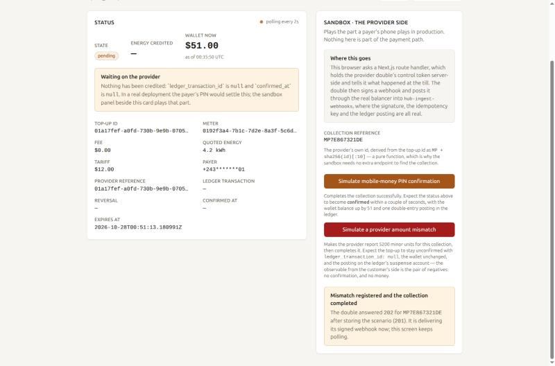 |
| The happy path: signed webhook in, ledger posted once, wallet balance moves — all in about two seconds. | The other path: the provider reports a different amount than was quoted. No confirmation, no credit — and nothing lost either (see the ledger below). |

### The staff side: the same event, from the other seat

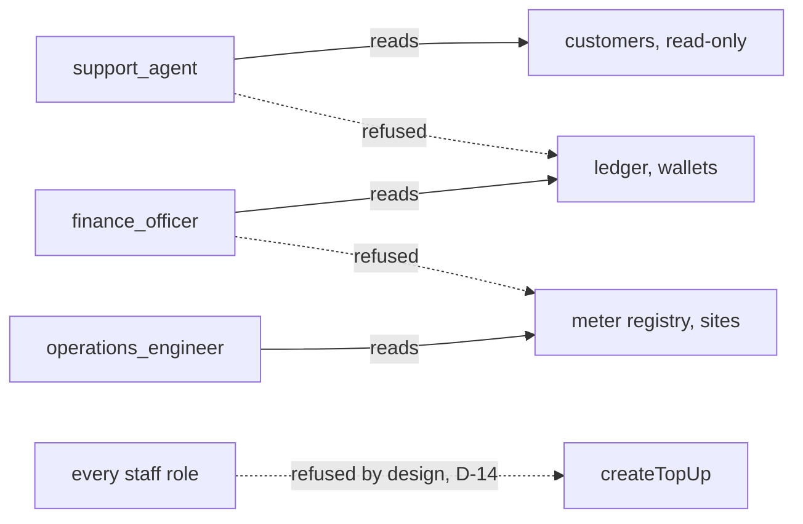

| | |
|---|---|
| 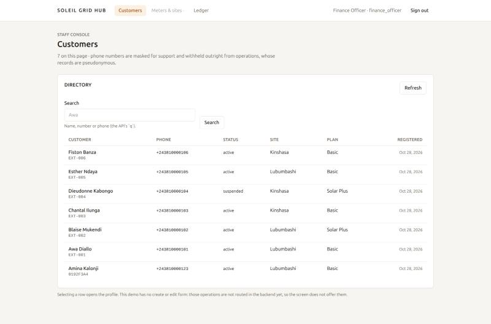 | 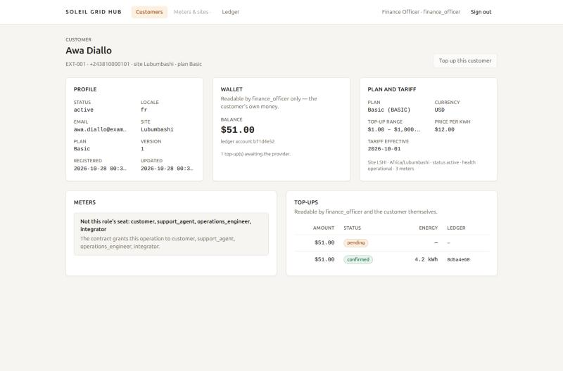 |
| Real, varied seed data — six customers, two sites, mixed statuses. | A `finance_officer` viewing a customer: the wallet is theirs to read, the meter registry is not — the contract's own refusal message is what the screen shows, and the "top up this customer" button is disabled with the actual reason: staff cannot move customer money, by design. |

| | |
|---|---|
| 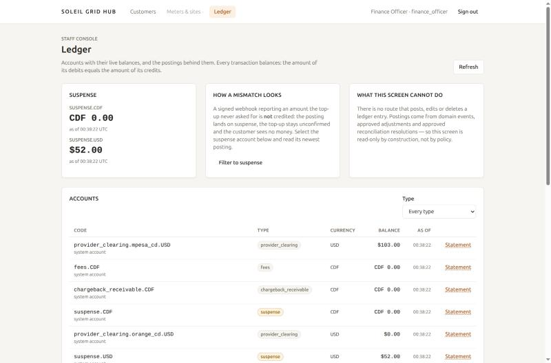 | 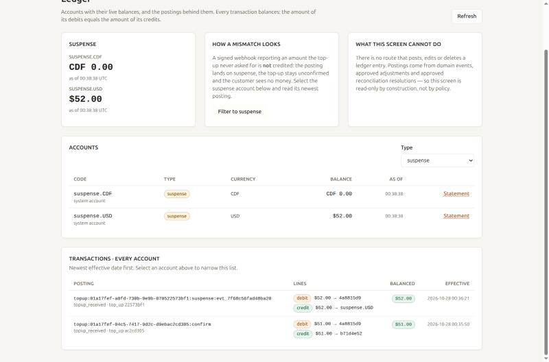 |
| The mismatch from the screenshot above, landed: `suspense.USD` carries the exact amount, live. | Both postings from this walkthrough, side by side — balanced debit/credit lines, each tied back to its top-up id. This is the double-entry claim, not asserted, shown. |

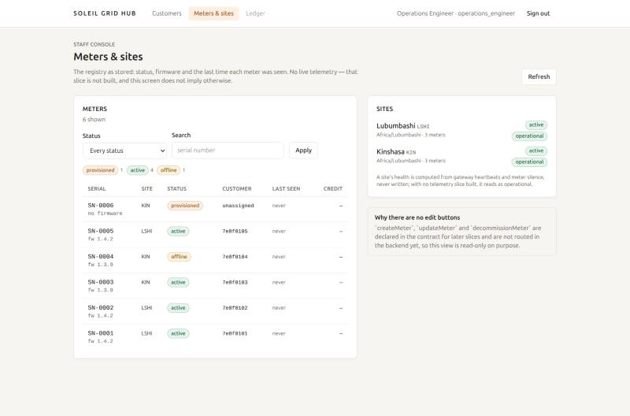

*Honest about its own limits: "No live telemetry — that slice is not built, and this screen does
not imply otherwise." `status` and `last_seen_at` are real columns from the registry, not a live
feed dressed up to look like one.*

---

## Engineering decisions worth knowing about

- **Hexagonal architecture per module.** Every module (`identity`, `customers`, `ledger`,
  `payments`) is `domain / application / infrastructure / api`, with import-linter enforcing that
  domain code never imports Django and application code never imports a concrete adapter. The ports
  are typed `Protocol`s; the wiring that assembles concrete adapters lives in one `wiring.py` per
  module.
- **Idempotency is structural, not a cache.** The webhook path's exactly-once guarantee is a
  database unique constraint. A top-up's `Idempotency-Key` header is retained and replayed from
  Redis. Neither can be defeated by a retry storm or a process crash mid-request — the concurrency
  test suite crashes the process mid-transaction on purpose and asserts zero partial rows.
- **Least privilege at the database, not just the application.** Four distinct PostgreSQL roles
  (`hub_api`, `hub_ingest`, `hub_worker`, read replicas), each with column- and function-level grants
  matching exactly what that pool's code needs — proven by tests that run *as* those roles, not as a
  superuser.
- **Security decisions the demo frontend keeps, not works around.** The customer OTP code is stored
  hashed and is never retrievable over HTTP or in a log — so the demo signs in through a
  `HUB_ENV=local`-only route that mints a token the same way the project's own end-to-end test does,
  rather than weakening the real flow to make a demo easier. The access token lives in memory only,
  never `localStorage`.
- **Tests that prove the hard claims, not just the easy ones.** 700+ backend tests, including a
  concurrency suite that fires fifty parallel duplicate webhook deliveries and asserts exactly one
  posting, and an end-to-end suite that runs the whole flow — signature, balancer routing, four real
  gunicorn workers — against the real provider double rather than an in-process fake.

---

## Tech stack

**Backend:** Django 5.2 (REST, no DRF on the signed-webhook path — raw bytes in, signature verified
before anything else touches them), PostgreSQL 16 with row-level security, Redis, HAProxy, gunicorn.
**Frontend:** Next.js 15 (App Router), React 19, TypeScript (strict), Tailwind CSS 4 — deliberately
without an i18n library, a generated API client, or an SSE stream; see
[`docs/plan/frontend/demo-shell-plan.md`](docs/plan/frontend/demo-shell-plan.md) for exactly what was
cut and why. **Provider double:** a dependency-free Python HTTP server
(`tools/provider_stub`) that signs its own webhooks and exposes a token-guarded control API for
programmable fault injection. **Infra:** Docker Compose, one image for every backend process type.

---

## Running it

```bash
make env                              # copy .env.example to .env
COMPOSE_PROFILES=stubs make up WEB=real   # the stack, the provider double, and the real frontend
make seed                             # 2 sites, 2 plans, 6 customers, 6 meters, 6 staff accounts
```

Open `http://localhost:8080`. Full walkthrough, including how to sign in as each seeded role and
exactly how to drive both payment outcomes, in [`frontend/README.md`](frontend/README.md).

```bash
make test       # backend unit + architecture tests
make lint       # ruff, mypy, import-linter, Django checks
make verify SLICE=04   # the full verification command list for the payments slice
```

---

## Where to read more

- [`docs/01-prd.md`](docs/01-prd.md) — the product requirements this was planned against (personas,
  journeys, success metrics)
- [`docs/02-system-architecture.md`](docs/02-system-architecture.md),
  [`docs/03-code-architecture.md`](docs/03-code-architecture.md) — the fuller architecture this
  repository implements a slice of
- [`docs/plan/progress.md`](docs/plan/progress.md) — the task-by-task build log, including defects
  found and fixed while writing each slice's tests
- [`docs/plan/frontend/demo-shell-plan.md`](docs/plan/frontend/demo-shell-plan.md) — the plan this
  demo frontend was built from, and the reasoning behind every deliberate simplification
