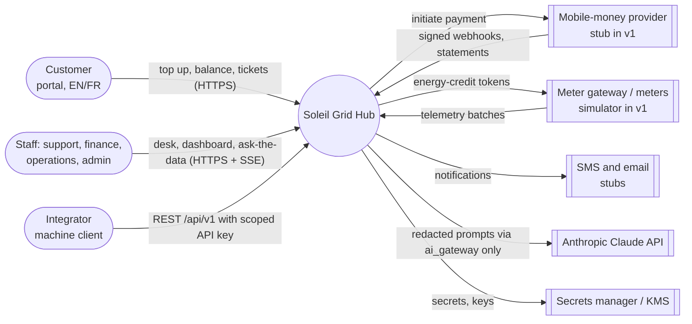
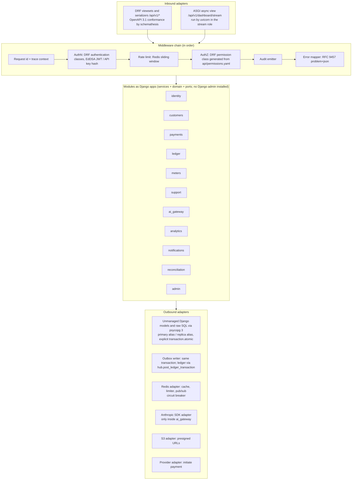

# 02 - System Architecture: Soleil Grid Hub

Status: design. Owner: System architect. Stack (D-42 to D-46, ADR-0019 to ADR-0021): Django 5 with Django REST framework, Next.js frontend as a fourth deployable `hub-web`. Every number is an assumption unless marked *measured*. It follows `00-shared-context.md` and does not renumber FR or NFR ids. Revision 1 applies the tech lead's decisions D-01 to D-38 (section 7 of that file); how each earlier challenge was resolved is in section 11.

## 1. Context and goals

### 1.1 What the architecture must get right, in priority order

1. **Money correctness (NFR-05, FR-02 to FR-05, FR-14).** A payment changes the ledger at most once. Every posting sums to zero. A meter never receives energy that was not paid for, and a customer is never charged for energy that was not delivered without being refunded.
2. **Availability of the payment-confirmation path (NFR-01, 99.9% monthly, about 43 minutes of error budget).** This path has its own instances, its own balancer backend and its own capacity, separate from everything else.
3. **Bursty writes without collateral damage (NFR-03).** Telemetry peaks of about 417 batches/s and payday webhook peaks of about 30/s must not slow the staff API or the webhooks.
4. **Read-heavy dashboards that stay cheap (FR-13, NFR-02).** Reads come from Redis and materialised views. Pushes go over Server-Sent Events (SSE).
5. **Bounded AI (NFR-07, NFR-08, NFR-13).** One egress point to Claude, no write path, a person approves anything that reaches a customer, and every call is audited and budgeted.
6. **Portability and operability (NFR-12, NFR-14).** Containers, IaC, HAProxy, Postgres, Redis and S3-compatible storage all run on any cloud or on VMs.

### 1.2 C4 level 1: system context



### 1.3 C4 level 2: containers

```mermaid
flowchart TB
  subgraph Edge
    nlb[Cloud L4 network LB<br/>2 AZs, TCP pass-through, PROXY protocol]
    hap[HAProxy x2 (L7)<br/>TLS, routing, health, edge rate limit]
    cdn[CDN optional<br/>hashed Next.js assets, public pages]
  end
  subgraph App["Stateless app tier (one backend image, three Django deployables, plus hub-web)"]
    api[hub-api<br/>Django 5 + DRF, gunicorn: staff, customer, integrator API]
    stm[hub-api role=stream<br/>Django ASGI, uvicorn: SSE only]
    ingw[hub-ingest role=webhooks<br/>Django + DRF, gunicorn]
    ingt[hub-ingest role=telemetry<br/>Django + DRF, gunicorn]
    web[hub-web<br/>Next.js App Router, Node standalone]
    wrk[hub-worker<br/>stream consumers, outbox relay, scheduler]
  end
  subgraph Data
    pgb[PgBouncer x2<br/>transaction pooling]
    pgp[(PostgreSQL 16 primary<br/>+ synchronous HA standby, D-26)]
    pgr[(PostgreSQL read replica<br/>async streaming)]
    rds[(Redis 7 primary + replica<br/>cache, limits, idempotency, pub/sub, streams)]
    s3[(S3-compatible object storage<br/>attachments, telemetry archive, backups)]
  end
  br[Browser: Next.js pages + client components] --> cdn
  br --> nlb
  nlb --> hap
  hap -->|/api/v1/*| api
  hap -->|/api/v1/webhooks/providers/*| ingw
  hap -->|/api/v1/telemetry/*, /api/v1/gateway/*| ingt
  hap -->|/api/v1/dashboard/stream| stm
  hap -->|/ and /_next/*| web
  api --> pgb
  stm --> pgb
  stm --> rds
  ingw --> pgb
  ingt --> pgb
  wrk --> pgb
  pgb --> pgp
  pgb --> pgr
  pgp -. WAL .-> pgr
  api --> rds
  ingw --> rds
  ingt --> rds
  wrk --> rds
  api --> s3
  wrk --> s3
  wrk -->|ai_gateway| claude[[Claude API]]
  api -->|ai_gateway, ask-the-data only| claude
  wrk --> gw[[Meter gateway]]
  wrk --> sms[[SMS/email stubs]]
  api --> prov[[Provider initiate]]
```

`hub-ingest` is one deployable, as the contract says, but it runs as **two Deployments selected by a `ROLE` variable**: webhooks and telemetry. They share code and image and differ in replica count, limits and balancer backend. The stream pool uses the same hub-api image started as an ASGI process. The point is a bulkhead: a telemetry reconnection storm must not take capacity from payment confirmation (NFR-01). See ADR-C14 and decision D-04 (resolution of C5).

### 1.4 Component view of `hub-api`



Rules enforced by import-linter in CI:
- Modules call each other only through `service.py` interfaces or domain events.
- Only `ai_gateway` imports `anthropic`.
- Only `analytics` gets the replica database alias.
- `ledger` exposes `post(transaction)` and never accepts raw line inserts.

`hub-web` is a fourth deployable (D-44, ADR-0021): a Next.js (App Router, TypeScript strict) server in Node standalone mode behind the same balancer and the same site as the API, so the refresh cookie keeps working. Server components render public pages (login shell, public help, tariffs, status); authenticated screens are client components that hold the access token in memory and call the Django API directly. It holds no secrets, never reads the database and does not proxy authenticated calls. Server Actions and the image optimiser are disabled. Django apps are the module form (`identity`, `customers`, ...), each with `managed = False` models mapped onto the SQL-first schema (D-43); the `hub.settings.api`, `.ingest`, `.worker` and `.stream` settings modules give each deployable its own database role. gunicorn (sync or threaded workers) runs `be_api`, `be_webhooks` and `be_telemetry`; uvicorn with async views serves only `be_stream`. `ATOMIC_REQUESTS` is off, because the webhook path needs one precisely bounded `transaction.atomic`.

## 2. Runtime views

### 2.a Top-up and webhook with exactly-once effect (FR-02, FR-03, FR-04; D-05, D-09)

```mermaid
sequenceDiagram
  autonumber
  participant C as Customer browser (hub-web client)
  participant A as hub-api
  participant P as Provider
  participant I as hub-ingest (webhooks)
  participant R as Redis
  participant DB as Postgres primary
  C->>A: POST /api/v1/top-ups {meter, amount} Idempotency-Key: K
  A->>DB: INSERT top_ups(status=initiated, quoted tariff, energy_wh, idem_key=K) ON CONFLICT (customer_id, idem_key) return existing
  A->>P: initiate(amount, our_ref=top_up_id) [timeout 5s]
  A-->>C: 202 {top_up_id, status: pending}
  P->>I: POST /api/v1/webhooks/providers/{provider} (signature, timestamp, event_id E)
  I->>I: verify HMAC over timestamp.E.body and |now - ts| < 300s
  alt invalid signature or stale timestamp
    I->>DB: INSERT quarantine log (not provider_events), 30-day retention
    I-->>P: 401
  else valid
    I->>I: check payer msisdn against the top-up; at 100 USD or more pull-verify with the provider status API [open threshold]
    I->>R: SET idem:prov:E NX EX 259200 (hint only)
    I->>DB: BEGIN
    I->>DB: INSERT provider_events(provider, event_id, provider_txn_id, payload) unique (provider, event_id) and (provider, provider_txn_id)
    alt unique violation (duplicate)
      I->>DB: ROLLBACK
      I-->>P: 200 duplicate, same outcome, no side effect
    else inserted
      I->>DB: SELECT top_up FOR UPDATE
      I->>DB: state machine: initiated or pending or pending_unknown -> confirmed; expired or cancelled -> confirmed with late = true
      I->>DB: post_ledger_transaction(provider_clearing +A, customer_wallet -A)
      I->>DB: INSERT outbox(payment.confirmed)
      I->>DB: COMMIT
      I-->>P: 200
    end
  end
  Note over I,DB: Failure: DB unavailable -> 503, nothing acked, provider retries (horizon assumed 72 h).<br/>Mismatch of amount or currency, decommissioned meter or erased customer -> money to suspense with a reconciliation exception.<br/>payment.reversed -> reversing entries; any shortfall posts to chargeback_receivable and opens an exception (D-06).<br/>Out-of-order "failed" after "confirmed" -> stored, no state regression, exception.
```

Exactly-once *effect* comes from the unique `(provider, event_id)` and `(provider, provider_txn_id)` constraints on `provider_events`, and a state machine that only moves forward, all inside one transaction. Webhook processing is synchronous (D-09): the acknowledgement is sent only after the event, the ledger entries and the outbox row are committed together. Redis only saves a database round trip and is never trusted; uniqueness lives in PostgreSQL alone. A confirmation that arrives after the top-up expired or was cancelled is credited once and flagged `late` (D-05); `suspense` is reserved for mismatch, decommissioned meters and erased customers. Invalid signatures never enter `provider_events`. The work is one short transaction of about 15 to 25 ms, so the 300 ms ack target in NFR-02 holds with margin. Ledger transactions commit synchronously with the standby (D-26).

### 2.b Energy-credit token issuance saga (FR-05; D-07, D-08, D-20)

```mermaid
sequenceDiagram
  autonumber
  participant S as Redis Stream events.payments
  participant W as hub-worker (token consumer)
  participant DB as Postgres primary
  participant G as Gateway adapter and site gateway
  participant RC as Reconciliation job
  S->>W: payment.confirmed (event_id, top_up_id)
  W->>DB: BEGIN; INSERT consumer_inbox(token_consumer, event_id) ON CONFLICT DO NOTHING
  alt duplicate delivery
    W->>DB: ROLLBACK; XACK
  else first time
    W->>DB: re-check snapshot: meter still belongs to the top-up's customer and is active; tariff and energy_wh from initiation
    W->>DB: post_ledger_transaction(customer_wallet +A, revenue_energy -A) (D-10)
    W->>DB: INSERT meter_tokens(token_id, posting_id, counter, expires_at, energy_wh, status=pending)
    W->>DB: INSERT outbox(token.requested); COMMIT; XACK
  end
  S->>W: token.requested
  W->>G: push(token_id, meter, counter, expiry) same token_id on every resend [timeout 10s]
  G-->>W: accepted for delivery, status=sent
  G->>W: POST /api/v1/gateway/tokens/{id}/acknowledge
  alt acknowledged
    W->>DB: status=acknowledged + outbox(token.issued, notification.requested)
  else definitive rejection (meter retired, invalid)
    W->>DB: BEGIN; compensating post (reverse the purchase entries); status=failed; outbox(token.failed, notification.requested); COMMIT
  else timeout / 5xx / no acknowledgement
    W->>W: resend with the same token id: 30 s doubling, capped at 30 min, for 72 hours (status stays pending, attempts > 0)
    W->>DB: status=unknown after the horizon
    RC->>G: query status(token_id) every 15 min
    RC->>DB: applied -> acknowledged; confirmed non-delivery -> compensate, status cancelled or failed; still unknown -> exception queue
  end
```

**Why this order: ledger first, token second.** If the token were sent first and the posting then failed, the meter would hold unpaid energy that cannot be taken back. A posting can always be reversed by a compensating posting, so the reversible step goes first. We **never compensate an unknown outcome**: compensation happens only after a definitive rejection or after reconciliation confirms the meter never applied the token, because refunding the wallet while the meter actually got the token would pay twice. A resend reuses the same token id, and the per-meter monotonic `counter` and `expires_at` make a duplicate application impossible. Token issuance is the single approved write to site systems (D-07): bound to meter id, counter and expiry, with no remote disconnect and no remote configuration in v1. Every token references its ledger posting (NOT NULL).

### 2.c Telemetry batch ingestion with duplicates and late data (FR-06; D-25)

```mermaid
sequenceDiagram
  autonumber
  participant M as Meter / gateway
  participant H as HAProxy be_telemetry
  participant T as hub-ingest (telemetry)
  participant DB as Postgres primary
  participant R as Redis
  M->>H: POST /api/v1/telemetry/batches (gateway API key, gzip, at most 1,000 readings or 256 KB)
  H->>H: edge limit per source; maxconn queue 5s
  H->>T: forward
  T->>T: key hash lookup (in-process cache 60s), schema validate
  T->>DB: INSERT reading_batches(gateway, batch_id) ON CONFLICT DO NOTHING (batch idempotency)
  T->>T: per reading: read_at > now+5m rejected; up to 7 days late accepted
  T->>DB: INSERT INTO meter_readings SELECT * FROM unnest(...) ON CONFLICT (meter_id, read_at) DO NOTHING
  T->>R: EVAL max-update last_seen hash (meter -> max read_at)  [skipped if Redis down]
  T-->>M: 200 {accepted, duplicates, rejected[] with reasons}
  Note over T,DB: Failure: pool wait > 200 ms or DB error -> 503 Retry-After: 30-90 s with jitter; device keeps its buffer.<br/>Partition for the month missing -> DEFAULT partition catches it + alert (partitions are pre-created 3 months ahead).<br/>The gateway sends a heartbeat every 5 minutes; 15 minutes of silence raises site_offline.
```

Partitioning is on `read_at`, the device time, so a late reading lands in its true partition and queries stay correct. The unique key `(meter_id, read_at)` includes the partition key, which Postgres requires for partitioned uniqueness; the `seq` field is advisory only. Partitions are monthly in v1 and weekly above 50,000 meters. Rollups do not trust arrival order: the hourly rollup job reads rows with `received_at > watermark` (BRIN index on `received_at`), collects the distinct `(meter, hour)` pairs those rows touch, and recomputes exactly those hours. Late data therefore corrects rollups without full recomputation.

**Exit triggers (accepting challenge C1 in this form).** Move telemetry out of PostgreSQL to a dedicated store when any one holds: hot data exceeds 500 GB, sustained ingest exceeds 3,000 rows per second, or insert latency breaches its target. Raw data is kept 90 days hot per the retention table in `04-data-model.md`, then archived.

### 2.d Ticket, AI triage, draft, human approval, send (FR-08 to FR-11, invariant 2)

```mermaid
sequenceDiagram
  autonumber
  participant U as Customer / email stub
  participant A as hub-api
  participant DB as Postgres
  participant W as hub-worker
  participant AG as ai_gateway
  participant CL as Claude API
  participant AGT as Support agent
  U->>A: POST /api/v1/tickets
  A->>DB: tx: ticket + outbox(ticket.created)
  W->>AG: triage(ticket_id)
  AG->>AG: budget check (per ticket, per day); redact PII to placeholders
  AG->>CL: messages (stable cached prefix + ticket), structured output schema
  alt ok
    CL-->>AG: {category, urgency, language, pii_flags}
    AG->>DB: INSERT ai_runs audit row (prompt hash, payload_ref to the redacted prompt, served_model, tokens, cost, latency)
    W->>DB: apply triage suggestion with override record; outbox(ticket.triaged)
  else stop_reason=refusal / schema invalid twice / budget exceeded
    W->>DB: triage_status=needs_human (agent triages manually)
  else 429 / 5xx / timeout
    W->>W: retry with backoff (SDK retries + server-side fallbacks), then needs_human after 30 min
  end
  W->>AG: draft(ticket_id): KB retrieval (Postgres FTS, ticket language, published versions)
  AG->>CL: draft with retrieved articles as citable sources
  AG->>AG: verify every citation id is in the retrieved set, else drop draft
  AG->>DB: ticket_messages(author_type=ai_draft, status=draft)
  AGT->>A: GET draft, edit, POST /drafts/{id}/approve
  A->>DB: tx: role check, approver_id, diff stored, message approved, outbox(notification.requested)
  W->>W: after the 30 s recall window (outbox available_at), send via SMS/email stub, idempotency key = message_id
  Note over W: Send failure -> retry 5x, then dlq.notifications + alert; ticket shows "not delivered".
```

The model never sends anything. The only path to a customer is `approve` → outbox → notification worker, and the approve endpoint requires the `ticket.ai_approve` permission (plus finance co-approval for money-affecting drafts, D-35). That is invariant 2 enforced in code rather than by convention.

### 2.e Ask the data (FR-12, invariants 1 and 5; D-24, D-31)

```mermaid
sequenceDiagram
  autonumber
  participant S as Staff (finance)
  participant A as hub-api (analytics)
  participant AG as ai_gateway
  participant CL as Claude API
  participant V as SQL guard
  participant RP as Postgres replica
  S->>A: POST /api/v1/analytics/ask {question, locale}
  A->>A: AuthZ analytics.ask (administrator has none); budget check
  A->>AG: generate(question, catalog = views in the role's schema only)
  AG->>CL: one structured output {sql, explanation} [model budget 3 s]
  CL-->>AG: SQL and an explanation of the SQL and its assumptions
  AG->>V: parse (sqlglot, postgres dialect)
  V->>V: exactly one SELECT; only allowlisted views in schema analytics_<role>;<br/>deny functions (pg_sleep, dblink, lo_*, set_config, pg_read_*); inject LIMIT 1000
  alt rejected
    V-->>A: reason; one repair attempt, then 422 with explanation
  else accepted
    A->>RP: check replay lag (pg_last_xact_replay_timestamp)
    A->>RP: as login analytics_finance: BEGIN READ ONLY; statement_timeout 5 s; run
    RP-->>A: rows (pseudonymous views)
    A-->>S: rows + SQL shown + "data as of <replica time>"
  end
  Note over A,RP: Query rows never reach the model; only the SQL text is audited in ai_runs.<br/>Replica down -> feature unavailable (never falls back to primary).<br/>Lag > 60 s -> answer with a stale-data banner. Timeout -> suggest narrowing the question.
```

There are four layers of defence: the model only ever sees the role's catalog; a parser-based allowlist; a database login per role (`analytics_support`, `analytics_finance`, `analytics_ops`) that only has `SELECT` on that role's view schema, with login-level read-only, timeout and temp-file settings; and a read-only transaction on a replica that is physically unable to accept writes. Any single layer can fail without breaking invariant 1 or 5. The 8 s outer budget in NFR-02 splits as model 3 s, guard 0.1 s, query 5 s (`statement_timeout`, also enforced by a PgBouncer query timeout), overhead 0.4 s at most. The model produces one structured output only, and query rows never reach it (D-31). **Accepted residual risk (D-24):** site scoping is not enforced in the analytics path in v1; support and operations see aggregate views and finance sees pseudonymous money rows, role-wide, while the main API enforces site scope.

### 2.f Live dashboard: cache plus SSE fed by Redis pub/sub (FR-13)

```mermaid
sequenceDiagram
  autonumber
  participant B as Browser (staff)
  participant A as hub-api instance N
  participant R as Redis
  participant W as hub-worker (dashboard projector)
  participant DB as Postgres
  B->>A: GET /api/v1/dashboard/summary
  A->>R: GET dash:v1:summary:{region}
  alt hit
    R-->>A: snapshot {version}
  else miss
    A->>R: SET lock NX PX 3000 (single flight)
    A->>DB: aggregate from materialised views
    A->>R: SET snapshot EX 30+jitter
  end
  A-->>B: snapshot (version v)
  B->>A: POST /api/v1/dashboard/stream-tickets -> single-use ticket (30 s, bound to the caller's IP)
  B->>A: GET /api/v1/dashboard/stream?ticket=... (EventSource)
  Note over A,B: First event is snapshot; event names are snapshot, site.status_changed, revenue.updated, alert.raised, alert.updated, heartbeat, resync_required.
  Note over A: one PSUBSCRIBE dash:* per instance, fan-out to local connections in memory
  W->>DB: consume payment.confirmed, alert.raised, alert.updated, site status events
  W->>R: HINCRBY / HSET aggregates, INCR version
  W->>R: PUBLISH dash:site:{id} {delta, version}
  R-->>A: message
  A-->>B: event: site.status_changed / revenue.updated / alert.raised / alert.updated, id: version
  A-->>B: event: heartbeat every 15 s (role and tv re-checked here)
  Note over A,B: Pub/sub has no replay. On reconnect, Last-Event-ID < current version -> server sends resync_required then a fresh snapshot.<br/>Redis down -> instance switches to server-side polling of the summary every 10 s and keeps the stream open.<br/>A stream lives at most 10 minutes, then the client requests a new ticket. A failed role or tv check closes the stream.
```

## 3. Load balancing

### 3.1 Topology and the L4 versus L7 choice

The chain is **cloud L4 network LB (TCP pass-through, PROXY protocol v2, spanning two availability zones) → 2 HAProxy nodes (L7, one per zone) → app pods (Django deployables and `hub-web`)**.

- **Why L7 is required.** We route by path (`/api/v1/webhooks/providers/*`, `/api/v1/telemetry/*`, `/api/v1/gateway/*`, `/api/v1/dashboard/stream`, and `/` plus `/_next/*` for the web pool), terminate TLS, inject request ids, set different timeouts per route, rate-limit by source and API key, health-check at HTTP level and control retries by method. L4 can do none of that.
- **Why keep a thin L4 in front.** Redundancy of HAProxy itself: the cloud LB gives a zone-spanning anycast or virtual IP without keepalived games in cloud networks, which often block gratuitous ARP. Because it passes TCP through, all L7 behaviour stays in portable HAProxy configuration (NFR-12).
- **Why HAProxy over nginx (OSS).** nginx OSS has no active health checks (they are nginx Plus only). HAProxy also gives `observe layer7` passive checks, stick tables synchronised between peers for rate limiting, a runtime API for draining, `slowstart`, and `disable-l7-retry` to restrict retries by method. Envoy would add per-request EWMA balancing, but its xDS control plane is operational weight we do not need at 650 peak rps.

### 3.2 Pools, and why they are separate

Five pools (D-04, resolution of C5 and C9; `be_web` added with the stack decision). `be_api_slow` is folded into `be_api`, with per-route timeouts instead of a separate backend.

| Backend | Targets | Paths | Traffic shape | Algorithm | Why |
|---|---|---|---|---|---|
| `be_api` | hub-api pods (gunicorn) | everything else under `/api/*`, including the staff webhook log `/api/v1/webhook-events`, `/api/v1/analytics/ask` and exports | 10 to 200 rps, mixed latency (5 ms reads to 8 s ask-the-data) | `leastconn` | Latency varies by more than 100x between requests. Round robin would pile requests onto a pod that is stuck on slow queries. Least connections counts in-flight work. Slow routes get a longer `timeout server` through a per-route rule rather than their own pool. |
| `be_stream` | hub-api image, ASGI role (uvicorn, async views) | `/api/v1/dashboard/stream` | about 300 long-lived SSE connections | `leastconn` | Spreads long-lived connections evenly. Kept apart from `be_api` so SSE connections do not distort the connection counts used to balance short requests. |
| `be_webhooks` | hub-ingest role=webhooks (gunicorn) | `/api/v1/webhooks/providers/*` | at most 30 rps, about 20 ms each, critical | `roundrobin` with `slowstart 30s` | Uniform, short requests: round robin is optimal and predictable. This pool is reserved so the NFR-01 path always has capacity. |
| `be_telemetry` | hub-ingest role=telemetry (gunicorn) | `/api/v1/telemetry/*`, `/api/v1/gateway/*` | at most 417 batches/s, uniform, bursty | `roundrobin`, `maxconn 64` per server, `timeout queue 5s` | Uniform cost per batch. maxconn plus a queue is the back-pressure point: when the queue times out, the meter gets a 503 and retries later. |
| `be_web` | hub-web pods (Node standalone) | `/` and `/_next/*` (everything not under `/api/`) | about 5 to 20 page requests per second at peak, mostly cached assets | `roundrobin` | Short, uniform requests. Own pool and health path `/web/health` (which does not collide with `/api/v1/health/*`) so a Node fault or a rendering spike never touches payments. |

`hub-ingest` is one deployable run as two Deployments (webhooks, telemetry). The staff view of the webhook log, `/api/v1/webhook-events`, is an ordinary staff API route and goes to `be_api`, never to the ingest pool.

**EWMA (peak exponentially weighted moving average of latency)** beats least connections when backends degrade unevenly, for example during noisy-neighbour CPU steal. HAProxy does not offer it. We accept least connections and revisit it with Envoy if per-pod p95 spread exceeds 2x for a week (measured trigger).

### 3.3 Health checks

- **Active checks.** `GET /api/v1/health/ready` every 2 s, `fall 3 rise 2`, so a dead pod is out within about 6 s. The ready endpoint checks the PgBouncer connection and the migration version. Results are cached for 1 s inside the app so checks cannot hammer the DB. **It does not check Redis**: Redis is optional for every path (section 4.4), and failing readiness on a shared dependency would remove every pod at once. `/api/v1/health/live` (process loop alive) is used only by the orchestrator to restart a pod, never by the balancer.
- **Passive checks.** `observe layer7 error-limit 10 on-error mark-down` takes a pod out after 10 consecutive 5xx responses even if the ready check still passes, which catches a pod with a broken connection pool. Active checks bring it back.
- **Agent check (optional).** A pod can report `drain` or a weight through `agent-check` during heavy GC or pool exhaustion.

### 3.4 Connection draining and graceful deploys

Rolling update with `maxUnavailable 0, maxSurge 1`. On SIGTERM:
1. The `preStop` hook flips readiness to failing and sleeps 10 s. HAProxy sees `fall 3 × 2 s` and stops sending new requests.
2. gunicorn (or uvicorn in the stream role) stops accepting connections and finishes in-flight requests within a 30 s graceful timeout; `hub-web` drains on SIGTERM the same way. `terminationGracePeriodSeconds=45`.
3. SSE connections receive `retry: 2000` and are closed. Browsers request a new ticket and reconnect to another pod (snapshot resync, view 2.f).
4. The new pod enters with `slowstart 30s`, so its weight ramps up while caches and pools warm.

Database migrations follow expand/contract, so two versions of the code run against one schema during the roll.

### 3.5 TLS

TLS 1.2 minimum and 1.3 preferred, with ALPN `h2,http/1.1` at HAProxy. HTTP/2 to browsers matters for SSE because it removes the six-connections-per-host limit of HTTP/1.1. Certificates come from ACME or the cloud certificate manager and are delivered as files. HSTS is set. **Re-encryption to the backends** uses an internal CA with `verify required`. That costs about 1 ms per request and closes NFR-06 "in transit" without trusting the VPC. For the provider webhooks we also enforce an IP allowlist at HAProxy plus the in-app HMAC check (defence in depth), and mTLS if the real provider supports it.

### 3.6 Timeouts and retries

| Setting | Value | Reason |
|---|---|---|
| `timeout connect` | 3 s | Same-region pods. A longer wait means the pod is dead. |
| `timeout http-request` | 10 s | Slowloris protection. |
| `timeout client` / `server` (api) | 30 s / 10 s | Read API p95 target is 200 ms. 10 s is a hard ceiling. |
| `timeout server` (be_api, slow routes `/api/v1/analytics/ask`, exports) | 15 s | Per-route override inside `be_api`; ask-the-data outer budget is 8 s plus margin. |
| `timeout server` (webhooks) | 5 s | The provider times out around 10 s. Failing fast lets it retry. |
| `timeout server` (stream) | 30 s, with 15 s heartbeat; streams last at most 10 min | An inactivity timer that heartbeats always reset. |
| `timeout queue` | 5 s | Back-pressure: answer 503 rather than build an unbounded queue. |

**Retry policy.** `retries 2` with `option redispatch` re-sends connection failures to another server, which is safe because the request never reached an app. L7 retries (`retry-on empty-response response-timeout 503`) are allowed **only** for GET, HEAD, OPTIONS, and for PUT or POST that carry an `Idempotency-Key` header. Everything else goes through `http-request disable-l7-retry`. Retrying a non-idempotent POST at the proxy is how double top-ups happen. Webhook backends never retry at L7 because the provider is the retrier.

### 3.7 Rate limiting: edge versus app

| Layer | Mechanism | Key | Purpose | Failure behaviour |
|---|---|---|---|---|
| Edge (HAProxy) | Stick table synchronised through `peers` | Source IP; API-key hash for ingest | Coarse flood protection: drop abuse before it costs a Python worker. Example: 300 req/10 s per IP. | Per-node state when the peer link is down, so the effective limit can double. Acceptable for a coarse layer. |
| App (Redis) | Sliding-window counter (Lua) | user id, API key and scope (FR-18), route class | Precise business quotas, `RateLimit-*` headers, per-plan limits. | Falls back to a local token bucket of limit/N per pod (section 4.4). |

The provider and meter-gateway source ranges are exempt from the per-IP edge limit, because legitimate retry bursts must not be dropped. They get a separate, much higher per-key ceiling.

### 3.8 SSE through the proxy

- HAProxy streams responses by default. We make sure `compression` excludes `text/event-stream`, because compression buffers. Through any nginx hop, `X-Accel-Buffering: no` and `proxy_buffering off`.
- Heartbeat comment every 15 s, below every inactivity timeout on the path, including cloud LB idle timeouts (typically 60 to 350 s).
- Authentication (D-18): `EventSource` cannot send an Authorization header, so the client calls `POST /api/v1/dashboard/stream-tickets` and receives a **single-use ticket valid 30 s and bound to the caller's IP**, passed as `GET /api/v1/dashboard/stream?ticket=`. HAProxy's log format strips query strings. A stream lives at most 10 minutes and the client then requests a new ticket; the role and the `tv` token version are re-checked on every heartbeat, so authorisation never outlives a revocation.

### 3.8a Authentication on the wire (D-17, D-46)

Only `POST /api/v1/auth/refresh` and `POST /api/v1/auth/logout` are authenticated by the refresh cookie; both require `Origin` equal to the site origin and the header `X-Hub-CSRF: 1`, on top of `SameSite=Strict`. Every other call uses the bearer access token in the `Authorization` header and never a cookie, so CSRF does not apply to it, and Django's CSRF middleware is not used for the API. The cookie is scoped to `Path=/api/v1/auth`, so it never reaches `be_web` page requests. Next.js Server Actions are disabled, so no cookie-authenticated mutation exists in `hub-web`. HAProxy can enforce the `Origin` and `X-Hub-CSRF` rule on those two paths as defence in depth.

### 3.9 Why no sticky sessions

The app tier is stateless: JWT authentication, state in Postgres and Redis, SSE resync by snapshot. Stickiness would unbalance load during deploys and after pod loss, which is exactly when we need balance. It would also hide state bugs. The one place affinity looks tempting is SSE, and we avoid needing it by making reconnects cheap and correct (version plus snapshot).

### 3.10 Redundancy of the balancer

There are two HAProxy nodes, one per zone, behind the cloud L4 LB, which health-checks them on `:8404/healthz`. Losing one node halves edge capacity, and each node is sized to carry 100% of peak (650 rps is tiny for HAProxy). For on-premises or VM deployments without a cloud LB, **keepalived/VRRP** moves a virtual IP between the two nodes, with failover in about 3 s, and `peers` keeps rate-limit tables warm across the switch.

### 3.11 A second region

- Global entry through DNS-based failover (health-checked records, TTL 60 s) or a global anycast LB. **Active-passive, not active-active**: the ledger has one writer (section 8).
- The provider's webhook URL points at a hostname that fails over. The provider is told about the failover IPs in advance for its allowlists.
- Each region has its own L4 LB, HAProxy pair and pools. Redis is not replicated across regions: the passive region starts with a cold cache and a degraded dashboard.
- Edge rate limits stay per region, which is acceptable because only one region takes writes.

### 3.12 HAProxy configuration sketch

```haproxy
global
  maxconn 20000
  stats socket /run/haproxy/admin.sock mode 600 level admin
  ssl-default-bind-options ssl-min-ver TLSv1.2

defaults
  mode http
  option httplog
  log-format "%ci %ID %HM %HPO %ST %Tt %b/%s"   # path only, query string never logged
  timeout connect 3s
  timeout client 30s
  timeout server 10s
  timeout http-request 10s
  timeout queue 5s
  retries 2
  option redispatch 1
  retry-on conn-failure empty-response response-timeout 503

peers lb_peers
  peer lb-a 10.0.1.10:10000
  peer lb-b 10.0.2.10:10000

frontend fe_https
  bind :443 ssl crt /etc/haproxy/certs/ alpn h2,http/1.1 accept-proxy
  unique-id-format %{+X}o\ %ci%cp%fp%Ts%rt
  http-request set-header X-Request-ID %[unique-id] unless { req.hdr(x-request-id) -m found }
  acl provider_src src -f /etc/haproxy/provider_ips.lst
  acl is_webhook   path_beg /api/v1/webhooks/providers/
  acl is_telemetry path_beg /api/v1/telemetry/ /api/v1/gateway/
  acl is_stream    path_beg /api/v1/dashboard/stream
  acl is_api       path_beg /api/
  acl is_webhealth path /web/health
  acl is_slow      path_beg /api/v1/analytics/ask /api/v1/exports
  # /api/v1/webhook-events (staff log) matches none of the above and goes to be_api
  acl safe_method  method GET HEAD OPTIONS
  acl has_idem     req.hdr(idempotency-key) -m found
  stick-table type ipv6 size 1m expire 60s store http_req_rate(10s) peers lb_peers
  http-request track-sc0 src
  http-request deny deny_status 429 if !provider_src { sc_http_req_rate(0) gt 300 }
  http-request deny deny_status 403 if is_webhook !provider_src
  http-request disable-l7-retry if !safe_method !has_idem
  http-request disable-l7-retry if is_webhook
  http-request set-timeout server 15s if is_slow   # per-route timeout inside be_api
  use_backend be_webhooks  if is_webhook
  use_backend be_telemetry if is_telemetry
  use_backend be_stream    if is_stream
  use_backend be_api       if is_api
  default_backend be_web   # /, /_next/*, /web/health (everything outside /api/)

backend be_api
  balance leastconn
  option httpchk
  http-check send meth GET uri /api/v1/health/ready
  http-check expect status 200
  default-server check inter 2s fall 3 rise 2 slowstart 30s ssl verify required ca-file /etc/haproxy/internal-ca.pem observe layer7 error-limit 10 on-error mark-down
  server-template api 12 hub-api.internal:8443 resolvers dns init-addr none

backend be_stream
  balance leastconn
  timeout server 30s
  option httpchk
  http-check send meth GET uri /api/v1/health/ready
  default-server check inter 2s fall 3 rise 2 ssl verify required ca-file /etc/haproxy/internal-ca.pem
  server-template api 12 hub-api.internal:8443 resolvers dns init-addr none

backend be_web
  balance roundrobin
  option httpchk
  http-check send meth GET uri /web/health
  http-check expect status 200
  default-server check inter 2s fall 3 rise 2 slowstart 30s ssl verify required ca-file /etc/haproxy/internal-ca.pem
  server-template web 4 hub-web.internal:8443 resolvers dns init-addr none

backend be_webhooks
  balance roundrobin
  timeout server 5s
  option httpchk
  http-check send meth GET uri /api/v1/health/ready
  default-server check inter 2s fall 3 rise 2 slowstart 30s ssl verify required ca-file /etc/haproxy/internal-ca.pem
  server-template wh 6 hub-ingest-webhooks.internal:8443 resolvers dns init-addr none

backend be_telemetry
  balance roundrobin
  option httpchk
  http-check send meth GET uri /api/v1/health/ready
  default-server check inter 2s fall 3 rise 2 maxconn 64 ssl verify required ca-file /etc/haproxy/internal-ca.pem
  server-template tm 12 hub-ingest-telemetry.internal:8443 resolvers dns init-addr none
```

The sketch has five backends. The `log-format` omits the query string so stream tickets never reach logs. (`resolvers dns` and the stats frontend are omitted for brevity.)

## 4. Caching

### 4.1 Layers

1. **Browser, edge and CDN.** Next.js hashed static assets under `/_next/static/*` are served by `hub-web` with `Cache-Control: public, max-age=31536000, immutable`, cached at the edge or CDN. HTML for public pages (help, tariffs, status) may use a short micro-cache (`s-maxage` of a few seconds, `stale-while-revalidate`). Authenticated pages and every API response are never cached (`private, no-store`). The Next.js image optimiser is disabled. Public KB articles get `s-maxage=300, stale-while-revalidate=60`. No authenticated response is ever cacheable by a CDN (`Cache-Control: private, no-store` is the API default).
2. **Edge micro-cache (HAProxy `cache`).** Only anonymous `GET /api/v1/public/*` (tariffs, public site status page) and public `hub-web` HTML, 2 s TTL. This absorbs refresh storms on unauthenticated pages. Micro-caching authenticated responses at a shared edge risks serving one user's data to another, so we do not.
3. **In-process.** API-key hash to principal (60 s), feature flags (30 s), role catalogs for ask-the-data (until deploy). These are tiny and avoid a Redis hop on every ingest request.
4. **App-level Redis.** Cache-aside for read models, plus projections that workers keep up to date.
5. **Postgres.** `shared_buffers` (25% of RAM) and the OS page cache hold the hot working set. Materialised views (`mv_revenue_daily`, `mv_site_energy_hourly`, `mv_alerts_open_by_site`) are refreshed `CONCURRENTLY` by the scheduler.
6. **Provider-side prompt cache.** Claude prompt caching on the stable prefix (system prompt, schema catalog, KB policy) cuts input cost and latency for FR-09 to FR-12.

### 4.2 Cache catalogue

| Cache | Key shape | TTL | Invalidation | Stampede protection | Consistency risk | Owner |
|---|---|---|---|---|---|---|
| Dashboard summary | `dash:v1:summary:{region}` | 30 s ± 20% jitter | Projector rewrites on events; TTL as backstop | Single-flight `SET lock NX PX 3000`; losers serve stale for ≤3 s | Up to 30 s stale on a missed event; display only | `analytics` |
| Site status | `dash:v1:site:{site_id}` (hash) | none (projection) + 24 h safety TTL | Updated by projector; rebuilt hourly from DB | Rebuild job is the only writer | Drift if an event is lost; hourly rebuild bounds it | `meters` |
| Revenue today | `dash:v1:revenue:{currency}:{yyyy-mm-dd}` | 48 h | `HINCRBY` on `payment.confirmed` and `token.issued`; reconciled to the ledger every 5 min | Single writer | Shows ≤5 min drift; labelled "provisional" | `ledger` |
| Meter last-seen | `meter:last_seen` (hash meter_id → ts) | none | Max-update Lua on ingest | n/a | Lost if Redis is lost; offline alerting falls back to DB `max(read_at)` per meter | `telemetry` |
| Customer summary (portal display) | `cust:v1:{customer_id}:summary` | 15 s | Deleted on `payment.confirmed`, `token.issued` for that customer | TTL jitter; per-key single flight | Display may lag 15 s. **Never used for a money decision** | `customers` |
| KB article | `kb:v1:{article_id}:{version}:{locale}` | 1 h | Immutable per version; the "current version" pointer key is deleted on publish | Versioned keys never stampede on publish | None (immutable) | `support` |
| RBAC permissions | `rbac:v1:{user_id}:{role_version}` | 60 s (< access token life of 10 min) | `role_version` bump on role change makes old keys unreachable | Single flight | Revocation delay ≤60 s; sessions are also revoked on role downgrade | `identity` |
| Ask-the-data result | `nlq:v1:{role}:{sha256(normalised question + locale)}` | 5 min | TTL only | Single flight per key | Role is in the key, so results never cross roles. Never keyed by question alone | `analytics` |
| Idempotency hint | `idem:prov:{provider}:{event_id}` | 72 h | TTL | n/a | False negatives harmless (DB decides); false positives impossible because the key is only set NX by the first receiver and the DB is re-read for the outcome | `payments` |

**Stale-while-revalidate in Redis.** Snapshot values carry `{data, soft_expiry}`. The Redis TTL is the hard expiry, set at twice the soft expiry. A reader past soft expiry that wins the lock refreshes; the others return the stale data. This keeps p95 flat when a TTL expires.

### 4.3 Never cached

- **The wallet balance used for any money decision** (debit, token issuance, refund). It is read with `SELECT ... FOR UPDATE` on the primary inside the posting transaction, every time.
- **Authorisation decisions for longer than the access-token life** (permissions cache 60 s, stream tickets 30 s single use, streams at most 10 minutes with the role and `tv` re-checked per heartbeat).
- **Payment state for an idempotency decision.** Redis is a hint and the DB unique constraint decides.
- **Ask-the-data results across roles**, and any personal data at a CDN or edge.
- **Provider or gateway responses** used for reconciliation.

### 4.4 Redis failure behaviour per use

Redis access goes through one adapter with a circuit breaker: after 5 errors in 10 s it stays open for 30 s, then half-opens. Every call has a 50 ms timeout.

| Use | Behaviour when Redis is down | Fallback | Cost of fallback |
|---|---|---|---|
| Cache | Miss | Read from DB or materialised views. In-process single flight (one coroutine per key per pod) stops the DB from being hit N times per pod. | Dashboard p95 rises toward 400 ms. DB CPU up about 15% (estimate) |
| Rate limiting (app) | Cannot count globally | Local token bucket at limit/N per pod (N = current pod count). Edge stick tables still apply. | Limits approximate within a factor of about 2 |
| Idempotency fast path | Skipped | DB unique constraints on `provider_events` (always authoritative) | +2 to 5 ms per webhook |
| Pub/sub (live dashboard) | No pushes | SSE handler polls the summary every 10 s server-side and pushes diffs. Clients see "live updates delayed" | 200 to 300 extra light queries per 10 s, served from materialised views |
| Streams | Relay cannot `XADD` | Outbox rows accumulate in Postgres, which is the source of truth. Workers switch to **direct mode**: they claim outbox rows with `FOR UPDATE SKIP LOCKED`. | Token issuance delay of a few seconds at most; lower throughput, which is fine at about 40 events/s |
| Meter last-seen | Not updated | Offline-alert job uses DB `max(read_at)` per meter over the last 2 hourly partitions' data | One heavier query per 5 min |

Redis runs as a primary plus replica (managed, or Sentinel) with AOF `everysec`. Because replication is asynchronous, a **failover can lose stream entries the relay already marked published**. The mitigation is in section 5.3.

## 5. Consistency and transactions

### 5.1 Transaction boundaries per use case

| Use case | One transaction contains | Isolation and locks | Outside the transaction |
|---|---|---|---|
| Top-up initiation | `top_ups` insert with tariff and `energy_wh` snapshot (idempotent on customer, key; 7-day window) + outbox | READ COMMITTED | Provider `initiate` call, after commit; retried by the worker if it fails |
| Webhook confirmation | `provider_events` insert, `top_ups` row `FOR UPDATE`, state change, `post_ledger_transaction`, outbox | READ COMMITTED + row lock | Signature check, payer check and optional pull-verify before the transaction; ack after commit |
| Token purchase | `consumer_inbox` insert, ownership and tariff re-check, wallet `FOR UPDATE`, purchase posting, `meter_tokens` row, outbox | READ COMMITTED + row lock | Gateway call |
| Token compensation | reversing posting, status, outbox (only after a definitive rejection or confirmed non-delivery) | READ COMMITTED + row lock | Notification |
| Telemetry batch | `reading_batches` insert, multi-row `meter_readings` insert `ON CONFLICT DO NOTHING` | READ COMMITTED | Redis last-seen |
| Ticket create / triage write / approve | domain rows + outbox | READ COMMITTED; approve uses `FOR UPDATE` on the draft (prevents double approval) | Claude calls, sends |
| Reconciliation run | read-only snapshot of ledger and statement | REPEATABLE READ READ ONLY (consistent snapshot) on primary | Exception creation in separate small transactions |
| Ask-the-data | single read-only statement | READ ONLY, statement_timeout, on replica | Claude call |

**Ledger sign convention (D-03).** `amount_minor > 0` is a debit and `< 0` a credit. A top-up posts `provider_clearing` +A and `customer_wallet` -A; token issuance posts `customer_wallet` +A and `revenue_energy` -A. A wallet balance (money the customer holds) is the negative of the sum of its entries. Accounts are `customer_wallet`, `provider_clearing`, `revenue_energy`, `fees`, `suspense` and `chargeback_receivable` (D-06). The API shows lines with an explicit `direction` and a positive `amount_minor`.

**Wallet locking.** Each customer wallet has one `wallet_balances` row, updated inside `post_ledger_transaction` under `SELECT ... FOR UPDATE`. The row is not directly writable by application roles; the `SECURITY DEFINER` function owned by `ledger_owner` is the only writer (D-22). A check that the wallet never goes below zero turns overdraw into a hard failure. When more than one wallet row is touched (rare: transfers, corrections), rows are locked in ascending `account_id` order to rule out deadlocks.

**Hot system accounts.** `provider_clearing` and `revenue_energy` appear in almost every posting. Keeping a running balance row for them would serialise every payment behind one lock. Their balances are computed from `ledger_entries` (indexed on `(account_id, effective_at)`) plus `ledger_balance_snapshots`.

**Balance invariant.** A deferred constraint trigger checks `sum(amount_minor) = 0` per `(transaction_id, currency)` at commit, where each `ledger_transactions` row owns its `ledger_entries`. Entries are append-only: `UPDATE` and `DELETE` are revoked and the immutability triggers are `ENABLE ALWAYS`; corrections are new postings. Ledger transactions commit synchronously with the standby.

**Why not SERIALIZABLE for money.** It would be correct, but on hot rows it produces serialisation failures that need retry loops in every caller. Explicit row locks give the same safety for our access patterns with predictable latency.

### 5.2 Outbox and relay

- `outbox(id uuidv7, aggregate_type, aggregate_id, event_type, payload jsonb, created_at, available_at, claimed_by, claimed_at, attempts, published_at, dead_at, last_error)` as in `db/schema.sql`. It is **unpartitioned**; published rows older than the retention window are removed by **batched deletion** (matching `04-data-model.md`), and a partial index keeps the claimable set small. `available_at` also carries the 30-second recall hold for approved messages.
- **The relay** runs in `hub-worker`. It claims rows with `FOR UPDATE SKIP LOCKED` where `published_at IS NULL AND dead_at IS NULL AND available_at <= now()` ordered by `available_at, id` in batches, stamping `claimed_by` and `claimed_at`; multiple relays are safe and a stale claim is released after a timeout. It is woken by `LISTEN/NOTIFY` after commit, with a 500 ms poll as backstop. It does `XADD events.<family> MAXLEN ~ 500000`, then sets `published_at`. Rows that exceed their attempts are marked `dead_at` and alerted. At about 2 ms per XADD in pipelines of 500, capacity is far above the 40 events/s peak.
- **Streams (five families):** `events.payments`, `events.tokens`, `events.support`, `events.notifications`, `events.alerts`. Each consuming module has its own consumer group. Event names follow the code architecture catalogue (`payment.confirmed`, `token.requested`, `token.issued`, `token.failed`, `notification.requested`, `ticket.triaged`, `alert.raised`, and so on). Dead-letter streams are `dlq.<stream>`.

### 5.3 Consumer idempotency and the Redis-loss gap

- Every consumer writes `consumer_inbox(consumer, event_id)` (primary key, PostgreSQL only; Redis is a hint) in the same transaction as its effect. A redelivery hits the conflict and only `XACK`s.
- External effects (gateway, SMS) carry an idempotency key derived from the business id (`token_id`, `message_id`).
- **Poison messages:** if the delivery count in `XPENDING` reaches 5, the consumer moves the entry to `dlq.<stream>`, acks it and raises an alert. `XAUTOCLAIM` with a 60 s idle time reassigns entries held by crashed consumers.
- **Gap:** a stream entry can be lost when Redis fails over after XADD, while the outbox already says "published". Two safeguards close it:
  1. **Replay window.** When the relay detects a Redis failover (the `run_id` changes or a reconnect follows an error), it re-publishes every outbox row with `published_at > now() - 10 min` (the 10-minute replay window, D-27). Consumers are idempotent, so the duplicates are harmless.
  2. **Business sweepers.** These are a backstop for any lost event: top-ups `confirmed` with no `meter_tokens` row after 5 min are re-emitted, and approved messages unsent after 10 min are re-queued.

### 5.4 CAP and PACELC by data class

| Data class | Under partition (CAP) | Else (PACELC) | Concretely |
|---|---|---|---|
| Ledger, payments, wallets | **CP**: refuse writes rather than diverge | **EC**: pay for consistency with latency | Single writer, synchronous HA standby in the other zone (about 1 to 2 ms per commit; ledger transactions commit synchronously), no multi-region writes. At the 3,000-customer tier a promoted replica with a documented RPO of seconds is accepted (D-26). Webhooks get 503 and the provider retries. |
| Telemetry | **AP**: accept, dedupe later | **EL** | Idempotent inserts; late data accepted for 7 days; readings more than 5 minutes ahead rejected; rollups reconverge |
| Cache, dashboard projections | **AP** | **EL** | Stale within the TTLs in 4.2, rebuildable from Postgres |
| KB search (Postgres full-text) | **CP on primary**, **AP on replica** | EL on replica | Staff search reads the replica (≤ seconds lag). Publishing reads the primary. |
| Analytics (ask-the-data) | AP (serves the replica, stale) | EL | "data as of" shown on every answer |

## 6. Scaling plan

### 6.1 Order of moves

1. **Vertical first** for Postgres. One bigger node is simpler than any distribution, and the 300,000 target fits on 8 vCPU / 32 GB (6.3).
2. **Horizontal for the app tier**, which is stateless (HPA on CPU at 60% and on rps per pod).
3. **Read/write routing.** `analytics`, KB search, exports and reports use the replica session. Everything that decides or writes uses the primary.
4. **Replica-lag handling.** Read-your-writes: after a write, the API returns `X-Write-LSN`. For 5 s afterwards the client sends it back, and the API routes to the primary unless `pg_last_wal_replay_lsn() >= LSN`. Above 5 s of lag, staff reports show "data as of". Above 60 s, a banner and an alert. Above 300 s, ask-the-data is disabled. It never falls back to the primary, because the primary carries money.
5. **PgBouncer** in transaction pooling mode, two instances. Server pool = (cores × 2) + 2 ≈ 18 to 20 on 8 vCPU for the primary, 14 on the replica, `reserve_pool_size 5`. Clients: about 13 pods × SQLAlchemy pool 8 ≈ 104 client connections. `max_prepared_statements 200` (PgBouncer ≥1.21) so psycopg 3 prepared statements survive transaction pooling (or are disabled with `prepare_threshold=None`). Trigger to resize: `cl_waiting > 0` for more than 10 s in 3 of 7 days.
6. **Partitioning.** Telemetry by `read_at` (monthly; weekly above 50,000 meters). The outbox is unpartitioned with batched deletion. `ledger_entries` stays unpartitioned: about 72 million rows a year at 300,000 is comfortable with proper indexes. Partition yearly when it passes 500 million rows.
7. **Telemetry out of the primary** is the first extraction. Trigger (D-25), any one of: hot data above 500 GB; sustained ingest above 3,000 rows per second; insert latency breaching its target. Move: a separate Postgres with TimescaleDB (compression of about 10x on columnar chunks, continuous aggregates) owned by the `telemetry` module, with the same interface. This is also when to consider a dedicated time-series store, and Timescale wins on SQL compatibility and portability.
8. **Service extraction.** Extract a module when it needs a different deploy cadence, scaling profile or failure isolation that pools cannot provide, measured as more than 2 incidents a quarter caused by co-deployment. Likely order: telemetry, then ai_gateway. Ledger and payments stay together.
9. **Sharding.** Not expected below roughly 3 million customers. Ledger writes peak at about 30 transactions/s at 300,000. The trigger is primary write TPS above 5,000 sustained *after* telemetry is moved. The shard key would be `customer_id`, with system accounts aggregated asynchronously.
10. **Workers.** HPA on stream lag: scale out when the oldest pending entry is older than 30 s or lag exceeds 1,000; scale in below 100 for 10 min. AI consumers scale separately and are capped by the token budget (NFR-13), not by CPU.
11. **Back-pressure,** end to end: HAProxy `maxconn` and `timeout queue` → 503 with `Retry-After` from ingest when the DB pool wait exceeds 200 ms → meters keep a local buffer and retry with jitter. Webhooks are never shed while their capacity is reserved. Telemetry is shed first. **Buffered ingest trigger:** above 2,000 batches/s, or ingest p95 above 300 ms at a healthy DB, ingest switches to `XADD telemetry.raw` and workers bulk-`COPY` in chunks of 5,000 rows. The trade-off is that an ack then means "in Redis with AOF", not "in Postgres".

### 6.2 Assumptions for sizing

- A1: 1 meter per customer. A2: 500 meters per site, so 6 / 60 / 600 sites.
- A3: concurrent staff 20 / 60 / 200 (the 200 is given; the others scale with the operator).
- A4: telemetry row ≈ 150 B on disk. Heap is about 85 B (24 B header, 16 B uuid, 3 × 8 B timestamps or counters, about 12 B of small ints, 4 B item pointer, page overhead). The primary-key btree is about 52 B (36 B entry at 70% fill). Plus about 13 B of BRIN, bloat and fill slack.
- A5: per top-up, about 6 KB in total: `top_ups` row 0.4 KB; `provider_events` 3 × 1 KB, kept 13 months for disputes; 5 ledger entries × 0.15 KB; transaction header, `meter_tokens` row and 4 outbox rows about 1 KB transient; audit about 1 KB.
- A6: tickets scale linearly from 6,000 a month at 300,000. Each ticket is about 8 KB plus 3 `ai_runs` rows of about 12 KB.
- A7: staff audit about 300 actions per staff member per day × 1 KB.
- A8: retention (the table in `04-data-model.md` is authoritative, D-28): raw telemetry 90 days in Postgres, then Parquet in object storage. Hourly rollups (60 B per row) for 13 months. Daily rollups indefinitely.
- A9: backend pod = 2 vCPU / 2 GB with 3 gunicorn workers (sync or threaded; stream pods use uvicorn). `hub-web` pod = 1 vCPU / 1 GB Node standalone; assumed capacity 100 server-rendered pages per second per pod (static assets are mostly cached at the edge), p95 under 100 ms. hub-api capacity 150 rps at p95 <200 ms; telemetry 250 batches/s; plan for 60% utilisation, then +1 for N+1, minimum 2 per pool across 2 zones. To be validated by load test (10-test-strategy).

### 6.3 Arithmetic

**Telemetry rate.** readings/day = meters × 96.
- 300k: 28.8 M/day ÷ 86,400 = 333/s; batches = 300,000 ÷ 3,600 = 83/s average; peak × 5 = 417 batches/s.
- 30k: 2.88 M/day, 8.3 batches/s average, 42 peak.
- 3k: 288 k/day, 0.83 average, 4.2 peak.

**Telemetry bytes.** At 300k: 28.8 M × 150 B = 4.32 GB/day, or 1.58 TB/year raw written.
- Hot raw at 90 days: 4.32 × 90 = **389 GB**.
- Hourly rollups: 300,000 × 24 = 7.2 M rows/day × 60 B = 432 MB/day; × 395 days = **171 GB**.
- Daily rollups: 300,000 × 60 B × 365 = **6.6 GB/year**.
- Archive: 1.58 TB/year raw ÷ about 10 (Parquet with zstd) ≈ **160 GB/year** in object storage.
- 30k and 3k are 1/10 and 1/100 of these figures.

**Business data per year.**
- Top-ups: 300,000 × 4 × 12 = 14.4 M × 6 KB = **86 GB**.
- Tickets: 72,000 × (8 + 36) KB = **3.2 GB**.
- Audit: 200 × 300 × 1 KB × 365 = **22 GB**.
- Total about **111 GB/year** at 300k. At 30k: 8.6 + 0.3 + (60 staff → 6.6) = 15.5 GB. At 3k: 0.86 + 0.03 + 2.2 = 3.1 GB.

**Peak request rate.**
- Webhooks = payday top-ups/s × 3 retries: 10 × 3 = 30/s at 300k, 3 at 30k, 0.3 at 3k.
- hub-api at 300k: portal is 10 top-ups/s × 6 calls (login check, balance, initiate, 3 status polls) = 60 rps. Integrators about 20 rps. Staff 200 × 0.1 = 20 rps. Total 100 rps, × 2 safety = **200 rps design**.
- hub-api at 30k: 6 + 2 + 6 = 14, design 30. At 3k: 0.6 + 0.2 + 2 ≈ 3, design 10.

**Instances.**
- hub-api at 300k: 200 ÷ (150 × 0.6 = 90) = 2.2, so 3, +1 = **4**.
- Telemetry at 300k: 417 ÷ (250 × 0.6 = 150) = 2.8, so 3, +1 = **4**.
- Webhooks at 300k: 30 ÷ 90 < 1, so 1, +1 = **2**.
- Web at 300k: about 200 concurrent staff plus portal visitors give an assumed 20 page navigations per second at peak, mostly client-side after first load, so 20 ÷ (100 × 0.6 = 60) < 1, so 1, +1 = **2**. This is an extra runtime to patch and monitor (Node), but a small one; at 30k and 3k it also sits at the minimum of 2 (0.5 vCPU at 3k).
- Workers at 300k: peak events = 10 top-ups/s × 4 events = 40/s. One worker process at concurrency 20 with 500 ms gateway calls handles about 40 tokens/s, so 1, +1 = 2, plus 1 for AI and scheduler = **3**.
- At 30k and 3k, every pool sits at its minimum of 2 (3k uses 0.5 vCPU pods).

**Redis at 300k.**
- last_seen: 300,000 × 90 B = 27 MB.
- Rate limit keys: 50,000 × 120 B = 6 MB.
- Idempotency: 40,000 top-ups/day × 3 days × 150 B = 18 MB.
- Caches: KB 500 articles × 2 locales × 20 KB = 20 MB; sites 600 × 4 KB = 2.4 MB; other about 20 MB. Total about 45 MB.
- Streams: about 160,000 events/day × 1 KB ≈ 160 MB.
- Sum ≈ 256 MB, × 1.5 for fragmentation and replication buffers ≈ 384 MB, so **provision 1 GB**.
- At 30k: (2.7 + 1 + 1.8 + 22 + 16) × 1.5 ≈ 65 MB, so 512 MB. At 3k: about 25 MB, so 256 MB.

### 6.4 Sizing table

| | 3,000 customers | 30,000 | 300,000 |
|---|---|---|---|
| Peak rps at edge (telemetry + webhooks + api) | 4 + 0.3 + 10 ≈ **15** | 42 + 3 + 30 ≈ **75** | 417 + 30 + 200 ≈ **650** |
| hub-api / ingest-webhooks / ingest-telemetry / worker / hub-web pods | 2 / 2 / 2 / 2 / 2 (0.5 vCPU) | 2 / 2 / 2 / 2 / 2 | 4 / 2 / 4 / 3 / 2 |
| HAProxy | 2 | 2 | 2 |
| Telemetry raw written per year | 15.8 GB | 158 GB | 1.58 TB |
| Business data per year | 3.1 GB | 15.5 GB | 111 GB |
| Postgres steady state after year 1 (hot raw + rollups + business) | 3.9 + 1.8 + 3.1 ≈ **9 GB** | 39 + 18 + 15.5 ≈ **72 GB** | 389 + 178 + 111 ≈ **680 GB** |
| Postgres primary (and standby) / replica | 2 vCPU 8 GB / same | 4 vCPU 16 GB / same | 8 vCPU 32 GB / same; disk 1.5 TB |
| Redis memory (provisioned) | ~25 MB (256 MB) | ~65 MB (512 MB) | ~384 MB (1 GB) |
| Peak DB inserts | ~17 rows/s | ~170 rows/s | ~1,700 rows/s + ~60 ledger rows/s |

## 7. Failure modes and degradation

| Failure | Detection | User-visible behaviour | Automated recovery | Manual step |
|---|---|---|---|---|
| Redis down or stream entries lost | Breaker opens; `redis_up=0`; error-rate alert | Dashboard "updates delayed", polls every 10 s; payments unaffected (+5 ms) | Fallbacks in 4.4; managed failover to replica in <30 s; relay replay window of 10 min plus business sweepers | Confirm the replay ran; check DLQ; post-incident capacity review |
| Replica lag > 60 s | `replay_lag` metric | "Data as of" banners; ask-the-data disabled above 300 s | Read-your-writes routes to the primary; lag usually self-heals | Find the long query or vacuum conflict (`max_standby_streaming_delay`); rebuild the replica if lag is stuck |
| Postgres primary failure | HA manager / managed service; PgBouncer errors | 20 to 60 s of 503 on writes; webhooks retried by the provider; telemetry buffered on devices | Promote the synchronous standby (RPO 0 for committed ledger transactions; RTO well inside 30 min); PgBouncer DNS or VIP follows; apps reconnect with backoff. At the 3,000-customer tier without a standby the replica is promoted with a documented RPO of seconds (D-26) | Verify no split brain; rebuild the old primary as standby; run reconciliation for the failover window |
| Provider outage | Initiation error rate, webhook silence vs baseline | "Payment service unavailable, try later" at initiation | Initiation retries stop on breaker; pending payments queried by the status-poll job | Talk to the provider; reconcile statements when back |
| Duplicate webhooks | Duplicate-count metric (normal) | None | Unique constraints on `provider_events` and the forward-only state machine (2.a) | None |
| Out-of-order webhooks | State-transition rejections | None, or a pending top-up held until resolved | Rejected regression stored; exception created | Finance reviews the exception queue (FR-14) |
| Claude outage / 429 | ai_gateway error and latency metrics per feature | Tickets show "triage pending"; ask-the-data "temporarily unavailable" | SDK retries, server-side fallbacks, queued jobs retried for 30 min, then `needs_human` | None for a short outage; for a long one, announce manual triage mode |
| Claude refusal | `stop_reason=refusal` counter | Ticket goes to manual triage; ask-the-data says it cannot answer | Recorded, no retry with the same prompt | Review a refusal sample weekly for prompt issues |
| Token budget exhausted | Budget counter at 100% | AI features off for the day, shown in the UI | Resets at UTC midnight | Admin may raise the budget with an audit entry |
| Worker crash | Pod restart; pending entries idle | Delays of seconds | `XAUTOCLAIM` after 60 s; inbox dedupe | None unless a crash loop, then roll back |
| Poison message | Delivery count reaches 5; DLQ depth > 0 alert | One item stuck (for example one token) | Moved to `dlq.<stream>`, stream continues | Fix and replay from `dlq.<stream>` with `dlq-replay <id>` (runbook) |
| One balancer node lost | Cloud LB health check | None (in-flight connections on that node reset; SSE reconnects) | Cloud LB or VRRP moves traffic in ~3 to 10 s | Replace the node via IaC |
| Availability-zone loss | Multi-signal: pods, LB, DB HA | Brief 503s (≤60 s), then normal at reduced headroom | Synchronous standby in the other zone promoted (RPO 0 for committed ledger transactions, RTO at most 30 min); pods rescheduled; N+1 sizing absorbs load | Watch capacity; scale up if the remaining zone exceeds 70% |
| Logical corruption or region loss | Reconciliation breaks, audit-chain verifier, region health checks | Writes paused or served from the recovery region; dashboards degraded | None automatic; the runbook in section 8 | Point-in-time restore or cross-region promotion; replay the erasure log; run the outbox replay window and sweepers; RTO at most 2 hours |
| Telemetry reconnection storm | Telemetry 503 rate, queue time | Meters back off; webhooks unaffected (separate pool) | Retry-After with jitter, HPA on telemetry pods | None unless sustained; then check jitter in the gateway firmware |

## 8. Disaster recovery and multi-region

**Targets (NFR-04, D-26): RPO at most 5 minutes overall and zero for committed ledger transactions with the synchronous standby; RTO 30 minutes for instance and zone failure and 2 hours for logical corruption or region loss.**

- **Topology.** A primary, a synchronous HA standby in the other zone and an asynchronous read replica. The standby is required from the 30,000-customer tier. At 3,000 customers promoting the replica is accepted with a documented RPO of seconds. Ledger transactions commit synchronously.
- **Backups.** Continuous WAL archiving (pgBackRest or managed PITR) to object storage in a **second region**, with `archive_timeout = 60 s`, so worst-case loss on total region failure is about 1 min of WAL. Daily full backups kept 35 days plus 12 monthly backups, per the retention table. Object storage replicated cross-region. Redis holds no record of truth and is not backed up. The erasure log is replayed after any restore (D-29).
- **Instance and zone failure (RTO 30 min).** The synchronous standby gives RPO 0 for committed ledger transactions and a failover of about 1 min, automated.
- **Logical corruption (RTO 2 h).** Stop writes, restore to a point just before the damage on a scratch instance, verify the ledger sums and the audit chain, then cut over or copy back the affected rows. The outbox replay window, business sweepers and reconciliation close the gap.
- **Region loss: warm standby (RTO 2 h).** An async cross-region streaming replica (lag normally under 5 s, so RPO in seconds), plus a minimal pre-provisioned app tier (1 pod per pool) and HAProxy pair through IaC. Runbook:
  1. Declare the incident (5 min).
  2. Promote the cross-region replica and fence the old primary (5 min).
  3. Scale pools and switch DNS (TTL 60 s; 10 min).
  4. Run the outbox replay window and the reconciliation sweepers (5 min).
  5. Verify the ledger, the audit chain and webhook intake before declaring recovery.
  The mechanical steps take about 25 min; the 2-hour target leaves room for verification and decisions.
- **Drills.** A quarterly restore of PITR to a scratch instance, timed and recorded; a twice-yearly regional failover game day.
- **Why not active-active.** Two writers to a ledger need either a distributed consensus database or conflict resolution on money. Both cost far more than the recovery time they save at this scale.

### NFR to mechanism map

| NFR | Delivered by |
|---|---|
| NFR-01 | Defined as: valid provider webhooks are accepted and posted to the ledger, provider outages excluded; confirmation-to-ledger freshness is a separate SLO, and the figure is proven in production only. Delivered by the dedicated `be_webhooks` pool and Deployment; synchronous processing; synchronous HA standby from the 30,000-customer tier; N+1 across 2 zones; HAProxy pair behind cloud LB; Redis optional on the path; SLO burn-rate alerts |
| NFR-02 | One short transaction per webhook; Redis and materialised views for the dashboard; replica for heavy reads; per-route timeouts; ask-the-data budget split (model 3 s, query 5 s, outer 8 s) |
| NFR-03 | Stateless horizontal pods; partitioned telemetry; PgBouncer; measured triggers in 6.1; sizing in 6.4 |
| NFR-04 | Scope: RPO at most 5 min, zero for committed ledger transactions with the synchronous standby; RTO 30 min for instance and zone failure, 2 h for logical corruption or region loss. Delivered by WAL archiving every 60 s cross-region; synchronous standby; warm standby region; PITR; drills |
| NFR-05 | Unique `(provider, event_id)` and `(provider, provider_txn_id)` keys on `provider_events`; `post_ledger_transaction` as the only writer; forward-only state machine; row locks; deferred zero-sum trigger; append-only lines; reconciliation |
| NFR-06 | TLS at the edge and re-encryption to pods; MFA; RBAC and RLS; secrets manager; encrypted volumes and backups; edge and app rate limits |
| NFR-07 | Redaction in ai_gateway; minimal fields in prompts; query strings stripped from logs; erasure jobs including the telemetry archive |
| NFR-08 | ai_gateway as the only egress; approval endpoint permission; `ai_runs` audit; no write path |
| NFR-09 | Request-id propagation from HAProxy; OpenTelemetry traces; per-backend and per-feature metrics; SLO alerts |
| NFR-10 | Frontend design, not architecture (08-frontend-ux; Next.js `hub-web`); SSE degrades to polling without breaking assistive tech |
| NFR-11 | Locale in stream tickets and AI requests; `kb:{locale}` keys; integer minor units with currency |
| NFR-12 | HAProxy, Postgres, Redis, S3 API, containers, IaC; the cloud L4 LB is replaceable by keepalived |
| NFR-13 | Per-ticket and per-day budgets checked before each call; cost metrics per feature; prompt caching |
| NFR-14 | One backend image, three Django deployables plus `hub-web`; docker compose with HAProxy, Postgres, Redis and stubs; runbooks referenced in section 7; Renovate |

## 9. ADR candidates

**ADR-C01. Modular monolith with three backend deployables.**
- Decision: one backend codebase and image; `hub-api`, `hub-ingest` and `hub-worker` deployables, plus the separate Next.js `hub-web` (ADR-0021); modules as Django apps; modules enforced by import rules.
- Rejected: *Microservices.* Distributed transactions across payments, ledger and tokens would need sagas over the network for a team of 2 to 4, with no scaling need a pool cannot meet. *Single deployable.* No isolation of ingest bursts.
- Consequences: what gets harder is enforcing boundaries (CI import rules), and one bad dependency upgrade affects all deployables. In exchange, ledger operations stay in one ACID transaction.

**ADR-C02. PostgreSQL for the ledger.**
- Decision: double-entry `ledger_transactions` and `ledger_entries` in Postgres 16 (debit positive, credit negative) with constraints, row locks, append-only entries and a `SECURITY DEFINER` posting function.
- Rejected: *Purpose-built ledger databases (for example TigerBeetle).* Excellent throughput, but a new operational skill and weak portability for 30 TPS. *MongoDB.* Multi-document transactions exist, but relational constraints and SQL reconciliation are the point here. *Event store.* Replay complexity without a business need.
- Consequences: hot system accounts need computed balances, not counters. Scale ceiling far above target.

**ADR-C03. Transactional outbox plus Redis Streams.**
- Decision (D-27): outbox in the same transaction (columns `published_at`, `dead_at`, `claimed_by`, `claimed_at`, `available_at`; unpartitioned with batched deletion), a relay publishing to five Redis Streams families, consumer groups with `consumer_inbox` dedupe, a 10-minute replay window plus business sweepers, `dlq.<stream>` dead letters. Uniqueness only in PostgreSQL; Redis is a hint.
- Rejected: *Kafka.* Durable and replayable, but a cluster to run for 40 events/s. *RabbitMQ.* Another stateful system with weaker replay. *SQS.* Cloud lock-in against NFR-12. *Postgres-only queue.* Kept as the degraded direct mode, but it contends with OLTP at scale.
- Consequences: Redis durability is weaker than Kafka's, so correctness rests on Postgres plus replay. Revisit when events exceed about 5,000/s or many independent consumers need long retention.

**ADR-C04. REST plus OpenAPI 3.1, no GraphQL.**
- Decision: resource REST under `/api/v1`, generated TypeScript client.
- Rejected: *GraphQL.* Flexible client queries, but HTTP caching is harder, per-field authorisation is easy to get wrong (invariant 5), query cost limiting is needed, and integrators expect REST.
- Consequences: some dashboard endpoints are purpose-built aggregates, and over-fetching is managed with field selection on a few endpoints.

**ADR-C05. Short-lived JWT plus rotating refresh tokens.**
- Decision (D-17): 10 min access JWT (EdDSA) with a `tv` token-version claim for revocation; opaque rotating refresh token with reuse detection per family, stored hashed in Postgres and carried in an `HttpOnly; Secure; SameSite=Strict` cookie for browsers; staff idle 30 min and absolute 8 h, customer idle 5 min and absolute 12 h; permissions cache ≤60 s; single-use 30 s stream tickets.
- Rejected: *Server sessions in Redis.* Instant revocation, but Redis becomes a hard dependency of every request (it is deliberately optional here). *Long-lived JWT.* Revocation impossible.
- Consequences: revocation takes up to 10 min unless the `tv` or role version is bumped. Key rotation needs JWKS with overlap.

**ADR-C06. HAProxy L7 behind a cloud L4 LB.**
- Decision: as in section 3.
- Rejected: *nginx OSS.* No active health checks. *Envoy.* EWMA and xDS power, but more to operate. *Cloud L7 LB only.* Less portable; route timeouts and retry semantics differ per cloud. *Kubernetes ingress defaults.* Hide the policies we need explicit.
- Consequences: we own HAProxy configuration, upgrades and certificate delivery.

**ADR-C07. Cache-aside with event-driven projections; no write-through.**
- Decision: read-through cache-aside for lookups; workers keep dashboard projections; TTLs as backstop.
- Rejected: *Write-through on every write.* It couples the write path (money) to Redis availability and caches data nobody reads. *No cache.* The DB would serve 200 dashboards repeatedly.
- Consequences: bounded staleness everywhere, and invalidation code lives with each owning module.

**ADR-C08. Telemetry in partitioned Postgres, Timescale by trigger.**
- Decision: native range partitions on `read_at` (monthly, weekly above 50,000 meters), idempotent inserts keyed `(meter_id, read_at)`, 90-day hot raw, Parquet archive, rollups; leave PostgreSQL on the triggers in 2.c and 6.1 (see ADR-C19).
- Rejected: *InfluxDB.* A separate query language and joins lost. *ClickHouse.* Superb analytics, but another system to run before it is needed. *TimescaleDB on day 1.* Extension availability varies on managed Postgres (portability).
- Consequences: we write the rollup and retention jobs that Timescale would provide.

**ADR-C09. SSE for live updates, not WebSocket.**
- Decision: SSE over HTTP/2 with Redis pub/sub fan-out, single-use stream tickets, 10-minute streams with per-heartbeat role and `tv` re-check, and snapshot resync.
- Rejected: *WebSocket.* Bidirectional, which we do not need. Upgrade handling, separate auth and harder proxying, with no built-in reconnect or event ids. *Polling only.* Simple, and kept as the fallback, but 200 users × 5 s polling = 40 rps of mostly empty responses.
- Consequences: one-way only. Long-lived connections must be counted in pod sizing (about 300, trivial).

**ADR-C10. Django 5 with Django REST framework (superseded draft: FastAPI) (D-42, ADR-0019, ADR-0020).**
- Decision: Django 5 and DRF on Python 3.12, psycopg 3, gunicorn for the three synchronous pools and uvicorn async views for `be_stream` only; explicit transactions; no Django admin (it would bypass maker-checker); unmanaged models over the SQL-first schema, with raw SQL and `COPY` for partitioned and bulk writes.
- Rejected: *FastAPI with SQLAlchemy.* Async throughout, but the owner chose Django and the ORM benefits are small on a SQL-first schema. *Node/NestJS.* The Python AI and data ecosystem (anthropic SDK, sqlglot, pandas) favours Python.
- Consequences: CPU-bound work goes to workers. The GIL is mitigated by several gunicorn workers per pod. A second runtime, Node for `hub-web`, adds patching and monitoring cost.

**ADR-C11. Read replica dedicated to analytics and ask-the-data.**
- Decision: async replica; per-role logins; never fall back to the primary.
- Rejected: *Run on the primary with a timeout.* One bad generated query competes with payments. *Separate warehouse (ETL).* Hours of latency and another system before data volume demands it.
- Consequences: staleness must be shown, and replica conflicts need `hot_standby_feedback` tuning, which costs some bloat on the primary.

**ADR-C12. AI gateway as the single egress to Claude.**
- Decision: only `ai_gateway` holds the key and imports the SDK. It does redaction, budgets, structured output validation, refusal handling, audit and per-feature metrics. Network egress policy allows the Anthropic endpoint only from pods running ai_gateway features.
- Rejected: *Direct SDK calls per module.* Budgets, audit and redaction become optional in practice. *A separate AI service now.* Extraction later is easy because the interface already exists.
- Consequences: the gateway is a choke point to keep performant (async, with no shared lock), and every feature change passes its review.

**ADR-C13. Webhooks processed synchronously in ingest.**
- Decision (D-09): verify the signature, check the payer, then in one transaction record `provider_events`, post the ledger entries and write the outbox row, then acknowledge. This is the ADR candidate for synchronous webhook processing.
- Rejected: *Ack, then queue, then process.* A faster ack, but the ack then promises something not yet durable in the ledger, and the provider would stop retrying events we might lose.
- Consequences: the ack depends on the DB (503 when it is down), which is correct because the provider retries.

**ADR-C14. Bulkheaded ingest pools.**
- Decision (D-04): `hub-ingest` is one deployable run as two Deployments with separate HAProxy pools `be_webhooks` and `be_telemetry`; five pools in total with `be_stream`, `be_api` and `be_web`.
- Rejected: *One pool with priority queues.* Python cannot isolate CPU and DB pool usage per route reliably.
- Consequences: two scaling configurations to maintain, from one image.

**ADR-C15. Postgres HA with a synchronous standby, separate from the read replica.**
- Decision (D-26): a synchronous HA standby required from the 30,000-customer tier, separate from the async read replica; at 3,000 customers a promoted replica with a documented RPO of seconds is accepted.
- Rejected: *Promoting the async read replica.* Can lose acknowledged payments and leaves analytics without a replica during the incident.
- Consequences: about 1 to 2 ms per commit and the cost of a third database node, deferred at the smallest tier.

**ADR-C16. Maker-checker through one `approvals` resource (D-15).**
- Decision: every money-posting resolution, adjustment, refund, tariff change, role grant, user creation, MFA reset, API-key creation, erasure approval, export and KB publication needs a second person; the approval stores a hash of the exact payload.
- Rejected: *Per-feature approval flows.* They drift apart. *Threshold-based approval.* The threshold is zero in v1.
- Consequences: slower operations and a need for two staff members on duty; a conflict check blocks approvals for linked customers.

**ADR-C17. Per-deployable database roles and definer functions (D-22).**
- Decision: roles `hub_api`, `hub_ingest`, `hub_worker`, `audit_writer`, `ledger_owner`, `migrator` and the three analytics logins; ledger writes only through `post_ledger_transaction` with a pinned `search_path`; immutability triggers `ENABLE ALWAYS`.
- Rejected: *One application role.* A compromised ingest pod could write anywhere. *Application-level checks only.*
- Consequences: more migration and test work (a test checks the role settings); connection pools per role.

**ADR-C18. Refresh-token cookie and revocation (D-17).**
- Decision: browser refresh tokens live in an `HttpOnly; Secure; SameSite=Strict; Path=/api/v1/auth` cookie and never in a response body; rotation with reuse detection and no grace window; access tokens carry `tv` for revocation.
- Rejected: *Refresh token in local storage.* Readable by script. *Server sessions in Redis.* A hard Redis dependency.
- Consequences: CSRF handling on the refresh route; non-browser clients use body transport.

**ADR-C19. Telemetry exit triggers (D-25, accepting challenge C1).**
- Decision: stay in partitioned PostgreSQL until hot data exceeds 500 GB, sustained ingest exceeds 3,000 rows per second, or insert latency breaches its target; raw data is kept 90 days hot per `04-data-model.md`.
- Rejected: *Leave on day 1.* Extra systems before need. *No trigger.* The decision would never be revisited.
- Consequences: the three metrics must be monitored from day 1.

**ADR-C20. Pseudonymisation versus crypto-shredding (D-29).**
- Decision: erasure is pseudonymisation in place; no crypto-shredding in v1; the erasure log is replayed after a restore.
- Rejected: *Crypto-shredding.* Key management complexity and a ledger that must stay intact. *Deleting rows.* Breaks ledger integrity.
- Consequences: backups keep personal data for up to 35 days plus monthly copies, which is why the replay is mandatory.

**ADR-C21. Pinned model fallbacks (D-33).**
- Decision: fallbacks are pinned to approved models inside the approved agreement, only on synchronous calls; the served model is recorded in `ai_runs.served_model`; fallbacks are off for evaluation runs.
- Rejected: *Provider-chosen default fallback.* It could leave the approved agreement. *No fallback.* Lower availability.
- Consequences: drift monitoring is required because the alias has no dated snapshot.

**ADR-C22. No site scoping in analytics (D-24).**
- Decision: the three analytics schemas give role-wide aggregate or pseudonymous views; the main API enforces site scope.
- Rejected: *Row-level site scoping in views.* Costly and fragile for generated SQL.
- Consequences: an accepted residual risk, recorded in the threat model; the administrator has no analytics access.

**ADR-C23. Token issuance is the single write to site systems (D-07).**
- Decision: the only approved write command to site systems is a token bound to meter id, counter and expiry, sent through the gateway adapter and acknowledged at `POST /api/v1/gateway/tokens/{id}/acknowledge`; no remote disconnect, no remote configuration.
- Rejected: *Remote disconnect for arrears.* Outside the read-only site-access rule.
- Consequences: arrears are handled by tariff and customer service, not by cutting supply.

**ADR-C24. Next.js as its own deployable `hub-web` (D-44, D-46, ADR-0021).**
- Decision: Next.js App Router on Node standalone, a fifth balancer pool `be_web`, access token in memory, only `/auth/refresh` and `/auth/logout` use the refresh cookie (with `Origin` and `X-Hub-CSRF: 1` checks), Server Actions disabled.
- Rejected: *Static single-page app on a CDN.* Rejected by the owner's stack choice. *Backend-for-frontend proxy.* Deferred until measurement shows a need.
- Consequences: an extra runtime and pool to operate and size (section 6).

**Final ADR numbers.** The candidates above are now recorded as accepted ADRs in `adr/`:

| Candidate | ADR | Candidate | ADR |
|---|---|---|---|
| C01 modular monolith | 0001 | C13 synchronous webhooks | 0004 |
| C02 PostgreSQL ledger | 0002 | C14 bulkheaded pools | 0008 |
| C03 outbox and streams | 0003 | C15 HA standby | 0015 |
| C04 REST and OpenAPI | 0005 | C16 maker-checker | 0007 |
| C05 JWT and refresh tokens | 0006 | C17 database roles | 0018 |
| C06 HAProxy L7 | 0008 | C18 refresh cookie | 0006 |
| C07 caching | 0009 | C19 telemetry exit triggers | 0010 |
| C08 telemetry in PostgreSQL | 0010 | C20 pseudonymisation | 0014 |
| C09 SSE | 0011 | C21 pinned fallbacks | 0012 and 0016 (confirm) |
| C10 backend framework | 0019 (and 0020) | C22 no site scoping | 0013 |
| C11 analytics replica | 0013 | C23 token issuance write | 0017 |
| C12 AI gateway | 0012 | C24 Next.js `hub-web` | 0021 |

The stack decision is recorded as ADR-0019 (Django and DRF), ADR-0020 (SQL-first schema with unmanaged models) and ADR-0021 (Next.js `hub-web`).

## 10. Summary of cross-document dependencies

- **04-data-model:** confirm A4 to A8, the retention periods and the indexes named here.
- **05-api-design:** the `Idempotency-Key`, `X-Write-LSN`, `/api/v1/dashboard/stream-tickets` and `/api/v1/gateway/*` endpoints, and the health paths.
- **06-ai-integration:** the budgets and the 3 s model budget for ask-the-data.
- **07-security:** the per-role database logins, the definer functions and the HAProxy allowlists.
- **09-devops-sre:** HPA metrics, runbooks and drills.
- **10-test-strategy:** load tests for the A9 per-pod capacities and the storm scenarios.

## 11. Resolutions in revision 1

Each challenge raised in the first draft was settled by the tech lead's decisions in section 7 of `00-shared-context.md`, or accepted or rejected as shown.

| Challenge | Resolution |
|---|---|
| C1. Monthly telemetry partitions are too large at 300,000 meters | **Accepted** in the form of D-25: monthly partitions in v1, weekly above 50,000 meters; leave PostgreSQL when hot data exceeds 500 GB, sustained ingest exceeds 3,000 rows per second, or insert latency breaches its target. Raw data is kept 90 days hot per the retention table (D-28). See 2.c and ADR-C19. |
| C2. A primary with one async replica has no safe failover target for money | **D-26.** Primary, synchronous HA standby and async read replica; the standby is required from the 30,000-customer tier; at 3,000 customers promoting the replica with an RPO of seconds is accepted; ledger transactions commit synchronously; RTO 30 minutes for instance and zone failure, 2 hours for logical corruption or region loss. See sections 7 and 8, ADR-C15. |
| C3. The outbox-to-Redis hop can lose events | **D-27.** The outbox is the source of truth; replay window of 10 minutes plus business sweepers; `consumer_inbox` dedupe. See 5.2 and 5.3, ADR-C03. |
| C4. Capacity figures mix average and peak | **Accepted** and already corrected in section 2 of the shared context (1,667 readings per second with 417 batches per second at peak); sizing here uses 417. The reconnection-storm test case stays with `10-test-strategy.md`. |
| C5. `hub-ingest` should be two pools | **D-04.** One deployable run as two Deployments; five balancer pools `be_webhooks`, `be_telemetry`, `be_stream`, `be_api`, `be_web` (`be_api_slow` folded into `be_api` with per-route timeouts). See section 3 and ADR-C14. |
| C6. The scope of NFR-01 should be explicit | **Accepted** and written into NFR-01 in the shared context: valid webhooks accepted and posted to the ledger, provider outages excluded, freshness a separate SLO, proven in production only. See the NFR map in section 8. |
| C7. Ask-the-data latency needs early measurement | **D-24.** Budgets of 3 s for the model, 5 s for the query and 8 s outside; the model produces one structured output and query rows never reach it. The first spike still measures the 3 s model budget; the fallback to a shorter cached catalog stays available. Relaxing the target to 10 s is **rejected** for v1 because NFR-02 keeps 8 s. |
| C8. Webhook replay retention | **D-27.** Provider retry horizon assumed at 72 hours; `provider_events` kept 13 months; uniqueness only in PostgreSQL. |
