# 04 Data model: Soleil Grid Hub

Status: design phase, revision 1, owned by the database engineer. This document extends `00-shared-context.md` and follows its section 7 (decisions D-01 to D-38), which binds this document and `db/schema.sql`. It does not renumber any FR or NFR id. Where revision 0 of this document argued with the contract, the outcome is in section 11.

**Verification performed.** The schema and the invariant tests embedded below are the files `db/schema.sql` and `db/invariant_tests.sql`, byte for byte (a test compares them). They were executed on a real PostgreSQL 16 (`postgres:16-alpine`, empty database, no extensions):
- The schema loads with `ON_ERROR_STOP=1` and no errors, as a superuser, in one pass.
- All 396 test statements behave as their `-- EXPECT:` line says when run one statement per connection. The error tests that guard a rule (the ledger entry guard, the period lock, the evidence and approval checks, every refusal branch of the erasure function) assert the error text, so they cannot pass for the wrong reason.
- Twenty concurrent deliveries of one payment credit the wallet exactly once (`tests/test_schema_in_postgres.py`).
- The plan shapes in section 8 are `EXPLAIN` output on the revision-1 schema with synthetic data (2,000 meters, 600,000 readings); the row-count and timing figures are assumptions to validate by load test.
- Two defects were found by the tests during this revision and fixed: a CHECK on the wallet row fired on the proposed tuple before `ON CONFLICT` resolved (revision 0), and the ledger definer role lacked the narrow `UPDATE` privilege that `SELECT ... FOR UPDATE` needs. Views also cannot call functions in `hub`, because function `EXECUTE` is checked against the calling role, not the view owner; the analytics views are written without such calls.

---

## 1. Design principles

**Authority.** `db/schema.sql` is the authority for every enumeration and state machine (D-01). The OpenAPI document is validated against it by `tests/test_alignment.py`, which parses the inline `CHECK (col IN (...))` lists; UI labels are a separate mapping. That is why every enumeration is an inline CHECK list and not an `ENUM` type, a lookup table, or a CHECK over an array.

**Identifiers.** Every business entity has a `uuid` primary key. The application generates UUIDv7, so ids are time-ordered, which keeps B-tree inserts append-like and makes `id` usable as a keyset cursor. PostgreSQL 16 has no native `uuidv7()`, so the schema ships `hub.uuid_v7()`, built on core `gen_random_uuid()`, for seeds, tests and emergency SQL; production ids come from the app. No extension is needed. Lookup tables `roles` and `permissions` use natural text keys. UUIDv7 ids embed the creation time to the millisecond, so no analytics view exposes a raw id (the finance views show salted hashes).

**Money.** Amounts are `bigint` minor units plus `currency char(3)`, restricted by CHECK to `USD` and `CDF`. **Both currencies are stored with two decimals**, the ISO 4217 minor unit for each (the Congolese franc has 100 centimes): 3,500 CDF per kWh is stored as 350,000. This is the answer to the question the UX document asked: the database never holds a fractional minor unit, the display layer decides how many decimals to show a customer, and `energy_wh = amount_minor * 1000 / tariff_minor_per_kwh` (integer division, rounded down to the watt-hour) is the same expression in both currencies. There are no floats or `numeric` in money paths. One deliberate deviation: `ai_runs.cost_micro_usd` is millionths of a dollar, because a typical model call costs a fraction of a US cent.

**Time.** All instants are `timestamptz`, stored as UTC; sessions run `timezone = 'UTC'`. `date` is used only for business dates. Display conversion happens in the UI (NFR-11).

**Naming.** All names are `lower_snake_case`, never quoted. Prefixes: `pk_<table>`, `fk_<table>_<what>`, `uq_<table>_<cols>`, `ck_<table>_<rule>`, `ix_<table>_<cols or purpose>`, `trg_<table>_<purpose>`. Every index carries a `-- Q:` comment naming the query it serves; indexes that exist only for a foreign key say so.

**Deletion.** Operational entities with a human lifecycle (`users`, `customers`, `kb_articles`) are soft-deleted (`deleted_at` plus a status). Financial, audit and erasure tables (`ledger_*`, `audit_log`, `audit_anchors`, `erasure_log`) never update or delete; corrections are new rows (a reversal). Technical queues (`outbox`, `consumer_inbox`, `idempotency_keys`, `reading_batches`) are purged in batches. Personal data is never "deleted with the row": it is pseudonymised in place (section 6.4). Foreign keys are `NO ACTION`; the only cascades are on `role_permissions`.

**Foreign keys everywhere, with one exception.** Every FK has an index. The exception is `meter_readings.meter_id`: at up to 1,700 inserts per second an FK adds a probe and a key-share lock per row, and ingest validates the meter against the gateway's site binding before writing. Orphans are found by a nightly anti-join.

**The database enforces what it can.** Every invariant that can be a CHECK, unique index, trigger or privilege is enforced there, so a buggy deployment cannot violate it: a confirmed top-up has a ledger transaction, an AI draft is not sent without an approver, an approver differs from the maker, a locked period rejects postings, an erased customer holds no phone.

---

## 2. Entity-relationship diagram

```mermaid
erDiagram
    sites ||--o{ customers : "serves"
    plans ||--o{ customers : "prices"
    plans ||--o{ plan_tariffs : "versioned by"
    approvals |o--o{ plan_tariffs : "approves"
    sites ||--o{ meters : "hosts"
    sites ||--o{ gateways : "hosts"
    gateways |o--o{ meters : "serves"
    api_keys |o--o| gateways : "one key each"
    customers |o--o{ meters : "owns now"
    meters ||--o{ meter_assignments : "history"
    customers ||--o{ meter_assignments : "history"
    meters ||--o| meter_state : "latest state"
    meters ||--o{ meter_readings : "reports (no FK, by design)"
    gateways ||--o{ reading_batches : "sends"
    meters ||--o{ meter_daily_usage : "rolled up to"
    customers ||--o{ top_ups : "pays"
    meter_assignments ||--o{ top_ups : "meter and customer pair"
    plan_tariffs ||--o{ top_ups : "quoted at"
    provider_events |o--o{ top_ups : "confirms"
    ledger_transactions |o--o| top_ups : "posted as"
    top_ups ||--o| meter_tokens : "issues"
    meter_assignments ||--o{ meter_tokens : "meter and customer pair"
    ledger_transactions ||--o{ meter_tokens : "funds"
    ledger_transactions ||--o{ ledger_entries : "has lines"
    ledger_accounts ||--o{ ledger_entries : "is debited or credited by"
    ledger_accounts ||--o| wallet_balances : "maintained balance"
    ledger_accounts ||--o{ ledger_balance_snapshots : "daily balance"
    customers |o--o| ledger_accounts : "wallet account"
    ledger_transactions |o--o| ledger_transactions : "reverses"
    approvals |o--o| ledger_transactions : "authorises"
    accounting_periods ||--o{ ledger_transactions : "guards posting dates"
    users ||--o{ user_roles : "holds"
    roles ||--o{ user_roles : "granted as"
    roles ||--o{ role_permissions : "includes"
    permissions ||--o{ role_permissions : "granted by"
    users ||--o{ user_sites : "assigned to"
    sites ||--o{ user_sites : "visible to"
    users ||--o{ api_keys : "owns"
    users ||--o{ refresh_tokens : "sessions"
    customers ||--o{ refresh_tokens : "sessions"
    users ||--o{ mfa_recovery_codes : "backup codes"
    users ||--o{ webauthn_credentials : "keys"
    users ||--o{ approvals : "makes or approves"
    customers |o--o{ approvals : "subject of"
    users ||--o{ staff_customer_link : "linked"
    customers ||--o{ staff_customer_link : "linked"
    sites ||--o{ alerts : "raises"
    sites ||--o{ alert_rules : "overrides"
    meters |o--o{ alerts : "about"
    gateways |o--o{ alerts : "about"
    sites ||--o{ incidents : "affects"
    incidents |o--o{ tickets : "groups"
    sites ||--o{ tickets : "scopes"
    customers |o--o{ tickets : "opens"
    tickets ||--o{ ticket_messages : "contains"
    tickets ||--o{ attachments : "has"
    tickets |o--o{ ai_runs : "audited by"
    ai_runs |o--o{ ticket_messages : "drafted"
    ticket_messages ||--o{ ticket_message_citations : "cites"
    kb_article_versions ||--o{ ticket_message_citations : "cited by"
    kb_articles ||--o{ kb_article_versions : "versions"
    notification_templates ||--o{ notifications : "renders"
    customers ||--o{ notifications : "receives"
    customers ||--o{ data_exports : "subject of"
    customers ||--o{ data_erasure_requests : "subject of"
    data_erasure_requests |o--o| erasure_log : "recorded in"
    reconciliation_batches ||--o{ reconciliation_items : "contains"
    top_ups |o--o{ reconciliation_items : "matched to"
    audit_log ||--o| audit_ip : "address kept apart"
    outbox {
        uuid id
        text event_type
        timestamptz published_at
    }
    consumer_inbox {
        text consumer
        uuid event_id
    }
    idempotency_keys {
        text scope
        text idem_key
        timestamptz expires_at
    }
    webhook_quarantine {
        uuid id
        text reason
        char body_sha256
    }
    customer_otp {
        uuid id
        bytea phone_hmac
    }
```



`outbox`, `consumer_inbox`, `idempotency_keys`, `webhook_quarantine` and `customer_otp` are deliberately unlinked: they hold ids or hashes by value so purging or erasing a business row never blocks on them.

---

## 3. The schema

### 3.1 How to read it

- One file, run once as a superuser on an empty PostgreSQL 16 database. It creates the cluster-level roles it needs (idempotently, all `NOLOGIN`; the deployment adds `LOGIN` and a password from the secrets manager), builds every object, then moves ownership to non-superusers and applies the grants. Nothing application-facing remains owned by a superuser.
- No extensions. Full-text search uses the built-in `french` and `english` configurations; French search is stemmed but accent-sensitive, and `unaccent` is a later, declared extension if the KB evaluation shows misses.
- Everything lives in schema `hub`, plus four view schemas (`analytics_common`, `analytics_support`, `analytics_finance`, `analytics_ops`).
- It sets `search_path = hub, pg_catalog` as a **role setting** on the application roles and the migrator (section 10.4), and gives the migrator membership of the three definer-owner roles so it can replace their functions in place.
- It seeds the four staff roles, the permission matrix, the four default alert rules, and the partitions from two months back to three months ahead.

### 3.2 Decisions worth knowing before reading the code

**State machines (7.2) and their guards.** Each machine is an inline CHECK list plus, where transitions matter, a trigger. `top_ups` (initiated, pending, pending_unknown, confirmed, failed, expired, cancelled, reversed, plus the boolean `late`) has `top_ups_guard`: the allowed transitions are listed in the function, `expired` and `cancelled` may only move to `confirmed` and then `late` must be true (D-05, credited once, never dropped), `confirmed` may only move to `reversed`, and only the payment path (the ingest and worker roles, the ledger owner, a superuser) may set `confirmed` or `reversed`. A staff session can initiate and cancel a top-up but cannot confirm a payment. `meter_tokens` (pending, sent, acknowledged, failed, cancelled, unknown) has `meter_tokens_guard`: a resend reuses the same token (sent goes back to pending, "retrying" is pending with `attempts > 0`), identity fields never change, acknowledged is final.

**Quoted snapshot, ownership and tariffs (D-08).** A top-up stores `plan_tariff_id`, `tariff_minor_per_kwh` and `energy_wh`, and a CHECK proves `energy_wh = amount_minor * 1000 / tariff_minor_per_kwh` (rounded down; the remainder stays in the wallet). Money, tariff and ownership columns are immutable after insert. Tariffs are `plan_tariffs` rows with `effective_from`, a proposed-or-approved status, an `approvals` link (a non-proposed tariff must have one) and a trigger that rejects a change of more than 25 percent against the previous tariff. The "composite foreign key (meter_id, customer_id) to meters" the review asked for is implemented against `meter_assignments`, the history of every (meter, customer) pair, maintained by a trigger on `meters`. A plain FK to `meters(id, customer_id)` would forbid handing a meter to a new customer while old top-ups reference the old owner. The proof is the same: a top-up or token cannot exist for a pair that never existed. At token insert a trigger re-checks inside the transaction that the meter still belongs to the customer and is `active`, and that the token counter equals the counter the issuer just incremented on `meters`, which makes counters strictly increasing per meter.

**Ledger: functions are the only door (D-22, S-2, S-3).** `ledger_accounts`, `ledger_transactions`, `ledger_entries` and `wallet_balances` have no write privilege for any application role. Rows are added by `SECURITY DEFINER` functions owned by `ledger_owner`, with `search_path = pg_catalog, hub, pg_temp`:
- `post_ledger_transaction` posts automatic kinds only against evidence the caller cannot forge: a `topup_received` posting needs a top-up whose linked `provider_events` row is a stored `payment.succeeded` with the same provider transaction id, amount and currency, and must credit exactly the top-up amount to that customer's wallet. Manual kinds (`adjustment`, `refund`, `reconciliation_fix`) need an approved, unexpired `approvals` row whose action matches and whose `payload_hash` equals the hash of the exact lines; the approval is consumed. A replay of a `posting_key` returns the existing transaction and changes nothing.
- `reverse_ledger_transaction` handles a provider reversal or an approved refund (D-06): the wallet gives back what it still holds; any shortfall (energy already issued) is debited to `chargeback_receivable` and an outbox event `ledger.chargeback_opened` opens an exception. A transaction is reversed at most once.
- `create_wallet_account` and `snapshot_ledger_balances` (daily balance of every system account, incrementally) are the other two.
Two further guards live on the tables: a deferred constraint trigger rejects a transaction with fewer than two entries or any non-zero currency sum, and a BEFORE INSERT guard allows an entry only into a transaction created in the same database transaction (`created_xid`), so a balanced pair cannot be slipped into an already committed transaction (S-9). `accounting_periods` plus `guard_period` reject a posting dated inside a locked period with the error `period_locked`. All immutability and ledger triggers are `ENABLE ALWAYS`, so `session_replication_role = replica` and `pg_restore --disable-triggers` do not bypass them; the tests prove it.

**Wallet balances: a maintained table, not a view.** A derived balance cannot enforce "no overdraft" without a lock anyway. `wallet_balances` is updated by the `AFTER INSERT` trigger on `ledger_entries` (now `SECURITY DEFINER`, so application roles need no write access), only for `customer_wallet` accounts, in the same transaction as the entry; its CHECK is the overdraft guard. `hub.v_wallet_balance_drift` recomputes every wallet from entries and the nightly job asserts zero rows. Entries remain the source of truth. System accounts are not maintained row by row (they would be hot rows); `ledger_balance_snapshots` gives their daily balance.

**Revenue is recognised at token issuance (D-10).** A top-up credits the wallet (`Dr provider_clearing, Cr customer_wallet`); issuing energy credit posts `Dr customer_wallet, Cr revenue_energy`. The wallet is normally near zero afterwards, and the customer's visible balance is the energy credit plus the wallet remainder. This stands pending the finance lead's confirmation (open item in the shared context); the change if finance disagrees is additive (a deferred-revenue account kind and a daily release).

**Webhooks (D-09).** `provider_events` holds only events that passed the signature check, with `UNIQUE (provider, event_id)` and `UNIQUE (provider, provider_txn_id)`; a reversal is its own event with its own transaction id. There is no `signature_valid` column and no stored invalid event: rejected deliveries go to `webhook_quarantine` as a log row (hash, length, source address, reason, never the body), kept 30 days.

**Telemetry (D-25, S-12).** `meter_readings` is partitioned monthly by `read_at`, key `(meter_id, read_at)`, which includes the partition key so uniqueness is global. The CHECK `ck_meter_readings_window` rejects a reading older than 45 days or more than 5 minutes ahead of the receive time; ingest applies the tighter 7-day lateness rule, and `hub_ingest` has no privilege on `received_at`, so it cannot widen the window. The duplicate policy is first write wins (`ON CONFLICT (meter_id, read_at) DO NOTHING`). That has a known risk: a rogue or buggy gateway can pre-write a reading and block the genuine one. Ingest therefore (1) checks that the meter belongs to the gateway's bound sites, (2) compares `cum_energy_wh` with the previous reading and rejects a decrease or an implausible jump before writing, and (3) records the batch in `reading_batches` for idempotency. A corrected value for an existing timestamp is rejected, not merged.

**Audit log: a hash chain behind a definer function (D-22, S-8).** `audit_log` has `stream`, `seq`, `prev_hash` and `hash`. Application roles cannot read or write it; they call `audit_append`, owned by `audit_writer`, which takes an advisory lock per stream, computes `seq` and the SHA-256 chain, and sets `occurred_at = now()` itself. `verify_audit_chain` (hourly job) returns the first bad sequence number for an altered row, a broken link, a gap, or a head older than the last signed anchor (`audit_anchors`, written daily; the signature is made outside the database). The IP address is in `audit_ip`, outside the chain, so erasure can remove it. `audit_page` is the read path and checks `audit.read`.

**Maker-checker approvals (D-15).** `approvals` records the maker, the maker's session, a hash of the exact payload (set by a trigger; the payload, action and maker cannot change afterwards), the approver and approver session, and an expiry. CHECKs force approver user and session to differ from the maker's. A trigger blocks approval where the maker or approver is in `staff_customer_link` for the subject customer. Approvals are consumed by the function that acts on them (ledger postings, erasure); reconciliation items, tariffs, data exports and KB versions reference them.

**Erasure (D-29).** `erase_customer(customer, request, operator)` is owned by a non-superuser role and refuses unless the request is an `approved` erasure for that customer, with no legal hold, a finished 7-day cooling-off period, two approved `erasure.approve` approvals from two distinct people (neither the requester) whose payloads name this request, an operator with the `dp_admin` attribute, a zero wallet and no unacknowledged token. It then scrubs through `scrub_customer`, consumes the approvals, writes `erasure_log`, completes the request and appends an audit row. Details in section 6.4.

**Idempotency windows (D-12).** `idempotency_keys.expires_at` is set by a trigger: 7 days for scopes starting `POST /api/v1/top-ups`, 24 hours for every other scope, so a client cannot choose it. A CHECK caps any window at 7 days.

**Outbox and inbox (D-27).** The outbox carries `customer_facing` and `ai_derived` flags; a CHECK requires `approval_ref` (the approved ticket message that released it) when both are true (invariant 2), and `available_at` doubles as the 30-second recall hold. `consumer_inbox (consumer, event_id)` lets consumers dedupe. Section 5.4 states the semantics.

**One customer per phone (D-11).** `uq_customers_phone` is unique among non-null numbers; the payer's number is stored separately on each top-up (`payer_msisdn`, with `payer_matched`).

```sql schema
-- Soleil Grid Hub: schema v2 (revision 1, PostgreSQL 16). No extensions required.
-- Run as a superuser on an empty database. The script creates the cluster-level roles it needs
-- (idempotently, all NOLOGIN: the deployment adds LOGIN and a rotated password from the secrets manager),
-- builds everything, then moves ownership to the non-superuser role migrator and the definer-function
-- owners (ledger_owner, audit_writer, privacy_owner) and applies the grants.
-- Ids are UUIDv7 generated by the application; hub.uuid_v7() exists for seeds and tests.
-- Money: BIGINT minor units + currency char(3) (USD and CDF, both stored at 2 decimals, ISO 4217 minor unit 2).
-- Ledger sign convention (D-03): amount_minor > 0 is a DEBIT, < 0 a CREDIT; a wallet balance is -(sum of its entries).
-- Enumerations are inline CHECK (col IN (...)) lists: this file is the authority for them (D-01).

CREATE SCHEMA IF NOT EXISTS hub;
REVOKE ALL ON SCHEMA public FROM PUBLIC;

-- ---------------------------------------------------------------------------
-- 0. Roles and database-level privileges (D-22, S-1, S-2, S-7)
-- ---------------------------------------------------------------------------
DO $$
DECLARE r text;
BEGIN
  FOREACH r IN ARRAY ARRAY['hub_api','hub_ingest','hub_worker','ai_gateway','audit_writer','ledger_owner',
                           'privacy_owner','migrator','analytics_support','analytics_finance','analytics_ops'] LOOP
    IF NOT EXISTS (SELECT 1 FROM pg_roles WHERE rolname = r) THEN
      EXECUTE format('CREATE ROLE %I NOLOGIN NOSUPERUSER NOBYPASSRLS NOCREATEROLE NOCREATEDB', r);
    END IF;
  END LOOP;
  -- PUBLIC loses CONNECT and TEMP; every role that needs the database gets CONNECT explicitly.
  EXECUTE format('REVOKE CONNECT, TEMPORARY ON DATABASE %I FROM PUBLIC', current_database());
  EXECUTE format('GRANT CONNECT ON DATABASE %I TO hub_api, hub_ingest, hub_worker, ai_gateway, audit_writer, migrator, analytics_support, analytics_finance, analytics_ops', current_database());
  EXECUTE format('GRANT TEMPORARY ON DATABASE %I TO migrator', current_database());
END $$;
-- Functions are never executable by PUBLIC by default; each function is granted explicitly below.
ALTER DEFAULT PRIVILEGES FOR ROLE migrator REVOKE EXECUTE ON FUNCTIONS FROM PUBLIC;
ALTER DEFAULT PRIVILEGES FOR ROLE migrator IN SCHEMA hub REVOKE ALL ON TABLES FROM PUBLIC;
ALTER DEFAULT PRIVILEGES REVOKE EXECUTE ON FUNCTIONS FROM PUBLIC;

-- ---------------------------------------------------------------------------
-- 1. Helper functions
-- ---------------------------------------------------------------------------
-- UUIDv7: 48-bit unix-ms prefix + random bits (built on gen_random_uuid(), core since PG13).
CREATE FUNCTION hub.uuid_v7() RETURNS uuid LANGUAGE sql VOLATILE AS $$
  SELECT encode(
    set_bit(set_bit(
      overlay(uuid_send(gen_random_uuid())
              placing substring(int8send(floor(extract(epoch FROM clock_timestamp()) * 1000)::bigint) FROM 3)
              FROM 1 FOR 6),
      52, 1), 53, 1), 'hex')::uuid
$$;

CREATE FUNCTION hub.touch_updated_at() RETURNS trigger LANGUAGE plpgsql AS $$
BEGIN
  NEW.updated_at := now();
  RETURN NEW;
END $$;

-- Optimistic concurrency (If-Match): every UPDATE increments version.
CREATE FUNCTION hub.bump_version() RETURNS trigger LANGUAGE plpgsql AS $$
BEGIN
  NEW.updated_at := now();
  NEW.version := OLD.version + 1;
  RETURN NEW;
END $$;

-- Statement-level guard: fires even when zero rows match, so it cannot be skipped by a WHERE false.
CREATE FUNCTION hub.forbid_mutation() RETURNS trigger LANGUAGE plpgsql AS $$
BEGIN
  RAISE EXCEPTION '% on hub.% is not allowed: the table is append-only', TG_OP, TG_TABLE_NAME
    USING ERRCODE = 'restrict_violation';
END $$;

-- Canonical hash of an approval payload (jsonb text form is canonical: keys sorted, no whitespace variance).
CREATE FUNCTION hub.payload_hash(p jsonb) RETURNS char(64) LANGUAGE sql IMMUTABLE AS $$
  SELECT encode(sha256(convert_to(p::text, 'UTF8')), 'hex')::char(64)
$$;

-- Session identity helpers for row-level security. The application sets these per transaction with
-- set_config('app.user_id', ..., true). They are NOT a security boundary by themselves (section 4.3 of the
-- data-model document); the policies derive the actual scope from user_sites and user_roles in the database.
CREATE FUNCTION hub.current_user_id() RETURNS uuid LANGUAGE sql STABLE AS $$
  SELECT nullif(current_setting('app.user_id', true), '')::uuid
$$;
CREATE FUNCTION hub.current_customer_id() RETURNS uuid LANGUAGE sql STABLE AS $$
  SELECT nullif(current_setting('app.customer_id', true), '')::uuid
$$;

-- ---------------------------------------------------------------------------
-- 2. Identity and access (FR-15, FR-18, D-13 to D-21)
-- ---------------------------------------------------------------------------
CREATE TABLE hub.users (
  id                 uuid PRIMARY KEY,
  email              text NOT NULL,
  display_name       text NOT NULL,
  password_hash      text,                     -- NULL for accounts that sign in through the company identity provider
  idp_subject        text,
  mfa_secret_enc     bytea,
  mfa_enrolled_at    timestamptz,
  status             text NOT NULL DEFAULT 'invited',
  preferred_language text NOT NULL DEFAULT 'en',
  all_sites          boolean NOT NULL DEFAULT false,
  finance_lead       boolean NOT NULL DEFAULT false,   -- user attributes, not roles (D-13)
  dp_admin           boolean NOT NULL DEFAULT false,
  token_version      integer NOT NULL DEFAULT 1,       -- the "tv" claim; incrementing it revokes every access token (D-17)
  last_login_at      timestamptz,
  created_at         timestamptz NOT NULL DEFAULT now(),
  updated_at         timestamptz NOT NULL DEFAULT now(),
  deleted_at         timestamptz,
  version            integer NOT NULL DEFAULT 1,
  CONSTRAINT ck_users_status CHECK (status IN ('invited','active','suspended')),
  CONSTRAINT ck_users_language CHECK (preferred_language IN ('en','fr')),
  CONSTRAINT ck_users_email_lower CHECK (email = lower(email))
);
-- Q: login lookup by email (unique; soft-deleted users keep their email reserved).
CREATE UNIQUE INDEX uq_users_email ON hub.users (email);
CREATE UNIQUE INDEX uq_users_idp_subject ON hub.users (idp_subject) WHERE idp_subject IS NOT NULL;

CREATE TABLE hub.roles (
  code        text PRIMARY KEY,
  description text NOT NULL
);
CREATE TABLE hub.permissions (
  code        text PRIMARY KEY,
  description text NOT NULL
);
CREATE TABLE hub.role_permissions (
  role_code       text NOT NULL REFERENCES hub.roles(code) ON DELETE CASCADE,
  permission_code text NOT NULL REFERENCES hub.permissions(code) ON DELETE CASCADE,
  CONSTRAINT pk_role_permissions PRIMARY KEY (role_code, permission_code)
);
-- Q: "which roles grant permission X" (reverse of the PK; FK index).
CREATE INDEX ix_role_permissions_permission ON hub.role_permissions (permission_code);

CREATE TABLE hub.user_roles (
  user_id    uuid NOT NULL REFERENCES hub.users(id),
  role_code  text NOT NULL REFERENCES hub.roles(code),
  granted_by uuid REFERENCES hub.users(id),
  granted_at timestamptz NOT NULL DEFAULT now(),
  CONSTRAINT pk_user_roles PRIMARY KEY (user_id, role_code)
);
-- Q: "who holds role X" (admin screen); FK indexes.
CREATE INDEX ix_user_roles_role ON hub.user_roles (role_code);
CREATE INDEX ix_user_roles_granted_by ON hub.user_roles (granted_by) WHERE granted_by IS NOT NULL;

-- Staff roles only (D-13). Machine principals (provider, gateway, integrator) are authentication schemes.
INSERT INTO hub.roles (code, description) VALUES
  ('support_agent','Handles tickets, approves AI replies, edits and publishes KB'),
  ('finance_officer','Reconciliation, ledger adjustments, finance reports'),
  ('operations_engineer','Meters, sites, alerts, dashboard'),
  ('administrator','Platform administration: users, roles, keys, configuration, audit. No money, no ticket or customer content');
INSERT INTO hub.permissions (code, description) VALUES
  ('customer.read','Read customer registry (masked)'),
  ('customer.read_pii','See unmasked personal data'),
  ('ticket.read','Read tickets'),
  ('ticket.reply','Draft and send replies'),
  ('ticket.ai_approve','Approve AI drafts for customers'),
  ('ledger.read','Read ledger and wallets'),
  ('ledger.adjust','Propose manual adjustments and refunds'),
  ('reconciliation.manage','Import statements and resolve items'),
  ('meter.read','Read meters and telemetry'),
  ('meter.command','Re-issue tokens'),
  ('alert.manage','Acknowledge and resolve alerts'),
  ('kb:edit','Edit KB articles'),
  ('kb:publish','Publish KB articles (second approver)'),
  ('askdata.use','Use ask-the-data'),
  ('audit.read','Read the audit log'),
  ('user.admin','Manage users and roles'),
  ('apikey.manage','Manage integrator and gateway API keys'),
  ('config.manage','Manage tariffs, alert rules and templates (maker-checker)'),
  ('erasure.manage','Process erasure requests (with dp_admin attribute)'),
  ('export:bulk','Bulk data export (with dp_admin attribute)');
INSERT INTO hub.role_permissions (role_code, permission_code) VALUES
  ('support_agent','customer.read'),('support_agent','ticket.read'),('support_agent','ticket.reply'),
  ('support_agent','ticket.ai_approve'),('support_agent','askdata.use'),('support_agent','kb:edit'),
  ('support_agent','kb:publish'),
  ('finance_officer','customer.read'),('finance_officer','ledger.read'),('finance_officer','ledger.adjust'),
  ('finance_officer','reconciliation.manage'),('finance_officer','askdata.use'),('finance_officer','config.manage'),
  ('operations_engineer','meter.read'),('operations_engineer','meter.command'),
  ('operations_engineer','alert.manage'),('operations_engineer','askdata.use'),
  ('administrator','user.admin'),('administrator','apikey.manage'),('administrator','audit.read'),
  ('administrator','config.manage'),('administrator','erasure.manage'),('administrator','export:bulk');

CREATE TABLE hub.user_sites (
  user_id uuid NOT NULL REFERENCES hub.users(id),
  site_id uuid NOT NULL,                       -- FK added after sites exists
  CONSTRAINT pk_user_sites PRIMARY KEY (user_id, site_id)
);
-- Q: RLS site visibility check (user, site) is the PK; reverse lookup "who sees site X".
CREATE INDEX ix_user_sites_site ON hub.user_sites (site_id);

CREATE TABLE hub.refresh_tokens (
  id           uuid PRIMARY KEY,
  user_id      uuid REFERENCES hub.users(id),
  customer_id  uuid,                           -- FK added after customers exists
  family_id    uuid NOT NULL,                  -- reuse of a rotated token revokes the whole family (D-17)
  token_hash   bytea NOT NULL,
  issued_at    timestamptz NOT NULL DEFAULT now(),
  expires_at   timestamptz NOT NULL,
  rotated_at   timestamptz,
  revoked_at   timestamptz,
  replaced_by  uuid REFERENCES hub.refresh_tokens(id),
  ip           inet,
  user_agent   text,
  CONSTRAINT ck_refresh_tokens_subject CHECK ((user_id IS NULL) <> (customer_id IS NULL)),
  CONSTRAINT ck_refresh_tokens_hash CHECK (octet_length(token_hash) = 32),
  CONSTRAINT ck_refresh_tokens_expiry CHECK (expires_at > issued_at)
);
-- Q: refresh: look the presented token up by hash.
CREATE UNIQUE INDEX uq_refresh_tokens_hash ON hub.refresh_tokens (token_hash);
-- Q: revoke a whole family on reuse detection.
CREATE INDEX ix_refresh_tokens_family ON hub.refresh_tokens (family_id);
CREATE INDEX ix_refresh_tokens_user ON hub.refresh_tokens (user_id) WHERE user_id IS NOT NULL;
CREATE INDEX ix_refresh_tokens_customer ON hub.refresh_tokens (customer_id) WHERE customer_id IS NOT NULL;
-- Q: purge job for expired tokens.
CREATE INDEX ix_refresh_tokens_expires ON hub.refresh_tokens (expires_at);
CREATE INDEX ix_refresh_tokens_replaced_by ON hub.refresh_tokens (replaced_by) WHERE replaced_by IS NOT NULL;

-- Customer one-time codes (D-21). The phone number is stored only as an HMAC so that rate limits and
-- attempt counters work without keeping the number.
CREATE TABLE hub.customer_otp (
  id             uuid PRIMARY KEY,
  phone_hmac     bytea NOT NULL,
  code_hash      bytea NOT NULL,
  purpose        text NOT NULL DEFAULT 'login',
  attempts       integer NOT NULL DEFAULT 0,
  max_attempts   integer NOT NULL DEFAULT 5,
  request_ip     inet,
  created_at     timestamptz NOT NULL DEFAULT now(),
  expires_at     timestamptz NOT NULL,
  consumed_at    timestamptz,
  CONSTRAINT ck_customer_otp_purpose CHECK (purpose IN ('login','export','erasure','reverify')),
  CONSTRAINT ck_customer_otp_attempts CHECK (attempts >= 0 AND attempts <= max_attempts + 1),
  CONSTRAINT ck_customer_otp_expiry CHECK (expires_at > created_at)
);
-- Q: per-phone rate limit (challenges in the last hour) and verification of the open challenge.
CREATE INDEX ix_customer_otp_phone ON hub.customer_otp (phone_hmac, created_at DESC);
-- Q: per-address rate limit.
CREATE INDEX ix_customer_otp_ip ON hub.customer_otp (request_ip, created_at DESC) WHERE request_ip IS NOT NULL;
CREATE INDEX ix_customer_otp_expires ON hub.customer_otp (expires_at);

CREATE TABLE hub.mfa_recovery_codes (
  id        uuid PRIMARY KEY,
  user_id   uuid NOT NULL REFERENCES hub.users(id),
  code_hash bytea NOT NULL,
  used_at   timestamptz,
  created_at timestamptz NOT NULL DEFAULT now()
);
-- Q: redeem a code: unused codes of a user.
CREATE INDEX ix_mfa_recovery_codes_user ON hub.mfa_recovery_codes (user_id) WHERE used_at IS NULL;
CREATE UNIQUE INDEX uq_mfa_recovery_codes_hash ON hub.mfa_recovery_codes (user_id, code_hash);

CREATE TABLE hub.webauthn_credentials (
  id            uuid PRIMARY KEY,
  user_id       uuid NOT NULL REFERENCES hub.users(id),
  credential_id bytea NOT NULL,
  public_key    bytea NOT NULL,
  sign_count    bigint NOT NULL DEFAULT 0,
  transports    text[] NOT NULL DEFAULT '{}',
  name          text NOT NULL,
  created_at    timestamptz NOT NULL DEFAULT now(),
  last_used_at  timestamptz,
  CONSTRAINT ck_webauthn_sign_count CHECK (sign_count >= 0)
);
-- Q: WebAuthn assertion: look the credential up by its id.
CREATE UNIQUE INDEX uq_webauthn_credential_id ON hub.webauthn_credentials (credential_id);
CREATE INDEX ix_webauthn_user ON hub.webauthn_credentials (user_id);

-- API keys (FR-18, D-19). Format sgh_<env>_<keyid>_<secret>. key_hash is HMAC-SHA256(server pepper, full key).
-- The pepper lives in the secrets manager, never in this database, so a database dump alone cannot be used to
-- test guesses; rotating the pepper means re-issuing keys (they live at most 180 days anyway).
CREATE TABLE hub.api_keys (
  id                 uuid PRIMARY KEY,
  kind               text NOT NULL,
  name               text NOT NULL,
  key_id             text NOT NULL,           -- the <keyid> part, shown in the UI and used to find the row
  key_hash           bytea NOT NULL,
  scopes             text[] NOT NULL,
  bound_site_ids     uuid[] NOT NULL DEFAULT '{}',
  allowed_cidrs      cidr[] NOT NULL DEFAULT '{}',
  rate_limit_per_min integer NOT NULL DEFAULT 600,
  owner_user_id      uuid NOT NULL REFERENCES hub.users(id),
  status             text NOT NULL DEFAULT 'active',
  last_used_at       timestamptz,
  created_at         timestamptz NOT NULL DEFAULT now(),
  expires_at         timestamptz NOT NULL,
  revoked_at         timestamptz,
  CONSTRAINT ck_api_keys_kind CHECK (kind IN ('gateway','integrator')),
  CONSTRAINT ck_api_keys_status CHECK (status IN ('active','revoked','expired')),
  CONSTRAINT ck_api_keys_hash_len CHECK (octet_length(key_hash) = 32),
  CONSTRAINT ck_api_keys_rate CHECK (rate_limit_per_min > 0),
  CONSTRAINT ck_api_keys_revoked CHECK ((status = 'revoked') = (revoked_at IS NOT NULL)),
  -- one allowed scope list per kind; the lists are disjoint (D-19)
  CONSTRAINT ck_api_keys_scopes CHECK (cardinality(scopes) > 0 AND (
       (kind = 'gateway' AND scopes <@ ARRAY['telemetry:write','tokens:acknowledge','gateway:heartbeat']::text[])
    OR (kind = 'integrator' AND scopes <@ ARRAY['customers:read','meters:read','topups:read','topups:write','tickets:read','tickets:write','tickets:inbound']::text[]))),
  -- a gateway key is useless without a site binding and a source address range
  CONSTRAINT ck_api_keys_gateway_bound CHECK (kind <> 'gateway' OR (cardinality(bound_site_ids) > 0 AND cardinality(allowed_cidrs) > 0)),
  CONSTRAINT ck_api_keys_expiry CHECK (expires_at > created_at AND expires_at <= created_at + interval '180 days')
);
-- Q: authenticate an integrator or gateway request: lookup by key id, then compare the HMAC.
CREATE UNIQUE INDEX uq_api_keys_key_id ON hub.api_keys (key_id);
CREATE UNIQUE INDEX uq_api_keys_hash ON hub.api_keys (key_hash);
-- Q: FK index; "keys owned by user" admin screen.
CREATE INDEX ix_api_keys_owner ON hub.api_keys (owner_user_id);
-- Q: expiry sweeper.
CREATE INDEX ix_api_keys_expiry ON hub.api_keys (expires_at) WHERE status = 'active';

-- ---------------------------------------------------------------------------
-- 3. Registry (FR-01)
-- ---------------------------------------------------------------------------
CREATE TABLE hub.sites (
  id           uuid PRIMARY KEY,
  code         text NOT NULL,
  name         text NOT NULL,
  country_code char(2) NOT NULL DEFAULT 'CD',
  currency     char(3) NOT NULL,
  timezone     text NOT NULL DEFAULT 'Africa/Lubumbashi',
  status       text NOT NULL DEFAULT 'active',
  created_at   timestamptz NOT NULL DEFAULT now(),
  updated_at   timestamptz NOT NULL DEFAULT now(),
  CONSTRAINT uq_sites_code UNIQUE (code),
  CONSTRAINT ck_sites_status CHECK (status IN ('planned','active','decommissioned')),
  CONSTRAINT ck_sites_currency CHECK (currency IN ('USD','CDF'))
);
ALTER TABLE hub.user_sites ADD CONSTRAINT fk_user_sites_site FOREIGN KEY (site_id) REFERENCES hub.sites(id);

CREATE TABLE hub.plans (
  id              uuid PRIMARY KEY,
  code            text NOT NULL,
  name            text NOT NULL,
  currency        char(3) NOT NULL,
  min_topup_minor bigint NOT NULL,
  max_topup_minor bigint NOT NULL,
  status          text NOT NULL DEFAULT 'active',
  created_at      timestamptz NOT NULL DEFAULT now(),
  updated_at      timestamptz NOT NULL DEFAULT now(),
  CONSTRAINT uq_plans_code UNIQUE (code),
  CONSTRAINT uq_plans_id_currency UNIQUE (id, currency),
  CONSTRAINT ck_plans_status CHECK (status IN ('draft','active','retired')),
  CONSTRAINT ck_plans_currency CHECK (currency IN ('USD','CDF')),
  CONSTRAINT ck_plans_amounts CHECK (min_topup_minor > 0 AND max_topup_minor >= min_topup_minor)
);

CREATE TABLE hub.customers (
  id           uuid PRIMARY KEY,
  site_id      uuid NOT NULL REFERENCES hub.sites(id),
  plan_id      uuid NOT NULL REFERENCES hub.plans(id),
  external_ref text,
  full_name    text NOT NULL,
  phone_e164   text,
  email        text,
  language     text NOT NULL DEFAULT 'fr',
  status       text NOT NULL DEFAULT 'active',
  pseudonym    text,
  erased_at    timestamptz,
  created_at   timestamptz NOT NULL DEFAULT now(),
  updated_at   timestamptz NOT NULL DEFAULT now(),
  deleted_at   timestamptz,
  version      integer NOT NULL DEFAULT 1,
  CONSTRAINT ck_customers_status CHECK (status IN ('active','suspended','closed','erased')),
  CONSTRAINT ck_customers_language CHECK (language IN ('en','fr')),
  CONSTRAINT ck_customers_phone CHECK (phone_e164 IS NULL OR phone_e164 ~ '^\+[1-9][0-9]{6,14}$'),
  -- an erased customer holds no direct identifiers
  CONSTRAINT ck_customers_erased CHECK (status <> 'erased' OR (phone_e164 IS NULL AND email IS NULL AND erased_at IS NOT NULL))
);
-- Q: D-11 one customer per phone number: webhook/portal login finds a customer by phone number.
CREATE UNIQUE INDEX uq_customers_phone ON hub.customers (phone_e164) WHERE phone_e164 IS NOT NULL;
-- Q: staff list customers of a site by status (FK index on site_id included).
CREATE INDEX ix_customers_site_status ON hub.customers (site_id, status) WHERE deleted_at IS NULL;
-- Q: FK index on plan_id (plan change impact report).
CREATE INDEX ix_customers_plan ON hub.customers (plan_id);
CREATE UNIQUE INDEX uq_customers_external_ref ON hub.customers (external_ref) WHERE external_ref IS NOT NULL;
ALTER TABLE hub.refresh_tokens ADD CONSTRAINT fk_refresh_tokens_customer FOREIGN KEY (customer_id) REFERENCES hub.customers(id);

-- Conflict-of-interest register: staff may not approve money for customers linked to them (D-15).
CREATE TABLE hub.staff_customer_link (
  user_id     uuid NOT NULL REFERENCES hub.users(id),
  customer_id uuid NOT NULL REFERENCES hub.customers(id),
  relation    text NOT NULL DEFAULT 'other',
  created_at  timestamptz NOT NULL DEFAULT now(),
  CONSTRAINT pk_staff_customer_link PRIMARY KEY (user_id, customer_id),
  CONSTRAINT ck_staff_customer_link_relation CHECK (relation IN ('self','relative','employee','other'))
);
-- Q: FK index "which staff are linked to customer X".
CREATE INDEX ix_staff_customer_link_customer ON hub.staff_customer_link (customer_id);

-- ---------------------------------------------------------------------------
-- 3b. Maker-checker approvals (D-15)
-- ---------------------------------------------------------------------------
CREATE TABLE hub.approvals (
  id                  uuid PRIMARY KEY,
  action              text NOT NULL,
  subject_customer_id uuid REFERENCES hub.customers(id),
  maker_user_id       uuid NOT NULL REFERENCES hub.users(id),
  maker_session_id    uuid NOT NULL,
  payload             jsonb NOT NULL,
  payload_hash        char(64) NOT NULL,   -- set by the guard trigger: sha256 of the payload text
  status              text NOT NULL DEFAULT 'pending',
  approver_user_id    uuid REFERENCES hub.users(id),
  approver_session_id uuid,
  decided_at          timestamptz,
  consumed_at         timestamptz,
  created_at          timestamptz NOT NULL DEFAULT now(),
  expires_at          timestamptz NOT NULL,
  CONSTRAINT ck_approvals_action CHECK (action IN ('ledger.adjustment','ledger.refund','recon.resolve','tariff.change',
    'role.grant','user.create','mfa.reset','apikey.create','erasure.approve','data.export','kb.publish')),
  CONSTRAINT ck_approvals_status CHECK (status IN ('pending','approved','rejected','expired','consumed')),
  -- the approver must differ from the maker, as a user and as a session
  CONSTRAINT ck_approvals_distinct_user CHECK (approver_user_id IS NULL OR approver_user_id <> maker_user_id),
  CONSTRAINT ck_approvals_distinct_session CHECK (approver_session_id IS NULL OR approver_session_id <> maker_session_id),
  CONSTRAINT ck_approvals_decided CHECK (status NOT IN ('approved','rejected','consumed')
    OR (approver_user_id IS NOT NULL AND approver_session_id IS NOT NULL AND decided_at IS NOT NULL)),
  CONSTRAINT ck_approvals_consumed CHECK ((status = 'consumed') = (consumed_at IS NOT NULL)),
  CONSTRAINT ck_approvals_expiry CHECK (expires_at > created_at)
);
-- Q: pending approvals queue for a given action.
CREATE INDEX ix_approvals_pending ON hub.approvals (action, created_at) WHERE status = 'pending';
CREATE INDEX ix_approvals_maker ON hub.approvals (maker_user_id);
CREATE INDEX ix_approvals_approver ON hub.approvals (approver_user_id) WHERE approver_user_id IS NOT NULL;
CREATE INDEX ix_approvals_subject ON hub.approvals (subject_customer_id) WHERE subject_customer_id IS NOT NULL;

-- The payload, action and maker of an approval never change after creation (the hash binds the decision to
-- the exact payload); an approver linked to the subject customer cannot approve.
CREATE FUNCTION hub.approvals_guard() RETURNS trigger LANGUAGE plpgsql AS $$
BEGIN
  IF TG_OP = 'INSERT' THEN
    NEW.payload_hash := hub.payload_hash(NEW.payload);
  ELSE
    NEW.payload_hash := OLD.payload_hash;
  END IF;
  IF TG_OP = 'UPDATE' THEN
    IF NEW.payload IS DISTINCT FROM OLD.payload OR NEW.action IS DISTINCT FROM OLD.action
       OR NEW.maker_user_id IS DISTINCT FROM OLD.maker_user_id OR NEW.subject_customer_id IS DISTINCT FROM OLD.subject_customer_id THEN
      RAISE EXCEPTION 'approval % is bound to its payload and cannot be changed', OLD.id USING ERRCODE = 'restrict_violation';
    END IF;
    IF OLD.status IN ('consumed','rejected','expired') AND NEW.status <> OLD.status THEN
      RAISE EXCEPTION 'approval % is final (%)', OLD.id, OLD.status USING ERRCODE = 'restrict_violation';
    END IF;
  END IF;
  IF NEW.status IN ('approved','consumed') AND NEW.subject_customer_id IS NOT NULL AND EXISTS (
       SELECT 1 FROM hub.staff_customer_link l
       WHERE l.customer_id = NEW.subject_customer_id AND l.user_id IN (NEW.approver_user_id, NEW.maker_user_id)) THEN
    RAISE EXCEPTION 'conflict_of_interest: maker or approver is linked to customer %', NEW.subject_customer_id
      USING ERRCODE = 'restrict_violation';
  END IF;
  RETURN NEW;
END $$;
CREATE TRIGGER trg_approvals_guard BEFORE INSERT OR UPDATE ON hub.approvals
  FOR EACH ROW EXECUTE FUNCTION hub.approvals_guard();

-- Versioned plan tariffs (D-08): effective_from, maker-checker approval, a maximum change per revision.
CREATE TABLE hub.plan_tariffs (
  id                   uuid PRIMARY KEY,
  plan_id              uuid NOT NULL REFERENCES hub.plans(id),
  tariff_minor_per_kwh bigint NOT NULL,
  effective_from       timestamptz NOT NULL,
  status               text NOT NULL DEFAULT 'proposed',
  proposed_by          uuid REFERENCES hub.users(id),
  approval_id          uuid REFERENCES hub.approvals(id),
  created_at           timestamptz NOT NULL DEFAULT now(),
  CONSTRAINT uq_plan_tariffs_effective UNIQUE (plan_id, effective_from),
  CONSTRAINT ck_plan_tariffs_status CHECK (status IN ('proposed','active','superseded')),
  CONSTRAINT ck_plan_tariffs_positive CHECK (tariff_minor_per_kwh > 0),
  CONSTRAINT ck_plan_tariffs_approved CHECK (status = 'proposed' OR approval_id IS NOT NULL)
);
CREATE INDEX ix_plan_tariffs_approval ON hub.plan_tariffs (approval_id) WHERE approval_id IS NOT NULL;
CREATE INDEX ix_plan_tariffs_proposed_by ON hub.plan_tariffs (proposed_by) WHERE proposed_by IS NOT NULL;

-- At most +/-25 percent against the previous tariff of the same plan (assumption, tunable by migration).
CREATE FUNCTION hub.plan_tariffs_guard() RETURNS trigger LANGUAGE plpgsql AS $$
DECLARE prev bigint;
BEGIN
  SELECT t.tariff_minor_per_kwh INTO prev FROM hub.plan_tariffs t
   WHERE t.plan_id = NEW.plan_id AND t.effective_from < NEW.effective_from
   ORDER BY t.effective_from DESC LIMIT 1;
  IF prev IS NOT NULL AND abs(NEW.tariff_minor_per_kwh - prev) * 100 > prev * 25 THEN
    RAISE EXCEPTION 'tariff_change_too_large: % -> % exceeds 25 percent', prev, NEW.tariff_minor_per_kwh
      USING ERRCODE = 'check_violation';
  END IF;
  RETURN NEW;
END $$;
CREATE TRIGGER trg_plan_tariffs_guard BEFORE INSERT ON hub.plan_tariffs
  FOR EACH ROW EXECUTE FUNCTION hub.plan_tariffs_guard();
-- Q: tariff in force for a plan at a given time (latest approved effective_from not after the instant).
CREATE INDEX ix_plan_tariffs_effective ON hub.plan_tariffs (plan_id, effective_from DESC) WHERE status <> 'proposed';

CREATE FUNCTION hub.current_tariff(p_plan uuid, p_at timestamptz DEFAULT now())
RETURNS TABLE (plan_tariff_id uuid, tariff_minor_per_kwh bigint) LANGUAGE sql STABLE AS $$
  SELECT t.id, t.tariff_minor_per_kwh FROM hub.plan_tariffs t
   WHERE t.plan_id = p_plan AND t.status <> 'proposed' AND t.effective_from <= p_at
   ORDER BY t.effective_from DESC LIMIT 1
$$;

CREATE TABLE hub.gateways (
  id                uuid PRIMARY KEY,
  site_id           uuid NOT NULL REFERENCES hub.sites(id),
  name              text NOT NULL,
  api_key_id        uuid REFERENCES hub.api_keys(id),   -- one key per physical gateway (D-20)
  status            text NOT NULL DEFAULT 'active',
  firmware          text,
  last_heartbeat_at timestamptz,
  created_at        timestamptz NOT NULL DEFAULT now(),
  updated_at        timestamptz NOT NULL DEFAULT now(),
  CONSTRAINT uq_gateways_site_name UNIQUE (site_id, name),
  CONSTRAINT ck_gateways_status CHECK (status IN ('active','suspended','retired'))
);
CREATE UNIQUE INDEX uq_gateways_api_key ON hub.gateways (api_key_id) WHERE api_key_id IS NOT NULL;
-- Q: site_offline rule: gateways whose heartbeat is older than 15 minutes (small table, scanned).
CREATE INDEX ix_gateways_heartbeat ON hub.gateways (last_heartbeat_at) WHERE status = 'active';

CREATE TABLE hub.meters (
  id            uuid PRIMARY KEY,
  serial_no     text NOT NULL,
  site_id       uuid NOT NULL REFERENCES hub.sites(id),
  gateway_id    uuid REFERENCES hub.gateways(id),
  customer_id   uuid REFERENCES hub.customers(id),
  status        text NOT NULL DEFAULT 'provisioned',
  firmware      text,
  token_counter bigint NOT NULL DEFAULT 0,     -- source of the monotonic per-meter token counter (D-07)
  installed_at  timestamptz,
  created_at    timestamptz NOT NULL DEFAULT now(),
  updated_at    timestamptz NOT NULL DEFAULT now(),
  version       integer NOT NULL DEFAULT 1,
  CONSTRAINT uq_meters_serial UNIQUE (serial_no),
  CONSTRAINT ck_meters_status CHECK (status IN ('provisioned','active','offline','disconnected','decommissioned')),
  CONSTRAINT ck_meters_counter CHECK (token_counter >= 0)
);
-- Q: top-up flow resolves the active meter of a customer.
CREATE INDEX ix_meters_customer ON hub.meters (customer_id) WHERE customer_id IS NOT NULL;
-- Q: dashboard counts meters per site and status (FK index on site_id included).
CREATE INDEX ix_meters_site_status ON hub.meters (site_id, status);
CREATE INDEX ix_meters_gateway ON hub.meters (gateway_id) WHERE gateway_id IS NOT NULL;

-- A meter can change hands. Every (meter, customer) pair that has ever existed stays here, so a top-up or
-- token can keep a composite FK that proves "this meter belonged to this customer" without freezing the
-- meter's current owner (a plain FK to meters(id, customer_id) would block handing the meter over).
CREATE TABLE hub.meter_assignments (
  meter_id          uuid NOT NULL REFERENCES hub.meters(id),
  customer_id       uuid NOT NULL REFERENCES hub.customers(id),
  first_assigned_at timestamptz NOT NULL DEFAULT now(),
  CONSTRAINT pk_meter_assignments PRIMARY KEY (meter_id, customer_id)
);
-- Q: FK index "meters ever assigned to customer X".
CREATE INDEX ix_meter_assignments_customer ON hub.meter_assignments (customer_id);

CREATE FUNCTION hub.record_meter_assignment() RETURNS trigger LANGUAGE plpgsql
SECURITY DEFINER SET search_path = pg_catalog, hub, pg_temp AS $$
BEGIN
  IF NEW.customer_id IS NOT NULL THEN
    INSERT INTO hub.meter_assignments (meter_id, customer_id) VALUES (NEW.id, NEW.customer_id)
    ON CONFLICT DO NOTHING;
  END IF;
  RETURN NULL;
END $$;
CREATE TRIGGER trg_meters_assignment AFTER INSERT OR UPDATE OF customer_id ON hub.meters
  FOR EACH ROW EXECUTE FUNCTION hub.record_meter_assignment();

-- Hot, narrow state row per meter. Deliberately NO index on last_seen_at so that the hourly
-- last_seen updates stay HOT (heap-only) updates; offline detection (silent more than 90 minutes) scans these rows.
CREATE TABLE hub.meter_state (
  meter_id           uuid PRIMARY KEY REFERENCES hub.meters(id),
  last_seen_at       timestamptz,
  last_reading_at    timestamptz,
  last_cum_energy_wh bigint,
  relay_closed       boolean,
  updated_at         timestamptz NOT NULL DEFAULT now()
);
ALTER TABLE hub.meter_state SET (fillfactor = 70);

-- ---------------------------------------------------------------------------
-- 4. Ledger (FR-04, NFR-05, D-03, D-06, D-22). Applications never write these tables directly:
--    postings go through the SECURITY DEFINER functions owned by ledger_owner.
-- ---------------------------------------------------------------------------
CREATE TABLE hub.accounting_periods (
  id           uuid PRIMARY KEY,
  period_start date NOT NULL,
  period_end   date NOT NULL,
  status       text NOT NULL DEFAULT 'open',
  locked_by    uuid REFERENCES hub.users(id),
  locked_at    timestamptz,
  created_at   timestamptz NOT NULL DEFAULT now(),
  CONSTRAINT uq_accounting_periods_start UNIQUE (period_start),
  CONSTRAINT ck_accounting_periods_status CHECK (status IN ('open','locked')),
  CONSTRAINT ck_accounting_periods_range CHECK (period_end >= period_start),
  CONSTRAINT ck_accounting_periods_locked CHECK ((status = 'locked') = (locked_by IS NOT NULL AND locked_at IS NOT NULL))
);
CREATE INDEX ix_accounting_periods_locked_by ON hub.accounting_periods (locked_by) WHERE locked_by IS NOT NULL;
-- Q: posting guard: is the effective date inside a locked period.
CREATE INDEX ix_accounting_periods_locked ON hub.accounting_periods (period_start, period_end) WHERE status = 'locked';

CREATE TABLE hub.ledger_accounts (
  id          uuid PRIMARY KEY,
  code        text NOT NULL,                 -- e.g. wallet.<customer uuid>.USD, provider_clearing.mtn.USD
  kind        text NOT NULL,
  currency    char(3) NOT NULL,
  customer_id uuid REFERENCES hub.customers(id),
  site_id     uuid REFERENCES hub.sites(id),
  created_at  timestamptz NOT NULL DEFAULT now(),
  CONSTRAINT uq_ledger_accounts_code UNIQUE (code),
  CONSTRAINT uq_ledger_accounts_id_currency UNIQUE (id, currency),  -- target of the entry currency FK
  CONSTRAINT ck_ledger_accounts_kind CHECK (kind IN ('customer_wallet','provider_clearing','revenue_energy','fees','suspense','chargeback_receivable')),
  CONSTRAINT ck_ledger_accounts_currency CHECK (currency IN ('USD','CDF')),
  CONSTRAINT ck_ledger_accounts_wallet_owner CHECK ((kind = 'customer_wallet') = (customer_id IS NOT NULL))
);
-- Q: find the wallet of a customer in a currency (one wallet per customer and currency).
CREATE UNIQUE INDEX uq_ledger_accounts_wallet ON hub.ledger_accounts (customer_id, currency) WHERE customer_id IS NOT NULL;
CREATE INDEX ix_ledger_accounts_site ON hub.ledger_accounts (site_id) WHERE site_id IS NOT NULL;
-- Q: reversal handling finds the system account of a kind and currency.
CREATE INDEX ix_ledger_accounts_kind ON hub.ledger_accounts (kind, currency) WHERE customer_id IS NULL;

CREATE TABLE hub.ledger_transactions (
  id                      uuid PRIMARY KEY,
  posting_key             text NOT NULL,     -- deterministic business key, e.g. topup:<id>:confirm; the double-credit guard
  kind                    text NOT NULL,
  description             text,
  effective_at            timestamptz NOT NULL DEFAULT now(),
  created_at              timestamptz NOT NULL DEFAULT now(),
  created_by_user_id      uuid REFERENCES hub.users(id),
  approval_id             uuid REFERENCES hub.approvals(id),
  source_top_up_id        uuid,               -- FK added after top_ups exists
  reverses_transaction_id uuid REFERENCES hub.ledger_transactions(id),
  created_xid             xid8 NOT NULL DEFAULT pg_current_xact_id(),  -- entries may only join a transaction made in the same database transaction (S-9)
  CONSTRAINT uq_ledger_transactions_posting_key UNIQUE (posting_key),
  CONSTRAINT uq_ledger_transactions_reverses UNIQUE (reverses_transaction_id),  -- a transaction is reversed at most once
  CONSTRAINT uq_ledger_transactions_approval UNIQUE (approval_id),              -- an approval authorises one posting
  CONSTRAINT ck_ledger_transactions_kind CHECK (kind IN ('topup_received','energy_purchase','fee','refund','adjustment','reconciliation_fix','reversal')),
  CONSTRAINT ck_ledger_transactions_reversal CHECK ((kind = 'reversal') = (reverses_transaction_id IS NOT NULL)),
  -- manual postings carry the approval of a second person (D-15)
  CONSTRAINT ck_ledger_transactions_manual CHECK (kind NOT IN ('adjustment','refund','reconciliation_fix') OR approval_id IS NOT NULL)
);
-- Q: finance daily revenue and statements by effective date.
CREATE INDEX ix_ledger_transactions_effective ON hub.ledger_transactions (effective_at);
CREATE INDEX ix_ledger_transactions_created_by ON hub.ledger_transactions (created_by_user_id) WHERE created_by_user_id IS NOT NULL;
CREATE INDEX ix_ledger_transactions_source_top_up ON hub.ledger_transactions (source_top_up_id) WHERE source_top_up_id IS NOT NULL;

CREATE TABLE hub.ledger_entries (
  id             uuid PRIMARY KEY,
  transaction_id uuid NOT NULL REFERENCES hub.ledger_transactions(id),
  account_id     uuid NOT NULL,
  currency       char(3) NOT NULL,
  amount_minor   bigint NOT NULL,            -- > 0 debit, < 0 credit
  created_at     timestamptz NOT NULL DEFAULT now(),
  CONSTRAINT fk_ledger_entries_account_currency FOREIGN KEY (account_id, currency) REFERENCES hub.ledger_accounts (id, currency),
  CONSTRAINT ck_ledger_entries_nonzero CHECK (amount_minor <> 0)
);
-- Q: customer statement and cursor pagination of an account (ids are time-ordered UUIDv7); also FK index on account_id.
CREATE INDEX ix_ledger_entries_account ON hub.ledger_entries (account_id, id);
-- Q: load all lines of a transaction (balance check, reversal, receipts); FK index.
CREATE INDEX ix_ledger_entries_transaction ON hub.ledger_entries (transaction_id);

-- Immutability (statement-level, so zero-row UPDATE/DELETE and TRUNCATE are rejected too).
-- All of these are switched to ENABLE ALWAYS at the end of the script, so session_replication_role = replica
-- (and pg_restore --disable-triggers) do not bypass them (S-9).
CREATE TRIGGER trg_ledger_entries_immutable BEFORE UPDATE OR DELETE ON hub.ledger_entries
  FOR EACH STATEMENT EXECUTE FUNCTION hub.forbid_mutation();
CREATE TRIGGER trg_ledger_entries_no_truncate BEFORE TRUNCATE ON hub.ledger_entries
  FOR EACH STATEMENT EXECUTE FUNCTION hub.forbid_mutation();
CREATE TRIGGER trg_ledger_transactions_immutable BEFORE UPDATE OR DELETE ON hub.ledger_transactions
  FOR EACH STATEMENT EXECUTE FUNCTION hub.forbid_mutation();
CREATE TRIGGER trg_ledger_transactions_no_truncate BEFORE TRUNCATE ON hub.ledger_transactions
  FOR EACH STATEMENT EXECUTE FUNCTION hub.forbid_mutation();

-- Ledger trigger functions are SECURITY DEFINER (owner ledger_owner, set at the end) with a pinned search_path,
-- so they work for any caller that is allowed to reach the ledger at all and cannot be hijacked by temp objects.

-- Balance rule: at commit, every transaction has >= 2 entries and sums to zero per currency.
CREATE FUNCTION hub.assert_transaction_balanced() RETURNS trigger LANGUAGE plpgsql
SECURITY DEFINER SET search_path = pg_catalog, hub, pg_temp AS $$
DECLARE
  v_tx  uuid;
  v_n   integer;
  v_cur char(3);
  v_sum numeric;
BEGIN
  IF TG_TABLE_NAME = 'ledger_transactions' THEN v_tx := NEW.id; ELSE v_tx := NEW.transaction_id; END IF;
  SELECT count(*) INTO v_n FROM hub.ledger_entries WHERE transaction_id = v_tx;
  IF v_n < 2 THEN
    RAISE EXCEPTION 'ledger transaction % has % entries; at least 2 required', v_tx, v_n
      USING ERRCODE = 'check_violation';
  END IF;
  SELECT currency, sum(amount_minor) INTO v_cur, v_sum
    FROM hub.ledger_entries WHERE transaction_id = v_tx
    GROUP BY currency HAVING sum(amount_minor) <> 0 LIMIT 1;
  IF FOUND THEN
    RAISE EXCEPTION 'ledger transaction % is unbalanced in %: sum = %', v_tx, v_cur, v_sum
      USING ERRCODE = 'check_violation';
  END IF;
  RETURN NULL;
END $$;

CREATE CONSTRAINT TRIGGER trg_ledger_entries_balanced AFTER INSERT ON hub.ledger_entries
  DEFERRABLE INITIALLY DEFERRED FOR EACH ROW EXECUTE FUNCTION hub.assert_transaction_balanced();
CREATE CONSTRAINT TRIGGER trg_ledger_transactions_balanced AFTER INSERT ON hub.ledger_transactions
  DEFERRABLE INITIALLY DEFERRED FOR EACH ROW EXECUTE FUNCTION hub.assert_transaction_balanced();

-- S-9: an entry can only be added to a transaction created in the same database transaction. A balanced pair
-- inserted later into an already committed transaction id would silently rewrite its effect.
CREATE FUNCTION hub.guard_entry_insert() RETURNS trigger LANGUAGE plpgsql
SECURITY DEFINER SET search_path = pg_catalog, hub, pg_temp AS $$
DECLARE v_xid xid8;
BEGIN
  SELECT created_xid INTO v_xid FROM hub.ledger_transactions WHERE id = NEW.transaction_id;
  IF v_xid IS NULL OR v_xid <> pg_current_xact_id() THEN
    RAISE EXCEPTION 'entries can only be added to a transaction created in the same database transaction (%)', NEW.transaction_id
      USING ERRCODE = 'restrict_violation';
  END IF;
  RETURN NEW;
END $$;
CREATE TRIGGER trg_ledger_entries_guard BEFORE INSERT ON hub.ledger_entries
  FOR EACH ROW EXECUTE FUNCTION hub.guard_entry_insert();

-- Accounting period posting guard (D-23): a locked period rejects new postings with the error "period_locked".
CREATE FUNCTION hub.guard_period() RETURNS trigger LANGUAGE plpgsql
SECURITY DEFINER SET search_path = pg_catalog, hub, pg_temp AS $$
BEGIN
  IF EXISTS (SELECT 1 FROM hub.accounting_periods p
             WHERE p.status = 'locked'
               AND (NEW.effective_at AT TIME ZONE 'UTC')::date BETWEEN p.period_start AND p.period_end) THEN
    RAISE EXCEPTION 'period_locked: effective date % is inside a locked accounting period', NEW.effective_at
      USING ERRCODE = 'restrict_violation';
  END IF;
  RETURN NEW;
END $$;
CREATE TRIGGER trg_ledger_transactions_period BEFORE INSERT ON hub.ledger_transactions
  FOR EACH ROW EXECUTE FUNCTION hub.guard_period();

-- Wallet balances: maintained table, updated by trigger in the same transaction as the entry. Application
-- roles have no write privilege on it (S-3): only this definer trigger changes it.
CREATE TABLE hub.wallet_balances (
  account_id    uuid PRIMARY KEY REFERENCES hub.ledger_accounts(id),
  currency      char(3) NOT NULL,
  balance_minor bigint NOT NULL DEFAULT 0,   -- credit-normal: -(sum of entries)
  entry_count   bigint NOT NULL DEFAULT 0,
  updated_at    timestamptz NOT NULL DEFAULT now(),
  CONSTRAINT ck_wallet_balances_no_overdraft CHECK (balance_minor >= 0)
);
ALTER TABLE hub.wallet_balances SET (fillfactor = 80);

CREATE FUNCTION hub.apply_wallet_balance() RETURNS trigger LANGUAGE plpgsql
SECURITY DEFINER SET search_path = pg_catalog, hub, pg_temp AS $$
DECLARE v_kind text;
BEGIN
  SELECT kind INTO v_kind FROM hub.ledger_accounts WHERE id = NEW.account_id;
  IF v_kind = 'customer_wallet' THEN
    -- Step 1: make sure the row exists (zero balance passes the CHECK; a negative first value would not,
    -- because CHECK runs on the proposed tuple before ON CONFLICT resolves).
    INSERT INTO hub.wallet_balances (account_id, currency) VALUES (NEW.account_id, NEW.currency)
    ON CONFLICT (account_id) DO NOTHING;
    -- Step 2: relative update. The UPDATE row-locks the wallet row, so concurrent postings to one wallet
    -- serialise here and each applies its delta to the latest committed balance.
    UPDATE hub.wallet_balances
       SET balance_minor = balance_minor - NEW.amount_minor,
           entry_count   = entry_count + 1,
           updated_at    = now()
     WHERE account_id = NEW.account_id;
  END IF;
  RETURN NULL;
END $$;
CREATE TRIGGER trg_ledger_entries_wallet AFTER INSERT ON hub.ledger_entries
  FOR EACH ROW EXECUTE FUNCTION hub.apply_wallet_balance();

-- Q: nightly integrity job: maintained balance must equal the derived balance (expect zero rows).
CREATE VIEW hub.v_wallet_balance_drift AS
SELECT a.id AS account_id, w.balance_minor AS maintained_minor, -coalesce(s.total, 0)::bigint AS derived_minor
FROM hub.ledger_accounts a
LEFT JOIN hub.wallet_balances w ON w.account_id = a.id
LEFT JOIN (SELECT account_id, sum(amount_minor) AS total FROM hub.ledger_entries GROUP BY account_id) s ON s.account_id = a.id
WHERE a.kind = 'customer_wallet'
  AND coalesce(w.balance_minor, 0) <> -coalesce(s.total, 0);

-- Daily balance of every non-wallet (system) account, computed incrementally from the previous snapshot.
CREATE TABLE hub.ledger_balance_snapshots (
  account_id    uuid NOT NULL REFERENCES hub.ledger_accounts(id),
  snapshot_date date NOT NULL,
  balance_minor bigint NOT NULL,             -- raw sum of entries (debit positive), end of snapshot_date UTC
  entry_count   bigint NOT NULL,
  created_at    timestamptz NOT NULL DEFAULT now(),
  CONSTRAINT pk_ledger_balance_snapshots PRIMARY KEY (account_id, snapshot_date)
);
-- Q: finance dashboards read one date across system accounts.
CREATE INDEX ix_ledger_balance_snapshots_date ON hub.ledger_balance_snapshots (snapshot_date);

-- ---------------------------------------------------------------------------
-- 5. Payments (FR-02, FR-03, FR-05, D-05 to D-09)
-- ---------------------------------------------------------------------------
-- Only events that passed the signature check are stored here (D-09); invalid ones go to webhook_quarantine.
-- Uniqueness is enforced in PostgreSQL only (Redis is a hint): (provider, event_id) and (provider, provider_txn_id).
-- A reversal is a separate event with its own provider_txn_id (the id of the reversing financial transaction).
CREATE TABLE hub.provider_events (
  id               uuid PRIMARY KEY,
  provider         text NOT NULL,
  event_id         text NOT NULL,
  provider_txn_id  text NOT NULL,
  event_type       text NOT NULL,
  amount_minor     bigint,
  currency         char(3),
  payload          jsonb NOT NULL,
  status           text NOT NULL DEFAULT 'received',
  last_error       text,
  received_at      timestamptz NOT NULL DEFAULT now(),
  processed_at     timestamptz,
  CONSTRAINT uq_provider_events_event UNIQUE (provider, event_id),
  CONSTRAINT uq_provider_events_txn UNIQUE (provider, provider_txn_id),
  CONSTRAINT ck_provider_events_type CHECK (event_type IN ('payment.succeeded','payment.failed','payment.reversed')),
  CONSTRAINT ck_provider_events_status CHECK (status IN ('received','processed','ignored','failed')),
  CONSTRAINT ck_provider_events_processed CHECK ((status IN ('processed','ignored')) = (processed_at IS NOT NULL)),
  CONSTRAINT ck_provider_events_amount CHECK (amount_minor IS NULL OR amount_minor > 0)
);
-- Q: replay/sweeper picks unprocessed events oldest first.
CREATE INDEX ix_provider_events_pending ON hub.provider_events (received_at) WHERE status IN ('received','failed');
-- Q: retention job (13 months) deletes by age.
CREATE INDEX ix_provider_events_received ON hub.provider_events (received_at);

-- Invalid-signature deliveries: a log row only, never the payload (the sender is untrusted). Kept 30 days.
CREATE TABLE hub.webhook_quarantine (
  id             uuid PRIMARY KEY,
  provider       text NOT NULL,
  reason         text NOT NULL,
  source_ip      inet,
  body_sha256    char(64) NOT NULL,
  body_length    integer NOT NULL,
  signature_hdr  text,
  received_at    timestamptz NOT NULL DEFAULT now(),
  CONSTRAINT ck_webhook_quarantine_reason CHECK (reason IN ('bad_signature','stale_timestamp','malformed','unknown_provider')),
  CONSTRAINT ck_webhook_quarantine_length CHECK (body_length >= 0)
);
-- Q: 30-day purge and "recent rejected deliveries" screen.
CREATE INDEX ix_webhook_quarantine_received ON hub.webhook_quarantine (received_at);

CREATE TABLE hub.top_ups (
  id                      uuid PRIMARY KEY,
  customer_id             uuid NOT NULL REFERENCES hub.customers(id),
  meter_id                uuid NOT NULL REFERENCES hub.meters(id),
  provider                text NOT NULL,
  provider_ref            text,              -- our reference, sent to the provider
  provider_txn_id         text,
  payer_msisdn            text,
  payer_matched           boolean,           -- payer number matches the pending top-up (D-09)
  status_pull_at          timestamptz,       -- set when the amount was confirmed by pulling the provider's status API
  amount_minor            bigint NOT NULL,
  currency                char(3) NOT NULL,
  -- D-08 snapshot: the quoted tariff and energy at initiation; energy is rounded down to the watt-hour
  plan_tariff_id          uuid NOT NULL REFERENCES hub.plan_tariffs(id),
  tariff_minor_per_kwh    bigint NOT NULL,
  energy_wh               bigint NOT NULL,
  status                  text NOT NULL DEFAULT 'initiated',
  late                    boolean NOT NULL DEFAULT false,   -- confirmation arrived after expired or cancelled (D-05)
  provider_event_id       uuid REFERENCES hub.provider_events(id),
  ledger_transaction_id   uuid REFERENCES hub.ledger_transactions(id),
  reversal_transaction_id uuid REFERENCES hub.ledger_transactions(id),
  initiated_at            timestamptz NOT NULL DEFAULT now(),
  expires_at              timestamptz NOT NULL,
  confirmed_at            timestamptz,
  updated_at              timestamptz NOT NULL DEFAULT now(),
  CONSTRAINT ck_top_ups_amount CHECK (amount_minor > 0),
  CONSTRAINT ck_top_ups_currency CHECK (currency IN ('USD','CDF')),
  CONSTRAINT ck_top_ups_status CHECK (status IN ('initiated','pending','pending_unknown','confirmed','failed','expired','cancelled','reversed')),
  CONSTRAINT ck_top_ups_snapshot CHECK (tariff_minor_per_kwh > 0 AND energy_wh > 0
    AND energy_wh = (amount_minor * 1000) / tariff_minor_per_kwh),
  CONSTRAINT ck_top_ups_confirmed CHECK ((status IN ('confirmed','reversed')) = (ledger_transaction_id IS NOT NULL AND confirmed_at IS NOT NULL)),
  CONSTRAINT ck_top_ups_reversed CHECK ((status = 'reversed') = (reversal_transaction_id IS NOT NULL)),
  CONSTRAINT ck_top_ups_late CHECK (NOT late OR status IN ('confirmed','reversed')),
  CONSTRAINT uq_top_ups_ledger_tx UNIQUE (ledger_transaction_id),   -- one ledger posting per top-up
  -- D-08: the meter must have belonged to the customer (assignment history, see meter_assignments)
  CONSTRAINT fk_top_ups_meter_customer FOREIGN KEY (meter_id, customer_id) REFERENCES hub.meter_assignments (meter_id, customer_id)
);
ALTER TABLE hub.ledger_transactions ADD CONSTRAINT fk_ledger_transactions_source_top_up
  FOREIGN KEY (source_top_up_id) REFERENCES hub.top_ups(id);
-- Q: webhook handler finds the top-up by our reference; unique per provider.
CREATE UNIQUE INDEX uq_top_ups_provider_ref ON hub.top_ups (provider, provider_ref) WHERE provider_ref IS NOT NULL;
CREATE UNIQUE INDEX uq_top_ups_provider_txn ON hub.top_ups (provider, provider_txn_id) WHERE provider_txn_id IS NOT NULL;
-- Q: customer top-up history, newest first (FK index on customer_id).
CREATE INDEX ix_top_ups_customer ON hub.top_ups (customer_id, initiated_at DESC);
-- Q: expiry sweeper: non-final top-ups by age.
CREATE INDEX ix_top_ups_open ON hub.top_ups (expires_at) WHERE status IN ('initiated','pending','pending_unknown');
-- Q: revenue today / reconciliation window over confirmed top-ups.
CREATE INDEX ix_top_ups_confirmed_at ON hub.top_ups (confirmed_at) WHERE status = 'confirmed';
CREATE INDEX ix_top_ups_meter ON hub.top_ups (meter_id, customer_id);
CREATE INDEX ix_top_ups_plan_tariff ON hub.top_ups (plan_tariff_id);
CREATE INDEX ix_top_ups_provider_event ON hub.top_ups (provider_event_id) WHERE provider_event_id IS NOT NULL;
CREATE INDEX ix_top_ups_reversal ON hub.top_ups (reversal_transaction_id) WHERE reversal_transaction_id IS NOT NULL;

-- State machine for top-ups. Only the payment path (ingest, worker, the ledger definer) may confirm or reverse;
-- a staff session can initiate and cancel but can never confirm a payment. Money fields never change.
CREATE FUNCTION hub.top_ups_guard() RETURNS trigger LANGUAGE plpgsql AS $$
DECLARE
  v_priv boolean := pg_has_role(current_user, 'hub_ingest', 'member') OR pg_has_role(current_user, 'hub_worker', 'member')
                    OR pg_has_role(current_user, 'ledger_owner', 'member');
  v_ok boolean;
BEGIN
  IF TG_OP = 'INSERT' THEN
    IF NEW.status <> 'initiated' AND NOT v_priv THEN
      RAISE EXCEPTION 'a top-up starts as initiated' USING ERRCODE = 'restrict_violation';
    END IF;
    RETURN NEW;
  END IF;
  IF NEW.amount_minor <> OLD.amount_minor OR NEW.currency <> OLD.currency OR NEW.tariff_minor_per_kwh <> OLD.tariff_minor_per_kwh
     OR NEW.energy_wh <> OLD.energy_wh OR NEW.customer_id <> OLD.customer_id OR NEW.meter_id <> OLD.meter_id
     OR NEW.plan_tariff_id <> OLD.plan_tariff_id THEN
    RAISE EXCEPTION 'top-up % money, tariff and ownership fields are immutable', OLD.id USING ERRCODE = 'restrict_violation';
  END IF;
  IF NEW.status <> OLD.status THEN
    v_ok := CASE OLD.status
      WHEN 'initiated'       THEN NEW.status IN ('pending','failed','expired','cancelled')
      WHEN 'pending'         THEN NEW.status IN ('pending_unknown','confirmed','failed','expired','cancelled')
      WHEN 'pending_unknown' THEN NEW.status IN ('pending','confirmed','failed','expired','cancelled')
      WHEN 'expired'         THEN NEW.status IN ('confirmed')
      WHEN 'cancelled'       THEN NEW.status IN ('confirmed')
      WHEN 'confirmed'       THEN NEW.status IN ('reversed')
      ELSE false END;
    IF NOT v_ok THEN
      RAISE EXCEPTION 'invalid top-up transition % -> %', OLD.status, NEW.status USING ERRCODE = 'restrict_violation';
    END IF;
    IF NEW.status IN ('confirmed','reversed') AND NOT v_priv THEN
      RAISE EXCEPTION 'only the payment path may set a top-up to %', NEW.status USING ERRCODE = 'restrict_violation';
    END IF;
    IF NEW.status = 'confirmed' AND OLD.status IN ('expired','cancelled') AND NOT NEW.late THEN
      RAISE EXCEPTION 'a confirmation after % must set late = true', OLD.status USING ERRCODE = 'restrict_violation';
    END IF;
  END IF;
  RETURN NEW;
END $$;
CREATE TRIGGER trg_top_ups_guard BEFORE INSERT OR UPDATE ON hub.top_ups
  FOR EACH ROW EXECUTE FUNCTION hub.top_ups_guard();

-- Energy-credit tokens (FR-05, D-07). Every token references a ledger posting (NOT NULL), carries a monotonic
-- per-meter counter and an expiry, and a resend reuses the same token id (status goes back to pending).
CREATE TABLE hub.meter_tokens (
  id                    uuid PRIMARY KEY,
  meter_id              uuid NOT NULL,
  customer_id           uuid NOT NULL,
  top_up_id             uuid REFERENCES hub.top_ups(id),
  ledger_transaction_id uuid NOT NULL REFERENCES hub.ledger_transactions(id),
  energy_wh             bigint NOT NULL,
  counter               bigint NOT NULL,
  expires_at            timestamptz NOT NULL,
  token_enc             bytea,                -- encrypted token payload; plaintext never stored
  status                text NOT NULL DEFAULT 'pending',
  attempts              integer NOT NULL DEFAULT 0,
  next_attempt_at       timestamptz NOT NULL DEFAULT now(),
  sent_at               timestamptz,
  acknowledged_at       timestamptz,
  last_error            text,
  created_at            timestamptz NOT NULL DEFAULT now(),
  updated_at            timestamptz NOT NULL DEFAULT now(),
  CONSTRAINT ck_meter_tokens_energy CHECK (energy_wh > 0),
  CONSTRAINT ck_meter_tokens_counter CHECK (counter > 0),
  CONSTRAINT ck_meter_tokens_status CHECK (status IN ('pending','sent','acknowledged','failed','cancelled','unknown')),
  CONSTRAINT ck_meter_tokens_ack CHECK ((status = 'acknowledged') = (acknowledged_at IS NOT NULL)),
  CONSTRAINT ck_meter_tokens_expiry CHECK (expires_at > created_at),
  CONSTRAINT uq_meter_tokens_counter UNIQUE (meter_id, counter),
  CONSTRAINT fk_meter_tokens_meter_customer FOREIGN KEY (meter_id, customer_id) REFERENCES hub.meter_assignments (meter_id, customer_id)
);
-- Q: a top-up yields at most one token (exactly-once issuance).
CREATE UNIQUE INDEX uq_meter_tokens_top_up ON hub.meter_tokens (top_up_id) WHERE top_up_id IS NOT NULL;
-- Q: token retry worker: due tokens (pending, or sent without acknowledgement).
CREATE INDEX ix_meter_tokens_due ON hub.meter_tokens (next_attempt_at) WHERE status IN ('pending','sent');
-- Q: reconciliation and the gateway pull: unresolved tokens of a meter.
CREATE INDEX ix_meter_tokens_unknown ON hub.meter_tokens (meter_id) WHERE status IN ('pending','sent','unknown');
-- Q: meter's recent tokens (support screen); FK index on meter_id and customer.
CREATE INDEX ix_meter_tokens_meter ON hub.meter_tokens (meter_id, created_at DESC);
CREATE INDEX ix_meter_tokens_customer ON hub.meter_tokens (customer_id, created_at DESC);
CREATE INDEX ix_meter_tokens_ledger_tx ON hub.meter_tokens (ledger_transaction_id);

-- Issuance rules inside the issuing transaction (D-08): the meter still belongs to the customer and is active,
-- and the counter equals the meter's counter, which the issuer incremented first (UPDATE meters SET
-- token_counter = token_counter + 1 ... RETURNING), so counters are strictly increasing per meter.
CREATE FUNCTION hub.meter_tokens_guard() RETURNS trigger LANGUAGE plpgsql AS $$
DECLARE
  v_m hub.meters;
  v_ok boolean;
BEGIN
  IF TG_OP = 'INSERT' THEN
    SELECT * INTO v_m FROM hub.meters WHERE id = NEW.meter_id FOR SHARE;
    IF NOT FOUND OR v_m.customer_id IS DISTINCT FROM NEW.customer_id OR v_m.status <> 'active' THEN
      RAISE EXCEPTION 'meter_not_eligible: meter % is not active or no longer belongs to customer %', NEW.meter_id, NEW.customer_id
        USING ERRCODE = 'restrict_violation';
    END IF;
    IF NEW.counter <> v_m.token_counter
       OR NEW.counter <= coalesce((SELECT max(t.counter) FROM hub.meter_tokens t WHERE t.meter_id = NEW.meter_id), 0) THEN
      RAISE EXCEPTION 'token counter % is not the next counter of meter %', NEW.counter, NEW.meter_id
        USING ERRCODE = 'restrict_violation';
    END IF;
    RETURN NEW;
  END IF;
  IF NEW.meter_id <> OLD.meter_id OR NEW.customer_id <> OLD.customer_id OR NEW.counter <> OLD.counter
     OR NEW.energy_wh <> OLD.energy_wh OR NEW.ledger_transaction_id <> OLD.ledger_transaction_id
     OR NEW.expires_at <> OLD.expires_at OR NEW.top_up_id IS DISTINCT FROM OLD.top_up_id THEN
    RAISE EXCEPTION 'token % identity fields are immutable (a resend reuses the same token)', OLD.id USING ERRCODE = 'restrict_violation';
  END IF;
  IF NEW.status <> OLD.status THEN
    v_ok := CASE OLD.status
      WHEN 'pending' THEN NEW.status IN ('sent','failed','cancelled')
      WHEN 'sent'    THEN NEW.status IN ('acknowledged','pending','failed','unknown','cancelled')
      WHEN 'unknown' THEN NEW.status IN ('acknowledged','failed','cancelled')
      ELSE false END;
    IF NOT v_ok THEN
      RAISE EXCEPTION 'invalid token transition % -> %', OLD.status, NEW.status USING ERRCODE = 'restrict_violation';
    END IF;
  END IF;
  RETURN NEW;
END $$;
CREATE TRIGGER trg_meter_tokens_guard BEFORE INSERT OR UPDATE ON hub.meter_tokens
  FOR EACH ROW EXECUTE FUNCTION hub.meter_tokens_guard();

-- ---------------------------------------------------------------------------
-- 4b. Ledger functions (SECURITY DEFINER, owner ledger_owner, pinned search_path). These are the ONLY way an
--     application role adds ledger rows. Automatic kinds need evidence a caller cannot forge (a stored provider
--     event matching the top-up); manual kinds need a consumed maker-checker approval bound to the exact lines.
-- ---------------------------------------------------------------------------
CREATE FUNCTION hub.create_wallet_account(p_customer uuid, p_currency char(3)) RETURNS uuid
LANGUAGE plpgsql SECURITY DEFINER SET search_path = pg_catalog, hub, pg_temp AS $$
DECLARE v_code text := 'wallet.' || p_customer::text || '.' || p_currency; v_id uuid;
BEGIN
  INSERT INTO hub.ledger_accounts (id, code, kind, currency, customer_id)
  VALUES (hub.uuid_v7(), v_code, 'customer_wallet', p_currency, p_customer)
  ON CONFLICT (code) DO NOTHING;
  SELECT id INTO v_id FROM hub.ledger_accounts WHERE code = v_code;
  RETURN v_id;
END $$;

-- p_lines: [{"account_id": uuid, "currency": "USD", "amount_minor": 1000}, ...]; debit positive, credit negative.
CREATE FUNCTION hub.post_ledger_transaction(p_posting_key text, p_kind text, p_effective_at timestamptz,
  p_description text, p_approval_id uuid, p_source_top_up_id uuid, p_lines jsonb) RETURNS uuid
LANGUAGE plpgsql SECURITY DEFINER SET search_path = pg_catalog, hub, pg_temp AS $$
DECLARE
  v_tx uuid;
  v_top hub.top_ups;
  v_ev hub.provider_events;
  v_appr hub.approvals;
  v_user uuid;
  v_action text;
  v_wallet_net bigint;
  v_other_wallets integer;
  v_manual boolean := p_kind IN ('adjustment','refund','reconciliation_fix');
BEGIN
  IF p_kind NOT IN ('topup_received','energy_purchase','fee','adjustment','refund','reconciliation_fix') THEN
    RAISE EXCEPTION 'kind % cannot be posted with post_ledger_transaction (reversals use reverse_ledger_transaction)', p_kind
      USING ERRCODE = 'invalid_parameter_value';
  END IF;
  IF jsonb_typeof(p_lines) IS DISTINCT FROM 'array' OR jsonb_array_length(p_lines) < 2 THEN
    RAISE EXCEPTION 'a posting needs at least two lines' USING ERRCODE = 'invalid_parameter_value';
  END IF;
  IF v_manual THEN
    v_action := CASE p_kind WHEN 'adjustment' THEN 'ledger.adjustment' WHEN 'refund' THEN 'ledger.refund' ELSE 'recon.resolve' END;
    SELECT * INTO v_appr FROM hub.approvals WHERE id = p_approval_id FOR UPDATE;
    IF NOT FOUND OR v_appr.status <> 'approved' OR v_appr.expires_at < now() OR v_appr.action <> v_action
       OR v_appr.payload_hash <> hub.payload_hash(p_lines) THEN
      RAISE EXCEPTION 'approval_required: no valid approved % approval bound to these lines', v_action
        USING ERRCODE = 'restrict_violation';
    END IF;
    v_user := v_appr.maker_user_id;
  ELSE
    IF p_source_top_up_id IS NULL THEN
      RAISE EXCEPTION 'source_required: % needs a source top-up', p_kind USING ERRCODE = 'restrict_violation';
    END IF;
    SELECT * INTO v_top FROM hub.top_ups WHERE id = p_source_top_up_id FOR UPDATE;
    IF NOT FOUND THEN
      RAISE EXCEPTION 'source top-up % not found', p_source_top_up_id USING ERRCODE = 'foreign_key_violation';
    END IF;
    SELECT coalesce(sum(l.amount_minor) FILTER (WHERE a.customer_id = v_top.customer_id), 0),
           count(*) FILTER (WHERE a.kind = 'customer_wallet' AND a.customer_id <> v_top.customer_id)
      INTO v_wallet_net, v_other_wallets
      FROM jsonb_to_recordset(p_lines) AS l(account_id uuid, currency char(3), amount_minor bigint)
      JOIN hub.ledger_accounts a ON a.id = l.account_id;
    IF v_other_wallets > 0 THEN
      RAISE EXCEPTION 'a % posting may only touch the wallet of its own customer', p_kind USING ERRCODE = 'restrict_violation';
    END IF;
    IF p_kind = 'topup_received' THEN
      SELECT * INTO v_ev FROM hub.provider_events WHERE id = v_top.provider_event_id;
      IF NOT FOUND OR v_ev.event_type <> 'payment.succeeded'
         OR v_ev.provider_txn_id IS DISTINCT FROM v_top.provider_txn_id
         OR v_ev.amount_minor IS DISTINCT FROM v_top.amount_minor OR v_ev.currency IS DISTINCT FROM v_top.currency THEN
        RAISE EXCEPTION 'evidence_required: no stored provider success event matches top-up %', v_top.id
          USING ERRCODE = 'restrict_violation';
      END IF;
      IF v_wallet_net <> -v_top.amount_minor OR v_top.status IN ('failed','reversed') THEN
        RAISE EXCEPTION 'the wallet must be credited exactly the top-up amount (% expected, % posted)', v_top.amount_minor, -v_wallet_net
          USING ERRCODE = 'restrict_violation';
      END IF;
    ELSIF p_kind = 'energy_purchase' THEN
      IF v_top.status <> 'confirmed' OR v_wallet_net <= 0 OR v_wallet_net > v_top.amount_minor THEN
        RAISE EXCEPTION 'energy_purchase needs a confirmed top-up and a wallet debit of at most its amount' USING ERRCODE = 'restrict_violation';
      END IF;
    END IF;
  END IF;

  INSERT INTO hub.ledger_transactions (id, posting_key, kind, description, effective_at, created_by_user_id, approval_id, source_top_up_id)
  VALUES (hub.uuid_v7(), p_posting_key, p_kind, p_description, coalesce(p_effective_at, now()), v_user,
          CASE WHEN v_manual THEN p_approval_id END, p_source_top_up_id)
  ON CONFLICT (posting_key) DO NOTHING
  RETURNING id INTO v_tx;
  IF v_tx IS NULL THEN                       -- replay of an already posted key: no second effect
    SELECT id INTO v_tx FROM hub.ledger_transactions WHERE posting_key = p_posting_key;
    RETURN v_tx;
  END IF;
  IF v_manual THEN
    UPDATE hub.approvals SET status = 'consumed', consumed_at = now() WHERE id = p_approval_id;
  END IF;
  INSERT INTO hub.ledger_entries (id, transaction_id, account_id, currency, amount_minor)
  SELECT hub.uuid_v7(), v_tx, l.account_id, l.currency, l.amount_minor
    FROM jsonb_to_recordset(p_lines) AS l(account_id uuid, currency char(3), amount_minor bigint)
   ORDER BY l.account_id;                    -- consistent lock order across wallets
  RETURN v_tx;
END $$;

-- Provider reversal or approved refund of a received top-up (D-06). The wallet gives back what it still holds;
-- any shortfall (energy already issued) goes to chargeback_receivable and an outbox event opens an exception.
CREATE FUNCTION hub.reverse_ledger_transaction(p_original uuid, p_posting_key text, p_source_event uuid, p_approval_id uuid)
RETURNS TABLE (reversal_tx uuid, shortfall_minor bigint)
LANGUAGE plpgsql SECURITY DEFINER SET search_path = pg_catalog, hub, pg_temp AS $$
DECLARE
  v_orig hub.ledger_transactions;
  v_ev hub.provider_events;
  v_appr hub.approvals;
  v_user uuid;
  v_wallet uuid;
  v_cur char(3);
  v_credit bigint;
  v_bal bigint;
  v_cov bigint;
  v_short bigint := 0;
  v_cb uuid;
  v_tx uuid;
BEGIN
  SELECT * INTO v_orig FROM hub.ledger_transactions WHERE id = p_original;
  IF NOT FOUND OR v_orig.kind <> 'topup_received' THEN
    RAISE EXCEPTION 'only a received top-up can be reversed' USING ERRCODE = 'invalid_parameter_value';
  END IF;
  IF p_source_event IS NOT NULL THEN
    SELECT * INTO v_ev FROM hub.provider_events WHERE id = p_source_event;
    IF NOT FOUND OR v_ev.event_type <> 'payment.reversed' THEN
      RAISE EXCEPTION 'evidence_required: the source event is not a stored payment.reversed' USING ERRCODE = 'restrict_violation';
    END IF;
  ELSIF p_approval_id IS NOT NULL THEN
    SELECT * INTO v_appr FROM hub.approvals WHERE id = p_approval_id FOR UPDATE;
    IF NOT FOUND OR v_appr.status <> 'approved' OR v_appr.expires_at < now() OR v_appr.action <> 'ledger.refund'
       OR v_appr.payload->>'original_transaction_id' IS DISTINCT FROM p_original::text THEN
      RAISE EXCEPTION 'approval_required: no valid approved refund for transaction %', p_original USING ERRCODE = 'restrict_violation';
    END IF;
    v_user := v_appr.maker_user_id;
  ELSE
    RAISE EXCEPTION 'evidence_required: a reversal needs a provider event or an approval' USING ERRCODE = 'restrict_violation';
  END IF;

  SELECT e.account_id, e.currency, -sum(e.amount_minor) INTO v_wallet, v_cur, v_credit
    FROM hub.ledger_entries e JOIN hub.ledger_accounts a ON a.id = e.account_id
   WHERE e.transaction_id = p_original AND a.kind = 'customer_wallet'
   GROUP BY e.account_id, e.currency;
  IF v_wallet IS NULL OR v_credit <= 0 THEN
    RAISE EXCEPTION 'transaction % credited no wallet', p_original USING ERRCODE = 'invalid_parameter_value';
  END IF;
  SELECT balance_minor INTO v_bal FROM hub.wallet_balances WHERE account_id = v_wallet FOR UPDATE;
  v_bal := coalesce(v_bal, 0);
  v_cov := least(v_bal, v_credit);
  v_short := v_credit - v_cov;
  IF v_short > 0 THEN
    SELECT id INTO v_cb FROM hub.ledger_accounts
     WHERE kind = 'chargeback_receivable' AND currency = v_cur AND customer_id IS NULL ORDER BY id LIMIT 1;
    IF v_cb IS NULL THEN
      RAISE EXCEPTION 'no chargeback_receivable account exists for %', v_cur USING ERRCODE = 'invalid_parameter_value';
    END IF;
  END IF;

  INSERT INTO hub.ledger_transactions (id, posting_key, kind, description, created_by_user_id, approval_id,
                                       source_top_up_id, reverses_transaction_id)
  VALUES (hub.uuid_v7(), p_posting_key, 'reversal', 'reversal of ' || p_original::text, v_user,
          p_approval_id, v_orig.source_top_up_id, p_original)
  ON CONFLICT (posting_key) DO NOTHING
  RETURNING id INTO v_tx;
  IF v_tx IS NULL THEN
    SELECT id INTO v_tx FROM hub.ledger_transactions WHERE posting_key = p_posting_key;
    RETURN QUERY SELECT v_tx, 0::bigint;
    RETURN;
  END IF;
  IF p_approval_id IS NOT NULL AND p_source_event IS NULL THEN
    UPDATE hub.approvals SET status = 'consumed', consumed_at = now() WHERE id = p_approval_id;
  END IF;
  INSERT INTO hub.ledger_entries (id, transaction_id, account_id, currency, amount_minor)
  SELECT hub.uuid_v7(), v_tx, x.account_id, x.currency, x.amount_minor FROM (
      SELECT e.account_id, e.currency, -e.amount_minor AS amount_minor
        FROM hub.ledger_entries e JOIN hub.ledger_accounts a ON a.id = e.account_id
       WHERE e.transaction_id = p_original AND a.kind <> 'customer_wallet'
      UNION ALL SELECT v_wallet, v_cur, v_cov WHERE v_cov > 0
      UNION ALL SELECT v_cb, v_cur, v_short WHERE v_short > 0) x
   ORDER BY x.account_id;
  IF v_short > 0 THEN
    INSERT INTO hub.outbox (id, aggregate_type, aggregate_id, event_type, payload)
    VALUES (hub.uuid_v7(), 'ledger_transaction', v_tx, 'ledger.chargeback_opened',
            jsonb_build_object('original_transaction_id', p_original, 'shortfall_minor', v_short, 'currency', v_cur));
  END IF;
  RETURN QUERY SELECT v_tx, v_short;
END $$;

-- Daily balance of every system account, incremental from the previous snapshot (worker job, once a day).
CREATE FUNCTION hub.snapshot_ledger_balances(p_date date) RETURNS integer
LANGUAGE plpgsql SECURITY DEFINER SET search_path = pg_catalog, hub, pg_temp AS $$
DECLARE n integer;
BEGIN
  INSERT INTO hub.ledger_balance_snapshots (account_id, snapshot_date, balance_minor, entry_count)
  SELECT a.id, p_date, coalesce(prev.balance_minor, 0) + coalesce(d.s, 0), coalesce(prev.entry_count, 0) + coalesce(d.c, 0)
    FROM hub.ledger_accounts a
    LEFT JOIN LATERAL (SELECT s.snapshot_date, s.balance_minor, s.entry_count FROM hub.ledger_balance_snapshots s
                        WHERE s.account_id = a.id AND s.snapshot_date < p_date
                        ORDER BY s.snapshot_date DESC LIMIT 1) prev ON true
    LEFT JOIN LATERAL (SELECT sum(e.amount_minor) AS s, count(*) AS c FROM hub.ledger_entries e
                        WHERE e.account_id = a.id
                          AND e.created_at < ((p_date + 1)::timestamp AT TIME ZONE 'UTC')
                          AND (prev.snapshot_date IS NULL OR e.created_at >= ((prev.snapshot_date + 1)::timestamp AT TIME ZONE 'UTC'))) d ON true
   WHERE a.kind <> 'customer_wallet'
  ON CONFLICT (account_id, snapshot_date) DO NOTHING;
  GET DIAGNOSTICS n = ROW_COUNT;
  RETURN n;
END $$;

-- ---------------------------------------------------------------------------
-- 6. Telemetry (FR-06, D-25). Declarative RANGE partitioning by month on read_at.
-- Duplicate policy: PRIMARY KEY (meter_id, read_at) includes the partition key, so it is enforced globally.
-- Ingest uses INSERT ... ON CONFLICT (meter_id, read_at) DO NOTHING: first write wins. Risk (S-12): a rogue or
-- buggy gateway can pre-write a reading and thereby block the genuine one; ingest therefore validates the meter
-- id against the gateway's site binding and compares cum_energy_wh with the previous reading (monotonic) before
-- writing. A corrected value for an existing timestamp is rejected, not merged. No FK to meters on this hot path.
-- ---------------------------------------------------------------------------
CREATE TABLE hub.reading_batches (
  gateway_id     uuid NOT NULL REFERENCES hub.gateways(id),
  batch_key      text NOT NULL,              -- idempotency key of the batch, chosen by the gateway
  reading_count  integer NOT NULL,
  payload_sha256 char(64) NOT NULL,
  inserted_count integer NOT NULL DEFAULT 0,
  received_at    timestamptz NOT NULL DEFAULT now(),
  CONSTRAINT pk_reading_batches PRIMARY KEY (gateway_id, batch_key),
  CONSTRAINT ck_reading_batches_size CHECK (reading_count BETWEEN 1 AND 1000),   -- D-25: at most 1,000 readings per batch
  CONSTRAINT ck_reading_batches_inserted CHECK (inserted_count BETWEEN 0 AND reading_count)
);
-- Q: purge of batches older than the 7-day late window.
CREATE INDEX ix_reading_batches_received ON hub.reading_batches (received_at);

CREATE TABLE hub.meter_readings (
  meter_id       uuid NOT NULL,
  read_at        timestamptz NOT NULL,
  cum_energy_wh  bigint NOT NULL,
  power_w        integer,
  voltage_mv     integer,
  current_ma     integer,
  relay_closed   boolean,
  quality        smallint NOT NULL DEFAULT 0,
  received_at    timestamptz NOT NULL DEFAULT now(),
  CONSTRAINT pk_meter_readings PRIMARY KEY (meter_id, read_at),
  CONSTRAINT ck_meter_readings_energy CHECK (cum_energy_wh >= 0),
  -- not older than 45 days and not more than 5 minutes ahead of the time the hub received it (S-12, D-25).
  -- Ingest applies the tighter 7-day window; 45 days is the hard floor that keeps rows out of far partitions.
  CONSTRAINT ck_meter_readings_window CHECK (read_at >= received_at - interval '45 days' AND read_at <= received_at + interval '5 minutes')
) PARTITION BY RANGE (read_at);

-- Catch-all so a reading outside the created months is never lost; it must stay empty (monitored).
CREATE TABLE hub.meter_readings_default PARTITION OF hub.meter_readings DEFAULT;

-- Creation job: the worker calls this daily; it creates two months back .. three months ahead, idempotently.
-- SECURITY DEFINER (owner migrator, who may create tables in schema hub) so the worker role needs no DDL right.
CREATE FUNCTION hub.ensure_meter_reading_partitions(p_months_back integer DEFAULT 2, p_months_ahead integer DEFAULT 3)
RETURNS SETOF text LANGUAGE plpgsql SECURITY DEFINER SET search_path = pg_catalog, hub, pg_temp AS $$
DECLARE
  m    date;
  i    integer;
  part text;
BEGIN
  FOR i IN -p_months_back .. p_months_ahead LOOP
    m := (date_trunc('month', now() AT TIME ZONE 'UTC') + make_interval(months => i))::date;
    part := 'meter_readings_' || to_char(m, 'YYYY_MM');
    IF to_regclass(format('hub.%I', part)) IS NULL THEN
      EXECUTE format('CREATE TABLE hub.%I PARTITION OF hub.meter_readings FOR VALUES FROM (%L) TO (%L)',
                     part,
                     (m::timestamp AT TIME ZONE 'UTC'),
                     (((m + interval '1 month')::date)::timestamp AT TIME ZONE 'UTC'));
      RETURN NEXT part;
    END IF;
  END LOOP;
END $$;
SELECT hub.ensure_meter_reading_partitions(2, 3);

-- Daily rollup kept after raw partitions are archived.
CREATE TABLE hub.meter_daily_usage (
  meter_id       uuid NOT NULL REFERENCES hub.meters(id),
  usage_date     date NOT NULL,
  energy_wh      bigint NOT NULL,
  readings_count integer NOT NULL,
  max_power_w    integer,
  min_voltage_mv integer,
  CONSTRAINT pk_meter_daily_usage PRIMARY KEY (meter_id, usage_date),
  CONSTRAINT ck_meter_daily_usage_energy CHECK (energy_wh >= 0)
);
-- Q: site-wide daily energy report scans one date across meters.
CREATE INDEX ix_meter_daily_usage_date ON hub.meter_daily_usage (usage_date);

-- ---------------------------------------------------------------------------
-- 7. Alerts, incidents and support (FR-07 to FR-11)
-- ---------------------------------------------------------------------------
-- Offline rules (7.2): a meter silent more than 90 minutes; a site gateway heartbeat (every 5 minutes) missing 15.
CREATE TABLE hub.alert_rules (
  id              uuid PRIMARY KEY,
  kind            text NOT NULL,
  site_id         uuid REFERENCES hub.sites(id),   -- NULL = default for every site
  threshold_value bigint NOT NULL,
  unit            text NOT NULL,
  severity        text NOT NULL DEFAULT 'warning',
  enabled         boolean NOT NULL DEFAULT true,
  updated_by      uuid REFERENCES hub.users(id),
  updated_at      timestamptz NOT NULL DEFAULT now(),
  version         integer NOT NULL DEFAULT 1,
  CONSTRAINT uq_alert_rules_scope UNIQUE NULLS NOT DISTINCT (kind, site_id),
  CONSTRAINT ck_alert_rules_kind CHECK (kind IN ('meter_offline','site_offline','low_balance','anomalous_consumption')),
  CONSTRAINT ck_alert_rules_unit CHECK (unit IN ('minutes','minor_units','percent')),
  CONSTRAINT ck_alert_rules_severity CHECK (severity IN ('info','warning','critical')),
  CONSTRAINT ck_alert_rules_threshold CHECK (threshold_value > 0)
);
CREATE INDEX ix_alert_rules_site ON hub.alert_rules (site_id) WHERE site_id IS NOT NULL;
CREATE INDEX ix_alert_rules_updated_by ON hub.alert_rules (updated_by) WHERE updated_by IS NOT NULL;
INSERT INTO hub.alert_rules (id, kind, threshold_value, unit, severity) VALUES
  (hub.uuid_v7(), 'meter_offline', 90, 'minutes', 'warning'),
  (hub.uuid_v7(), 'site_offline', 15, 'minutes', 'critical'),
  (hub.uuid_v7(), 'low_balance', 500, 'minor_units', 'info'),
  (hub.uuid_v7(), 'anomalous_consumption', 300, 'percent', 'warning');

CREATE TABLE hub.alerts (
  id              uuid PRIMARY KEY,
  site_id         uuid NOT NULL REFERENCES hub.sites(id),
  meter_id        uuid REFERENCES hub.meters(id),
  gateway_id      uuid REFERENCES hub.gateways(id),
  customer_id     uuid REFERENCES hub.customers(id),
  kind            text NOT NULL,
  severity        text NOT NULL DEFAULT 'warning',
  status          text NOT NULL DEFAULT 'open',
  dedup_key       text NOT NULL,
  details         jsonb NOT NULL DEFAULT '{}',
  opened_at       timestamptz NOT NULL DEFAULT now(),
  acknowledged_by uuid REFERENCES hub.users(id),
  acknowledged_at timestamptz,
  resolved_at     timestamptz,
  CONSTRAINT ck_alerts_kind CHECK (kind IN ('meter_offline','site_offline','low_balance','anomalous_consumption')),
  CONSTRAINT ck_alerts_severity CHECK (severity IN ('info','warning','critical')),
  CONSTRAINT ck_alerts_status CHECK (status IN ('open','acknowledged','resolved')),
  CONSTRAINT ck_alerts_resolved CHECK ((status = 'resolved') = (resolved_at IS NOT NULL)),
  CONSTRAINT ck_alerts_site_level CHECK (kind <> 'site_offline' OR meter_id IS NULL)
);
-- Q: alert raising is idempotent: at most one unresolved alert per dedup key.
CREATE UNIQUE INDEX uq_alerts_open_dedup ON hub.alerts (dedup_key) WHERE status <> 'resolved';
-- Q: dashboard "open alerts by site" (FK index on site_id included).
CREATE INDEX ix_alerts_site_open ON hub.alerts (site_id, severity, opened_at DESC) WHERE status <> 'resolved';
CREATE INDEX ix_alerts_meter ON hub.alerts (meter_id) WHERE meter_id IS NOT NULL;
CREATE INDEX ix_alerts_gateway ON hub.alerts (gateway_id) WHERE gateway_id IS NOT NULL;
CREATE INDEX ix_alerts_customer ON hub.alerts (customer_id) WHERE customer_id IS NOT NULL;
CREATE INDEX ix_alerts_ack_by ON hub.alerts (acknowledged_by) WHERE acknowledged_by IS NOT NULL;

CREATE TABLE hub.incidents (
  id          uuid PRIMARY KEY,
  site_id     uuid NOT NULL REFERENCES hub.sites(id),
  title       text NOT NULL,
  severity    text NOT NULL DEFAULT 'warning',
  status      text NOT NULL DEFAULT 'open',
  started_at  timestamptz NOT NULL DEFAULT now(),
  resolved_at timestamptz,
  created_by  uuid REFERENCES hub.users(id),
  CONSTRAINT ck_incidents_severity CHECK (severity IN ('info','warning','critical')),
  CONSTRAINT ck_incidents_status CHECK (status IN ('open','mitigated','resolved')),
  CONSTRAINT ck_incidents_resolved CHECK ((status = 'resolved') = (resolved_at IS NOT NULL))
);
CREATE INDEX ix_incidents_site_open ON hub.incidents (site_id, started_at DESC) WHERE status <> 'resolved';
CREATE INDEX ix_incidents_created_by ON hub.incidents (created_by) WHERE created_by IS NOT NULL;

CREATE TABLE hub.tickets (
  id                    uuid PRIMARY KEY,
  site_id               uuid NOT NULL REFERENCES hub.sites(id),
  customer_id           uuid REFERENCES hub.customers(id),
  incident_id           uuid REFERENCES hub.incidents(id),
  channel               text NOT NULL,
  subject               text NOT NULL,
  status                text NOT NULL DEFAULT 'open',
  -- triage vocabulary (7.2). The values staff see; the AI suggestion is kept next to them (override record).
  category              text,
  urgency               text,
  language              text,
  pii_flags             text[] NOT NULL DEFAULT '{}',
  ai_category           text,
  ai_urgency            text,
  ai_language           text,
  ai_pii_flags          text[] NOT NULL DEFAULT '{}',
  triage_ai_run_id      uuid,                -- FK added after ai_runs exists
  triage_overridden_by  uuid REFERENCES hub.users(id),
  triage_overridden_at  timestamptz,
  assigned_user_id      uuid REFERENCES hub.users(id),
  created_at            timestamptz NOT NULL DEFAULT now(),
  updated_at            timestamptz NOT NULL DEFAULT now(),
  first_response_at     timestamptz,
  resolved_at           timestamptz,
  version               integer NOT NULL DEFAULT 1,
  CONSTRAINT ck_tickets_channel CHECK (channel IN ('portal','api','email')),
  CONSTRAINT ck_tickets_status CHECK (status IN ('open','in_progress','pending_customer','resolved','closed')),
  CONSTRAINT ck_tickets_category CHECK (category IN ('billing_payment','no_power','meter_fault','tariff_question','account_change','complaint','safety_hazard','other')),
  CONSTRAINT ck_tickets_urgency CHECK (urgency IN ('low','normal','high','critical')),
  CONSTRAINT ck_tickets_language CHECK (language IN ('fr','en','sw','ln','other')),
  CONSTRAINT ck_tickets_ai_category CHECK (ai_category IN ('billing_payment','no_power','meter_fault','tariff_question','account_change','complaint','safety_hazard','other')),
  CONSTRAINT ck_tickets_ai_urgency CHECK (ai_urgency IN ('low','normal','high','critical')),
  CONSTRAINT ck_tickets_ai_language CHECK (ai_language IN ('fr','en','sw','ln','other')),
  CONSTRAINT ck_tickets_pii_flags CHECK (pii_flags <@ ARRAY['phone','email','national_id','payment_reference','address','health']::text[]),
  CONSTRAINT ck_tickets_ai_pii_flags CHECK (ai_pii_flags <@ ARRAY['phone','email','national_id','payment_reference','address','health']::text[]),
  CONSTRAINT ck_tickets_override CHECK ((triage_overridden_by IS NULL) = (triage_overridden_at IS NULL))
);
-- Q: agent queue: open tickets by site and age (FK index on site_id included).
CREATE INDEX ix_tickets_queue ON hub.tickets (site_id, status, created_at) WHERE status NOT IN ('resolved','closed');
-- Q: customer's tickets, newest first (FK index on customer_id).
CREATE INDEX ix_tickets_customer ON hub.tickets (customer_id, created_at DESC) WHERE customer_id IS NOT NULL;
-- Q: "my tickets" for an agent.
CREATE INDEX ix_tickets_assignee ON hub.tickets (assigned_user_id, status) WHERE assigned_user_id IS NOT NULL;
-- Q: tickets of an incident (FK index; at most 100 per incident).
CREATE INDEX ix_tickets_incident ON hub.tickets (incident_id) WHERE incident_id IS NOT NULL;
CREATE INDEX ix_tickets_overridden_by ON hub.tickets (triage_overridden_by) WHERE triage_overridden_by IS NOT NULL;
CREATE INDEX ix_tickets_triage_run ON hub.tickets (triage_ai_run_id) WHERE triage_ai_run_id IS NOT NULL;

CREATE FUNCTION hub.tickets_incident_limit() RETURNS trigger LANGUAGE plpgsql AS $$
BEGIN
  IF NEW.incident_id IS NOT NULL AND (TG_OP = 'INSERT' OR NEW.incident_id IS DISTINCT FROM OLD.incident_id)
     AND (SELECT count(*) FROM hub.tickets t WHERE t.incident_id = NEW.incident_id) >= 100 THEN
    RAISE EXCEPTION 'an incident links at most 100 tickets' USING ERRCODE = 'check_violation';
  END IF;
  RETURN NEW;
END $$;
CREATE TRIGGER trg_tickets_incident_limit BEFORE INSERT OR UPDATE OF incident_id ON hub.tickets
  FOR EACH ROW EXECUTE FUNCTION hub.tickets_incident_limit();

-- ai_runs is defined before ticket_messages (messages reference the run that drafted them). Every model call is
-- one row (NFR-08). Prompts are stored redacted only, outside the database, referenced by payload_ref (D-37).
CREATE TABLE hub.ai_runs (
  id                 uuid PRIMARY KEY,
  feature            text NOT NULL,
  model              text NOT NULL,          -- the configured model
  served_model       text,                   -- the model that actually answered (a fallback may differ, D-33)
  fallback_ran       boolean NOT NULL DEFAULT false,
  prompt_template    text NOT NULL,
  prompt_hash        char(64) NOT NULL,      -- SHA-256 hex of the redacted prompt actually sent
  payload_ref        text,                   -- object-storage key of the redacted prompt and output, keyed by hash
  input_tokens       integer NOT NULL DEFAULT 0,
  output_tokens      integer NOT NULL DEFAULT 0,
  cache_read_tokens  integer NOT NULL DEFAULT 0,
  cache_write_tokens integer NOT NULL DEFAULT 0,
  cost_micro_usd     bigint NOT NULL DEFAULT 0,  -- millionths of a US dollar: cents are too coarse per call
  latency_ms         integer,
  status             text NOT NULL,
  stop_reason        text,
  stop_category      text,
  ticket_id          uuid REFERENCES hub.tickets(id),
  customer_id        uuid REFERENCES hub.customers(id),   -- per-customer daily budget (D-34)
  api_key_id         uuid REFERENCES hub.api_keys(id),    -- per-key daily budget
  requested_by       uuid REFERENCES hub.users(id),
  reviewer_id        uuid REFERENCES hub.users(id),
  human_decision     text NOT NULL DEFAULT 'pending',
  decided_at         timestamptz,
  output             jsonb,
  generated_sql      text,
  created_at         timestamptz NOT NULL DEFAULT now(),
  CONSTRAINT ck_ai_runs_feature CHECK (feature IN ('triage','reply_draft','summary','ask_data')),
  CONSTRAINT ck_ai_runs_status CHECK (status IN ('started','ok','refused','truncated','invalid','timeout','error','budget_blocked','guard_blocked')),
  CONSTRAINT ck_ai_runs_stop_category CHECK (stop_category IN ('completed','truncated','refusal','guard','error','other')),
  CONSTRAINT ck_ai_runs_decision CHECK (human_decision IN ('pending','approved','edited','rejected','not_required')),
  CONSTRAINT ck_ai_runs_tokens CHECK (input_tokens >= 0 AND output_tokens >= 0 AND cache_read_tokens >= 0 AND cache_write_tokens >= 0 AND cost_micro_usd >= 0),
  CONSTRAINT ck_ai_runs_hash CHECK (prompt_hash ~ '^[0-9a-f]{64}$'),
  CONSTRAINT ck_ai_runs_fallback CHECK (NOT fallback_ran OR served_model IS NOT NULL),
  CONSTRAINT ck_ai_runs_reviewed CHECK (human_decision NOT IN ('approved','edited','rejected') OR (reviewer_id IS NOT NULL AND decided_at IS NOT NULL))
);
ALTER TABLE hub.tickets ADD CONSTRAINT fk_tickets_triage_run FOREIGN KEY (triage_ai_run_id) REFERENCES hub.ai_runs(id);
-- Q: AI spend and latency per feature per day (NFR-09, NFR-13).
CREATE INDEX ix_ai_runs_feature_day ON hub.ai_runs (feature, created_at);
-- Q: per-ticket budget check (FK index on ticket_id).
CREATE INDEX ix_ai_runs_ticket ON hub.ai_runs (ticket_id, created_at) WHERE ticket_id IS NOT NULL;
-- Q: per-customer and per-key daily budgets (FK indexes).
CREATE INDEX ix_ai_runs_customer ON hub.ai_runs (customer_id, created_at) WHERE customer_id IS NOT NULL;
CREATE INDEX ix_ai_runs_api_key ON hub.ai_runs (api_key_id, created_at) WHERE api_key_id IS NOT NULL;
-- Q: review queue of runs that await a human decision.
CREATE INDEX ix_ai_runs_pending_review ON hub.ai_runs (created_at) WHERE human_decision = 'pending';
CREATE INDEX ix_ai_runs_requested_by ON hub.ai_runs (requested_by) WHERE requested_by IS NOT NULL;
CREATE INDEX ix_ai_runs_reviewer ON hub.ai_runs (reviewer_id) WHERE reviewer_id IS NOT NULL;
-- Q: stuck-run sweeper and fallback monitoring.
CREATE INDEX ix_ai_runs_started ON hub.ai_runs (created_at) WHERE status = 'started';

CREATE TABLE hub.ticket_messages (
  id                 uuid PRIMARY KEY,
  ticket_id          uuid NOT NULL REFERENCES hub.tickets(id),
  direction          text NOT NULL,
  author_type        text NOT NULL,
  author_user_id     uuid REFERENCES hub.users(id),
  body               text NOT NULL,
  language           text,
  status             text NOT NULL DEFAULT 'sent',
  ai_run_id          uuid REFERENCES hub.ai_runs(id),
  money_affecting    boolean NOT NULL DEFAULT false,
  approved_by        uuid REFERENCES hub.users(id),
  approved_at        timestamptz,
  finance_approver   uuid REFERENCES hub.users(id),   -- co-approval of a money-affecting draft (D-35)
  recalled_at        timestamptz,
  created_at         timestamptz NOT NULL DEFAULT now(),
  CONSTRAINT ck_ticket_messages_direction CHECK (direction IN ('inbound','outbound','internal')),
  CONSTRAINT ck_ticket_messages_author CHECK (author_type IN ('customer','agent','ai_draft','system')),
  CONSTRAINT ck_ticket_messages_status CHECK (status IN ('draft','approved','sent','rejected','recalled','received')),
  CONSTRAINT ck_ticket_messages_length CHECK (char_length(body) <= 5000),
  -- invariant 2: an AI-written message cannot be approved or sent without a named approver
  CONSTRAINT ck_ticket_messages_ai_approval CHECK (
    author_type <> 'ai_draft'
    OR status IN ('draft','rejected')
    OR (approved_by IS NOT NULL AND approved_at IS NOT NULL AND ai_run_id IS NOT NULL)),
  CONSTRAINT ck_ticket_messages_ai_not_inbound CHECK (author_type <> 'ai_draft' OR direction = 'outbound'),
  -- D-35: a money-affecting AI draft needs a finance co-approval from a different person
  CONSTRAINT ck_ticket_messages_money CHECK (NOT money_affecting OR status IN ('draft','rejected')
    OR (finance_approver IS NOT NULL AND finance_approver <> approved_by)),
  CONSTRAINT ck_ticket_messages_recalled CHECK ((status = 'recalled') = (recalled_at IS NOT NULL))
);
-- Q: render a ticket thread in order (FK index on ticket_id).
CREATE INDEX ix_ticket_messages_thread ON hub.ticket_messages (ticket_id, created_at);
CREATE INDEX ix_ticket_messages_ai_run ON hub.ticket_messages (ai_run_id) WHERE ai_run_id IS NOT NULL;
CREATE INDEX ix_ticket_messages_author ON hub.ticket_messages (author_user_id) WHERE author_user_id IS NOT NULL;
CREATE INDEX ix_ticket_messages_approved_by ON hub.ticket_messages (approved_by) WHERE approved_by IS NOT NULL;
CREATE INDEX ix_ticket_messages_finance ON hub.ticket_messages (finance_approver) WHERE finance_approver IS NOT NULL;

CREATE TABLE hub.attachments (
  id            uuid PRIMARY KEY,
  ticket_id     uuid NOT NULL REFERENCES hub.tickets(id),
  message_id    uuid REFERENCES hub.ticket_messages(id),
  object_key    text,
  sha256        char(64) NOT NULL,
  content_type  text NOT NULL,
  size_bytes    integer NOT NULL,
  scan_status   text NOT NULL DEFAULT 'pending',
  uploaded_by   uuid REFERENCES hub.users(id),     -- NULL when the customer uploaded it
  created_at    timestamptz NOT NULL DEFAULT now(),
  deleted_at    timestamptz,
  CONSTRAINT ck_attachments_type CHECK (content_type IN ('image/jpeg','image/png','application/pdf')),
  CONSTRAINT ck_attachments_size CHECK (size_bytes > 0 AND size_bytes <= 5242880),     -- 5 MB (D-30)
  CONSTRAINT ck_attachments_scan CHECK (scan_status IN ('pending','clean','infected','failed')),
  CONSTRAINT ck_attachments_key CHECK (deleted_at IS NOT NULL OR object_key IS NOT NULL)
);
-- Q: attachments of a ticket / message (FK indexes).
CREATE INDEX ix_attachments_ticket ON hub.attachments (ticket_id);
CREATE INDEX ix_attachments_message ON hub.attachments (message_id) WHERE message_id IS NOT NULL;
CREATE INDEX ix_attachments_uploaded_by ON hub.attachments (uploaded_by) WHERE uploaded_by IS NOT NULL;
-- Q: scan worker picks files that still await a verdict.
CREATE INDEX ix_attachments_scan ON hub.attachments (created_at) WHERE scan_status = 'pending';

-- At most 3 files per message (D-30).
CREATE FUNCTION hub.attachments_limit() RETURNS trigger LANGUAGE plpgsql AS $$
BEGIN
  IF (SELECT count(*) FROM hub.attachments a WHERE a.ticket_id = NEW.ticket_id
        AND a.message_id IS NOT DISTINCT FROM NEW.message_id AND a.deleted_at IS NULL) >= 3 THEN
    RAISE EXCEPTION 'at most 3 attachments per message' USING ERRCODE = 'check_violation';
  END IF;
  RETURN NEW;
END $$;
CREATE TRIGGER trg_attachments_limit BEFORE INSERT ON hub.attachments
  FOR EACH ROW EXECUTE FUNCTION hub.attachments_limit();

-- ---------------------------------------------------------------------------
-- 8. Knowledge base (FR-17, D-36), full-text search EN and FR
-- ---------------------------------------------------------------------------
CREATE TABLE hub.kb_articles (
  id         uuid PRIMARY KEY,
  slug       text NOT NULL,
  status     text NOT NULL DEFAULT 'draft',
  created_by uuid REFERENCES hub.users(id),
  created_at timestamptz NOT NULL DEFAULT now(),
  updated_at timestamptz NOT NULL DEFAULT now(),
  CONSTRAINT uq_kb_articles_slug UNIQUE (slug),
  CONSTRAINT ck_kb_articles_status CHECK (status IN ('draft','published','archived'))
);
CREATE INDEX ix_kb_articles_created_by ON hub.kb_articles (created_by) WHERE created_by IS NOT NULL;

CREATE TABLE hub.kb_article_versions (
  id           uuid PRIMARY KEY,
  article_id   uuid NOT NULL REFERENCES hub.kb_articles(id),
  language     text NOT NULL,
  version_no   integer NOT NULL,
  title        text NOT NULL,
  body         text NOT NULL,
  approved_by  uuid REFERENCES hub.users(id),     -- second approver (D-36)
  published_by uuid REFERENCES hub.users(id),
  published_at timestamptz,
  created_by   uuid REFERENCES hub.users(id),
  created_at   timestamptz NOT NULL DEFAULT now(),
  search       tsvector GENERATED ALWAYS AS (
                 setweight(to_tsvector(CASE language WHEN 'fr' THEN 'french'::regconfig ELSE 'english'::regconfig END, coalesce(title, '')), 'A') ||
                 setweight(to_tsvector(CASE language WHEN 'fr' THEN 'french'::regconfig ELSE 'english'::regconfig END, coalesce(body, '')), 'B')
               ) STORED,
  CONSTRAINT uq_kb_versions_article_lang_ver UNIQUE (article_id, language, version_no),
  CONSTRAINT ck_kb_versions_language CHECK (language IN ('en','fr')),
  CONSTRAINT ck_kb_versions_version CHECK (version_no >= 1),
  -- publication needs a second person: the approver differs from the publisher and from the author
  CONSTRAINT ck_kb_versions_published CHECK (published_at IS NULL OR (published_by IS NOT NULL AND approved_by IS NOT NULL
    AND approved_by <> published_by AND approved_by IS DISTINCT FROM created_by))
);
-- Q: KB retrieval for reply drafting: websearch_to_tsquery(config, q) @@ search.
CREATE INDEX ix_kb_versions_search ON hub.kb_article_versions USING gin (search);
-- Q: current published version of an article in a language.
CREATE INDEX ix_kb_versions_published ON hub.kb_article_versions (article_id, language, version_no DESC) WHERE published_at IS NOT NULL;
CREATE INDEX ix_kb_versions_created_by ON hub.kb_article_versions (created_by) WHERE created_by IS NOT NULL;
CREATE INDEX ix_kb_versions_approved_by ON hub.kb_article_versions (approved_by) WHERE approved_by IS NOT NULL;
CREATE INDEX ix_kb_versions_published_by ON hub.kb_article_versions (published_by) WHERE published_by IS NOT NULL;

-- A published version is immutable; corrections create a new version.
CREATE FUNCTION hub.kb_version_guard() RETURNS trigger LANGUAGE plpgsql AS $$
BEGIN
  IF OLD.published_at IS NOT NULL AND (NEW.title IS DISTINCT FROM OLD.title OR NEW.body IS DISTINCT FROM OLD.body
       OR NEW.language IS DISTINCT FROM OLD.language OR NEW.published_at IS DISTINCT FROM OLD.published_at) THEN
    RAISE EXCEPTION 'published KB version % is immutable; create a new version', OLD.id USING ERRCODE = 'restrict_violation';
  END IF;
  RETURN NEW;
END $$;
CREATE TRIGGER trg_kb_versions_guard BEFORE UPDATE ON hub.kb_article_versions
  FOR EACH ROW EXECUTE FUNCTION hub.kb_version_guard();

CREATE VIEW hub.kb_current_versions AS
SELECT DISTINCT ON (v.article_id, v.language) v.id, v.article_id, a.slug, v.language, v.version_no, v.title, v.body, v.search
FROM hub.kb_article_versions v JOIN hub.kb_articles a ON a.id = v.article_id
WHERE v.published_at IS NOT NULL AND a.status = 'published'
ORDER BY v.article_id, v.language, v.version_no DESC;

CREATE TABLE hub.ticket_message_citations (
  message_id uuid NOT NULL REFERENCES hub.ticket_messages(id),
  kb_version_id uuid NOT NULL REFERENCES hub.kb_article_versions(id),
  CONSTRAINT pk_ticket_message_citations PRIMARY KEY (message_id, kb_version_id)
);
-- Q: "which replies cited this KB version" before archiving it; FK index.
CREATE INDEX ix_ticket_message_citations_kb ON hub.ticket_message_citations (kb_version_id);

-- ---------------------------------------------------------------------------
-- 8b. Notifications (FR-19) and data exports (FR-20)
-- ---------------------------------------------------------------------------
CREATE TABLE hub.notification_templates (
  id            uuid PRIMARY KEY,
  code          text NOT NULL,
  channel       text NOT NULL,
  language      text NOT NULL,
  body_template text NOT NULL,
  param_schema  jsonb NOT NULL DEFAULT '{}',   -- parameters a sender may supply (A-18): free text is not accepted
  status        text NOT NULL DEFAULT 'active',
  updated_at    timestamptz NOT NULL DEFAULT now(),
  version       integer NOT NULL DEFAULT 1,
  CONSTRAINT uq_notification_templates UNIQUE (code, channel, language),
  CONSTRAINT ck_notification_templates_channel CHECK (channel IN ('sms','email')),
  CONSTRAINT ck_notification_templates_language CHECK (language IN ('en','fr')),
  CONSTRAINT ck_notification_templates_status CHECK (status IN ('draft','active','retired'))
);

CREATE TABLE hub.notifications (
  id             uuid PRIMARY KEY,
  customer_id    uuid NOT NULL REFERENCES hub.customers(id),
  template_id    uuid NOT NULL REFERENCES hub.notification_templates(id),
  channel        text NOT NULL,
  params         jsonb NOT NULL DEFAULT '{}',
  status         text NOT NULL DEFAULT 'queued',
  created_by     uuid REFERENCES hub.users(id),   -- NULL for system notifications
  content_sha256 char(64),
  scheduled_at   timestamptz NOT NULL DEFAULT now(),
  sent_at        timestamptz,
  provider_ref   text,
  last_error     text,
  created_at     timestamptz NOT NULL DEFAULT now(),
  CONSTRAINT ck_notifications_channel CHECK (channel IN ('sms','email')),
  CONSTRAINT ck_notifications_status CHECK (status IN ('queued','sent','failed','cancelled')),
  CONSTRAINT ck_notifications_sent CHECK ((status = 'sent') = (sent_at IS NOT NULL))
);
-- Q: sender picks due queued notifications.
CREATE INDEX ix_notifications_due ON hub.notifications (scheduled_at) WHERE status = 'queued';
-- Q: customer's notification history (FK index), per-agent daily cap check.
CREATE INDEX ix_notifications_customer ON hub.notifications (customer_id, created_at DESC);
CREATE INDEX ix_notifications_creator ON hub.notifications (created_by, created_at DESC) WHERE created_by IS NOT NULL;
CREATE INDEX ix_notifications_template ON hub.notifications (template_id);

CREATE TABLE hub.data_exports (
  id           uuid PRIMARY KEY,
  customer_id  uuid NOT NULL REFERENCES hub.customers(id),
  requested_by uuid REFERENCES hub.users(id),
  approval_id  uuid REFERENCES hub.approvals(id),
  scope        text[] NOT NULL,
  status       text NOT NULL DEFAULT 'requested',
  object_key   text,
  created_at   timestamptz NOT NULL DEFAULT now(),
  expires_at   timestamptz NOT NULL,
  downloaded_at timestamptz,
  CONSTRAINT ck_data_exports_status CHECK (status IN ('requested','approved','preparing','ready','expired','failed')),
  -- one subject, personal scopes only: never the audit log or the ledger
  CONSTRAINT ck_data_exports_scope CHECK (cardinality(scope) > 0 AND scope <@ ARRAY['profile','tickets','top_ups','tokens','notifications']::text[]),
  CONSTRAINT ck_data_exports_expiry CHECK (expires_at > created_at AND expires_at <= created_at + interval '7 days'),
  CONSTRAINT ck_data_exports_approved CHECK (status IN ('requested','failed') OR approval_id IS NOT NULL)
);
CREATE INDEX ix_data_exports_customer ON hub.data_exports (customer_id);
CREATE INDEX ix_data_exports_requested_by ON hub.data_exports (requested_by) WHERE requested_by IS NOT NULL;
CREATE INDEX ix_data_exports_approval ON hub.data_exports (approval_id) WHERE approval_id IS NOT NULL;
-- Q: expiry sweeper deletes ready files after their window.
CREATE INDEX ix_data_exports_expiry ON hub.data_exports (expires_at) WHERE status = 'ready';

-- ---------------------------------------------------------------------------
-- 9. Async, idempotency (FR-19, D-12, D-27)
-- ---------------------------------------------------------------------------
-- The outbox is the source of truth; the relay publishes to Redis Streams; consumers dedupe in consumer_inbox.
-- A customer-facing, AI-derived message must carry the approval that released it (invariant 2).
CREATE TABLE hub.outbox (
  id              uuid PRIMARY KEY,
  aggregate_type  text NOT NULL,
  aggregate_id    uuid NOT NULL,
  event_type      text NOT NULL,             -- e.g. payment.confirmed
  payload         jsonb NOT NULL,
  customer_facing boolean NOT NULL DEFAULT false,
  ai_derived      boolean NOT NULL DEFAULT false,
  approval_ref    uuid REFERENCES hub.ticket_messages(id),   -- the approved ticket message that releases this event
  created_at      timestamptz NOT NULL DEFAULT now(),
  available_at    timestamptz NOT NULL DEFAULT now(),        -- also the 30-second recall hold of approved drafts (D-35)
  claimed_by      text,
  claimed_at      timestamptz,
  attempts        integer NOT NULL DEFAULT 0,
  published_at    timestamptz,
  dead_at         timestamptz,
  last_error      text,
  CONSTRAINT ck_outbox_attempts CHECK (attempts >= 0),
  CONSTRAINT ck_outbox_ai_approval CHECK (NOT (customer_facing AND ai_derived) OR approval_ref IS NOT NULL)
);
-- Q: relay claim: oldest available unpublished rows (see the SKIP LOCKED statement in 04-data-model.md).
CREATE INDEX ix_outbox_claimable ON hub.outbox (available_at, id) WHERE published_at IS NULL AND dead_at IS NULL;
-- Q: purge of published rows older than the retention window.
CREATE INDEX ix_outbox_published ON hub.outbox (published_at) WHERE published_at IS NOT NULL;
-- Q: trace all events of one aggregate (support, debugging, erasure scrub).
CREATE INDEX ix_outbox_aggregate ON hub.outbox (aggregate_type, aggregate_id);
CREATE INDEX ix_outbox_approval ON hub.outbox (approval_ref) WHERE approval_ref IS NOT NULL;

-- Each consumer records the events it has handled; a replay window of 10 minutes after a Redis loss is safe.
CREATE TABLE hub.consumer_inbox (
  consumer     text NOT NULL,
  event_id     uuid NOT NULL,
  processed_at timestamptz NOT NULL DEFAULT now(),
  CONSTRAINT pk_consumer_inbox PRIMARY KEY (consumer, event_id)
);
-- Q: 14-day purge.
CREATE INDEX ix_consumer_inbox_processed ON hub.consumer_inbox (processed_at);

CREATE TABLE hub.idempotency_keys (
  scope               text NOT NULL,         -- e.g. POST /api/v1/top-ups:<principal>
  idem_key            text NOT NULL,
  request_hash        char(64) NOT NULL,
  subject_customer_id uuid REFERENCES hub.customers(id),   -- lets erasure scrub the stored response
  response_status     integer,
  response_body       jsonb,
  locked_until        timestamptz,
  created_at          timestamptz NOT NULL DEFAULT now(),
  expires_at          timestamptz NOT NULL DEFAULT now() + interval '24 hours',
  CONSTRAINT pk_idempotency_keys PRIMARY KEY (scope, idem_key),
  CONSTRAINT ck_idempotency_keys_window CHECK (expires_at > created_at AND expires_at <= created_at + interval '7 days')
);
-- Q: hourly purge of expired keys.
CREATE INDEX ix_idempotency_keys_expires ON hub.idempotency_keys (expires_at);
CREATE INDEX ix_idempotency_keys_customer ON hub.idempotency_keys (subject_customer_id) WHERE subject_customer_id IS NOT NULL;

-- D-12: the window is 7 days for top-up initiation and 24 hours for every other scope, set by the database so
-- that a client cannot choose it.
CREATE FUNCTION hub.idempotency_window() RETURNS trigger LANGUAGE plpgsql AS $$
BEGIN
  NEW.expires_at := NEW.created_at + CASE WHEN NEW.scope LIKE 'POST /api/v1/top-ups%' THEN interval '7 days' ELSE interval '24 hours' END;
  RETURN NEW;
END $$;
CREATE TRIGGER trg_idempotency_window BEFORE INSERT ON hub.idempotency_keys
  FOR EACH ROW EXECUTE FUNCTION hub.idempotency_window();

-- ---------------------------------------------------------------------------
-- 9b. Audit log: append-only hash chain per stream (FR-15, D-22, S-8). Application roles can neither read nor
--     write the table: they call audit_append (SECURITY DEFINER, owner audit_writer), which computes seq, prev_hash
--     and hash under an advisory lock and fixes occurred_at to now(). The IP address lives in a side table so
--     that erasure can remove it without touching the chained rows.
-- ---------------------------------------------------------------------------
CREATE TABLE hub.audit_log (
  id          uuid PRIMARY KEY,
  stream      text NOT NULL,
  seq         bigint NOT NULL,
  prev_hash   bytea,
  hash        bytea NOT NULL,
  occurred_at timestamptz NOT NULL,
  actor_type  text NOT NULL,
  actor_id    uuid,
  action      text NOT NULL,                 -- e.g. ledger.adjust, ai.reply.approve, user.role.grant
  entity_type text NOT NULL,
  entity_id   uuid,
  site_id     uuid,
  request_id  text,
  details     jsonb NOT NULL DEFAULT '{}',   -- ids and field names only, never personal data values
  CONSTRAINT uq_audit_log_stream_seq UNIQUE (stream, seq),
  CONSTRAINT ck_audit_log_stream CHECK (stream ~ '^[a-z0-9_.:-]{1,64}$'),
  CONSTRAINT ck_audit_log_seq CHECK (seq >= 1 AND ((seq = 1) = (prev_hash IS NULL))),
  CONSTRAINT ck_audit_log_hash CHECK (octet_length(hash) = 32 AND (prev_hash IS NULL OR octet_length(prev_hash) = 32)),
  CONSTRAINT ck_audit_log_actor CHECK (actor_type IN ('user','api_key','system','ai','customer'))
);
-- Q: "what did actor X do, newest first".
CREATE INDEX ix_audit_log_actor ON hub.audit_log (actor_id, occurred_at DESC);
-- Q: "history of entity Y".
CREATE INDEX ix_audit_log_entity ON hub.audit_log (entity_type, entity_id, occurred_at DESC);
-- Q: time-window export for auditors (BRIN: rows arrive in time order, index is tiny).
CREATE INDEX ix_audit_log_time ON hub.audit_log USING brin (occurred_at);

CREATE TRIGGER trg_audit_log_immutable BEFORE UPDATE OR DELETE ON hub.audit_log
  FOR EACH STATEMENT EXECUTE FUNCTION hub.forbid_mutation();
CREATE TRIGGER trg_audit_log_no_truncate BEFORE TRUNCATE ON hub.audit_log
  FOR EACH STATEMENT EXECUTE FUNCTION hub.forbid_mutation();

CREATE TABLE hub.audit_ip (
  audit_id            uuid PRIMARY KEY REFERENCES hub.audit_log(id),
  ip                  inet NOT NULL,
  subject_customer_id uuid REFERENCES hub.customers(id)
);
-- Q: erasure removes the addresses linked to a customer.
CREATE INDEX ix_audit_ip_customer ON hub.audit_ip (subject_customer_id) WHERE subject_customer_id IS NOT NULL;

-- Daily signed anchor of each stream's head (the signature is produced outside the database with a key held
-- by the security officer); detects truncation of the tail, which a chain alone cannot.
CREATE TABLE hub.audit_anchors (
  id          uuid PRIMARY KEY,
  stream      text NOT NULL,
  seq         bigint NOT NULL,
  hash        bytea NOT NULL,
  signature   bytea,
  anchored_at timestamptz NOT NULL DEFAULT now(),
  CONSTRAINT uq_audit_anchors UNIQUE (stream, seq)
);
CREATE TRIGGER trg_audit_anchors_immutable BEFORE UPDATE OR DELETE ON hub.audit_anchors
  FOR EACH STATEMENT EXECUTE FUNCTION hub.forbid_mutation();

CREATE FUNCTION hub.audit_row_hash(p_prev bytea, p_stream text, p_seq bigint, p_at timestamptz, p_actor_type text,
  p_actor_id uuid, p_action text, p_entity_type text, p_entity_id uuid, p_site uuid, p_request text, p_details jsonb)
RETURNS bytea LANGUAGE sql STABLE AS $$
  SELECT sha256(convert_to(concat_ws('|', coalesce(encode(p_prev, 'hex'), ''), p_stream, p_seq::text,
           to_char(p_at AT TIME ZONE 'UTC', 'YYYY-MM-DD"T"HH24:MI:SS.US'), p_actor_type, coalesce(p_actor_id::text, ''),
           p_action, p_entity_type, coalesce(p_entity_id::text, ''), coalesce(p_site::text, ''),
           coalesce(p_request, ''), p_details::text), 'UTF8'))
$$;

-- Call this LAST in a business transaction: the advisory lock it takes is held until commit, and it serialises
-- appends to one stream (use several streams, for example auth, money, admin, to spread the load).
CREATE FUNCTION hub.audit_append(p_stream text, p_actor_type text, p_actor_id uuid, p_action text, p_entity_type text,
  p_entity_id uuid, p_site_id uuid, p_request_id text, p_details jsonb,
  p_ip inet DEFAULT NULL, p_subject_customer uuid DEFAULT NULL) RETURNS uuid
LANGUAGE plpgsql SECURITY DEFINER SET search_path = pg_catalog, hub, pg_temp AS $$
DECLARE
  v_seq bigint;
  v_prev bytea;
  v_id uuid := hub.uuid_v7();
  v_at timestamptz := now();
  v_hash bytea;
BEGIN
  PERFORM pg_advisory_xact_lock(hashtextextended('hub.audit:' || p_stream, 0));
  SELECT seq, hash INTO v_seq, v_prev FROM hub.audit_log WHERE stream = p_stream ORDER BY seq DESC LIMIT 1;
  v_seq := coalesce(v_seq, 0) + 1;
  v_hash := hub.audit_row_hash(v_prev, p_stream, v_seq, v_at, p_actor_type, p_actor_id, p_action, p_entity_type,
                               p_entity_id, p_site_id, p_request_id, coalesce(p_details, '{}'));
  INSERT INTO hub.audit_log (id, stream, seq, prev_hash, hash, occurred_at, actor_type, actor_id, action, entity_type,
                             entity_id, site_id, request_id, details)
  VALUES (v_id, p_stream, v_seq, v_prev, v_hash, v_at, p_actor_type, p_actor_id, p_action, p_entity_type,
          p_entity_id, p_site_id, p_request_id, coalesce(p_details, '{}'));
  IF p_ip IS NOT NULL THEN
    INSERT INTO hub.audit_ip (audit_id, ip, subject_customer_id) VALUES (v_id, p_ip, p_subject_customer);
  END IF;
  RETURN v_id;
END $$;

-- Verifier job (hourly): returns NULL when the stream is intact, otherwise the first sequence number that is
-- wrong (altered row, broken link, gap, or a head older than the last signed anchor).
CREATE FUNCTION hub.verify_audit_chain(p_stream text) RETURNS bigint
LANGUAGE plpgsql SECURITY DEFINER SET search_path = pg_catalog, hub, pg_temp AS $$
DECLARE
  r hub.audit_log;
  v_prev bytea := NULL;
  v_next bigint := 1;
  v_anchor hub.audit_anchors;
BEGIN
  FOR r IN SELECT * FROM hub.audit_log WHERE stream = p_stream ORDER BY seq LOOP
    IF r.seq <> v_next OR r.prev_hash IS DISTINCT FROM v_prev OR r.hash <> hub.audit_row_hash(
         r.prev_hash, r.stream, r.seq, r.occurred_at, r.actor_type, r.actor_id, r.action, r.entity_type,
         r.entity_id, r.site_id, r.request_id, r.details) THEN
      RETURN r.seq;
    END IF;
    v_prev := r.hash;
    v_next := r.seq + 1;
  END LOOP;
  SELECT * INTO v_anchor FROM hub.audit_anchors WHERE stream = p_stream ORDER BY seq DESC LIMIT 1;
  IF FOUND AND NOT EXISTS (SELECT 1 FROM hub.audit_log l WHERE l.stream = p_stream AND l.seq = v_anchor.seq AND l.hash = v_anchor.hash) THEN
    RETURN v_anchor.seq;
  END IF;
  RETURN NULL;
END $$;

-- Records the current head of a stream as an anchor (the daily job signs it outside the database).
CREATE FUNCTION hub.audit_anchor(p_stream text, p_signature bytea) RETURNS bigint
LANGUAGE plpgsql SECURITY DEFINER SET search_path = pg_catalog, hub, pg_temp AS $$
DECLARE v_seq bigint; v_hash bytea;
BEGIN
  PERFORM pg_advisory_xact_lock(hashtextextended('hub.audit:' || p_stream, 0));
  SELECT seq, hash INTO v_seq, v_hash FROM hub.audit_log WHERE stream = p_stream ORDER BY seq DESC LIMIT 1;
  IF v_seq IS NULL THEN RETURN NULL; END IF;
  INSERT INTO hub.audit_anchors (id, stream, seq, hash, signature) VALUES (hub.uuid_v7(), p_stream, v_seq, v_hash, p_signature)
  ON CONFLICT (stream, seq) DO NOTHING;
  RETURN v_seq;
END $$;

-- Read path for the audit screen: no direct table access, the permission is checked here, no IP address.
CREATE FUNCTION hub.audit_page(p_stream text, p_after_seq bigint, p_limit integer DEFAULT 100)
RETURNS TABLE (id uuid, stream text, seq bigint, occurred_at timestamptz, actor_type text, actor_id uuid, action text,
               entity_type text, entity_id uuid, site_id uuid, request_id text, details jsonb, prev_hash bytea, hash bytea)
LANGUAGE plpgsql SECURITY DEFINER SET search_path = pg_catalog, hub, pg_temp AS $$
BEGIN
  IF NOT hub.user_has_permission('audit.read') THEN
    RAISE EXCEPTION 'audit.read permission required' USING ERRCODE = 'insufficient_privilege';
  END IF;
  RETURN QUERY SELECT l.id, l.stream, l.seq, l.occurred_at, l.actor_type, l.actor_id, l.action, l.entity_type,
                      l.entity_id, l.site_id, l.request_id, l.details, l.prev_hash, l.hash
                 FROM hub.audit_log l WHERE l.stream = p_stream AND l.seq > p_after_seq ORDER BY l.seq LIMIT least(p_limit, 1000);
END $$;

-- Permission lookup used by RLS policies and audit_page. The user id comes from the session setting; the
-- permissions come from the database.
CREATE FUNCTION hub.user_has_permission(p_permission text) RETURNS boolean
LANGUAGE sql STABLE SECURITY DEFINER SET search_path = pg_catalog, hub, pg_temp AS $$
  SELECT EXISTS (
    SELECT 1 FROM hub.users u
      JOIN hub.user_roles ur ON ur.user_id = u.id
      JOIN hub.role_permissions rp ON rp.role_code = ur.role_code
     WHERE u.id = hub.current_user_id() AND u.status = 'active' AND u.deleted_at IS NULL AND rp.permission_code = p_permission)
$$;

-- Site visibility for staff: all_sites users see everything, others only the sites listed in user_sites.
CREATE FUNCTION hub.site_visible(p_site uuid) RETURNS boolean
LANGUAGE sql STABLE SECURITY DEFINER SET search_path = pg_catalog, hub, pg_temp AS $$
  SELECT EXISTS (SELECT 1 FROM hub.users u WHERE u.id = hub.current_user_id() AND u.status = 'active'
                   AND u.deleted_at IS NULL AND u.all_sites)
      OR EXISTS (SELECT 1 FROM hub.user_sites s JOIN hub.users u ON u.id = s.user_id
                  WHERE s.user_id = hub.current_user_id() AND s.site_id = p_site AND u.status = 'active' AND u.deleted_at IS NULL)
$$;

-- API-key verification for the gateway and integrator paths: the ingest role never reads api_keys itself (S-2).
-- The presented value is already the HMAC (computed in the application with the pepper); it is compared here.
CREATE FUNCTION hub.verify_api_key(p_key_id text, p_key_hash bytea, p_ip inet)
RETURNS TABLE (api_key_id uuid, kind text, scopes text[], bound_site_ids uuid[], rate_limit_per_min integer)
LANGUAGE plpgsql SECURITY DEFINER SET search_path = pg_catalog, hub, pg_temp AS $$
DECLARE k hub.api_keys;
BEGIN
  SELECT * INTO k FROM hub.api_keys WHERE key_id = p_key_id;
  IF NOT FOUND OR k.key_hash <> p_key_hash OR k.status <> 'active' OR k.expires_at <= now() THEN
    RETURN;
  END IF;
  IF cardinality(k.allowed_cidrs) > 0 AND NOT EXISTS (SELECT 1 FROM unnest(k.allowed_cidrs) c WHERE p_ip <<= c) THEN
    RETURN;
  END IF;
  UPDATE hub.api_keys SET last_used_at = now() WHERE id = k.id AND (last_used_at IS NULL OR last_used_at < now() - interval '1 minute');
  RETURN QUERY SELECT k.id, k.kind, k.scopes, k.bound_site_ids, k.rate_limit_per_min;
END $$;

-- ---------------------------------------------------------------------------
-- 10. Reconciliation (FR-14) and erasure (FR-20, D-29)
-- ---------------------------------------------------------------------------
CREATE TABLE hub.reconciliation_batches (
  id                   uuid PRIMARY KEY,
  provider             text NOT NULL,
  currency             char(3) NOT NULL,
  period_start         date NOT NULL,
  period_end           date NOT NULL,
  statement_sha256     char(64) NOT NULL,
  source               text NOT NULL DEFAULT 'uploaded',
  status               text NOT NULL DEFAULT 'open',
  provider_total_minor bigint,
  ledger_total_minor   bigint,
  imported_by          uuid REFERENCES hub.users(id),
  created_at           timestamptz NOT NULL DEFAULT now(),
  completed_at         timestamptz,
  CONSTRAINT uq_reconciliation_batches_statement UNIQUE (provider, statement_sha256),
  CONSTRAINT ck_reconciliation_batches_source CHECK (source IN ('fetched','uploaded')),
  CONSTRAINT ck_reconciliation_batches_status CHECK (status IN ('open','matching','needs_review','completed','failed')),
  CONSTRAINT ck_reconciliation_batches_period CHECK (period_end >= period_start),
  CONSTRAINT ck_reconciliation_batches_currency CHECK (currency IN ('USD','CDF'))
);
CREATE INDEX ix_reconciliation_batches_imported_by ON hub.reconciliation_batches (imported_by) WHERE imported_by IS NOT NULL;
-- Q: list batches by provider and period.
CREATE INDEX ix_reconciliation_batches_provider_period ON hub.reconciliation_batches (provider, period_start DESC);

CREATE TABLE hub.reconciliation_items (
  id                    uuid PRIMARY KEY,
  batch_id              uuid NOT NULL REFERENCES hub.reconciliation_batches(id),
  provider_ref          text NOT NULL,
  provider_amount_minor bigint NOT NULL,
  currency              char(3) NOT NULL,
  top_up_id             uuid REFERENCES hub.top_ups(id),
  ledger_transaction_id uuid REFERENCES hub.ledger_transactions(id),
  kind                  text NOT NULL,
  status                text NOT NULL DEFAULT 'open',
  evidence_source       text,
  approval_id           uuid REFERENCES hub.approvals(id),
  posted_transaction_id uuid REFERENCES hub.ledger_transactions(id),   -- the posting that resolved a money difference
  resolved_by           uuid REFERENCES hub.users(id),
  resolved_at           timestamptz,
  resolution_note       text,
  CONSTRAINT uq_reconciliation_items_ref UNIQUE (batch_id, provider_ref),
  CONSTRAINT ck_reconciliation_items_kind CHECK (kind IN ('statement_only','ledger_only','amount_mismatch','duplicate_in_statement','currency_mismatch')),
  CONSTRAINT ck_reconciliation_items_status CHECK (status IN ('open','pending_approval','resolved','written_off')),
  CONSTRAINT ck_reconciliation_items_evidence CHECK (evidence_source IN ('status_pull','statement_fetch','upload')),
  -- the resolution note is mandatory as soon as the item leaves 'open'
  CONSTRAINT ck_reconciliation_items_note CHECK (status = 'open' OR char_length(btrim(coalesce(resolution_note, ''))) > 0),
  CONSTRAINT ck_reconciliation_items_resolved CHECK ((status IN ('resolved','written_off')) = (resolved_by IS NOT NULL AND resolved_at IS NOT NULL)),
  -- every money-posting resolution has a second person's approval (D-15)
  CONSTRAINT ck_reconciliation_items_approval CHECK (status = 'open' OR approval_id IS NOT NULL OR kind = 'duplicate_in_statement'),
  CONSTRAINT ck_reconciliation_items_posting CHECK (posted_transaction_id IS NULL OR approval_id IS NOT NULL),
  -- matching a statement line to a top-up needs provider evidence obtained by the system, not an upload alone
  CONSTRAINT ck_reconciliation_items_match CHECK (top_up_id IS NULL OR status = 'open' OR evidence_source IN ('status_pull','statement_fetch'))
);
-- Q: exception queue: unresolved items (batch_id is also covered by the unique key above).
CREATE INDEX ix_reconciliation_items_exceptions ON hub.reconciliation_items (batch_id, kind) WHERE status IN ('open','pending_approval');
CREATE INDEX ix_reconciliation_items_top_up ON hub.reconciliation_items (top_up_id) WHERE top_up_id IS NOT NULL;
CREATE INDEX ix_reconciliation_items_ledger_tx ON hub.reconciliation_items (ledger_transaction_id) WHERE ledger_transaction_id IS NOT NULL;
CREATE INDEX ix_reconciliation_items_posted_tx ON hub.reconciliation_items (posted_transaction_id) WHERE posted_transaction_id IS NOT NULL;
CREATE INDEX ix_reconciliation_items_approval ON hub.reconciliation_items (approval_id) WHERE approval_id IS NOT NULL;
CREATE INDEX ix_reconciliation_items_resolved_by ON hub.reconciliation_items (resolved_by) WHERE resolved_by IS NOT NULL;

CREATE TABLE hub.data_erasure_requests (
  id                uuid PRIMARY KEY,
  customer_id       uuid NOT NULL REFERENCES hub.customers(id),
  kind              text NOT NULL DEFAULT 'erasure',
  requested_via     text NOT NULL,
  requested_by      uuid REFERENCES hub.users(id),     -- NULL when the customer asked through the portal
  status            text NOT NULL DEFAULT 'pending_approval',
  second_proof_at   timestamptz,                       -- second proof of identity (D-21)
  legal_hold_reason text,
  approval_1_id     uuid REFERENCES hub.approvals(id),
  approval_2_id     uuid REFERENCES hub.approvals(id),
  notice_sent_at    timestamptz,                       -- notice to the old contact at the start of the cooling-off period
  received_at       timestamptz NOT NULL DEFAULT now(),
  cooling_off_until timestamptz NOT NULL DEFAULT now() + interval '7 days',
  due_at            timestamptz NOT NULL DEFAULT now() + interval '30 days',
  completed_at      timestamptz,
  CONSTRAINT ck_erasure_kind CHECK (kind IN ('erasure','export')),
  CONSTRAINT ck_erasure_via CHECK (requested_via IN ('portal','email','staff','regulator')),
  CONSTRAINT ck_erasure_status CHECK (status IN ('pending_approval','verified','approved','processing','completed','rejected','cancelled','blocked_by_retention')),
  CONSTRAINT ck_erasure_completed CHECK ((status = 'completed') = (completed_at IS NOT NULL)),
  CONSTRAINT ck_erasure_hold CHECK (status <> 'blocked_by_retention' OR legal_hold_reason IS NOT NULL),
  CONSTRAINT ck_erasure_cooling CHECK (cooling_off_until >= received_at + interval '7 days'),
  CONSTRAINT ck_erasure_proof CHECK (status NOT IN ('verified','approved','processing','completed') OR second_proof_at IS NOT NULL),
  CONSTRAINT ck_erasure_approvers CHECK (status NOT IN ('approved','processing','completed') OR kind = 'export'
    OR (approval_1_id IS NOT NULL AND approval_2_id IS NOT NULL AND approval_1_id <> approval_2_id))
);
-- Q: DPO work queue ordered by deadline.
CREATE INDEX ix_erasure_open_due ON hub.data_erasure_requests (due_at) WHERE status NOT IN ('completed','rejected','cancelled');
CREATE INDEX ix_erasure_customer ON hub.data_erasure_requests (customer_id);
CREATE INDEX ix_erasure_requested_by ON hub.data_erasure_requests (requested_by) WHERE requested_by IS NOT NULL;
CREATE INDEX ix_erasure_approval_1 ON hub.data_erasure_requests (approval_1_id) WHERE approval_1_id IS NOT NULL;
CREATE INDEX ix_erasure_approval_2 ON hub.data_erasure_requests (approval_2_id) WHERE approval_2_id IS NOT NULL;

-- Every completed erasure is recorded here. The table is append-only and ALSO exported off the database
-- (the nightly archive job copies it to the write-once bucket), because after a restore from backup it is
-- replayed: hub.replay_erasure_log() pseudonymises every customer listed, so restored backups never bring
-- erased personal data back (D-29).
CREATE TABLE hub.erasure_log (
  id           uuid PRIMARY KEY,
  customer_id  uuid NOT NULL REFERENCES hub.customers(id),
  request_id   uuid REFERENCES hub.data_erasure_requests(id),
  performed_by uuid REFERENCES hub.users(id),
  erased_at    timestamptz NOT NULL DEFAULT now(),
  CONSTRAINT uq_erasure_log_customer UNIQUE (customer_id)
);
CREATE INDEX ix_erasure_log_request ON hub.erasure_log (request_id) WHERE request_id IS NOT NULL;
CREATE INDEX ix_erasure_log_performed_by ON hub.erasure_log (performed_by) WHERE performed_by IS NOT NULL;
CREATE TRIGGER trg_erasure_log_immutable BEFORE UPDATE OR DELETE ON hub.erasure_log
  FOR EACH STATEMENT EXECUTE FUNCTION hub.forbid_mutation();
CREATE TRIGGER trg_erasure_log_no_truncate BEFORE TRUNCATE ON hub.erasure_log
  FOR EACH STATEMENT EXECUTE FUNCTION hub.forbid_mutation();

-- The scrub itself (idempotent, no validation): used by erase_customer and by the post-restore replay.
-- Ledger rows, accounts, amounts and wallet balances are never touched; they identify nobody afterwards.
CREATE FUNCTION hub.scrub_customer(p_customer uuid) RETURNS void
LANGUAGE plpgsql SECURITY DEFINER SET search_path = pg_catalog, hub, pg_temp AS $$
DECLARE v_phone text;
BEGIN
  SELECT phone_e164 INTO v_phone FROM hub.customers WHERE id = p_customer;
  -- object-storage purges are queued first, while the keys are still known
  INSERT INTO hub.outbox (id, aggregate_type, aggregate_id, event_type, payload)
  SELECT hub.uuid_v7(), 'attachment', a.id, 'attachment.purge', jsonb_build_object('object_key', a.object_key)
    FROM hub.attachments a JOIN hub.tickets t ON t.id = a.ticket_id
   WHERE t.customer_id = p_customer AND a.object_key IS NOT NULL;
  INSERT INTO hub.outbox (id, aggregate_type, aggregate_id, event_type, payload)
  SELECT hub.uuid_v7(), 'ai_run', r.id, 'payload.purge', jsonb_build_object('payload_ref', r.payload_ref)
    FROM hub.ai_runs r
   WHERE r.payload_ref IS NOT NULL
     AND (r.customer_id = p_customer OR r.ticket_id IN (SELECT id FROM hub.tickets WHERE customer_id = p_customer));
  UPDATE hub.attachments a SET object_key = NULL, deleted_at = coalesce(a.deleted_at, now())
   WHERE a.ticket_id IN (SELECT id FROM hub.tickets WHERE customer_id = p_customer);
  UPDATE hub.ticket_messages m SET body = '[erased]'
   WHERE m.ticket_id IN (SELECT id FROM hub.tickets WHERE customer_id = p_customer);
  UPDATE hub.tickets SET subject = '[erased]' WHERE customer_id = p_customer;
  UPDATE hub.ai_runs SET output = NULL, generated_sql = NULL, payload_ref = NULL
   WHERE customer_id = p_customer OR ticket_id IN (SELECT id FROM hub.tickets WHERE customer_id = p_customer);
  -- webhook payloads: those linked to the customer's top-ups AND orphans that carry the number
  UPDATE hub.provider_events SET payload = jsonb_build_object('erased', true)
   WHERE id IN (SELECT provider_event_id FROM hub.top_ups WHERE customer_id = p_customer AND provider_event_id IS NOT NULL)
      OR (v_phone IS NOT NULL AND (payload->>'payer_msisdn' = v_phone OR payload->>'msisdn' = v_phone));
  UPDATE hub.top_ups SET payer_msisdn = NULL WHERE customer_id = p_customer;
  UPDATE hub.outbox SET payload = jsonb_build_object('erased', true)
   WHERE payload->>'customer_id' = p_customer::text OR aggregate_id = p_customer
      OR aggregate_id IN (SELECT id FROM hub.top_ups WHERE customer_id = p_customer)
      OR aggregate_id IN (SELECT id FROM hub.tickets WHERE customer_id = p_customer)
      OR aggregate_id IN (SELECT id FROM hub.meter_tokens WHERE customer_id = p_customer)
      OR aggregate_id IN (SELECT id FROM hub.notifications WHERE customer_id = p_customer);
  UPDATE hub.idempotency_keys SET response_body = NULL WHERE subject_customer_id = p_customer;
  UPDATE hub.notifications SET params = '{}' WHERE customer_id = p_customer;
  UPDATE hub.data_exports SET object_key = NULL, status = 'expired' WHERE customer_id = p_customer AND status <> 'failed';
  DELETE FROM hub.audit_ip WHERE subject_customer_id = p_customer;
  DELETE FROM hub.refresh_tokens WHERE customer_id = p_customer;
  UPDATE hub.customers
     SET full_name = '[erased]', phone_e164 = NULL, email = NULL, external_ref = NULL,
         status = 'erased', erased_at = coalesce(erased_at, now()),
         pseudonym = 'erased-' || substr(id::text, 25), deleted_at = coalesce(deleted_at, now())
   WHERE id = p_customer;
END $$;

-- The guarded entry point. Every check the review asked for (S-4) lives here; a failed check raises and
-- changes nothing.
CREATE FUNCTION hub.erase_customer(p_customer uuid, p_request uuid, p_performed_by uuid) RETURNS void
LANGUAGE plpgsql SECURITY DEFINER SET search_path = pg_catalog, hub, pg_temp AS $$
DECLARE
  r hub.data_erasure_requests;
  a1 hub.approvals;
  a2 hub.approvals;
BEGIN
  SELECT * INTO r FROM hub.data_erasure_requests WHERE id = p_request FOR UPDATE;
  IF NOT FOUND THEN
    RAISE EXCEPTION 'erasure_invalid: request % not found', p_request USING ERRCODE = 'restrict_violation';
  END IF;
  IF r.kind <> 'erasure' OR r.customer_id <> p_customer THEN
    RAISE EXCEPTION 'erasure_invalid: request % is not an erasure request for customer %', p_request, p_customer USING ERRCODE = 'restrict_violation';
  END IF;
  IF r.status <> 'approved' THEN
    RAISE EXCEPTION 'erasure_invalid: request status is %, expected approved', r.status USING ERRCODE = 'restrict_violation';
  END IF;
  IF r.legal_hold_reason IS NOT NULL THEN
    RAISE EXCEPTION 'erasure_blocked: legal hold: %', r.legal_hold_reason USING ERRCODE = 'restrict_violation';
  END IF;
  IF r.cooling_off_until > now() THEN
    RAISE EXCEPTION 'erasure_blocked: cooling-off period runs until %', r.cooling_off_until USING ERRCODE = 'restrict_violation';
  END IF;
  IF NOT EXISTS (SELECT 1 FROM hub.users u WHERE u.id = p_performed_by AND u.dp_admin AND u.status = 'active') THEN
    RAISE EXCEPTION 'erasure_invalid: the operator must be an active data-protection administrator' USING ERRCODE = 'restrict_violation';
  END IF;
  SELECT * INTO a1 FROM hub.approvals WHERE id = r.approval_1_id FOR UPDATE;
  SELECT * INTO a2 FROM hub.approvals WHERE id = r.approval_2_id FOR UPDATE;
  IF a1.id IS NULL OR a2.id IS NULL
     OR a1.action <> 'erasure.approve' OR a2.action <> 'erasure.approve'
     OR a1.status <> 'approved' OR a2.status <> 'approved'
     OR a1.approver_user_id = a2.approver_user_id
     OR a1.payload->>'request_id' IS DISTINCT FROM p_request::text OR a2.payload->>'request_id' IS DISTINCT FROM p_request::text
     OR a1.approver_user_id IS NOT DISTINCT FROM r.requested_by OR a2.approver_user_id IS NOT DISTINCT FROM r.requested_by THEN
    RAISE EXCEPTION 'erasure_invalid: two distinct approvers (other than the requester) must have approved this request' USING ERRCODE = 'restrict_violation';
  END IF;
  IF EXISTS (SELECT 1 FROM hub.wallet_balances w JOIN hub.ledger_accounts la ON la.id = w.account_id
              WHERE la.customer_id = p_customer AND w.balance_minor <> 0) THEN
    RAISE EXCEPTION 'erasure_blocked: the wallet is not zero' USING ERRCODE = 'restrict_violation';
  END IF;
  IF EXISTS (SELECT 1 FROM hub.meter_tokens t WHERE t.customer_id = p_customer AND t.status IN ('pending','sent','unknown')) THEN
    RAISE EXCEPTION 'erasure_blocked: tokens are not yet acknowledged' USING ERRCODE = 'restrict_violation';
  END IF;

  PERFORM hub.scrub_customer(p_customer);
  UPDATE hub.approvals SET status = 'consumed', consumed_at = now() WHERE id IN (a1.id, a2.id);
  INSERT INTO hub.erasure_log (id, customer_id, request_id, performed_by) VALUES (hub.uuid_v7(), p_customer, p_request, p_performed_by);
  UPDATE hub.data_erasure_requests SET status = 'completed', completed_at = now() WHERE id = p_request;
  PERFORM hub.audit_append('privacy', 'user', p_performed_by, 'customer.erase', 'customer', p_customer, NULL, NULL,
                           jsonb_build_object('request_id', p_request));
END $$;

-- After ANY restore from backup: first re-import the erasure_log rows from the off-database copy, then run this.
CREATE FUNCTION hub.replay_erasure_log() RETURNS integer
LANGUAGE plpgsql SECURITY DEFINER SET search_path = pg_catalog, hub, pg_temp AS $$
DECLARE c uuid; n integer := 0;
BEGIN
  FOR c IN SELECT customer_id FROM hub.erasure_log ORDER BY erased_at LOOP
    PERFORM hub.scrub_customer(c);
    n := n + 1;
  END LOOP;
  RETURN n;
END $$;

-- ---------------------------------------------------------------------------
-- 11. Version and updated_at triggers
-- ---------------------------------------------------------------------------
DO $$
DECLARE t text;
BEGIN
  FOREACH t IN ARRAY ARRAY['users','customers','meters','tickets','alert_rules','notification_templates'] LOOP
    EXECUTE format('CREATE TRIGGER trg_%1$s_version BEFORE UPDATE ON hub.%1$I FOR EACH ROW EXECUTE FUNCTION hub.bump_version()', t);
  END LOOP;
  FOREACH t IN ARRAY ARRAY['sites','plans','gateways','meter_state','top_ups','meter_tokens','kb_articles'] LOOP
    EXECUTE format('CREATE TRIGGER trg_%1$s_touch BEFORE UPDATE ON hub.%1$I FOR EACH ROW EXECUTE FUNCTION hub.touch_updated_at()', t);
  END LOOP;
END $$;

-- Immutability and ledger guards fire ALWAYS (S-9): session_replication_role = replica and
-- pg_restore --disable-triggers do not skip them.
ALTER TABLE hub.ledger_entries ENABLE ALWAYS TRIGGER trg_ledger_entries_immutable;
ALTER TABLE hub.ledger_entries ENABLE ALWAYS TRIGGER trg_ledger_entries_no_truncate;
ALTER TABLE hub.ledger_entries ENABLE ALWAYS TRIGGER trg_ledger_entries_balanced;
ALTER TABLE hub.ledger_entries ENABLE ALWAYS TRIGGER trg_ledger_entries_guard;
ALTER TABLE hub.ledger_entries ENABLE ALWAYS TRIGGER trg_ledger_entries_wallet;
ALTER TABLE hub.ledger_transactions ENABLE ALWAYS TRIGGER trg_ledger_transactions_immutable;
ALTER TABLE hub.ledger_transactions ENABLE ALWAYS TRIGGER trg_ledger_transactions_no_truncate;
ALTER TABLE hub.ledger_transactions ENABLE ALWAYS TRIGGER trg_ledger_transactions_balanced;
ALTER TABLE hub.ledger_transactions ENABLE ALWAYS TRIGGER trg_ledger_transactions_period;
ALTER TABLE hub.audit_log ENABLE ALWAYS TRIGGER trg_audit_log_immutable;
ALTER TABLE hub.audit_log ENABLE ALWAYS TRIGGER trg_audit_log_no_truncate;
ALTER TABLE hub.audit_anchors ENABLE ALWAYS TRIGGER trg_audit_anchors_immutable;
ALTER TABLE hub.erasure_log ENABLE ALWAYS TRIGGER trg_erasure_log_immutable;
ALTER TABLE hub.erasure_log ENABLE ALWAYS TRIGGER trg_erasure_log_no_truncate;
ALTER TABLE hub.top_ups ENABLE ALWAYS TRIGGER trg_top_ups_guard;
ALTER TABLE hub.meter_tokens ENABLE ALWAYS TRIGGER trg_meter_tokens_guard;
ALTER TABLE hub.approvals ENABLE ALWAYS TRIGGER trg_approvals_guard;

-- ---------------------------------------------------------------------------
-- 12. Row-level security, FORCEd (S-5, D-22). Staff reach rows by site (user_sites), the customer portal by
--     customer id, system components (worker, ingest, definer owners, migrator) see everything the table
--     privileges allow. Honest scope: app.user_id / app.customer_id are set by the application, so RLS stops
--     bugs and cross-tenant queries, not a compromised application; see section 4.3 of the data-model document.
-- ---------------------------------------------------------------------------
ALTER TABLE hub.customers        ENABLE ROW LEVEL SECURITY;
ALTER TABLE hub.tickets          ENABLE ROW LEVEL SECURITY;
ALTER TABLE hub.ticket_messages  ENABLE ROW LEVEL SECURITY;
ALTER TABLE hub.top_ups          ENABLE ROW LEVEL SECURITY;
ALTER TABLE hub.meter_tokens     ENABLE ROW LEVEL SECURITY;
ALTER TABLE hub.wallet_balances  ENABLE ROW LEVEL SECURITY;
ALTER TABLE hub.ledger_accounts  ENABLE ROW LEVEL SECURITY;
ALTER TABLE hub.customers        FORCE ROW LEVEL SECURITY;
ALTER TABLE hub.tickets          FORCE ROW LEVEL SECURITY;
ALTER TABLE hub.ticket_messages  FORCE ROW LEVEL SECURITY;
ALTER TABLE hub.top_ups          FORCE ROW LEVEL SECURITY;
ALTER TABLE hub.meter_tokens     FORCE ROW LEVEL SECURITY;
ALTER TABLE hub.wallet_balances  FORCE ROW LEVEL SECURITY;
ALTER TABLE hub.ledger_accounts  FORCE ROW LEVEL SECURITY;

CREATE POLICY customers_system ON hub.customers FOR ALL TO hub_worker, hub_ingest, ledger_owner, privacy_owner, migrator
  USING (true) WITH CHECK (true);
CREATE POLICY customers_staff ON hub.customers FOR ALL TO hub_api
  USING (hub.site_visible(site_id)) WITH CHECK (hub.site_visible(site_id));
CREATE POLICY customers_self ON hub.customers FOR ALL TO hub_api
  USING (id = hub.current_customer_id()) WITH CHECK (id = hub.current_customer_id());

CREATE POLICY tickets_system ON hub.tickets FOR ALL TO hub_worker, privacy_owner, migrator USING (true) WITH CHECK (true);
CREATE POLICY tickets_staff ON hub.tickets FOR ALL TO hub_api
  USING (hub.site_visible(site_id)) WITH CHECK (hub.site_visible(site_id));
CREATE POLICY tickets_self ON hub.tickets FOR ALL TO hub_api
  USING (customer_id = hub.current_customer_id()) WITH CHECK (customer_id = hub.current_customer_id());

CREATE POLICY ticket_messages_system ON hub.ticket_messages FOR ALL TO hub_worker, privacy_owner, migrator USING (true) WITH CHECK (true);
CREATE POLICY ticket_messages_staff ON hub.ticket_messages FOR ALL TO hub_api
  USING (hub.current_customer_id() IS NULL AND EXISTS (SELECT 1 FROM hub.tickets t WHERE t.id = ticket_messages.ticket_id))
  WITH CHECK (hub.current_customer_id() IS NULL AND EXISTS (SELECT 1 FROM hub.tickets t WHERE t.id = ticket_messages.ticket_id));
-- the portal sees only what was actually sent or received, never internal notes or unapproved drafts
CREATE POLICY ticket_messages_self ON hub.ticket_messages FOR SELECT TO hub_api
  USING (hub.current_customer_id() IS NOT NULL AND direction <> 'internal' AND status IN ('sent','received')
         AND EXISTS (SELECT 1 FROM hub.tickets t WHERE t.id = ticket_messages.ticket_id));

CREATE POLICY top_ups_system ON hub.top_ups FOR ALL TO hub_worker, hub_ingest, ledger_owner, privacy_owner, migrator USING (true) WITH CHECK (true);
CREATE POLICY top_ups_visible ON hub.top_ups FOR ALL TO hub_api
  USING (EXISTS (SELECT 1 FROM hub.customers c WHERE c.id = top_ups.customer_id))
  WITH CHECK (EXISTS (SELECT 1 FROM hub.customers c WHERE c.id = top_ups.customer_id));
CREATE POLICY meter_tokens_system ON hub.meter_tokens FOR ALL TO hub_worker, hub_ingest, ledger_owner, privacy_owner, migrator USING (true) WITH CHECK (true);
CREATE POLICY meter_tokens_visible ON hub.meter_tokens FOR SELECT TO hub_api
  USING (EXISTS (SELECT 1 FROM hub.customers c WHERE c.id = meter_tokens.customer_id));
CREATE POLICY ledger_accounts_system ON hub.ledger_accounts FOR ALL TO hub_worker, ledger_owner, privacy_owner, migrator USING (true) WITH CHECK (true);
CREATE POLICY ledger_accounts_visible ON hub.ledger_accounts FOR SELECT TO hub_api
  USING ((customer_id IS NOT NULL AND EXISTS (SELECT 1 FROM hub.customers c WHERE c.id = ledger_accounts.customer_id))
      OR (customer_id IS NULL AND hub.user_has_permission('ledger.read')));
CREATE POLICY wallet_balances_system ON hub.wallet_balances FOR ALL TO hub_worker, ledger_owner, privacy_owner, migrator USING (true) WITH CHECK (true);
CREATE POLICY wallet_balances_visible ON hub.wallet_balances FOR SELECT TO hub_api
  USING (EXISTS (SELECT 1 FROM hub.ledger_accounts a WHERE a.id = wallet_balances.account_id));

-- ---------------------------------------------------------------------------
-- 13. Ask-the-data layer: one schema of views per application role (FR-12, NFR-07, D-24, S-6). The analytics roles
--     get NO privilege on schema hub. The views are aggregate-first: support and operations see counts per day,
--     site and category, never rows about a customer; finance sees pseudonymous money rows (a salted hash of the
--     customer id, dates only, no times, no phone digits). The administrator has no schema.
-- ---------------------------------------------------------------------------
CREATE TABLE hub.analytics_salt (
  id   smallint PRIMARY KEY,
  salt bytea NOT NULL,
  CONSTRAINT ck_analytics_salt_single CHECK (id = 1)
);
INSERT INTO hub.analytics_salt (id, salt) VALUES (1, sha256(uuid_send(gen_random_uuid()) || uuid_send(gen_random_uuid())));

-- Pseudonymous references are left(hex(sha256(uuid || salt)), 24). Only the view owner can read the salt, and the
-- expression is written inline in each view because EXECUTE on a function is checked against the calling role,
-- which must not need any privilege in schema hub.

CREATE SCHEMA analytics_common;
CREATE SCHEMA analytics_support;
CREATE SCHEMA analytics_finance;
CREATE SCHEMA analytics_ops;

CREATE VIEW analytics_common.v_sites AS
  SELECT id, code, name, country_code, currency, status FROM hub.sites;
CREATE VIEW analytics_common.v_plans AS
  SELECT p.id, p.code, p.name, p.currency, p.min_topup_minor, p.max_topup_minor, p.status,
         (SELECT t.tariff_minor_per_kwh FROM hub.plan_tariffs t
           WHERE t.plan_id = p.id AND t.status <> 'proposed' AND t.effective_from <= now()
           ORDER BY t.effective_from DESC LIMIT 1) AS tariff_minor_per_kwh
  FROM hub.plans p;

CREATE VIEW analytics_support.v_ticket_daily AS
  SELECT (created_at AT TIME ZONE 'UTC')::date AS day, site_id, channel, status, category, urgency, language,
         count(*) AS tickets,
         count(*) FILTER (WHERE first_response_at IS NOT NULL) AS responded,
         round(avg(extract(epoch FROM first_response_at - created_at)) / 60)::integer AS avg_first_response_minutes
  FROM hub.tickets
  GROUP BY 1, site_id, channel, status, category, urgency, language;
CREATE VIEW analytics_support.v_alert_daily AS
  SELECT (opened_at AT TIME ZONE 'UTC')::date AS day, site_id, kind, severity, count(*) AS alerts
  FROM hub.alerts GROUP BY 1, site_id, kind, severity;

CREATE VIEW analytics_finance.v_top_ups AS
  SELECT left(encode(sha256(uuid_send(u.id) || s.salt), 'hex'), 24) AS top_up_ref,
         left(encode(sha256(uuid_send(u.customer_id) || s.salt), 'hex'), 24) AS customer_ref, c.site_id,
         u.provider, u.amount_minor, u.currency, u.status, u.late,
         (u.initiated_at AT TIME ZONE 'UTC')::date AS initiated_day, (u.confirmed_at AT TIME ZONE 'UTC')::date AS confirmed_day
  FROM hub.top_ups u JOIN hub.customers c ON c.id = u.customer_id CROSS JOIN hub.analytics_salt s;
CREATE VIEW analytics_finance.v_top_up_daily AS
  SELECT (u.initiated_at AT TIME ZONE 'UTC')::date AS day, c.site_id, u.provider, u.currency, u.status,
         count(*) AS top_ups, sum(u.amount_minor) AS amount_minor
  FROM hub.top_ups u JOIN hub.customers c ON c.id = u.customer_id
  GROUP BY 1, c.site_id, u.provider, u.currency, u.status;
CREATE VIEW analytics_finance.v_ledger_lines AS
  SELECT left(encode(sha256(uuid_send(e.id) || s.salt), 'hex'), 24) AS entry_ref,
         left(encode(sha256(uuid_send(e.transaction_id) || s.salt), 'hex'), 24) AS transaction_ref,
         t.kind AS transaction_kind, (t.effective_at AT TIME ZONE 'UTC')::date AS effective_day,
         a.kind AS account_kind, a.site_id, e.currency, e.amount_minor
  FROM hub.ledger_entries e
  JOIN hub.ledger_transactions t ON t.id = e.transaction_id
  JOIN hub.ledger_accounts a ON a.id = e.account_id
  CROSS JOIN hub.analytics_salt s;
CREATE VIEW analytics_finance.v_wallet_balances AS
  SELECT left(encode(sha256(uuid_send(w.account_id) || s.salt), 'hex'), 24) AS wallet_ref, w.currency, w.balance_minor,
         (w.updated_at AT TIME ZONE 'UTC')::date AS updated_day
  FROM hub.wallet_balances w CROSS JOIN hub.analytics_salt s;
CREATE VIEW analytics_finance.v_reconciliation_items AS
  SELECT provider_ref, provider_amount_minor, currency, kind, status, (resolved_at AT TIME ZONE 'UTC')::date AS resolved_day
  FROM hub.reconciliation_items;

CREATE VIEW analytics_ops.v_site_status AS
  SELECT s.id AS site_id,
         (SELECT count(*) FROM hub.meters m WHERE m.site_id = s.id AND m.status <> 'decommissioned') AS meters_total,
         (SELECT count(*) FROM hub.meters m WHERE m.site_id = s.id AND m.status = 'active') AS meters_active,
         (SELECT count(*) FROM hub.meters m JOIN hub.meter_state ms ON ms.meter_id = m.id
           WHERE m.site_id = s.id AND m.status = 'active' AND ms.last_seen_at < now() - interval '90 minutes') AS meters_silent_90m,
         (SELECT count(*) FROM hub.gateways g WHERE g.site_id = s.id AND g.status = 'active') AS gateways_total,
         (SELECT count(*) FROM hub.gateways g WHERE g.site_id = s.id AND g.status = 'active'
             AND g.last_heartbeat_at < now() - interval '15 minutes') AS gateways_silent_15m
  FROM hub.sites s;
CREATE VIEW analytics_ops.v_site_daily_usage AS
  SELECT d.usage_date, m.site_id, count(*) AS meters_reporting, sum(d.energy_wh) AS energy_wh, max(d.max_power_w) AS max_power_w
  FROM hub.meter_daily_usage d JOIN hub.meters m ON m.id = d.meter_id
  GROUP BY d.usage_date, m.site_id;
CREATE VIEW analytics_ops.v_alert_daily AS
  SELECT (opened_at AT TIME ZONE 'UTC')::date AS day, site_id, kind, severity, count(*) AS alerts
  FROM hub.alerts GROUP BY 1, site_id, kind, severity;
CREATE VIEW analytics_ops.v_token_daily AS
  SELECT (t.created_at AT TIME ZONE 'UTC')::date AS day, m.site_id, t.status, count(*) AS tokens
  FROM hub.meter_tokens t JOIN hub.meters m ON m.id = t.meter_id
  GROUP BY 1, m.site_id, t.status;

-- ---------------------------------------------------------------------------
-- 14. Ownership (nothing application-facing is owned by a superuser) and privileges
-- ---------------------------------------------------------------------------
DO $$
DECLARE o record;
BEGIN
  FOR o IN SELECT n.nspname, c.relname, c.relkind FROM pg_class c JOIN pg_namespace n ON n.oid = c.relnamespace
            WHERE (n.nspname = 'hub' OR n.nspname LIKE 'analytics\_%') AND c.relkind IN ('r','p','v') LOOP
    EXECUTE format('ALTER %s %I.%I OWNER TO migrator', CASE o.relkind WHEN 'v' THEN 'VIEW' ELSE 'TABLE' END, o.nspname, o.relname);
  END LOOP;
  FOR o IN SELECT p.oid::regprocedure AS sig, p.proname FROM pg_proc p JOIN pg_namespace n ON n.oid = p.pronamespace WHERE n.nspname = 'hub' LOOP
    EXECUTE format('ALTER FUNCTION %s OWNER TO %s', o.sig,
      CASE
        WHEN o.proname IN ('assert_transaction_balanced','guard_entry_insert','guard_period','apply_wallet_balance','create_wallet_account',
                           'post_ledger_transaction','reverse_ledger_transaction','snapshot_ledger_balances') THEN 'ledger_owner'
        WHEN o.proname IN ('audit_append','verify_audit_chain','audit_anchor','audit_page') THEN 'audit_writer'
        WHEN o.proname IN ('scrub_customer','erase_customer','replay_erasure_log') THEN 'privacy_owner'
        ELSE 'migrator' END);
  END LOOP;
END $$;
ALTER SCHEMA hub OWNER TO migrator;
ALTER SCHEMA analytics_common OWNER TO migrator;
ALTER SCHEMA analytics_support OWNER TO migrator;
ALTER SCHEMA analytics_finance OWNER TO migrator;
ALTER SCHEMA analytics_ops OWNER TO migrator;

REVOKE ALL ON ALL FUNCTIONS IN SCHEMA hub FROM PUBLIC;
REVOKE ALL ON ALL TABLES IN SCHEMA hub FROM PUBLIC;
GRANT USAGE ON SCHEMA hub TO hub_api, hub_ingest, hub_worker, ai_gateway, audit_writer, ledger_owner, privacy_owner;

-- Small helpers every application role may call (also needed to evaluate the RLS policies).
GRANT EXECUTE ON FUNCTION hub.uuid_v7(), hub.payload_hash(jsonb), hub.current_user_id(), hub.current_customer_id(),
  hub.site_visible(uuid), hub.user_has_permission(text), hub.current_tariff(uuid, timestamptz),
  hub.audit_row_hash(bytea, text, bigint, timestamptz, text, uuid, text, text, uuid, uuid, text, jsonb)
  TO hub_api, hub_ingest, hub_worker, ai_gateway, audit_writer, ledger_owner, privacy_owner;

-- hub_api: staff and customer API. No ledger, wallet, provider_event, telemetry or audit_log write access.
GRANT SELECT ON hub.users, hub.roles, hub.permissions, hub.role_permissions, hub.user_roles, hub.user_sites, hub.sites, hub.plans,
  hub.plan_tariffs, hub.customers, hub.staff_customer_link, hub.approvals, hub.gateways, hub.meters, hub.meter_assignments,
  hub.meter_state, hub.ledger_accounts, hub.ledger_transactions, hub.ledger_entries, hub.wallet_balances,
  hub.ledger_balance_snapshots, hub.accounting_periods, hub.top_ups, hub.meter_tokens, hub.meter_daily_usage, hub.meter_readings,
  hub.alert_rules, hub.alerts, hub.incidents, hub.tickets, hub.ticket_messages, hub.ticket_message_citations, hub.attachments,
  hub.ai_runs, hub.kb_articles, hub.kb_article_versions, hub.kb_current_versions, hub.notification_templates, hub.notifications,
  hub.data_exports, hub.data_erasure_requests, hub.reconciliation_batches, hub.reconciliation_items, hub.webhook_quarantine,
  hub.refresh_tokens, hub.customer_otp, hub.mfa_recovery_codes, hub.webauthn_credentials TO hub_api;
GRANT SELECT (id, kind, name, key_id, scopes, bound_site_ids, allowed_cidrs, rate_limit_per_min, owner_user_id, status, last_used_at, created_at, expires_at, revoked_at)
  ON hub.api_keys TO hub_api;
GRANT SELECT (id, provider, event_id, provider_txn_id, event_type, amount_minor, currency, status, last_error, received_at, processed_at)
  ON hub.provider_events TO hub_api;
GRANT INSERT, UPDATE ON hub.users, hub.refresh_tokens, hub.customer_otp, hub.mfa_recovery_codes, hub.webauthn_credentials,
  hub.api_keys, hub.sites, hub.plans, hub.plan_tariffs, hub.customers, hub.approvals, hub.gateways, hub.meters, hub.top_ups,
  hub.alert_rules, hub.alerts, hub.incidents, hub.tickets, hub.ticket_messages, hub.attachments, hub.kb_articles,
  hub.kb_article_versions, hub.notification_templates, hub.notifications, hub.data_exports, hub.data_erasure_requests,
  hub.reconciliation_batches, hub.reconciliation_items, hub.accounting_periods, hub.idempotency_keys TO hub_api;
GRANT INSERT, DELETE ON hub.user_roles, hub.user_sites, hub.staff_customer_link TO hub_api;
GRANT INSERT ON hub.ticket_message_citations, hub.outbox TO hub_api;
GRANT EXECUTE ON FUNCTION hub.create_wallet_account(uuid, char), hub.post_ledger_transaction(text, text, timestamptz, text, uuid, uuid, jsonb),
  hub.reverse_ledger_transaction(uuid, text, uuid, uuid), hub.audit_append(text, text, uuid, text, text, uuid, uuid, text, jsonb, inet, uuid),
  hub.audit_page(text, bigint, integer), hub.verify_api_key(text, bytea, inet) TO hub_api;

-- hub_ingest: webhooks, telemetry and gateway traffic. It cannot touch users, user_roles, api_keys, audit tables
-- or the ledger tables; it posts through the definer functions (which demand stored provider evidence).
GRANT SELECT ON hub.sites, hub.plans, hub.plan_tariffs, hub.customers, hub.meters, hub.meter_assignments, hub.meter_state,
  hub.gateways, hub.top_ups, hub.meter_tokens, hub.provider_events, hub.meter_readings, hub.reading_batches TO hub_ingest;
GRANT INSERT ON hub.provider_events, hub.webhook_quarantine, hub.reading_batches, hub.outbox TO hub_ingest;
GRANT INSERT, UPDATE ON hub.meter_state, hub.idempotency_keys TO hub_ingest;
GRANT INSERT (meter_id, read_at, cum_energy_wh, power_w, voltage_mv, current_ma, relay_closed, quality) ON hub.meter_readings TO hub_ingest;
GRANT UPDATE (status, last_error, processed_at) ON hub.provider_events TO hub_ingest;
GRANT UPDATE (status, late, payer_matched, status_pull_at, provider_event_id, provider_txn_id, ledger_transaction_id,
              reversal_transaction_id, confirmed_at, updated_at) ON hub.top_ups TO hub_ingest;
GRANT UPDATE (status, acknowledged_at, last_error, attempts, sent_at, next_attempt_at, updated_at) ON hub.meter_tokens TO hub_ingest;
GRANT UPDATE (last_heartbeat_at, firmware, updated_at) ON hub.gateways TO hub_ingest;
GRANT UPDATE (inserted_count) ON hub.reading_batches TO hub_ingest;
GRANT EXECUTE ON FUNCTION hub.post_ledger_transaction(text, text, timestamptz, text, uuid, uuid, jsonb),
  hub.reverse_ledger_transaction(uuid, text, uuid, uuid), hub.verify_api_key(text, bytea, inet),
  hub.audit_append(text, text, uuid, text, text, uuid, uuid, text, jsonb, inet, uuid) TO hub_ingest;

-- hub_worker: queue consumers and scheduled jobs.
GRANT SELECT ON ALL TABLES IN SCHEMA hub TO hub_worker;
REVOKE SELECT ON hub.audit_log, hub.audit_ip, hub.audit_anchors, hub.api_keys, hub.users, hub.refresh_tokens, hub.customer_otp,
  hub.mfa_recovery_codes, hub.webauthn_credentials, hub.analytics_salt FROM hub_worker;
GRANT SELECT (id, email, display_name, status, preferred_language, all_sites) ON hub.users TO hub_worker;
GRANT SELECT (id, expires_at) ON hub.refresh_tokens, hub.customer_otp TO hub_worker;
GRANT INSERT, UPDATE ON hub.top_ups, hub.meter_tokens, hub.meters, hub.meter_state, hub.alerts, hub.incidents, hub.notifications,
  hub.attachments, hub.data_exports, hub.reconciliation_batches, hub.reconciliation_items, hub.meter_daily_usage TO hub_worker;
GRANT UPDATE ON hub.data_erasure_requests, hub.ai_runs, hub.provider_events, hub.ticket_messages TO hub_worker;
GRANT INSERT, UPDATE, DELETE ON hub.outbox, hub.idempotency_keys TO hub_worker;
GRANT INSERT, DELETE ON hub.consumer_inbox TO hub_worker;
GRANT DELETE ON hub.reading_batches, hub.webhook_quarantine, hub.refresh_tokens, hub.customer_otp TO hub_worker;
GRANT EXECUTE ON FUNCTION hub.create_wallet_account(uuid, char), hub.post_ledger_transaction(text, text, timestamptz, text, uuid, uuid, jsonb),
  hub.reverse_ledger_transaction(uuid, text, uuid, uuid), hub.snapshot_ledger_balances(date), hub.erase_customer(uuid, uuid, uuid),
  hub.ensure_meter_reading_partitions(integer, integer), hub.verify_audit_chain(text), hub.audit_anchor(text, bytea),
  hub.audit_append(text, text, uuid, text, text, uuid, uuid, text, jsonb, inet, uuid) TO hub_worker;

-- ai_gateway: the only database role of the model gateway. It may INSERT ai_runs; it can read just enough
-- columns to enforce the dollar budgets. There is no model-controlled path to any other write (invariant 1).
GRANT INSERT ON hub.ai_runs TO ai_gateway;
GRANT SELECT (id, feature, status, cost_micro_usd, created_at, ticket_id, customer_id, api_key_id) ON hub.ai_runs TO ai_gateway;

-- Definer owners hold only what their functions need.
GRANT SELECT, INSERT ON hub.ledger_accounts, hub.ledger_transactions, hub.ledger_entries, hub.ledger_balance_snapshots TO ledger_owner;
GRANT SELECT, INSERT, UPDATE ON hub.wallet_balances TO ledger_owner;
GRANT SELECT ON hub.top_ups, hub.provider_events, hub.accounting_periods, hub.customers TO ledger_owner;
GRANT UPDATE (updated_at) ON hub.top_ups TO ledger_owner;   -- SELECT ... FOR UPDATE needs an UPDATE privilege; this is the narrowest one
GRANT SELECT ON hub.approvals TO ledger_owner;
GRANT UPDATE (status, consumed_at) ON hub.approvals TO ledger_owner;
GRANT INSERT ON hub.outbox TO ledger_owner;
GRANT SELECT, INSERT ON hub.audit_log, hub.audit_ip, hub.audit_anchors TO audit_writer;
GRANT SELECT, UPDATE ON hub.customers, hub.tickets, hub.ticket_messages, hub.ai_runs, hub.provider_events, hub.top_ups,
  hub.notifications, hub.attachments, hub.data_exports, hub.idempotency_keys, hub.approvals, hub.data_erasure_requests TO privacy_owner;
GRANT SELECT, UPDATE, INSERT ON hub.outbox TO privacy_owner;
GRANT SELECT, INSERT ON hub.erasure_log TO privacy_owner;
GRANT SELECT ON hub.wallet_balances, hub.ledger_accounts, hub.meter_tokens, hub.users TO privacy_owner;
GRANT SELECT, DELETE ON hub.audit_ip, hub.refresh_tokens TO privacy_owner;
GRANT EXECUTE ON FUNCTION hub.audit_append(text, text, uuid, text, text, uuid, uuid, text, jsonb, inet, uuid), hub.scrub_customer(uuid) TO privacy_owner;
GRANT EXECUTE ON FUNCTION hub.replay_erasure_log() TO migrator;
-- Ownership checks use role membership with inheritance, so the migrator can CREATE OR REPLACE the definer
-- functions (which keeps their owner, SECURITY DEFINER and search_path as long as the migration restates them)
-- without anyone holding superuser. The definer owners themselves cannot log in.
GRANT ledger_owner, audit_writer, privacy_owner TO migrator;

-- Analytics roles: their own view schemas only, nothing in hub.
GRANT USAGE ON SCHEMA analytics_common TO analytics_support, analytics_finance, analytics_ops;
GRANT SELECT ON ALL TABLES IN SCHEMA analytics_common TO analytics_support, analytics_finance, analytics_ops;
GRANT USAGE ON SCHEMA analytics_support TO analytics_support;
GRANT SELECT ON ALL TABLES IN SCHEMA analytics_support TO analytics_support;
GRANT USAGE ON SCHEMA analytics_finance TO analytics_finance;
GRANT SELECT ON ALL TABLES IN SCHEMA analytics_finance TO analytics_finance;
GRANT USAGE ON SCHEMA analytics_ops TO analytics_ops;
GRANT SELECT ON ALL TABLES IN SCHEMA analytics_ops TO analytics_ops;

-- Guard rails on EACH analytics LOGIN role (S-1): ALTER ROLE ... SET is per role and is not inherited.
-- A session may still override them (SET statement_timeout = 0); the hard boundary is the grants above and the
-- PgBouncer query_timeout in front of these roles.
DO $$
DECLARE r text;
BEGIN
  FOREACH r IN ARRAY ARRAY['analytics_support','analytics_finance','analytics_ops'] LOOP
    EXECUTE format('ALTER ROLE %I SET default_transaction_read_only = on', r);
    EXECUTE format('ALTER ROLE %I SET statement_timeout = ''5s''', r);
    EXECUTE format('ALTER ROLE %I SET idle_in_transaction_session_timeout = ''10s''', r);
    EXECUTE format('ALTER ROLE %I SET temp_file_limit = ''256MB''', r);
    EXECUTE format('ALTER ROLE %I CONNECTION LIMIT 10', r);
  END LOOP;
END $$;
ALTER ROLE analytics_support SET search_path = analytics_support, analytics_common;
ALTER ROLE analytics_finance SET search_path = analytics_finance, analytics_common;
ALTER ROLE analytics_ops     SET search_path = analytics_ops, analytics_common;
-- The search_path is a ROLE setting, not an application setting: the Django models use plain table names
-- (db_table = 'customers') and every deployable's role resolves them to schema hub.
ALTER ROLE hub_api    SET search_path = hub, pg_catalog;
ALTER ROLE hub_ingest SET search_path = hub, pg_catalog;
ALTER ROLE hub_worker SET search_path = hub, pg_catalog;
ALTER ROLE ai_gateway SET search_path = hub, pg_catalog;
ALTER ROLE migrator   SET search_path = hub, pg_catalog;
ALTER ROLE hub_api    SET statement_timeout = '15s';
ALTER ROLE hub_api    SET idle_in_transaction_session_timeout = '15s';
ALTER ROLE hub_ingest SET statement_timeout = '5s';
ALTER ROLE hub_ingest SET idle_in_transaction_session_timeout = '5s';
ALTER ROLE hub_worker SET statement_timeout = '60s';
ALTER ROLE hub_worker SET idle_in_transaction_session_timeout = '30s';
ALTER ROLE ai_gateway SET statement_timeout = '5s';
```

---

## 4. Access control at the database level (FR-12, NFR-07, D-22, D-24)

### 4.1 Roles

All roles are `NOLOGIN` in the schema; the deployment adds `LOGIN` and a rotated password. `hub_api`, `hub_ingest`, `hub_worker`, `ai_gateway` and `migrator` carry `search_path = hub, pg_catalog` as a role setting (the Django models use plain table names, section 10.4); the analytics roles carry their own view schema first. None of the roles is a superuser and none bypasses RLS (a test asserts it). `PUBLIC` loses `CONNECT` and `TEMP` on the database, `USAGE` on schema `public`, and `EXECUTE` on every function in `hub`; each role is granted what it needs.

| Role | Used by | What it can do |
|---|---|---|
| `hub_api` | the API deployable, on the primary and on the read replica | Staff and portal API. Reads most tables (row-level security applies), writes the business tables of its modules, executes the ledger functions for manual postings (approval required), `verify_api_key` (integrator keys) and `audit_append`. No write on `ledger_*`, `wallet_balances`, `provider_events`, `meter_readings`, no access to `audit_log`; sees `api_keys` and `provider_events` through column grants that exclude the key hash and the payload. |
| `hub_ingest` | the ingest deployable (webhooks, telemetry, gateway) | Inserts `provider_events`, `webhook_quarantine`, `reading_batches`, `meter_readings` (not `received_at`), updates the payment-path columns of `top_ups` and the acknowledgement columns of `meter_tokens`, calls `post_ledger_transaction`, `reverse_ledger_transaction`, `verify_api_key` (gateway keys), `audit_append`. Cannot touch `users`, `user_roles`, `api_keys`, `audit_log`, any ledger table. |
| `hub_worker` | the worker deployable | Queue consumers and scheduled jobs: token issuance, alerts, reconciliation, purges, partitions, `erase_customer`, `snapshot_ledger_balances`, the audit verifier and anchor. No access to secrets (`password_hash`, `key_hash`, OTPs, refresh tokens beyond the expiry columns used for purging), audit tables or the analytics salt. |
| `ai_gateway` | the model gateway | `INSERT` on `ai_runs` and a few read columns for budgets. Nothing else (invariant 1: no model-controlled path to any write). |
| `audit_writer` | owner of the audit functions | `SELECT, INSERT` on the three audit tables; used only through the definer functions. |
| `ledger_owner` | owner of the ledger functions and triggers | The narrow table privileges the ledger functions need. No login. |
| `privacy_owner` | owner of `scrub_customer`, `erase_customer`, `replay_erasure_log` | Update on the tables the scrub touches; no `BYPASSRLS`. |
| `migrator` | migrations | Owns every table, view and non-definer function and is a member of the three owner roles above (so it can replace their functions in place). The only role with DDL rights on `hub`. Not used at runtime. |
| `analytics_support`, `analytics_finance`, `analytics_ops` | ask-the-data, one pool each | `USAGE` on `analytics_common` and their own view schema only. The administrator has none (D-14). |

### 4.2 Guard rails on each analytics login role (S-1)

`ALTER ROLE ... SET` is per role and is not inherited by members. Revision 0 set the guard rails on a role nobody logged in as. Now each of the three login roles carries its own `default_transaction_read_only = on`, `statement_timeout = 5s` (D-24: model 3 s, query 5 s, outer 8 s), `idle_in_transaction_session_timeout = 10s`, `temp_file_limit = 256MB` and `CONNECTION LIMIT 10`; the tests read `pg_db_role_setting` and `pg_roles` to prove it. A session can still run `SET statement_timeout = 0`, so these are not the boundary: the boundary is the grants, and the PgBouncer `query_timeout` in front of these roles is the watchdog.

### 4.3 Row-level security: what it does and what it does not cover

RLS is `ENABLE`d and `FORCE`d on `customers`, `tickets`, `ticket_messages`, `top_ups`, `meter_tokens`, `wallet_balances` and `ledger_accounts` (a test checks all seven). There are three kinds of policy:
- **System** policies (`hub_worker`, `hub_ingest` where it needs the table, the definer owners, `migrator`) allow all rows; their reach is limited by table privileges instead.
- **Staff** policies for `hub_api`: a row is visible if `hub.site_visible(site_id)`, which reads the database: the user from `app.user_id` has `all_sites`, or a row in `user_sites`. `ticket_messages` follow their ticket; money tables follow `customers` (so they inherit its policy); system ledger accounts need the `ledger.read` permission, looked up from `user_roles`.
- **Portal** policies for `hub_api`: `id = app.customer_id` for customers, `customer_id = app.customer_id` for tickets, and a customer reads only messages that were `sent` or `received` and are not `internal`, never drafts or notes; money tables are visible through the customer.

With no identity set, nothing is visible (fail closed); the tests prove that, the site scoping, the portal scoping and the refusal to create a customer on a foreign site.

**Honest limit.** `app.user_id` and `app.customer_id` are session settings the application chooses, so RLS is a safety net against bugs (a forgotten `WHERE site_id`, a portal IDOR), not a boundary against a compromised API process, which could name another user. A session setting becomes a boundary only if a `SECURITY DEFINER` function sets it after verifying something the caller cannot forge (for example a signed token checked inside the database). v1 does not do that. The controls that do hold against a compromised application are the ones in the table above: no write path to the ledger, wallet or audit log, approvals bound to payload hashes, and no access to secrets from `hub_ingest`. The portal-visible money tables are protected by customer id, not only by site.

### 4.4 The analytics layer (D-24, S-6)

The views are **aggregate-first**. They run with the owner's rights, so the analytics roles hold no privilege on `hub`.

| Schema | Granted to | Exposes |
|---|---|---|
| `analytics_common` | all three | sites, plans with the tariff in force |
| `analytics_support` | `analytics_support` | `v_ticket_daily` (counts per day, site, channel, status, category, urgency, language, with average first-response minutes), `v_alert_daily` |
| `analytics_finance` | `analytics_finance` | pseudonymous money rows: `v_top_ups`, `v_ledger_lines`, `v_wallet_balances`, `v_reconciliation_items`, plus `v_top_up_daily` |
| `analytics_ops` | `analytics_ops` | `v_site_status` (meters and gateways per site, silent counts), `v_site_daily_usage`, `v_alert_daily`, `v_token_daily` |

No view exposes a phone digit, a customer-level row to support or operations, a time finer than a day (all analytics columns are `date`, not `timestamp`; a test asserts it), a raw uuid (UUIDv7 embeds a timestamp), or a customer reference to support and operations. Finance rows carry `left(hex(sha256(uuid || salt)), 24)`, with the salt in a table only the view owner can read, so a reference is stable within the finance views and cannot be reversed to the customer id. The customer-level `v_customers` and ticket-level `v_tickets` of revision 0 are gone.

**Accepted residual risk.** Aggregates over small groups can single out a person (a site with one ticket on a given day, a pseudonymous wallet seen at two dates). The mitigation is the role scope, the 5-second budget, no model-visible rows (query rows never reach the model, D-31), and the audit of every generated query in `ai_runs`. A minimum group size is not enforced in the views in v1. Site scoping is not enforced in the analytics path either (D-24): each analytics role reads all sites of aggregated or pseudonymous data, and the main API enforces site scope.

### 4.5 How the layer proves a user cannot read what their role forbids

If the application's SQL guard failed completely and the model's SQL ran verbatim, the database still refuses everything outside the role's views. The evidence, all in `sql invariant_tests`:
1. No path to base tables: `SELECT` on `hub.customers` or `hub.ledger_entries` fails with "permission denied for schema hub", and a catalog query asserts that no analytics role holds any privilege (including column level) on any table, partition or view in `hub`, nor `USAGE` on schema `hub`.
2. No column leak: a catalog query over every analytics view column asserts no name from a deny-list (names, phone, email, payload, body, key hash, `customer_id`, `meter_id`, `serial_no`, ...); another asserts that the support and operations schemas contain no column mentioning a customer, phone or reference; another that no analytics column is a timestamp.
3. No lateral movement: `analytics_support` cannot read `analytics_finance.v_top_ups`; no role holds `SET ROLE` membership of another.
4. No writes: no `INSERT`, `UPDATE` or `DELETE` privilege exists for these roles, and the read-only default applies.
5. Guard rails per login role (4.2) and `PUBLIC` without `TEMP`.
6. Every generated query is audited in `ai_runs` (`feature = 'ask_data'`, `generated_sql`, status `guard_blocked` when refused).

The catalog remains readable (table and view names); no data is exposed.

---

## 5. Concurrency design

### 5.1 How double credit is prevented

Webhook handling is synchronous (D-09): verify the signature; then in one transaction insert the event, post to the ledger, write the outbox row, acknowledge. Independent guards, so a bug in one leaves the others:
1. `provider_events UNIQUE (provider, event_id)` and `UNIQUE (provider, provider_txn_id)`: a replay or a second event for the same provider transaction is a no-op insert (`ON CONFLICT DO NOTHING RETURNING`). Uniqueness is in PostgreSQL only; Redis is a hint.
2. `ledger_transactions.posting_key UNIQUE` with a deterministic key such as `topup:<top_up_id>:confirm`; `post_ledger_transaction` returns the existing transaction on replay. Two concurrent first deliveries race on the unique index: one commits, the other blocks and then raises `23505`, which the handler treats as "already applied". Tested with twenty simultaneous deliveries: one winner, nineteen `uq_ledger_transactions_posting_key` errors, one wallet credit.
3. `top_ups.ledger_transaction_id UNIQUE` and `ck_top_ups_confirmed` (a confirmed top-up has a ledger transaction and a timestamp), plus the state machine (`confirmed` can only be reached from an allowed state and only by the payment path).
4. The function demands evidence: no stored provider success event matching the top-up, no posting.
5. `meter_tokens`: one token per top-up (unique partial index), one counter per meter.

Late confirmations (D-05): a success event for an `expired` or `cancelled` top-up credits the wallet once and sets `late`; only an amount or currency mismatch, a decommissioned meter or an erased customer routes to `suspense` with a reconciliation exception. Provider reversals (D-06): `reverse_ledger_transaction`.

### 5.2 Locking strategy for wallet updates

The wallet row is the lock. For each entry on a wallet the definer trigger does `INSERT ... ON CONFLICT DO NOTHING` (the row exists, zero balance passes the CHECK; a negative first value would fail the CHECK on the proposed tuple before `ON CONFLICT` resolves, the revision-0 defect) and then a relative `UPDATE balance_minor = balance_minor - delta`, which row-locks until commit. Concurrent postings to one wallet queue; each applies its delta to the latest committed value, even at `READ COMMITTED`. A posting that touches several wallets inserts its entries ordered by `account_id` (the functions do this) so two such postings cannot deadlock.

### 5.3 Isolation levels

| Work | Level | Why |
|---|---|---|
| Webhook processing, ledger posting, token issue, outbox claim | `READ COMMITTED` | Correctness comes from row locks and unique constraints. `SERIALIZABLE` adds retry loops for no gain here. |
| API reads, dashboards | `READ COMMITTED` | Single statements. |
| Reconciliation matching, GDPR export, month-end reports | `REPEATABLE READ, READ ONLY` | A consistent snapshot across queries, on the replica where possible. |

### 5.4 Outbox, consumer_inbox and the replay window (D-27)

The outbox is the source of truth, written in the same transaction as the business change. Relays claim rows with `FOR UPDATE SKIP LOCKED` and publish to Redis Streams (five stream families; dead letters in `dlq.<stream>`):

```sql
UPDATE hub.outbox
   SET claimed_by = $1, claimed_at = now(), attempts = attempts + 1
 WHERE id IN (SELECT id FROM hub.outbox
              WHERE published_at IS NULL AND dead_at IS NULL AND available_at <= now()
                AND (claimed_at IS NULL OR claimed_at < now() - interval '60 seconds')
              ORDER BY available_at, id
              LIMIT 100
              FOR UPDATE SKIP LOCKED)
RETURNING id, aggregate_type, aggregate_id, event_type, payload;
```

Delivery is at-least-once. A crash between publish and marking `published_at` re-publishes; every consumer therefore records `(consumer, event_id)` in `consumer_inbox` in its own transaction and skips an event it has seen. The 60-second reclaim window recovers rows claimed by a crashed relay; after the configured attempts a row gets `dead_at` and an alert. If Redis loses its streams, the relay re-publishes outbox rows from a **10-minute replay window** (rows published in the last ten minutes are re-sent; the inbox absorbs the duplicates), and business sweepers (expired top-ups, unacknowledged tokens, unsent notifications) cover anything older. The provider retry horizon is assumed to be 72 hours and `provider_events` is kept 13 months. `available_at` also implements the 30-second recall hold of approved drafts (D-35). `consumer_inbox` rows are purged after 14 days, outbox rows 7 days after publication (90 days when dead). The claim is raw SQL, never the ORM (section 10.9).

### 5.5 Expected contention

| Hot spot | Estimate | Verdict |
|---|---|---|
| A customer wallet row | four top-ups a month, two or three postings each | No contention. |
| Shared accounts (`provider_clearing`, `revenue_energy`) | Entries are inserted, never updated; no balance row | No row-lock contention; each entry's FK check takes `FOR KEY SHARE` on the account row, forming a MultiXact. Fine at 10 to 30 postings per second; shard clearing accounts per site near 1,000. |
| `audit_append` | one advisory lock per stream, held to commit | Call it last in a transaction; use several streams (auth, money, admin, privacy). At 50,000 events a day the lock is idle; a payday burst on the `money` stream serialises appends, a few milliseconds each. |
| `meters` row of a token issue | `UPDATE token_counter` locks the meter until commit | Per meter, one issue at a time; no cross-meter contention. |
| `outbox` | about 160,000 inserts a day average | `SKIP LOCKED`; dead tuples are the cost: daily purge, aggressive autovacuum. |
| `meter_state` | up to 83 batch updates a second, HOT | Row locks are brief and spread over 300,000 rows. |

### 5.6 Idempotency windows (D-12)

`idempotency_keys (scope, idem_key)` stores the request hash and the response. `expires_at` is set by trigger: **7 days** for `POST /api/v1/top-ups`, **24 hours** for every other scope; the purge job deletes expired keys hourly in batches. A repeated key with a different request hash is a client error handled in the API; the database guarantees only one stored response per key.

---

## 6. Partitioning, retention and erasure

### 6.1 Partitioning

Only `meter_readings` is partitioned in v1: monthly `RANGE` on `read_at` plus a default partition that must stay empty (monitored). A monthly partition holds about 864 million rows (about 120 GB with indexes). Weekly partitions are the next step above 50,000 meters (D-25); only the creation function changes.

`hub.ensure_meter_reading_partitions(months_back, months_ahead)` is `SECURITY DEFINER`, owned by `migrator`, so the worker needs no DDL privilege (S-7; revision 0 granted the function without the right to create tables). The worker runs it daily; it creates two months back through three months ahead, covering the 45-day floor of the window CHECK, so a late batch never lands in the default partition. A monitor alerts when the newest partition ends within 45 days or when the default partition holds a row; creating a partition while the default holds overlapping rows fails.

Always bound `read_at` on both sides in queries. On the revision-1 schema `read_at >= now() - interval '24 hours' AND read_at < now()` prunes six of seven partitions (the default one too); without the upper bound the future and default partitions are planned and scanned.

Detaching an old partition uses plain `ALTER TABLE hub.meter_readings DETACH PARTITION ...` with `lock_timeout = '2s'` and retries, because `DETACH ... CONCURRENTLY` is not allowed on a table with a default partition. The archive job then exports the detached table, verifies row count and checksum, and drops it.

### 6.2 The single retention table (D-28)

This table is the one owner of retention; other documents refer to it. All periods are assumptions pending legal sign-off **[open: legal]**, except where operationally derived.

| Data | Kept in PostgreSQL | Then | Mechanism |
|---|---|---|---|
| Telemetry, raw `meter_readings` | 90 days (monthly partitions) | Exported to the archive store and kept 13 months, then only hourly aggregates (kept 5 years in the archive); `meter_daily_usage` kept 5 years in PostgreSQL | Detach, export, verify, drop |
| `reading_batches` | 7 days (the late window) | Deleted | Hourly batched delete |
| Tickets and messages | 3 years after closure | Bodies and subjects pseudonymised, rows kept up to 7 years | Monthly job |
| Attachments | with the ticket | Object deleted by the purge event; row kept as metadata | `attachment.purge` outbox event |
| AI audit metadata (`ai_runs`) | 13 months | Deleted | Monthly job |
| Redacted prompt payloads | not in PostgreSQL | 90 days in object storage, keyed by prompt hash, referenced by `payload_ref` | Lifecycle rule plus the erasure scrub |
| `ai_runs.output`, `generated_sql` | 90 days | Nulled | Monthly job |
| `provider_events` | 13 months | Payload nulled, then row deleted at 13 months | Monthly job |
| Quarantined webhooks | 30 days | Deleted | Daily batched delete |
| Logs | 30 days hot, 90 days cold | Deleted | Log pipeline |
| Ledger (`ledger_*`, `top_ups`, `meter_tokens`, `reconciliation_*`, `approvals`) | 10 years | Archived by year above 500 million rows (not needed in v1) | Never updated or deleted in place |
| `audit_log`, `audit_anchors` | 7 years | Whole-year export, then deletion by migration with the verifier suspended | Yearly job |
| `erasure_log` | for as long as any backup that predates an entry may be restored (assume the life of the system) | Never deleted; it holds only a customer uuid, a request id and a date | None |
| Backups | 35 days plus 12 monthly | Expire | Backup tool |
| `outbox` | published 7 days, dead 90 days | Deleted | Hourly batched delete |
| `consumer_inbox` | 14 days | Deleted | Daily |
| `idempotency_keys` | 24 hours, 7 days for top-ups | Deleted | Hourly |
| `refresh_tokens`, `customer_otp` | until expiry plus 30 days; OTP 24 hours | Deleted | Daily |
| `notifications`, `alerts` | 13 months | Deleted | Monthly |
| `data_exports` | link valid at most 7 days | Object deleted, row kept 13 months | Daily |
| `data_erasure_requests` | 5 years | Deleted | Monthly |

Purges use the batched pattern (delete by id from a `LIMIT` subquery, repeat, short sleep) to avoid long transactions and WAL spikes. `outbox` and `idempotency_keys` get aggressive autovacuum settings.

### 6.3 Why the ledger is not partitioned

About 72 million entries a year (about 16 GB, section 7.4) is comfortably one table, and partitioning would force every unique key to carry the partition key, weakening `posting_key`. Revisit at 500 million rows.

### 6.4 Erasure that preserves ledger integrity (FR-20, NFR-07, D-29)

The rule: **ledger rows are never deleted, updated or re-keyed; the person they point to is erased instead.** Ledger rows reference customers only through wallet accounts' `customer_id`; erasing the identifying fields makes that uuid identify nobody (pseudonymisation), while the books still sum. D-29 chooses overwrite pseudonymisation, not crypto-shredding, which is why the erasure log exists.

Workflow: the request is `pending_approval`; a second proof of identity moves it to `verified`; two approvers (maker-checker) make it `approved`; a notice goes to the old contact and the 7-day cooling-off period runs (`cooling_off_until`, CHECKed to at least seven days after receipt); the data-protection administrator's worker runs `erase_customer`.

`erase_customer` validates, in this order: the request exists, is an erasure for this customer, is `approved`, has no legal hold, is past the cooling-off period; the operator is an active `dp_admin`; two approvals exist, are `approved`, are `erasure.approve` for this request, have distinct approvers who are not the requester; the wallet is zero; no token is `pending`, `sent` or `unknown`. Any failure raises and changes nothing (each branch is tested). Then `scrub_customer` runs, idempotently:
- `customers`: name, phone, email, external reference removed, status `erased`, pseudonym set (a CHECK forbids identifiers on an erased row);
- `ticket_messages.body`, `tickets.subject`, `ai_runs.output`, `generated_sql`, `payload_ref` (a `payload.purge` outbox event is queued first);
- `provider_events.payload` for the customer's top-ups **and orphan events** whose payload carries the number (an unrelated event is left alone, tested); `top_ups.payer_msisdn`;
- `outbox.payload` for the customer's aggregates, `idempotency_keys.response_body`, `notifications.params`, data exports, attachments (an `attachment.purge` event is queued first), `refresh_tokens`;
- `audit_ip` (the address side table; the chained rows hold no address).
Untouched: `ledger_accounts`, `ledger_transactions`, `ledger_entries`, `wallet_balances`, top-up amounts and statuses, tokens, reconciliation items. Afterwards the approvals are consumed, `erasure_log` gets a row, the request is `completed`, and `audit_append` records `customer.erase` in the `privacy` stream.

**Replay after a restore.** A restore from backup brings erased people back. After any restore, first re-import `erasure_log` from its off-database copy (the nightly archive job copies it to the write-once bucket, so the copy survives), then run `hub.replay_erasure_log()` as the migrator, which scrubs every customer in the log. The invariant test simulates a restore (identifiers and a message body come back) and proves the replay erases them again. Backups themselves age out by retention and are not edited; the customer-facing notice says so. Items outside this database (object storage, Redis, archived Parquet) are in the DPO runbook; archived telemetry is keyed by meter, not by person.

---

## 7. Migrations, backup, replicas, capacity

### 7.1 Migrations: expand and contract

`db/schema.sql` is the full current schema and the baseline for a new environment. After the first release every change is a numbered SQL file in `db/migrations/NNNN_name.sql` (naming, ordering and the Django wrapper that applies it are in section 10.5), run by the `migrator` role through `manage.py migrate`, never by a superuser at runtime. Every change ships in backwards-compatible steps so old and new application versions run together during a rolling deploy: **expand** (a new nullable column or table, constraints `NOT VALID`, then `VALIDATE`), backfill in resumable throttled batches, migrate reads, and **contract** in a later release. Rules the migration lint enforces:
- `lock_timeout = '3s'`, a statement timeout, retries on lock timeout; a waiting `ALTER` blocks every later query on that table.
- Indexes on live tables use `CREATE INDEX CONCURRENTLY`, which cannot run inside a transaction: such a file contains exactly that one statement and is marked `-- transaction: none` (the Django migration then has `atomic = False`). On `meter_readings` create the index per partition concurrently, then `CREATE INDEX ... ON ONLY` the parent and `ATTACH` each partition index.
- Changing a state list: `ADD CONSTRAINT ... NOT VALID`, `VALIDATE`, `DROP` the old one. The new list is changed in `db/schema.sql` first, then the OpenAPI enum follows (D-01).
- Definer functions are replaced with `CREATE OR REPLACE FUNCTION` run by the migrator, which restates `SECURITY DEFINER` and the pinned `search_path`; the owner is kept because the migrator is a member of the owner roles (a test replaces a function and checks the owner and `search_path` survive). A catalog test fails if any definer function lacks the pinned `search_path` or is owned by a superuser.
- No migration disables the ledger, audit or erasure triggers. A ledger correction is a reversal posting, never an `UPDATE`.
- Each migration has a documented down path or a "forward-fix only" note and runs in CI against production-shaped data.

### 7.2 Backup, point-in-time recovery, and the durability wording of D-26

- **Topology (D-26).** A primary, a **synchronous HA standby** and an **asynchronous read replica**. The standby is required from the 30,000-customer tier; at 3,000 customers, promoting the replica is accepted with a documented RPO of seconds.
- **Synchronous commit.** With `synchronous_standby_names` set, ledger transactions commit synchronously: a commit is acknowledged only after the standby has flushed it. The ledger functions run with `synchronous_commit = on`; telemetry inserts may use `synchronous_commit = local` (their loss on failover is bounded by seconds of readings that devices resend). The shared context's NFR-04 reads: RPO zero for committed ledger transactions with the synchronous standby, at most 5 minutes otherwise; RTO at most 30 minutes for instance and zone failure, 2 hours for logical corruption or region loss.
- **Backups.** pgBackRest (or the managed equivalent): weekly full, daily differential, WAL archived with `archive_timeout = 60s`, to a separate bucket and account with object lock, encrypted at rest. Retention 35 days plus 12 monthly (D-28).
- **RTO arithmetic.** At about 460 GB at the end of year one and a restore of about 200 MB per second, the base restore alone takes 460 / 0.2 = 2,300 s, about 38 minutes, before WAL replay. So the 30-minute RTO for instance and zone failure is met by promoting the synchronous standby (automated, minutes), and the 2-hour RTO for logical corruption or region loss is met by point-in-time recovery: restore (about 38 minutes), replay to the target time, run the verification queries and the erasure replay, repoint.
- **PITR runbook** (in `09-devops-sre.md`): stop writes, restore the base backup to a new instance, set `recovery_target_time` just before the incident, replay, run `hub.v_wallet_balance_drift`, `verify_audit_chain` for every stream, re-import `erasure_log` and run `replay_erasure_log`, then repoint. A monthly drill restores to a scratch instance and runs the invariant tests and these checks.
- **Nightly integrity job:** every transaction of the last day sums to zero, every wallet matches its derived balance, every audit stream verifies, `meter_readings_default` is empty.

### 7.3 Replica and PgBouncer

- **Read replica.** One asynchronous hot standby serves the read API (`hub_api` has no write privilege that matters there) and the three analytics roles. `hot_standby_feedback = on` is acceptable because analytics queries are capped at 5 seconds and read-API queries at 15; `max_standby_streaming_delay = 30s`. Clients that need read-your-writes (a top-up the customer just made) read from the primary. A lag alert fires above 10 seconds.
- **PgBouncer** in transaction pooling mode, one pool per role. The RLS identity is set with `set_config('app.user_id', ..., true)` inside the transaction (`SET LOCAL` semantics); no session state, no session-level advisory locks (the audit lock is transaction-level), no `LISTEN`. Prepared statements: psycopg 3 prepares a statement after five executions, which breaks transaction pooling unless PgBouncer is 1.21 or later with `max_prepared_statements`; the Django settings switch it off (section 10.10). Pool sizes by arithmetic: telemetry peaks at 417 batches a second, each one multi-row insert of about 4 readings at about 5 ms, so about two busy connections; webhooks peak near 30 a second at about 15 ms, under one. Provision the ingest deployable 30, the API 40, the worker 20, each analytics role 5, under `max_connections = 200`. The analytics pools carry a PgBouncer `query_timeout` as the watchdog behind the role settings.

### 7.4 Capacity estimate at 300,000 meters

Assumptions come from the shared context: 28.8 million readings a day, 1.2 million top-ups a month, 6,000 tickets a month. Row sizes use PostgreSQL's layout (24-byte tuple header, 4-byte line pointer, alignment, B-tree entries of 8-byte header plus key at 70 to 90 percent fill).

**Telemetry.** Heap row: 24 + `meter_id` 16 + `read_at` 8 + `cum_energy_wh` 8 + three `integer` 12 + `relay_closed` 1 + `quality` 2 (one byte of padding) + `received_at` 8 = 80 bytes, plus 4 for the line pointer = 84. Primary key entry 8 + 24 = 32, plus 4 = 36, at about 70 percent fill (scattered inserts) is about 51. Total about 135, rounded to **140 bytes a row**. Per day 28.8 million x 140 B = 4.03 GB. Per year 28.8 million x 365 = 10.51 billion rows x 140 B = **1.47 TB** raw. With 90 days hot: 2.59 billion rows = **363 GB**. WAL is about 8 to 10 GB a day; 14 days of archive is about 140 GB. Archived at an assumed 8 to 1 compression (to be measured): about 184 GB a year. `meter_daily_usage`: 109.5 million rows a year x about 140 B = 15 GB. `reading_batches` (if each meter sends its own batch an hour: 7.2 million rows a day, about 100 B with its key) is about 0.7 GB a day, about 5 GB held for the 7-day window; if gateways aggregate many meters per batch it is far smaller.

**Ledger.** 14.4 million top-ups a year; each makes about 2 transactions and 5 entries. Transactions: 28.8 million rows; heap about 160 B (with `created_xid`, `source_top_up_id`, `approval_id`) plus five indexes, about 370 B, so **10.6 GB a year**. Entries: 72 million rows x about 221 B = **15.9 GB**. `wallet_balances` 300,000 rows, about 60 MB.

**Payments.** `top_ups`: 14.4 million rows x about 530 B (the snapshot columns add about 60 B) = **7.6 GB**. `provider_events`: about 1.5 events per top-up, 21.6 million rows x about 1 KB = **22 GB** (payloads are nulled after 13 months). `meter_tokens`: 14.4 million x about 360 B = **5.2 GB**. `outbox`: about 158,000 rows a day written, 7-day retention keeps about 1.1 million rows, about 0.5 GB plus bloat headroom.

**Support, AI, audit.** 72,000 tickets, 288,000 messages, 216,000 AI runs a year: under 1 GB with indexes. Audit: 18.25 million rows a year (50,000 events a day) x about 560 B with the two hashes = **10.2 GB**.

| Item | Rows a year | GB a year |
|---|---|---|
| `meter_readings` (raw, if kept) | 10.51 billion | 1,470 |
| `meter_readings` (steady state, 90 days) | 2.59 billion held | 363 held |
| `meter_daily_usage` | 109.5 million | 15 |
| `ledger_entries` | 72 million | 15.9 |
| `ledger_transactions` | 28.8 million | 10.6 |
| `top_ups` | 14.4 million | 7.6 |
| `provider_events` | 21.6 million | 22 |
| `meter_tokens` | 14.4 million | 5.2 |
| `audit_log` | 18.25 million | 10.2 |
| Support, AI, alerts, KB, notifications, other | about 2 million | about 5 |
| **Non-telemetry growth** | about 200 million | **about 90 GB a year** |

**Planning figure.** End of year one is about 363 GB hot telemetry plus about 90 GB other plus the registry and queues, near **460 GB**, growing about 90 GB a year afterwards; the archive grows about 184 GB a year in object storage. Provision 1 TB on the primary, the standby and the replica. The telemetry exit triggers are D-25: hot data above 500 GB, sustained ingest above 3,000 rows a second, or insert latency breaking its target.

---

## 8. Ten critical queries

All plan shapes below were taken from `EXPLAIN` on the revision-1 schema with 2,000 meters and 600,000 readings; cost at 300,000 meters is an estimate.

| # | Query (abbreviated) | Index relied on | Plan shape |
|---|---|---|---|
| 1 | Webhook dedupe: `INSERT INTO provider_events ... ON CONFLICT (provider, event_id) DO NOTHING RETURNING id` | `uq_provider_events_event` (and `uq_provider_events_txn`) | Insert with one index probe per unique key; sub-millisecond. The 300 ms p95 ack budget is dominated by signature check and network. |
| 2 | Lock the top-up: `SELECT ... FROM top_ups WHERE provider = $1 AND provider_ref = $2 FOR UPDATE` | `uq_top_ups_provider_ref` | `LockRows` over `Index Scan`, one row (verified). |
| 3 | Post a transaction through `post_ledger_transaction`, including the commit-time balance check | `ix_ledger_entries_transaction`, primary-key probes | Inserts into transaction and entries; at commit each constraint trigger runs one `Index Scan` on `ix_ledger_entries_transaction` for 2 to 3 rows; the wallet trigger does one PK probe and one `UPDATE`. Functionally tested. |
| 4 | Wallet balance by id: `SELECT balance_minor FROM wallet_balances WHERE account_id = $1` (id from `uq_ledger_accounts_wallet`) | PK; `uq_ledger_accounts_wallet` | Two single-row index lookups plus the RLS `EXISTS` on `customers`; under 1 ms. |
| 5 | Statement, keyset pagination: `... FROM ledger_entries WHERE account_id = $1 AND id > $cursor ORDER BY id LIMIT 50` | `ix_ledger_entries_account (account_id, id)` | `Limit` over an index scan with both conditions in the index condition and no sort (verified). |
| 6 | Latest reading of a meter: `... WHERE meter_id = $1 ORDER BY read_at DESC LIMIT 1` | `pk_meter_readings` per partition | `Limit` over `Merge Append` of backward index scans (verified); prefer `meter_state.last_cum_energy_wh` for dashboards. |
| 7 | 24-hour window with both bounds on `read_at` | `pk_meter_readings` | Run-time pruning removes six of seven partitions; one bitmap index scan (verified). |
| 8 | Offline detection: `meter_state WHERE last_seen_at < now() - interval '90 minutes'` joined to active meters | none, by design (keeps updates HOT) | `Seq Scan` on a 300,000-row table of about 25 MB; tens of milliseconds, run every minute (shape verified on a smaller table). |
| 9 | Outbox claim (section 5.4) | `ix_outbox_claimable` | `Update` over `LockRows` over `Limit` over `Index Scan` on the partial index; independent of table size (verified). |
| 10 | Revenue today: `SELECT currency, sum(amount_minor) FROM top_ups WHERE status = 'confirmed' AND confirmed_at >= $start GROUP BY currency` | `ix_top_ups_confirmed_at` | `GroupAggregate` over a sorted `Index Scan` (verified). About 40,000 rows a day average and up to 860,000 at the payday peak, so it is cached 5 to 10 seconds (FR-13) and, if still heavy, replaced by an incrementally maintained per-site, per-hour counter. |

Two more: the dashboard's open alerts per site uses `ix_alerts_site_open`, and KB retrieval uses `ix_kb_versions_search` (a `Bitmap Index Scan` on the GIN index once the planner is pushed off a sequential scan, which on a tiny table it rightly prefers).

---

## 9. Invariant tests

### 9.1 How to run them

- Run after the schema, connected as the superuser that loaded it, one statement at a time in autocommit mode, in file order (`tests/test_schema_in_postgres.py` does exactly this against a disposable container). Each statement is preceded by `-- EXPECT: ok`, `-- EXPECT: error` or `-- EXPECT: rows=N`; comments that explain a test sit above its `EXPECT` line.
- Role tests are `DO` blocks that switch role with `SET LOCAL ROLE` and set `app.user_id` or `app.customer_id` with `set_config(..., true)`, so each statement is self-contained. A runner that splits on semicolons must understand dollar quoting.
- Tests use fixed ids; recreate the database for each run. The ledger tests use a single data-modifying statement per case because the balance check is deferred to commit.
- The setup statements before the first ledger statement are reused by the concurrency test, which therefore must not mention the ledger tables; that is why the first ledger test comes after all setup.

### 9.2 What is covered

| Control | Statements |
|---|---|
| Unbalanced, cross-currency, empty, wrong-currency postings rejected; balanced accepted; duplicate posting key; overdraft | the ledger block |
| Entries only into a same-transaction header; `ENABLE ALWAYS` triggers survive `session_replication_role = replica`; fourteen triggers are `ALWAYS` | S-9 block |
| `period_locked`, and an open period posts | accounting period block |
| Ledger, audit, erasure log immutable (UPDATE, DELETE, TRUNCATE, zero-row) | immutability block |
| Duplicate event id; duplicate provider transaction id; invalid signatures never stored; quarantine | webhook block |
| Top-up snapshot arithmetic, ownership FK, state machine, late flag, staff cannot confirm | top-up block |
| Evidence required for posting, replay returns the same transaction, approvals bound to lines and consumed, no write path to ledger and wallet for application roles | posting-function block |
| Late credit once; provider reversal; shortfall to `chargeback_receivable`; snapshots | D-05 and D-06 block |
| Approver differs from maker (user and session), payload immutable, conflict of interest, tariff bound, approval needed for active tariff | approvals block |
| Token ledger reference (NOT NULL), monotonic counter, eligibility, one per top-up, state machine, meter handover | token block |
| Duplicate reading first write wins; window CHECK both ends; partition exists and receives; default partition empty; ingest cannot set `received_at`; worker creates partitions | telemetry block |
| API key scopes per kind, gateway needs CIDR and site, expiry at most 180 days, hash length; verify function | key block |
| Least privilege per role; no superuser or bypass roles; definer owner and `search_path`; no `PUBLIC` execute; `FORCE` RLS | privilege block |
| RLS: fail closed, site scope, portal scope, internal notes hidden, system accounts need `ledger.read` | RLS block |
| Triage vocabulary, AI statuses and features, fallback needs served model, AI draft approval, recall, money co-approval, message length, attachments | support block |
| Outbox claim, AI-derived customer-facing event needs approval, consumer inbox, idempotency windows 7 days and 24 hours | queue block |
| Alert kinds incl. `site_offline`, rule uniqueness; reconciliation note, approval, evidence | alert and reconciliation block |
| KB publication needs second person, EN and FR search, immutable published version | KB block |
| Audit chain: append only through the function, no read or forge by application roles, links, tamper, gap and truncation detection, audit page permission | audit block |
| Analytics: no privilege on `hub`, no personal column, no timestamp, per-role guard rails in `pg_db_role_setting`, connection limits | analytics block |
| Role `search_path` settings; a migration replaces a definer function and keeps owner and `search_path`; the migrator is not a superuser | role setting block |
| Erasure: every refusal branch, success scrub of every location, ledger untouched, log append-only, replay after simulated restore | erasure block |

```sql invariant_tests
-- Soleil Grid Hub: invariant tests (revision 1). Run after the schema, as the superuser that loaded it, one
-- statement at a time (autocommit). Every statement is preceded by its expectation. Statements are order
-- dependent and the ids are fixed, so recreate the database for each run.
-- Fixed ids: sites 1111..01/02, plan 2222..01, users 3333..01-06, customers 4444..01-03, meters 5555..01-03,
-- accounts 6666..01 wallet(c1) ..02 clearing ..03 revenue ..04 suspense CDF ..05 chargeback ..06 wallet(c2) ..07 wallet(c3).
-- Users: 01 agent (site 1), 02 approver (all sites), 03 second approver, 04 data-protection admin, 05 no sites, 06 administrator.

-- ===== Setup =====
-- EXPECT: ok
INSERT INTO hub.sites (id, code, name, currency) VALUES
  ('11111111-0000-7000-8000-000000000001', 'T-LUB', 'Test site Lubumbashi', 'USD'),
  ('11111111-0000-7000-8000-000000000002', 'T-KOL', 'Test site Kolwezi', 'USD');
-- EXPECT: ok
INSERT INTO hub.plans (id, code, name, currency, min_topup_minor, max_topup_minor)
VALUES ('22222222-0000-7000-8000-000000000001', 'T-STD', 'Standard', 'USD', 100, 100000);
-- EXPECT: ok
INSERT INTO hub.users (id, email, display_name, password_hash, status, all_sites, dp_admin, finance_lead) VALUES
  ('33333333-0000-7000-8000-000000000001', 'agent@example.test', 'Test Agent', 'argon2id$placeholder', 'active', false, false, false),
  ('33333333-0000-7000-8000-000000000002', 'approver@example.test', 'Test Approver', 'argon2id$placeholder', 'active', true, false, true),
  ('33333333-0000-7000-8000-000000000003', 'approver2@example.test', 'Test Approver Two', 'argon2id$placeholder', 'active', true, false, false),
  ('33333333-0000-7000-8000-000000000004', 'dpo@example.test', 'Test DP Admin', 'argon2id$placeholder', 'active', true, true, false),
  ('33333333-0000-7000-8000-000000000005', 'nosites@example.test', 'Test No Sites', 'argon2id$placeholder', 'active', false, false, false),
  ('33333333-0000-7000-8000-000000000006', 'admin@example.test', 'Test Administrator', 'argon2id$placeholder', 'active', true, false, false);
-- EXPECT: ok
INSERT INTO hub.user_sites (user_id, site_id) VALUES ('33333333-0000-7000-8000-000000000001', '11111111-0000-7000-8000-000000000001');
-- EXPECT: ok
INSERT INTO hub.user_roles (user_id, role_code) VALUES
  ('33333333-0000-7000-8000-000000000001', 'support_agent'),
  ('33333333-0000-7000-8000-000000000006', 'administrator'),
  ('33333333-0000-7000-8000-000000000002', 'finance_officer');
-- EXPECT: ok
INSERT INTO hub.customers (id, site_id, plan_id, full_name, phone_e164, email, language) VALUES
  ('44444444-0000-7000-8000-000000000001', '11111111-0000-7000-8000-000000000001', '22222222-0000-7000-8000-000000000001', 'Amina Test', '+243970000123', 'amina@example.test', 'fr'),
  ('44444444-0000-7000-8000-000000000002', '11111111-0000-7000-8000-000000000002', '22222222-0000-7000-8000-000000000001', 'Bruno Test', '+243970000456', 'bruno@example.test', 'fr'),
  ('44444444-0000-7000-8000-000000000003', '11111111-0000-7000-8000-000000000001', '22222222-0000-7000-8000-000000000001', 'Chantal Test', '+243970000789', 'chantal@example.test', 'fr');
-- EXPECT: ok
INSERT INTO hub.meters (id, serial_no, site_id, customer_id, status) VALUES
  ('55555555-0000-7000-8000-000000000001', 'MTR-T-0001', '11111111-0000-7000-8000-000000000001', '44444444-0000-7000-8000-000000000001', 'active'),
  ('55555555-0000-7000-8000-000000000002', 'MTR-T-0002', '11111111-0000-7000-8000-000000000002', '44444444-0000-7000-8000-000000000002', 'active'),
  ('55555555-0000-7000-8000-000000000003', 'MTR-T-0003', '11111111-0000-7000-8000-000000000001', '44444444-0000-7000-8000-000000000003', 'active');
-- EXPECT: ok
INSERT INTO hub.approvals (id, action, maker_user_id, maker_session_id, payload, status, approver_user_id, approver_session_id, decided_at, expires_at)
VALUES ('88888888-0000-7000-8000-000000000001', 'tariff.change', '33333333-0000-7000-8000-000000000001', '77777777-0000-7000-8000-0000000000a1',
        '{"plan":"T-STD","tariff_minor_per_kwh":35}', 'approved', '33333333-0000-7000-8000-000000000002', '77777777-0000-7000-8000-0000000000b2',
        now(), now() + interval '1 day');
-- EXPECT: ok
INSERT INTO hub.plan_tariffs (id, plan_id, tariff_minor_per_kwh, effective_from, status, proposed_by, approval_id)
VALUES ('a1a1a1a1-0000-7000-8000-000000000001', '22222222-0000-7000-8000-000000000001', 35, now() - interval '1 day', 'active',
        '33333333-0000-7000-8000-000000000001', '88888888-0000-7000-8000-000000000001');
-- EXPECT: ok
INSERT INTO hub.ledger_accounts (id, code, kind, currency, customer_id, site_id) VALUES
  ('66666666-0000-7000-8000-000000000001', 'wallet.test.USD', 'customer_wallet', 'USD', '44444444-0000-7000-8000-000000000001', NULL),
  ('66666666-0000-7000-8000-000000000002', 'provider_clearing.test.USD', 'provider_clearing', 'USD', NULL, NULL),
  ('66666666-0000-7000-8000-000000000003', 'revenue_energy.test.USD', 'revenue_energy', 'USD', NULL, '11111111-0000-7000-8000-000000000001'),
  ('66666666-0000-7000-8000-000000000004', 'suspense.test.CDF', 'suspense', 'CDF', NULL, NULL),
  ('66666666-0000-7000-8000-000000000005', 'chargeback_receivable.test.USD', 'chargeback_receivable', 'USD', NULL, NULL),
  ('66666666-0000-7000-8000-000000000006', 'wallet.test2.USD', 'customer_wallet', 'USD', '44444444-0000-7000-8000-000000000002', NULL),
  ('66666666-0000-7000-8000-000000000007', 'wallet.test3.USD', 'customer_wallet', 'USD', '44444444-0000-7000-8000-000000000003', NULL);

-- ===== Ledger: balance rule =====
-- EXPECT: error
WITH t AS (
  INSERT INTO hub.ledger_transactions (id, posting_key, kind) VALUES (hub.uuid_v7(), 'test:unbalanced:1', 'topup_received') RETURNING id)
INSERT INTO hub.ledger_entries (id, transaction_id, account_id, currency, amount_minor)
SELECT hub.uuid_v7(), t.id, v.acc, 'USD', v.amt
FROM t, (VALUES ('66666666-0000-7000-8000-000000000002'::uuid, 1000::bigint),
                ('66666666-0000-7000-8000-000000000001'::uuid, -900::bigint)) AS v(acc, amt);
-- EXPECT: rows=0
SELECT 1 FROM hub.ledger_transactions WHERE posting_key = 'test:unbalanced:1';
-- EXPECT: error
WITH t AS (
  INSERT INTO hub.ledger_transactions (id, posting_key, kind) VALUES (hub.uuid_v7(), 'test:crosscurrency:1', 'topup_received') RETURNING id)
INSERT INTO hub.ledger_entries (id, transaction_id, account_id, currency, amount_minor)
SELECT hub.uuid_v7(), t.id, v.acc, v.cur, v.amt
FROM t, (VALUES ('66666666-0000-7000-8000-000000000002'::uuid, 'USD'::char(3), 1000::bigint),
                ('66666666-0000-7000-8000-000000000004'::uuid, 'CDF'::char(3), -1000::bigint)) AS v(acc, cur, amt);
-- EXPECT: error
INSERT INTO hub.ledger_transactions (id, posting_key, kind) VALUES (hub.uuid_v7(), 'test:empty:1', 'topup_received');
-- EXPECT: error
WITH t AS (
  INSERT INTO hub.ledger_transactions (id, posting_key, kind) VALUES (hub.uuid_v7(), 'test:wrongcurrency:1', 'topup_received') RETURNING id)
INSERT INTO hub.ledger_entries (id, transaction_id, account_id, currency, amount_minor)
SELECT hub.uuid_v7(), t.id, v.acc, 'CDF', v.amt
FROM t, (VALUES ('66666666-0000-7000-8000-000000000002'::uuid, 1000::bigint),
                ('66666666-0000-7000-8000-000000000004'::uuid, -1000::bigint)) AS v(acc, amt);
-- EXPECT: ok
WITH t AS (
  INSERT INTO hub.ledger_transactions (id, posting_key, kind) VALUES (hub.uuid_v7(), 'test:balanced:1', 'topup_received') RETURNING id)
INSERT INTO hub.ledger_entries (id, transaction_id, account_id, currency, amount_minor)
SELECT hub.uuid_v7(), t.id, v.acc, 'USD', v.amt
FROM t, (VALUES ('66666666-0000-7000-8000-000000000002'::uuid, 1000::bigint),
                ('66666666-0000-7000-8000-000000000001'::uuid, -1000::bigint)) AS v(acc, amt);
-- EXPECT: rows=1
SELECT 1 FROM hub.wallet_balances WHERE account_id = '66666666-0000-7000-8000-000000000001' AND balance_minor = 1000;
-- EXPECT: error
WITH t AS (
  INSERT INTO hub.ledger_transactions (id, posting_key, kind) VALUES (hub.uuid_v7(), 'test:balanced:1', 'topup_received') RETURNING id)
INSERT INTO hub.ledger_entries (id, transaction_id, account_id, currency, amount_minor)
SELECT hub.uuid_v7(), t.id, v.acc, 'USD', v.amt
FROM t, (VALUES ('66666666-0000-7000-8000-000000000002'::uuid, 1000::bigint),
                ('66666666-0000-7000-8000-000000000001'::uuid, -1000::bigint)) AS v(acc, amt);
-- EXPECT: rows=1
SELECT 1 FROM hub.wallet_balances WHERE account_id = '66666666-0000-7000-8000-000000000001' AND balance_minor = 1000;
-- EXPECT: error
WITH t AS (
  INSERT INTO hub.ledger_transactions (id, posting_key, kind) VALUES (hub.uuid_v7(), 'test:overdraft:1', 'energy_purchase') RETURNING id)
INSERT INTO hub.ledger_entries (id, transaction_id, account_id, currency, amount_minor)
SELECT hub.uuid_v7(), t.id, v.acc, 'USD', v.amt
FROM t, (VALUES ('66666666-0000-7000-8000-000000000001'::uuid, 5000::bigint),
                ('66666666-0000-7000-8000-000000000003'::uuid, -5000::bigint)) AS v(acc, amt);
-- EXPECT: ok
WITH t AS (
  INSERT INTO hub.ledger_transactions (id, posting_key, kind) VALUES (hub.uuid_v7(), 'test:purchase:1', 'energy_purchase') RETURNING id)
INSERT INTO hub.ledger_entries (id, transaction_id, account_id, currency, amount_minor)
SELECT hub.uuid_v7(), t.id, v.acc, 'USD', v.amt
FROM t, (VALUES ('66666666-0000-7000-8000-000000000001'::uuid, 400::bigint),
                ('66666666-0000-7000-8000-000000000003'::uuid, -400::bigint)) AS v(acc, amt);
-- EXPECT: rows=1
SELECT 1 FROM hub.wallet_balances WHERE account_id = '66666666-0000-7000-8000-000000000001' AND balance_minor = 600;
-- EXPECT: rows=0
SELECT * FROM hub.v_wallet_balance_drift;
-- S-9: a balanced pair inserted later into an already committed transaction would rewrite its effect.
-- EXPECT: error
INSERT INTO hub.ledger_entries (id, transaction_id, account_id, currency, amount_minor)
SELECT hub.uuid_v7(), (SELECT id FROM hub.ledger_transactions WHERE posting_key = 'test:balanced:1'), v.acc, 'USD', v.amt
FROM (VALUES ('66666666-0000-7000-8000-000000000002'::uuid, 5::bigint), ('66666666-0000-7000-8000-000000000003'::uuid, -5::bigint)) AS v(acc, amt);
-- EXPECT: ok
DO $$ DECLARE m text; BEGIN
  INSERT INTO hub.ledger_entries (id, transaction_id, account_id, currency, amount_minor)
  SELECT hub.uuid_v7(), (SELECT id FROM hub.ledger_transactions WHERE posting_key = 'test:balanced:1'), v.acc, 'USD', v.amt
  FROM (VALUES ('66666666-0000-7000-8000-000000000002'::uuid, 5::bigint), ('66666666-0000-7000-8000-000000000003'::uuid, -5::bigint)) AS v(acc, amt);
  RAISE EXCEPTION 'NOT_RAISED';
EXCEPTION WHEN SQLSTATE '23001' THEN
  GET STACKED DIAGNOSTICS m = MESSAGE_TEXT;
  IF m NOT LIKE 'entries can only be added%' THEN RAISE EXCEPTION 'wrong error: %', m; END IF;
END $$;

-- ===== Accounting period guard (D-23) =====
-- EXPECT: ok
INSERT INTO hub.accounting_periods (id, period_start, period_end, status, locked_by, locked_at)
VALUES ('bbbbbbbb-0000-7000-8000-000000000001', '2020-01-01', '2020-01-31', 'locked', '33333333-0000-7000-8000-000000000002', now());
-- EXPECT: ok
DO $$ DECLARE m text; BEGIN
  INSERT INTO hub.ledger_transactions (id, posting_key, kind, effective_at) VALUES (hub.uuid_v7(), 'test:locked:1', 'fee', '2020-01-15 12:00:00+00');
  RAISE EXCEPTION 'NOT_RAISED';
EXCEPTION WHEN SQLSTATE '23001' THEN
  GET STACKED DIAGNOSTICS m = MESSAGE_TEXT;
  IF m NOT LIKE 'period_locked%' THEN RAISE EXCEPTION 'wrong error: %', m; END IF;
END $$;
-- EXPECT: ok
WITH t AS (
  INSERT INTO hub.ledger_transactions (id, posting_key, kind, effective_at) VALUES (hub.uuid_v7(), 'test:open-period:1', 'fee', '2020-02-15 12:00:00+00') RETURNING id)
INSERT INTO hub.ledger_entries (id, transaction_id, account_id, currency, amount_minor)
SELECT hub.uuid_v7(), t.id, v.acc, 'USD', v.amt
FROM t, (VALUES ('66666666-0000-7000-8000-000000000002'::uuid, 50::bigint), ('66666666-0000-7000-8000-000000000003'::uuid, -50::bigint)) AS v(acc, amt);

-- ===== Ledger and audit immutability =====
-- EXPECT: error
UPDATE hub.ledger_entries SET amount_minor = amount_minor + 1;
-- EXPECT: error
UPDATE hub.ledger_entries SET amount_minor = 1 WHERE false;
-- EXPECT: error
DELETE FROM hub.ledger_entries;
-- EXPECT: error
TRUNCATE hub.ledger_entries;
-- EXPECT: error
UPDATE hub.ledger_transactions SET description = 'tampered';
-- EXPECT: error
DELETE FROM hub.ledger_transactions;
-- S-9: the guards are ENABLE ALWAYS, so a replica-role session (restore tooling) cannot bypass them.
-- EXPECT: error
DO $$ BEGIN SET LOCAL session_replication_role = replica; UPDATE hub.ledger_entries SET amount_minor = amount_minor + 1; END $$;
-- EXPECT: error
DO $$ BEGIN SET LOCAL session_replication_role = replica; DELETE FROM hub.audit_log; END $$;
-- EXPECT: rows=14
SELECT t.tgname FROM pg_trigger t WHERE t.tgrelid IN ('hub.ledger_entries'::regclass, 'hub.ledger_transactions'::regclass, 'hub.audit_log'::regclass,
  'hub.audit_anchors'::regclass, 'hub.erasure_log'::regclass) AND NOT t.tgisinternal AND t.tgenabled = 'A';

-- ===== Webhook inbox: duplicates and the quarantine (D-09) =====
-- EXPECT: ok
INSERT INTO hub.provider_events (id, provider, event_id, provider_txn_id, event_type, amount_minor, currency, payload)
VALUES (hub.uuid_v7(), 'mtn_stub', 'evt-0001', 'txn-0001', 'payment.succeeded', 1000, 'USD', '{"payer_msisdn":"+243970000123","amount":1000}');
-- EXPECT: error
INSERT INTO hub.provider_events (id, provider, event_id, provider_txn_id, event_type, amount_minor, currency, payload)
VALUES (hub.uuid_v7(), 'mtn_stub', 'evt-0001', 'txn-0099', 'payment.succeeded', 1000, 'USD', '{}');
-- the second unique key: same provider transaction id under a different event id
-- EXPECT: error
INSERT INTO hub.provider_events (id, provider, event_id, provider_txn_id, event_type, amount_minor, currency, payload)
VALUES (hub.uuid_v7(), 'mtn_stub', 'evt-0098', 'txn-0001', 'payment.succeeded', 1000, 'USD', '{}');
-- EXPECT: rows=0
INSERT INTO hub.provider_events (id, provider, event_id, provider_txn_id, event_type, amount_minor, currency, payload)
VALUES (hub.uuid_v7(), 'mtn_stub', 'evt-0001', 'txn-0001', 'payment.succeeded', 1000, 'USD', '{}')
ON CONFLICT (provider, event_id) DO NOTHING RETURNING id;
-- EXPECT: ok
INSERT INTO hub.provider_events (id, provider, event_id, provider_txn_id, event_type, amount_minor, currency, payload)
VALUES (hub.uuid_v7(), 'other_stub', 'evt-0001', 'txn-0001', 'payment.succeeded', 50, 'USD', '{}');
-- invalid-signature deliveries have no place in provider_events: there is no signature_valid column
-- EXPECT: rows=0
SELECT column_name FROM information_schema.columns WHERE table_schema = 'hub' AND table_name = 'provider_events' AND column_name LIKE 'signature%';
-- EXPECT: error
INSERT INTO hub.provider_events (id, provider, event_id, provider_txn_id, event_type, payload)
VALUES (hub.uuid_v7(), 'mtn_stub', 'evt-bad-type', 'txn-bad', 'payment.invalid_signature', '{}');
-- EXPECT: ok
INSERT INTO hub.webhook_quarantine (id, provider, reason, source_ip, body_sha256, body_length, signature_hdr)
VALUES (hub.uuid_v7(), 'mtn_stub', 'bad_signature', '203.0.113.9', repeat('a', 64), 120, 'v1=deadbeef');

-- ===== Top-ups: snapshot, ownership, state machine (D-05, D-08, 7.2) =====
-- EXPECT: ok
INSERT INTO hub.top_ups (id, customer_id, meter_id, provider, provider_ref, provider_txn_id, payer_msisdn, amount_minor, currency,
  plan_tariff_id, tariff_minor_per_kwh, energy_wh, status, expires_at)
VALUES ('c1c1c1c1-0000-7000-8000-000000000001', '44444444-0000-7000-8000-000000000001', '55555555-0000-7000-8000-000000000001', 'mtn_stub',
  'ref-0001', 'txn-0001', '+243970000123', 1000, 'USD', 'a1a1a1a1-0000-7000-8000-000000000001', 35, 28571, 'pending', now() + interval '1 hour');
-- energy is amount * 1000 / tariff rounded down: 1000 * 1000 / 35 = 28571.4 -> 28571, so 28572 is rejected
-- EXPECT: error
INSERT INTO hub.top_ups (id, customer_id, meter_id, provider, amount_minor, currency, plan_tariff_id, tariff_minor_per_kwh, energy_wh, expires_at)
VALUES (hub.uuid_v7(), '44444444-0000-7000-8000-000000000001', '55555555-0000-7000-8000-000000000001', 'mtn_stub', 1000, 'USD',
  'a1a1a1a1-0000-7000-8000-000000000001', 35, 28572, now() + interval '1 hour');
-- the meter must have belonged to the customer (composite foreign key to the assignment history)
-- EXPECT: error
INSERT INTO hub.top_ups (id, customer_id, meter_id, provider, amount_minor, currency, plan_tariff_id, tariff_minor_per_kwh, energy_wh, expires_at)
VALUES (hub.uuid_v7(), '44444444-0000-7000-8000-000000000002', '55555555-0000-7000-8000-000000000001', 'mtn_stub', 1000, 'USD',
  'a1a1a1a1-0000-7000-8000-000000000001', 35, 28571, now() + interval '1 hour');
-- EXPECT: error
INSERT INTO hub.top_ups (id, customer_id, meter_id, provider, amount_minor, currency, plan_tariff_id, tariff_minor_per_kwh, energy_wh, status, expires_at)
VALUES (hub.uuid_v7(), '44444444-0000-7000-8000-000000000001', '55555555-0000-7000-8000-000000000001', 'mtn_stub', 1000, 'USD',
  'a1a1a1a1-0000-7000-8000-000000000001', 35, 28571, 'settled', now() + interval '1 hour');
-- EXPECT: error
INSERT INTO hub.top_ups (id, customer_id, meter_id, provider, provider_ref, amount_minor, currency, plan_tariff_id, tariff_minor_per_kwh, energy_wh, expires_at)
VALUES (hub.uuid_v7(), '44444444-0000-7000-8000-000000000001', '55555555-0000-7000-8000-000000000001', 'mtn_stub', 'ref-0001', 1000, 'USD',
  'a1a1a1a1-0000-7000-8000-000000000001', 35, 28571, now() + interval '1 hour');
-- EXPECT: error
INSERT INTO hub.top_ups (id, customer_id, meter_id, provider, amount_minor, currency, plan_tariff_id, tariff_minor_per_kwh, energy_wh, status, expires_at)
VALUES (hub.uuid_v7(), '44444444-0000-7000-8000-000000000001', '55555555-0000-7000-8000-000000000001', 'mtn_stub', 1000, 'USD',
  'a1a1a1a1-0000-7000-8000-000000000001', 35, 28571, 'confirmed', now() + interval '1 hour');
-- the quoted snapshot never changes
-- EXPECT: error
UPDATE hub.top_ups SET amount_minor = 2000, energy_wh = 57142 WHERE id = 'c1c1c1c1-0000-7000-8000-000000000001';
-- late is only meaningful on a confirmed or reversed top-up
-- EXPECT: error
UPDATE hub.top_ups SET late = true WHERE id = 'c1c1c1c1-0000-7000-8000-000000000001';
-- EXPECT: ok
INSERT INTO hub.top_ups (id, customer_id, meter_id, provider, provider_ref, provider_txn_id, amount_minor, currency,
  plan_tariff_id, tariff_minor_per_kwh, energy_wh, status, expires_at) VALUES
  ('c1c1c1c1-0000-7000-8000-000000000004', '44444444-0000-7000-8000-000000000001', '55555555-0000-7000-8000-000000000001', 'mtn_stub',
   'ref-0004', 'txn-0004', 300, 'USD', 'a1a1a1a1-0000-7000-8000-000000000001', 35, 8571, 'expired', now() - interval '1 hour'),
  ('c1c1c1c1-0000-7000-8000-000000000005', '44444444-0000-7000-8000-000000000001', '55555555-0000-7000-8000-000000000001', 'mtn_stub',
   'ref-0005', NULL, 300, 'USD', 'a1a1a1a1-0000-7000-8000-000000000001', 35, 8571, 'failed', now() - interval '1 hour'),
  ('c1c1c1c1-0000-7000-8000-000000000003', '44444444-0000-7000-8000-000000000001', '55555555-0000-7000-8000-000000000001', 'mtn_stub',
   'ref-0003', NULL, 100, 'USD', 'a1a1a1a1-0000-7000-8000-000000000001', 35, 2857, 'pending', now() + interval '1 hour');
-- a confirmation after expiry must say so (late = true): without the flag it is rejected
-- EXPECT: error
UPDATE hub.top_ups SET status = 'confirmed' WHERE id = 'c1c1c1c1-0000-7000-8000-000000000004';
-- failed is final
-- EXPECT: error
UPDATE hub.top_ups SET status = 'confirmed' WHERE id = 'c1c1c1c1-0000-7000-8000-000000000005';
-- EXPECT: ok
UPDATE hub.top_ups SET status = 'pending_unknown' WHERE id = 'c1c1c1c1-0000-7000-8000-000000000003';
-- a staff session can never confirm a payment: only the payment path may
-- EXPECT: ok
DO $$ BEGIN
  SET LOCAL ROLE hub_api;
  PERFORM set_config('app.user_id', '33333333-0000-7000-8000-000000000002', true);
  UPDATE hub.top_ups SET status = 'confirmed' WHERE id = 'c1c1c1c1-0000-7000-8000-000000000001';
  RESET ROLE;
  RAISE EXCEPTION 'NOT_RAISED';
EXCEPTION WHEN SQLSTATE '23001' THEN RESET ROLE;
END $$;
-- EXPECT: ok
DO $$ BEGIN
  SET LOCAL ROLE hub_api;
  PERFORM set_config('app.user_id', '33333333-0000-7000-8000-000000000002', true);
  INSERT INTO hub.top_ups (id, customer_id, meter_id, provider, amount_minor, currency, plan_tariff_id, tariff_minor_per_kwh, energy_wh, status, expires_at)
  VALUES (hub.uuid_v7(), '44444444-0000-7000-8000-000000000001', '55555555-0000-7000-8000-000000000001', 'mtn_stub', 1000, 'USD',
          'a1a1a1a1-0000-7000-8000-000000000001', 35, 28571, 'confirmed', now() + interval '1 hour');
  RESET ROLE;
  RAISE EXCEPTION 'NOT_RAISED';
EXCEPTION WHEN SQLSTATE '23001' THEN RESET ROLE;
END $$;

-- ===== Posting through post_ledger_transaction: evidence, approvals, replay (D-22, S-2, S-3) =====
-- no stored provider event is linked to the top-up yet
-- EXPECT: ok
DO $$ DECLARE m text; BEGIN
  PERFORM hub.post_ledger_transaction('topup:c1c1c1c1-0000-7000-8000-000000000001:confirm', 'topup_received', NULL, 'test',
    NULL, 'c1c1c1c1-0000-7000-8000-000000000001',
    jsonb_build_array(jsonb_build_object('account_id', '66666666-0000-7000-8000-000000000002', 'currency', 'USD', 'amount_minor', 1000),
                      jsonb_build_object('account_id', '66666666-0000-7000-8000-000000000001', 'currency', 'USD', 'amount_minor', -1000)));
  RAISE EXCEPTION 'NOT_RAISED';
EXCEPTION WHEN SQLSTATE '23001' THEN
  GET STACKED DIAGNOSTICS m = MESSAGE_TEXT;
  IF m NOT LIKE 'evidence_required%' THEN RAISE EXCEPTION 'wrong error: %', m; END IF;
END $$;
-- EXPECT: ok
UPDATE hub.top_ups SET provider_event_id = (SELECT id FROM hub.provider_events WHERE provider = 'mtn_stub' AND event_id = 'evt-0001')
WHERE id = 'c1c1c1c1-0000-7000-8000-000000000001';
-- the application role posts, and replaying the same posting key has no second effect
-- EXPECT: ok
DO $$ DECLARE a uuid; b uuid; n integer; lines jsonb := jsonb_build_array(
    jsonb_build_object('account_id', '66666666-0000-7000-8000-000000000002', 'currency', 'USD', 'amount_minor', 1000),
    jsonb_build_object('account_id', '66666666-0000-7000-8000-000000000001', 'currency', 'USD', 'amount_minor', -1000));
BEGIN
  SET LOCAL ROLE hub_ingest;
  a := hub.post_ledger_transaction('topup:c1c1c1c1-0000-7000-8000-000000000001:confirm', 'topup_received', NULL, 'webhook', NULL,
         'c1c1c1c1-0000-7000-8000-000000000001', lines);
  b := hub.post_ledger_transaction('topup:c1c1c1c1-0000-7000-8000-000000000001:confirm', 'topup_received', NULL, 'webhook', NULL,
         'c1c1c1c1-0000-7000-8000-000000000001', lines);
  RESET ROLE;
  SELECT count(*) INTO n FROM hub.ledger_transactions WHERE posting_key = 'topup:c1c1c1c1-0000-7000-8000-000000000001:confirm';
  IF a <> b OR n <> 1 THEN RAISE EXCEPTION 'replay changed the ledger: % % %', a, b, n; END IF;
END $$;
-- wallet: 600 (direct tests) + 1000 = 1600
-- EXPECT: rows=1
SELECT 1 FROM hub.wallet_balances WHERE account_id = '66666666-0000-7000-8000-000000000001' AND balance_minor = 1600;
-- EXPECT: ok
UPDATE hub.top_ups SET status = 'confirmed', ledger_transaction_id = (SELECT id FROM hub.ledger_transactions WHERE posting_key = 'topup:c1c1c1c1-0000-7000-8000-000000000001:confirm'),
  confirmed_at = now() WHERE id = 'c1c1c1c1-0000-7000-8000-000000000001';
-- one ledger posting per top-up: a second top-up cannot claim the same transaction
-- EXPECT: error
UPDATE hub.top_ups SET status = 'confirmed', ledger_transaction_id = (SELECT id FROM hub.ledger_transactions WHERE posting_key = 'topup:c1c1c1c1-0000-7000-8000-000000000001:confirm'),
  confirmed_at = now() WHERE id = 'c1c1c1c1-0000-7000-8000-000000000003';
-- a wallet posting for a top-up must credit exactly its amount
-- EXPECT: ok
DO $$ DECLARE m text; BEGIN
  PERFORM hub.post_ledger_transaction('topup:wrong-amount', 'topup_received', NULL, 'test', NULL, 'c1c1c1c1-0000-7000-8000-000000000001',
    jsonb_build_array(jsonb_build_object('account_id', '66666666-0000-7000-8000-000000000002', 'currency', 'USD', 'amount_minor', 5000),
                      jsonb_build_object('account_id', '66666666-0000-7000-8000-000000000001', 'currency', 'USD', 'amount_minor', -5000)));
  RAISE EXCEPTION 'NOT_RAISED';
EXCEPTION WHEN SQLSTATE '23001' THEN NULL;
END $$;
-- a staff role cannot post a manual adjustment without an approval
-- EXPECT: ok
DO $$ DECLARE m text; BEGIN
  SET LOCAL ROLE hub_api;
  PERFORM hub.post_ledger_transaction('adj:no-approval', 'adjustment', NULL, 'test', NULL, NULL,
    jsonb_build_array(jsonb_build_object('account_id', '66666666-0000-7000-8000-000000000002', 'currency', 'USD', 'amount_minor', 25),
                      jsonb_build_object('account_id', '66666666-0000-7000-8000-000000000003', 'currency', 'USD', 'amount_minor', -25)));
  RESET ROLE;
  RAISE EXCEPTION 'NOT_RAISED';
EXCEPTION WHEN SQLSTATE '23001' THEN
  RESET ROLE;
  GET STACKED DIAGNOSTICS m = MESSAGE_TEXT;
  IF m NOT LIKE 'approval_required%' THEN RAISE EXCEPTION 'wrong error: %', m; END IF;
END $$;
-- with an approval bound to the exact lines it posts once; the approval is then spent
-- EXPECT: ok
DO $$ DECLARE v_lines jsonb := jsonb_build_array(
    jsonb_build_object('account_id', '66666666-0000-7000-8000-000000000002', 'currency', 'USD', 'amount_minor', 25),
    jsonb_build_object('account_id', '66666666-0000-7000-8000-000000000003', 'currency', 'USD', 'amount_minor', -25));
  v_id uuid := 'dddddddd-0000-7000-8000-0000000000a1'; n integer; m text;
BEGIN
  INSERT INTO hub.approvals (id, action, maker_user_id, maker_session_id, payload, status, approver_user_id, approver_session_id, decided_at, expires_at)
  VALUES (v_id, 'ledger.adjustment', '33333333-0000-7000-8000-000000000001', hub.uuid_v7(), v_lines, 'approved',
          '33333333-0000-7000-8000-000000000002', hub.uuid_v7(), now(), now() + interval '1 hour');
  SET LOCAL ROLE hub_api;
  PERFORM hub.post_ledger_transaction('adj:approved:1', 'adjustment', NULL, 'goodwill', v_id, NULL, v_lines);
  RESET ROLE;
  SELECT count(*) INTO n FROM hub.approvals WHERE id = v_id AND status = 'consumed';
  IF n <> 1 THEN RAISE EXCEPTION 'approval was not consumed'; END IF;
  BEGIN
    SET LOCAL ROLE hub_api;
    PERFORM hub.post_ledger_transaction('adj:approved:2', 'adjustment', NULL, 'again', v_id, NULL, v_lines);
    RESET ROLE;
    RAISE EXCEPTION 'NOT_RAISED';
  EXCEPTION WHEN SQLSTATE '23001' THEN RESET ROLE;
  END;
END $$;
-- an approval bound to different lines is refused
-- EXPECT: ok
DO $$ DECLARE v_id uuid := 'dddddddd-0000-7000-8000-0000000000a2'; BEGIN
  INSERT INTO hub.approvals (id, action, maker_user_id, maker_session_id, payload, status, approver_user_id, approver_session_id, decided_at, expires_at)
  VALUES (v_id, 'ledger.adjustment', '33333333-0000-7000-8000-000000000001', hub.uuid_v7(), '[]'::jsonb, 'approved',
          '33333333-0000-7000-8000-000000000002', hub.uuid_v7(), now(), now() + interval '1 hour');
  PERFORM hub.post_ledger_transaction('adj:wrong-hash', 'adjustment', NULL, 'x', v_id, NULL,
    jsonb_build_array(jsonb_build_object('account_id', '66666666-0000-7000-8000-000000000002', 'currency', 'USD', 'amount_minor', 25),
                      jsonb_build_object('account_id', '66666666-0000-7000-8000-000000000003', 'currency', 'USD', 'amount_minor', -25)));
  RAISE EXCEPTION 'NOT_RAISED';
EXCEPTION WHEN SQLSTATE '23001' THEN NULL;
END $$;
-- application roles have no write path to the ledger tables or wallet balances
-- EXPECT: error
DO $$ BEGIN SET LOCAL ROLE hub_api; UPDATE hub.wallet_balances SET balance_minor = 1000000; END $$;
-- EXPECT: error
DO $$ BEGIN SET LOCAL ROLE hub_api; INSERT INTO hub.ledger_accounts (id, code, kind, currency) VALUES (hub.uuid_v7(), 'x', 'suspense', 'USD'); END $$;
-- EXPECT: error
DO $$ BEGIN SET LOCAL ROLE hub_ingest; INSERT INTO hub.ledger_entries (id, transaction_id, account_id, currency, amount_minor) VALUES (hub.uuid_v7(), hub.uuid_v7(), hub.uuid_v7(), 'USD', 1); END $$;
-- EXPECT: error
DO $$ BEGIN SET LOCAL ROLE hub_worker; UPDATE hub.wallet_balances SET balance_minor = 1; END $$;
-- manual kinds always need approval, even for a superuser inserting directly
-- EXPECT: error
INSERT INTO hub.ledger_transactions (id, posting_key, kind) VALUES (hub.uuid_v7(), 'test:manual-without-approval', 'adjustment');

-- ===== Late confirmation is credited once and flagged (D-05) =====
-- EXPECT: ok
INSERT INTO hub.provider_events (id, provider, event_id, provider_txn_id, event_type, amount_minor, currency, payload)
VALUES (hub.uuid_v7(), 'mtn_stub', 'evt-0004', 'txn-0004', 'payment.succeeded', 300, 'USD', '{"payer_msisdn":"+243970000123"}');
-- EXPECT: ok
UPDATE hub.top_ups SET provider_event_id = (SELECT id FROM hub.provider_events WHERE provider = 'mtn_stub' AND event_id = 'evt-0004')
WHERE id = 'c1c1c1c1-0000-7000-8000-000000000004';
-- EXPECT: ok
DO $$ DECLARE v_tx uuid; BEGIN
  v_tx := hub.post_ledger_transaction('topup:c1c1c1c1-0000-7000-8000-000000000004:confirm', 'topup_received', NULL, 'late webhook', NULL,
    'c1c1c1c1-0000-7000-8000-000000000004',
    jsonb_build_array(jsonb_build_object('account_id', '66666666-0000-7000-8000-000000000002', 'currency', 'USD', 'amount_minor', 300),
                      jsonb_build_object('account_id', '66666666-0000-7000-8000-000000000001', 'currency', 'USD', 'amount_minor', -300)));
  UPDATE hub.top_ups SET status = 'confirmed', late = true, ledger_transaction_id = v_tx, confirmed_at = now()
   WHERE id = 'c1c1c1c1-0000-7000-8000-000000000004';
END $$;
-- EXPECT: rows=1
SELECT 1 FROM hub.top_ups WHERE id = 'c1c1c1c1-0000-7000-8000-000000000004' AND status = 'confirmed' AND late;
-- wallet: 1600 + 300 (late credit) + 25-adjustment does not touch the wallet = 1900
-- EXPECT: rows=1
SELECT 1 FROM hub.wallet_balances WHERE account_id = '66666666-0000-7000-8000-000000000001' AND balance_minor = 1900;

-- ===== Provider reversal, chargeback_receivable (D-06) =====
-- full cover: the wallet still holds the money, so the reversal debits it, no shortfall
-- EXPECT: ok
INSERT INTO hub.provider_events (id, provider, event_id, provider_txn_id, event_type, amount_minor, currency, payload)
VALUES (hub.uuid_v7(), 'mtn_stub', 'evt-rev-1', 'txn-rev-1', 'payment.reversed', 1000, 'USD', '{}');
-- EXPECT: ok
DO $$ DECLARE r record; BEGIN
  SELECT * INTO r FROM hub.reverse_ledger_transaction(
    (SELECT id FROM hub.ledger_transactions WHERE posting_key = 'topup:c1c1c1c1-0000-7000-8000-000000000001:confirm'),
    'reversal:c1c1c1c1-0000-7000-8000-000000000001', (SELECT id FROM hub.provider_events WHERE event_id = 'evt-rev-1'), NULL);
  IF r.shortfall_minor <> 0 THEN RAISE EXCEPTION 'unexpected shortfall %', r.shortfall_minor; END IF;
END $$;
-- EXPECT: rows=1
SELECT 1 FROM hub.wallet_balances WHERE account_id = '66666666-0000-7000-8000-000000000001' AND balance_minor = 900;
-- a transaction is reversed at most once
-- EXPECT: error
SELECT * FROM hub.reverse_ledger_transaction(
    (SELECT id FROM hub.ledger_transactions WHERE posting_key = 'topup:c1c1c1c1-0000-7000-8000-000000000001:confirm'),
    'reversal:second-attempt', (SELECT id FROM hub.provider_events WHERE event_id = 'evt-rev-1'), NULL);
-- a reversal needs evidence
-- EXPECT: error
SELECT * FROM hub.reverse_ledger_transaction(
    (SELECT id FROM hub.ledger_transactions WHERE posting_key = 'topup:c1c1c1c1-0000-7000-8000-000000000004:confirm'), 'reversal:no-evidence', NULL, NULL);
-- shortfall: customer 2 buys energy with part of the money, then the provider reverses the whole payment
-- EXPECT: ok
INSERT INTO hub.provider_events (id, provider, event_id, provider_txn_id, event_type, amount_minor, currency, payload) VALUES
  (hub.uuid_v7(), 'mtn_stub', 'evt-0002', 'txn-0002', 'payment.succeeded', 700, 'USD', '{"payer_msisdn":"+243970000456"}'),
  (hub.uuid_v7(), 'mtn_stub', 'evt-rev-2', 'txn-rev-2', 'payment.reversed', 700, 'USD', '{}');
-- EXPECT: ok
INSERT INTO hub.top_ups (id, customer_id, meter_id, provider, provider_ref, provider_txn_id, amount_minor, currency, plan_tariff_id,
  tariff_minor_per_kwh, energy_wh, status, provider_event_id, expires_at)
VALUES ('c1c1c1c1-0000-7000-8000-000000000002', '44444444-0000-7000-8000-000000000002', '55555555-0000-7000-8000-000000000002', 'mtn_stub', 'ref-0002', 'txn-0002',
  700, 'USD', 'a1a1a1a1-0000-7000-8000-000000000001', 35, 20000, 'pending',
  (SELECT id FROM hub.provider_events WHERE event_id = 'evt-0002'), now() + interval '1 hour');
-- EXPECT: ok
DO $$ DECLARE v_tx uuid; r record; BEGIN
  v_tx := hub.post_ledger_transaction('topup:c1c1c1c1-0000-7000-8000-000000000002:confirm', 'topup_received', NULL, 'webhook', NULL,
    'c1c1c1c1-0000-7000-8000-000000000002',
    jsonb_build_array(jsonb_build_object('account_id', '66666666-0000-7000-8000-000000000002', 'currency', 'USD', 'amount_minor', 700),
                      jsonb_build_object('account_id', '66666666-0000-7000-8000-000000000006', 'currency', 'USD', 'amount_minor', -700)));
  UPDATE hub.top_ups SET status = 'confirmed', ledger_transaction_id = v_tx, confirmed_at = now() WHERE id = 'c1c1c1c1-0000-7000-8000-000000000002';
  PERFORM hub.post_ledger_transaction('energy:c1c1c1c1-0000-7000-8000-000000000002', 'energy_purchase', NULL, 'token issuance', NULL,
    'c1c1c1c1-0000-7000-8000-000000000002',
    jsonb_build_array(jsonb_build_object('account_id', '66666666-0000-7000-8000-000000000006', 'currency', 'USD', 'amount_minor', 500),
                      jsonb_build_object('account_id', '66666666-0000-7000-8000-000000000003', 'currency', 'USD', 'amount_minor', -500)));
  SELECT * INTO r FROM hub.reverse_ledger_transaction(v_tx, 'reversal:c1c1c1c1-0000-7000-8000-000000000002',
    (SELECT id FROM hub.provider_events WHERE event_id = 'evt-rev-2'), NULL);
  IF r.shortfall_minor <> 500 THEN RAISE EXCEPTION 'expected a 500 shortfall, got %', r.shortfall_minor; END IF;
END $$;
-- the wallet is empty, the shortfall sits in chargeback_receivable and an exception event was queued
-- EXPECT: rows=1
SELECT 1 FROM hub.wallet_balances WHERE account_id = '66666666-0000-7000-8000-000000000006' AND balance_minor = 0;
-- EXPECT: rows=1
SELECT 1 FROM hub.ledger_entries WHERE account_id = '66666666-0000-7000-8000-000000000005' AND amount_minor = 500;
-- EXPECT: rows=1
SELECT 1 FROM hub.outbox WHERE event_type = 'ledger.chargeback_opened' AND (payload->>'shortfall_minor')::bigint = 500;
-- EXPECT: rows=0
SELECT * FROM hub.v_wallet_balance_drift;
-- EXPECT: ok
SELECT hub.snapshot_ledger_balances(current_date);
-- EXPECT: rows=1
SELECT 1 FROM hub.ledger_balance_snapshots WHERE account_id = '66666666-0000-7000-8000-000000000005' AND balance_minor = 500;

-- ===== Maker-checker approvals (D-15) =====
-- EXPECT: error
INSERT INTO hub.approvals (id, action, maker_user_id, maker_session_id, payload, status, approver_user_id, approver_session_id, decided_at, expires_at)
VALUES (hub.uuid_v7(), 'role.grant', '33333333-0000-7000-8000-000000000001', hub.uuid_v7(), '{"role":"x"}', 'approved',
        '33333333-0000-7000-8000-000000000001', hub.uuid_v7(), now(), now() + interval '1 hour');
-- EXPECT: error
INSERT INTO hub.approvals (id, action, maker_user_id, maker_session_id, payload, status, approver_user_id, approver_session_id, decided_at, expires_at)
VALUES (hub.uuid_v7(), 'role.grant', '33333333-0000-7000-8000-000000000001', '77777777-0000-7000-8000-0000000000c3', '{"role":"x"}', 'approved',
        '33333333-0000-7000-8000-000000000002', '77777777-0000-7000-8000-0000000000c3', now(), now() + interval '1 hour');
-- EXPECT: error
INSERT INTO hub.approvals (id, action, maker_user_id, maker_session_id, payload, status, expires_at)
VALUES (hub.uuid_v7(), 'refund.everything', '33333333-0000-7000-8000-000000000001', hub.uuid_v7(), '{}', 'pending', now() + interval '1 hour');
-- EXPECT: error
UPDATE hub.approvals SET payload = '{"tampered":true}' WHERE id = '88888888-0000-7000-8000-000000000001';
-- EXPECT: rows=1
SELECT 1 FROM hub.approvals WHERE id = '88888888-0000-7000-8000-000000000001' AND payload_hash = encode(sha256(convert_to(payload::text, 'UTF8')), 'hex');
-- a conflict of interest blocks approval of money for a customer linked to the approver
-- EXPECT: ok
INSERT INTO hub.staff_customer_link (user_id, customer_id, relation) VALUES ('33333333-0000-7000-8000-000000000002', '44444444-0000-7000-8000-000000000001', 'relative');
-- EXPECT: error
INSERT INTO hub.approvals (id, action, subject_customer_id, maker_user_id, maker_session_id, payload, status, approver_user_id, approver_session_id, decided_at, expires_at)
VALUES (hub.uuid_v7(), 'ledger.refund', '44444444-0000-7000-8000-000000000001', '33333333-0000-7000-8000-000000000001', hub.uuid_v7(), '{"x":1}', 'approved',
        '33333333-0000-7000-8000-000000000002', hub.uuid_v7(), now(), now() + interval '1 hour');
-- EXPECT: ok
DELETE FROM hub.staff_customer_link WHERE user_id = '33333333-0000-7000-8000-000000000002';
-- tariff changes are bounded to 25 percent per revision
-- EXPECT: error
INSERT INTO hub.plan_tariffs (id, plan_id, tariff_minor_per_kwh, effective_from, status) VALUES
  (hub.uuid_v7(), '22222222-0000-7000-8000-000000000001', 70, now(), 'proposed');
-- EXPECT: ok
INSERT INTO hub.plan_tariffs (id, plan_id, tariff_minor_per_kwh, effective_from, status) VALUES
  (hub.uuid_v7(), '22222222-0000-7000-8000-000000000001', 40, now(), 'proposed');
-- a tariff that is not proposed needs an approval
-- EXPECT: error
INSERT INTO hub.plan_tariffs (id, plan_id, tariff_minor_per_kwh, effective_from, status) VALUES
  (hub.uuid_v7(), '22222222-0000-7000-8000-000000000001', 36, now() + interval '1 day', 'active');
-- EXPECT: rows=1
SELECT 1 FROM hub.current_tariff('22222222-0000-7000-8000-000000000001') WHERE tariff_minor_per_kwh = 35;

-- ===== Tokens: ledger reference, monotonic counter, eligibility, state machine (D-07, D-08) =====
-- EXPECT: error
INSERT INTO hub.meter_tokens (id, meter_id, customer_id, ledger_transaction_id, energy_wh, counter, expires_at)
VALUES (hub.uuid_v7(), '55555555-0000-7000-8000-000000000001', '44444444-0000-7000-8000-000000000001', NULL, 28571, 1, now() + interval '3 days');
-- the counter must be the meter's next counter (the issuer increments it first)
-- EXPECT: error
INSERT INTO hub.meter_tokens (id, meter_id, customer_id, ledger_transaction_id, energy_wh, counter, expires_at)
VALUES (hub.uuid_v7(), '55555555-0000-7000-8000-000000000001', '44444444-0000-7000-8000-000000000001',
        (SELECT id FROM hub.ledger_transactions WHERE posting_key = 'test:purchase:1'), 28571, 1, now() + interval '3 days');
-- EXPECT: ok
UPDATE hub.meters SET token_counter = token_counter + 1 WHERE id = '55555555-0000-7000-8000-000000000001';
-- EXPECT: ok
INSERT INTO hub.meter_tokens (id, meter_id, customer_id, top_up_id, ledger_transaction_id, energy_wh, counter, expires_at)
VALUES ('e1e1e1e1-0000-7000-8000-000000000001', '55555555-0000-7000-8000-000000000001', '44444444-0000-7000-8000-000000000001',
        'c1c1c1c1-0000-7000-8000-000000000001', (SELECT id FROM hub.ledger_transactions WHERE posting_key = 'test:purchase:1'), 28571, 1, now() + interval '3 days');
-- a counter is never reused
-- EXPECT: error
INSERT INTO hub.meter_tokens (id, meter_id, customer_id, ledger_transaction_id, energy_wh, counter, expires_at)
VALUES (hub.uuid_v7(), '55555555-0000-7000-8000-000000000001', '44444444-0000-7000-8000-000000000001',
        (SELECT id FROM hub.ledger_transactions WHERE posting_key = 'test:purchase:1'), 100, 1, now() + interval '3 days');
-- one token per top-up
-- EXPECT: ok
UPDATE hub.meters SET token_counter = token_counter + 1 WHERE id = '55555555-0000-7000-8000-000000000001';
-- EXPECT: error
INSERT INTO hub.meter_tokens (id, meter_id, customer_id, top_up_id, ledger_transaction_id, energy_wh, counter, expires_at)
VALUES (hub.uuid_v7(), '55555555-0000-7000-8000-000000000001', '44444444-0000-7000-8000-000000000001', 'c1c1c1c1-0000-7000-8000-000000000001',
        (SELECT id FROM hub.ledger_transactions WHERE posting_key = 'test:purchase:1'), 28571, 2, now() + interval '3 days');
-- the token's customer must be one the meter belonged to
-- EXPECT: error
INSERT INTO hub.meter_tokens (id, meter_id, customer_id, ledger_transaction_id, energy_wh, counter, expires_at)
VALUES (hub.uuid_v7(), '55555555-0000-7000-8000-000000000001', '44444444-0000-7000-8000-000000000002',
        (SELECT id FROM hub.ledger_transactions WHERE posting_key = 'test:purchase:1'), 100, 2, now() + interval '3 days');
-- an inactive meter gets no token
-- EXPECT: ok
UPDATE hub.meters SET status = 'offline' WHERE id = '55555555-0000-7000-8000-000000000001';
-- EXPECT: error
INSERT INTO hub.meter_tokens (id, meter_id, customer_id, ledger_transaction_id, energy_wh, counter, expires_at)
VALUES (hub.uuid_v7(), '55555555-0000-7000-8000-000000000001', '44444444-0000-7000-8000-000000000001',
        (SELECT id FROM hub.ledger_transactions WHERE posting_key = 'test:purchase:1'), 100, 2, now() + interval '3 days');
-- EXPECT: ok
UPDATE hub.meters SET status = 'active' WHERE id = '55555555-0000-7000-8000-000000000001';
-- EXPECT: error
INSERT INTO hub.meter_tokens (id, meter_id, customer_id, ledger_transaction_id, energy_wh, counter, expires_at, status)
VALUES (hub.uuid_v7(), '55555555-0000-7000-8000-000000000001', '44444444-0000-7000-8000-000000000001',
        (SELECT id FROM hub.ledger_transactions WHERE posting_key = 'test:purchase:1'), 100, 2, now() + interval '3 days', 'queued');
-- EXPECT: error
UPDATE hub.meter_tokens SET status = 'acknowledged', acknowledged_at = now() WHERE id = 'e1e1e1e1-0000-7000-8000-000000000001';
-- EXPECT: ok
UPDATE hub.meter_tokens SET status = 'sent', sent_at = now(), attempts = 1 WHERE id = 'e1e1e1e1-0000-7000-8000-000000000001';
-- a resend reuses the same token id: sent goes back to pending
-- EXPECT: ok
UPDATE hub.meter_tokens SET status = 'pending', attempts = 2, next_attempt_at = now() + interval '1 minute' WHERE id = 'e1e1e1e1-0000-7000-8000-000000000001';
-- EXPECT: error
UPDATE hub.meter_tokens SET counter = 99 WHERE id = 'e1e1e1e1-0000-7000-8000-000000000001';
-- EXPECT: ok
UPDATE hub.meter_tokens SET status = 'sent' WHERE id = 'e1e1e1e1-0000-7000-8000-000000000001';
-- EXPECT: ok
UPDATE hub.meter_tokens SET status = 'unknown' WHERE id = 'e1e1e1e1-0000-7000-8000-000000000001';
-- EXPECT: ok
UPDATE hub.meter_tokens SET status = 'acknowledged', acknowledged_at = now() WHERE id = 'e1e1e1e1-0000-7000-8000-000000000001';
-- EXPECT: error
UPDATE hub.meter_tokens SET status = 'pending', acknowledged_at = NULL WHERE id = 'e1e1e1e1-0000-7000-8000-000000000001';
-- a meter can change hands: history stays, the old owner gets no new token
-- EXPECT: ok
UPDATE hub.meters SET customer_id = '44444444-0000-7000-8000-000000000002' WHERE id = '55555555-0000-7000-8000-000000000001';
-- EXPECT: rows=2
SELECT 1 FROM hub.meter_assignments WHERE meter_id = '55555555-0000-7000-8000-000000000001';
-- EXPECT: ok
UPDATE hub.meters SET token_counter = token_counter + 1 WHERE id = '55555555-0000-7000-8000-000000000001';
-- EXPECT: error
INSERT INTO hub.meter_tokens (id, meter_id, customer_id, ledger_transaction_id, energy_wh, counter, expires_at)
VALUES (hub.uuid_v7(), '55555555-0000-7000-8000-000000000001', '44444444-0000-7000-8000-000000000001',
        (SELECT id FROM hub.ledger_transactions WHERE posting_key = 'test:purchase:1'), 100, 3, now() + interval '3 days');
-- EXPECT: ok
UPDATE hub.meters SET customer_id = '44444444-0000-7000-8000-000000000001' WHERE id = '55555555-0000-7000-8000-000000000001';

-- ===== Telemetry: duplicates, windows, partitions (D-25, S-12) =====
-- EXPECT: ok
INSERT INTO hub.meter_readings (meter_id, read_at, cum_energy_wh, power_w)
VALUES ('55555555-0000-7000-8000-000000000001', (date_trunc('month', now() AT TIME ZONE 'UTC') AT TIME ZONE 'UTC') + interval '15 minutes', 100, 50);
-- EXPECT: error
INSERT INTO hub.meter_readings (meter_id, read_at, cum_energy_wh, power_w)
VALUES ('55555555-0000-7000-8000-000000000001', (date_trunc('month', now() AT TIME ZONE 'UTC') AT TIME ZONE 'UTC') + interval '15 minutes', 100, 50);
-- first write wins: the duplicate is ignored and the original value stays
-- EXPECT: rows=0
INSERT INTO hub.meter_readings (meter_id, read_at, cum_energy_wh, power_w)
VALUES ('55555555-0000-7000-8000-000000000001', (date_trunc('month', now() AT TIME ZONE 'UTC') AT TIME ZONE 'UTC') + interval '15 minutes', 999, 70)
ON CONFLICT (meter_id, read_at) DO NOTHING RETURNING meter_id;
-- EXPECT: rows=1
SELECT 1 FROM hub.meter_readings
WHERE meter_id = '55555555-0000-7000-8000-000000000001'
  AND read_at = (date_trunc('month', now() AT TIME ZONE 'UTC') AT TIME ZONE 'UTC') + interval '15 minutes'
  AND cum_energy_wh = 100;
-- EXPECT: rows=1
SELECT 1 FROM pg_class c JOIN pg_namespace n ON n.oid = c.relnamespace
WHERE n.nspname = 'hub' AND c.relkind = 'r'
  AND c.relname = 'meter_readings_' || to_char(now() AT TIME ZONE 'UTC', 'YYYY_MM');
-- EXPECT: ok
INSERT INTO hub.meter_readings (meter_id, read_at, cum_energy_wh, power_w)
VALUES ('55555555-0000-7000-8000-000000000001', now(), 120, 55);
-- EXPECT: rows=1
SELECT 1 FROM hub.meter_readings
WHERE meter_id = '55555555-0000-7000-8000-000000000001'
  AND tableoid = ('hub.meter_readings_' || to_char(now() AT TIME ZONE 'UTC', 'YYYY_MM'))::regclass
  AND cum_energy_wh = 120;
-- a reading 40 days old (a late batch within the hard floor) is accepted and lands in a created partition, not in the default one
-- EXPECT: ok
INSERT INTO hub.meter_readings (meter_id, read_at, cum_energy_wh) VALUES ('55555555-0000-7000-8000-000000000001', now() - interval '40 days', 90);
-- EXPECT: rows=0
SELECT 1 FROM hub.meter_readings_default;
-- hard floor: not older than 45 days
-- EXPECT: error
INSERT INTO hub.meter_readings (meter_id, read_at, cum_energy_wh) VALUES ('55555555-0000-7000-8000-000000000001', now() - interval '46 days', 80);
-- not more than 5 minutes ahead of the receive time
-- EXPECT: error
INSERT INTO hub.meter_readings (meter_id, read_at, cum_energy_wh) VALUES ('55555555-0000-7000-8000-000000000001', now() + interval '10 minutes', 1);
-- EXPECT: ok
INSERT INTO hub.meter_readings (meter_id, read_at, cum_energy_wh) VALUES ('55555555-0000-7000-8000-000000000001', now() + interval '2 minutes', 121);
-- a reading with an explicit old received_at passes the window and lands in the default partition (it must stay empty in production)
-- EXPECT: ok
INSERT INTO hub.meter_readings (meter_id, read_at, cum_energy_wh, received_at) VALUES ('55555555-0000-7000-8000-000000000001', now() - interval '3 years', 5, now() - interval '3 years');
-- EXPECT: rows=1
SELECT 1 FROM hub.meter_readings_default WHERE meter_id = '55555555-0000-7000-8000-000000000001';
-- EXPECT: rows=0
SELECT * FROM hub.ensure_meter_reading_partitions(2, 3);
-- the ingest role cannot choose received_at (column privilege), so it cannot widen the window
-- EXPECT: error
DO $$ BEGIN SET LOCAL ROLE hub_ingest; INSERT INTO hub.meter_readings (meter_id, read_at, cum_energy_wh, received_at) VALUES ('55555555-0000-7000-8000-000000000002', now(), 1, now() + interval '30 days'); END $$;
-- EXPECT: ok
DO $$ BEGIN SET LOCAL ROLE hub_ingest; INSERT INTO hub.meter_readings (meter_id, read_at, cum_energy_wh) VALUES ('55555555-0000-7000-8000-000000000002', now(), 7) ON CONFLICT (meter_id, read_at) DO NOTHING; RESET ROLE; END $$;
-- the worker creates partitions without any DDL privilege because the function is SECURITY DEFINER
-- EXPECT: ok
DO $$ BEGIN SET LOCAL ROLE hub_worker; PERFORM hub.ensure_meter_reading_partitions(2, 4); RESET ROLE; END $$;
-- EXPECT: ok
INSERT INTO hub.gateways (id, site_id, name) VALUES ('f2f2f2f2-0000-7000-8000-000000000001', '11111111-0000-7000-8000-000000000001', 'gw-lub-1');
-- EXPECT: ok
INSERT INTO hub.reading_batches (gateway_id, batch_key, reading_count, payload_sha256) VALUES ('f2f2f2f2-0000-7000-8000-000000000001', 'batch-1', 4, repeat('b', 64));
-- EXPECT: error
INSERT INTO hub.reading_batches (gateway_id, batch_key, reading_count, payload_sha256) VALUES ('f2f2f2f2-0000-7000-8000-000000000001', 'batch-1', 4, repeat('b', 64));
-- EXPECT: error
INSERT INTO hub.reading_batches (gateway_id, batch_key, reading_count, payload_sha256) VALUES ('f2f2f2f2-0000-7000-8000-000000000001', 'batch-big', 1001, repeat('b', 64));

-- ===== API keys (D-19) =====
-- EXPECT: ok
INSERT INTO hub.api_keys (id, kind, name, key_id, key_hash, scopes, bound_site_ids, allowed_cidrs, owner_user_id, expires_at)
VALUES ('f3f3f3f3-0000-7000-8000-000000000001', 'gateway', 'gw-lub-1 key', 'k_gw1', decode(repeat('ab', 32), 'hex'),
        ARRAY['telemetry:write','gateway:heartbeat'], ARRAY['11111111-0000-7000-8000-000000000001']::uuid[], ARRAY['203.0.113.0/24']::cidr[],
        '33333333-0000-7000-8000-000000000006', now() + interval '90 days');
-- a gateway key needs a source address range and a site binding
-- EXPECT: error
INSERT INTO hub.api_keys (id, kind, name, key_id, key_hash, scopes, bound_site_ids, owner_user_id, expires_at)
VALUES (hub.uuid_v7(), 'gateway', 'no cidr', 'k_gw2', decode(repeat('ac', 32), 'hex'), ARRAY['telemetry:write'],
        ARRAY['11111111-0000-7000-8000-000000000001']::uuid[], '33333333-0000-7000-8000-000000000006', now() + interval '90 days');
-- expiry is required and at most 180 days
-- EXPECT: error
INSERT INTO hub.api_keys (id, kind, name, key_id, key_hash, scopes, owner_user_id, expires_at)
VALUES (hub.uuid_v7(), 'integrator', 'too long', 'k_int1', decode(repeat('ad', 32), 'hex'), ARRAY['customers:read'], '33333333-0000-7000-8000-000000000006', now() + interval '181 days');
-- EXPECT: error
INSERT INTO hub.api_keys (id, kind, name, key_id, key_hash, scopes, owner_user_id, expires_at)
VALUES (hub.uuid_v7(), 'integrator', 'no expiry', 'k_int2', decode(repeat('ae', 32), 'hex'), ARRAY['customers:read'], '33333333-0000-7000-8000-000000000006', NULL);
-- scopes come from one list per kind and the lists are disjoint
-- EXPECT: error
INSERT INTO hub.api_keys (id, kind, name, key_id, key_hash, scopes, owner_user_id, expires_at)
VALUES (hub.uuid_v7(), 'integrator', 'gateway scope', 'k_int3', decode(repeat('af', 32), 'hex'), ARRAY['telemetry:write'], '33333333-0000-7000-8000-000000000006', now() + interval '30 days');
-- EXPECT: error
INSERT INTO hub.api_keys (id, kind, name, key_id, key_hash, scopes, owner_user_id, expires_at)
VALUES (hub.uuid_v7(), 'integrator', 'admin scope', 'k_int4', decode(repeat('a1', 32), 'hex'), ARRAY['customers:read','admin:all'], '33333333-0000-7000-8000-000000000006', now() + interval '30 days');
-- EXPECT: error
INSERT INTO hub.api_keys (id, kind, name, key_id, key_hash, scopes, owner_user_id, expires_at)
VALUES (hub.uuid_v7(), 'integrator', 'bad hash', 'k_int5', '\x0102', ARRAY['customers:read'], '33333333-0000-7000-8000-000000000006', now() + interval '30 days');
-- EXPECT: ok
INSERT INTO hub.api_keys (id, kind, name, key_id, key_hash, scopes, owner_user_id, expires_at)
VALUES (hub.uuid_v7(), 'integrator', 'partner', 'k_int6', decode(repeat('a2', 32), 'hex'), ARRAY['customers:read','topups:read'], '33333333-0000-7000-8000-000000000006', now() + interval '30 days');
-- the ingest role authenticates keys through a function: the right hash from the right address passes, anything else returns no row
-- EXPECT: ok
DO $$ DECLARE n integer; BEGIN
  SET LOCAL ROLE hub_ingest;
  SELECT count(*) INTO n FROM hub.verify_api_key('k_gw1', decode(repeat('ab', 32), 'hex'), '203.0.113.50');
  IF n <> 1 THEN RAISE EXCEPTION 'valid key rejected'; END IF;
  SELECT count(*) INTO n FROM hub.verify_api_key('k_gw1', decode(repeat('ff', 32), 'hex'), '203.0.113.50');
  IF n <> 0 THEN RAISE EXCEPTION 'wrong hash accepted'; END IF;
  SELECT count(*) INTO n FROM hub.verify_api_key('k_gw1', decode(repeat('ab', 32), 'hex'), '198.51.100.1');
  IF n <> 0 THEN RAISE EXCEPTION 'wrong address accepted'; END IF;
  RESET ROLE;
END $$;

-- ===== Least privilege per role (D-22, S-2) =====
-- EXPECT: error
DO $$ BEGIN SET LOCAL ROLE hub_ingest; PERFORM 1 FROM hub.users; END $$;
-- EXPECT: error
DO $$ BEGIN SET LOCAL ROLE hub_ingest; PERFORM 1 FROM hub.api_keys; END $$;
-- EXPECT: error
DO $$ BEGIN SET LOCAL ROLE hub_ingest; PERFORM 1 FROM hub.ledger_entries; END $$;
-- EXPECT: error
DO $$ BEGIN SET LOCAL ROLE hub_ingest; INSERT INTO hub.user_roles (user_id, role_code) VALUES ('33333333-0000-7000-8000-000000000005', 'administrator'); END $$;
-- EXPECT: error
DO $$ BEGIN SET LOCAL ROLE hub_ingest; INSERT INTO hub.api_keys (id, kind, name, key_id, key_hash, scopes, owner_user_id, expires_at)
  VALUES (hub.uuid_v7(), 'integrator', 'x', 'x', decode(repeat('ab', 32), 'hex'), ARRAY['customers:read'], '33333333-0000-7000-8000-000000000006', now() + interval '1 day'); END $$;
-- EXPECT: error
DO $$ BEGIN SET LOCAL ROLE hub_ingest; PERFORM 1 FROM hub.audit_log; END $$;
-- EXPECT: error
DO $$ BEGIN SET LOCAL ROLE hub_worker; PERFORM password_hash FROM hub.users; END $$;
-- EXPECT: ok
DO $$ BEGIN SET LOCAL ROLE hub_worker; PERFORM email, display_name FROM hub.users; RESET ROLE; END $$;
-- EXPECT: error
DO $$ BEGIN SET LOCAL ROLE hub_api; INSERT INTO hub.provider_events (id, provider, event_id, provider_txn_id, event_type, payload) VALUES (hub.uuid_v7(), 'p', 'e', 't', 'payment.succeeded', '{}'); END $$;
-- EXPECT: error
DO $$ BEGIN SET LOCAL ROLE hub_api; INSERT INTO hub.meter_readings (meter_id, read_at, cum_energy_wh) VALUES (hub.uuid_v7(), now(), 1); END $$;
-- EXPECT: error
DO $$ BEGIN SET LOCAL ROLE hub_api; PERFORM payload FROM hub.provider_events; END $$;
-- the model gateway can only INSERT ai_runs (invariant 1)
-- EXPECT: ok
DO $$ BEGIN SET LOCAL ROLE ai_gateway;
  INSERT INTO hub.ai_runs (id, feature, model, prompt_template, prompt_hash, status) VALUES (hub.uuid_v7(), 'summary', 'claude-opus-5-5', 'summary.v1', repeat('cd', 32), 'ok');
  RESET ROLE; END $$;
-- EXPECT: error
DO $$ BEGIN SET LOCAL ROLE ai_gateway; PERFORM 1 FROM hub.customers; END $$;
-- EXPECT: error
DO $$ BEGIN SET LOCAL ROLE ai_gateway; UPDATE hub.ai_runs SET output = '{}'; END $$;
-- EXPECT: error
DO $$ BEGIN SET LOCAL ROLE ai_gateway; INSERT INTO hub.tickets (id, site_id, channel, subject) VALUES (hub.uuid_v7(), '11111111-0000-7000-8000-000000000001', 'api', 'x'); END $$;
-- none of the application roles is a superuser or bypasses row-level security
-- EXPECT: rows=0
SELECT rolname FROM pg_roles WHERE rolname IN ('hub_api','hub_ingest','hub_worker','ai_gateway','audit_writer','ledger_owner','privacy_owner','migrator',
  'analytics_support','analytics_finance','analytics_ops') AND (rolsuper OR rolbypassrls OR rolcreaterole OR rolcreatedb);
-- the old shared roles do not exist any more
-- EXPECT: rows=0
SELECT rolname FROM pg_roles WHERE rolname IN ('app_rw','app_ro_replica','analytics_ro');
-- definer functions are owned by the right non-superuser role and pin search_path with pg_temp last
-- EXPECT: rows=1
SELECT 1 FROM pg_proc p WHERE p.proname = 'post_ledger_transaction' AND p.prosecdef AND p.proowner = (SELECT oid FROM pg_roles WHERE rolname = 'ledger_owner');
-- EXPECT: rows=1
SELECT 1 FROM pg_proc p WHERE p.proname = 'erase_customer' AND p.prosecdef AND p.proowner = (SELECT oid FROM pg_roles WHERE rolname = 'privacy_owner');
-- EXPECT: rows=1
SELECT 1 FROM pg_proc p WHERE p.proname = 'audit_append' AND p.prosecdef AND p.proowner = (SELECT oid FROM pg_roles WHERE rolname = 'audit_writer');
-- EXPECT: rows=0
SELECT p.proname FROM pg_proc p JOIN pg_namespace n ON n.oid = p.pronamespace
WHERE n.nspname = 'hub' AND p.prosecdef AND NOT (coalesce(p.proconfig::text, '') LIKE '%search_path=pg_catalog, hub, pg_temp%');
-- EXPECT: rows=0
SELECT p.proname FROM pg_proc p JOIN pg_namespace n ON n.oid = p.pronamespace
WHERE n.nspname = 'hub' AND p.proowner IN (SELECT oid FROM pg_roles WHERE rolsuper);
-- EXPECT: rows=0
SELECT c.relname FROM pg_class c JOIN pg_namespace n ON n.oid = c.relnamespace
WHERE n.nspname = 'hub' AND c.relkind IN ('r','p','v') AND c.relowner IN (SELECT oid FROM pg_roles WHERE rolsuper);
-- PUBLIC has no CONNECT or TEMP on the database and no EXECUTE on any hub function (S-7)
-- EXPECT: rows=0
SELECT 1 WHERE has_database_privilege('analytics_ops', current_database(), 'TEMP') OR has_database_privilege('hub_api', current_database(), 'TEMP');
-- EXPECT: rows=1
SELECT 1 WHERE has_database_privilege('hub_api', current_database(), 'CONNECT');
-- EXPECT: rows=0
SELECT p.proname FROM pg_proc p JOIN pg_namespace n ON n.oid = p.pronamespace
WHERE n.nspname = 'hub' AND (p.proacl IS NULL OR EXISTS (SELECT 1 FROM aclexplode(p.proacl) a WHERE a.grantee = 0 AND a.privilege_type = 'EXECUTE'));
-- EXPECT: rows=1
SELECT 1 FROM pg_default_acl d WHERE d.defaclrole = (SELECT oid FROM pg_roles WHERE rolname = 'migrator') AND d.defaclobjtype = 'f' AND d.defaclnamespace = 0;
-- RLS is FORCEd on the seven protected tables
-- EXPECT: rows=7
SELECT relname FROM pg_class WHERE relnamespace = 'hub'::regnamespace AND relrowsecurity AND relforcerowsecurity
  AND relname IN ('customers','tickets','ticket_messages','top_ups','meter_tokens','wallet_balances','ledger_accounts');

-- ===== Tickets, triage vocabulary, AI audit, drafts (7.2, D-32, D-35, D-37) =====
-- EXPECT: ok
INSERT INTO hub.tickets (id, site_id, customer_id, channel, subject) VALUES
  ('f1f1f1f1-0000-7000-8000-000000000001', '11111111-0000-7000-8000-000000000001', '44444444-0000-7000-8000-000000000001', 'portal', 'Compteur hors ligne'),
  ('f1f1f1f1-0000-7000-8000-000000000002', '11111111-0000-7000-8000-000000000002', '44444444-0000-7000-8000-000000000002', 'portal', 'Question tarif');
-- EXPECT: error
INSERT INTO hub.tickets (id, site_id, channel, subject, status) VALUES (hub.uuid_v7(), '11111111-0000-7000-8000-000000000001', 'api', 'x', 'new');
-- EXPECT: error
INSERT INTO hub.tickets (id, site_id, channel, subject, category) VALUES (hub.uuid_v7(), '11111111-0000-7000-8000-000000000001', 'api', 'x', 'unknown');
-- EXPECT: error
INSERT INTO hub.tickets (id, site_id, channel, subject, urgency) VALUES (hub.uuid_v7(), '11111111-0000-7000-8000-000000000001', 'api', 'x', 'p1');
-- EXPECT: error
INSERT INTO hub.tickets (id, site_id, channel, subject, language) VALUES (hub.uuid_v7(), '11111111-0000-7000-8000-000000000001', 'api', 'x', 'de');
-- EXPECT: error
INSERT INTO hub.tickets (id, site_id, channel, subject, pii_flags) VALUES (hub.uuid_v7(), '11111111-0000-7000-8000-000000000001', 'api', 'x', ARRAY['passport']);
-- EXPECT: ok
UPDATE hub.tickets SET category = 'no_power', urgency = 'high', language = 'ln', pii_flags = ARRAY['phone','payment_reference'],
  ai_category = 'meter_fault', ai_urgency = 'normal', ai_language = 'ln', triage_overridden_by = '33333333-0000-7000-8000-000000000001', triage_overridden_at = now()
WHERE id = 'f1f1f1f1-0000-7000-8000-000000000001';
-- optimistic concurrency: every update increments the version
-- EXPECT: rows=1
SELECT 1 FROM hub.tickets WHERE id = 'f1f1f1f1-0000-7000-8000-000000000001' AND version = 2;
-- EXPECT: ok
UPDATE hub.customers SET language = 'en' WHERE id = '44444444-0000-7000-8000-000000000002';
-- EXPECT: rows=1
SELECT 1 FROM hub.customers WHERE id = '44444444-0000-7000-8000-000000000002' AND version = 2;
-- D-11: one customer per phone number
-- EXPECT: error
INSERT INTO hub.customers (id, site_id, plan_id, full_name, phone_e164) VALUES (hub.uuid_v7(), '11111111-0000-7000-8000-000000000001', '22222222-0000-7000-8000-000000000001', 'Duplicate Phone', '+243970000123');
-- EXPECT: ok
INSERT INTO hub.ai_runs (id, feature, model, served_model, fallback_ran, prompt_template, prompt_hash, payload_ref, input_tokens, output_tokens, cost_micro_usd,
  status, stop_category, ticket_id, customer_id, requested_by)
VALUES ('aaaaaaaa-0000-7000-8000-000000000001', 'reply_draft', 'claude-opus-5-5', 'claude-opus-5-5', false, 'reply_draft.v1', repeat('ab', 32), 's3://ai/ab', 1200, 300, 15000,
        'ok', 'completed', 'f1f1f1f1-0000-7000-8000-000000000001', '44444444-0000-7000-8000-000000000001', '33333333-0000-7000-8000-000000000001');
-- EXPECT: ok
INSERT INTO hub.ai_runs (id, feature, model, prompt_template, prompt_hash, status) VALUES
  (hub.uuid_v7(), 'triage', 'claude-opus-5-5', 't1', repeat('ab', 32), 'refused'),
  (hub.uuid_v7(), 'ask_data', 'claude-opus-5-5', 'a1', repeat('ab', 32), 'guard_blocked'),
  (hub.uuid_v7(), 'summary', 'claude-opus-5-5', 's1', repeat('ab', 32), 'started'),
  (hub.uuid_v7(), 'summary', 'claude-opus-5-5', 's1', repeat('ab', 32), 'budget_blocked');
-- the previous names are gone
-- EXPECT: error
INSERT INTO hub.ai_runs (id, feature, model, prompt_template, prompt_hash, status) VALUES (hub.uuid_v7(), 'triage', 'm', 't', repeat('ab', 32), 'blocked_guard');
-- EXPECT: error
INSERT INTO hub.ai_runs (id, feature, model, prompt_template, prompt_hash, status) VALUES (hub.uuid_v7(), 'chat', 'm', 't', repeat('ab', 32), 'ok');
-- EXPECT: error
INSERT INTO hub.ai_runs (id, feature, model, prompt_template, prompt_hash, status, fallback_ran) VALUES (hub.uuid_v7(), 'triage', 'm', 't', repeat('ab', 32), 'ok', true);
-- EXPECT: ok
INSERT INTO hub.ai_runs (id, feature, model, served_model, fallback_ran, prompt_template, prompt_hash, status) VALUES (hub.uuid_v7(), 'triage', 'm', 'approved-fallback', true, 't', repeat('ab', 32), 'ok');
-- EXPECT: error
INSERT INTO hub.ai_runs (id, feature, model, prompt_template, prompt_hash, status) VALUES (hub.uuid_v7(), 'triage', 'm', 't', 'not-a-hash', 'ok');
-- EXPECT: error
UPDATE hub.ai_runs SET human_decision = 'approved' WHERE id = 'aaaaaaaa-0000-7000-8000-000000000001';
-- EXPECT: ok
UPDATE hub.ai_runs SET human_decision = 'approved', reviewer_id = '33333333-0000-7000-8000-000000000002', decided_at = now() WHERE id = 'aaaaaaaa-0000-7000-8000-000000000001';
-- an AI draft cannot be approved or sent without an approver
-- EXPECT: error
INSERT INTO hub.ticket_messages (id, ticket_id, direction, author_type, body, status, ai_run_id)
VALUES (hub.uuid_v7(), 'f1f1f1f1-0000-7000-8000-000000000001', 'outbound', 'ai_draft', 'Bonjour', 'sent', 'aaaaaaaa-0000-7000-8000-000000000001');
-- EXPECT: ok
INSERT INTO hub.ticket_messages (id, ticket_id, direction, author_type, body, status, ai_run_id)
VALUES (hub.uuid_v7(), 'f1f1f1f1-0000-7000-8000-000000000001', 'outbound', 'ai_draft', 'Bonjour', 'draft', 'aaaaaaaa-0000-7000-8000-000000000001');
-- EXPECT: ok
INSERT INTO hub.ticket_messages (id, ticket_id, direction, author_type, body, status, ai_run_id, approved_by, approved_at)
VALUES ('abababab-0000-7000-8000-000000000001', 'f1f1f1f1-0000-7000-8000-000000000001', 'outbound', 'ai_draft', 'Bonjour, votre compteur est reconnecte.', 'sent',
        'aaaaaaaa-0000-7000-8000-000000000001', '33333333-0000-7000-8000-000000000002', now());
-- recall window: a message can be recalled, with its timestamp
-- EXPECT: error
INSERT INTO hub.ticket_messages (id, ticket_id, direction, author_type, body, status, ai_run_id, approved_by, approved_at)
VALUES (hub.uuid_v7(), 'f1f1f1f1-0000-7000-8000-000000000001', 'outbound', 'ai_draft', 'Bonjour', 'recalled', 'aaaaaaaa-0000-7000-8000-000000000001', '33333333-0000-7000-8000-000000000002', now());
-- EXPECT: ok
INSERT INTO hub.ticket_messages (id, ticket_id, direction, author_type, body, status, ai_run_id, approved_by, approved_at, recalled_at)
VALUES (hub.uuid_v7(), 'f1f1f1f1-0000-7000-8000-000000000001', 'outbound', 'ai_draft', 'Bonjour', 'recalled', 'aaaaaaaa-0000-7000-8000-000000000001', '33333333-0000-7000-8000-000000000002', now(), now());
-- a money-affecting draft needs a finance co-approval from a different person
-- EXPECT: error
INSERT INTO hub.ticket_messages (id, ticket_id, direction, author_type, body, status, ai_run_id, approved_by, approved_at, money_affecting)
VALUES (hub.uuid_v7(), 'f1f1f1f1-0000-7000-8000-000000000001', 'outbound', 'ai_draft', 'Remboursement accorde', 'sent', 'aaaaaaaa-0000-7000-8000-000000000001', '33333333-0000-7000-8000-000000000001', now(), true);
-- EXPECT: error
INSERT INTO hub.ticket_messages (id, ticket_id, direction, author_type, body, status, ai_run_id, approved_by, approved_at, money_affecting, finance_approver)
VALUES (hub.uuid_v7(), 'f1f1f1f1-0000-7000-8000-000000000001', 'outbound', 'ai_draft', 'Remboursement accorde', 'sent', 'aaaaaaaa-0000-7000-8000-000000000001', '33333333-0000-7000-8000-000000000001', now(), true, '33333333-0000-7000-8000-000000000001');
-- EXPECT: ok
INSERT INTO hub.ticket_messages (id, ticket_id, direction, author_type, body, status, ai_run_id, approved_by, approved_at, money_affecting, finance_approver)
VALUES (hub.uuid_v7(), 'f1f1f1f1-0000-7000-8000-000000000001', 'outbound', 'ai_draft', 'Remboursement accorde', 'sent', 'aaaaaaaa-0000-7000-8000-000000000001', '33333333-0000-7000-8000-000000000001', now(), true, '33333333-0000-7000-8000-000000000002');
-- message length cap (D-30)
-- EXPECT: error
INSERT INTO hub.ticket_messages (id, ticket_id, direction, author_type, body) VALUES (hub.uuid_v7(), 'f1f1f1f1-0000-7000-8000-000000000001', 'inbound', 'customer', repeat('x', 5001));
-- EXPECT: ok
INSERT INTO hub.ticket_messages (id, ticket_id, direction, author_type, body, status) VALUES
  ('abababab-0000-7000-8000-000000000002', 'f1f1f1f1-0000-7000-8000-000000000001', 'internal', 'agent', 'internal note: customer is a relative of staff', 'sent'),
  ('abababab-0000-7000-8000-000000000003', 'f1f1f1f1-0000-7000-8000-000000000001', 'inbound', 'customer', 'Mon compteur est eteint', 'received');
-- attachments: at most 3 per message, listed types, 5 MB
-- EXPECT: ok
INSERT INTO hub.attachments (id, ticket_id, message_id, object_key, sha256, content_type, size_bytes) VALUES
  (hub.uuid_v7(), 'f1f1f1f1-0000-7000-8000-000000000001', 'abababab-0000-7000-8000-000000000003', 'att/1', repeat('1', 64), 'image/jpeg', 1000),
  (hub.uuid_v7(), 'f1f1f1f1-0000-7000-8000-000000000001', 'abababab-0000-7000-8000-000000000003', 'att/2', repeat('2', 64), 'image/png', 1000),
  (hub.uuid_v7(), 'f1f1f1f1-0000-7000-8000-000000000001', 'abababab-0000-7000-8000-000000000003', 'att/3', repeat('3', 64), 'application/pdf', 1000);
-- EXPECT: error
INSERT INTO hub.attachments (id, ticket_id, message_id, object_key, sha256, content_type, size_bytes) VALUES
  (hub.uuid_v7(), 'f1f1f1f1-0000-7000-8000-000000000001', 'abababab-0000-7000-8000-000000000003', 'att/4', repeat('4', 64), 'image/jpeg', 1000);
-- EXPECT: error
INSERT INTO hub.attachments (id, ticket_id, object_key, sha256, content_type, size_bytes) VALUES
  (hub.uuid_v7(), 'f1f1f1f1-0000-7000-8000-000000000001', 'att/5', repeat('5', 64), 'text/html', 1000);
-- EXPECT: error
INSERT INTO hub.attachments (id, ticket_id, object_key, sha256, content_type, size_bytes) VALUES
  (hub.uuid_v7(), 'f1f1f1f1-0000-7000-8000-000000000001', 'att/6', repeat('6', 64), 'image/png', 5242881);
-- incidents link tickets
-- EXPECT: ok
INSERT INTO hub.incidents (id, site_id, title, created_by) VALUES ('f4f4f4f4-0000-7000-8000-000000000001', '11111111-0000-7000-8000-000000000001', 'Gateway down', '33333333-0000-7000-8000-000000000001');
-- EXPECT: ok
UPDATE hub.tickets SET incident_id = 'f4f4f4f4-0000-7000-8000-000000000001' WHERE id = 'f1f1f1f1-0000-7000-8000-000000000001';

-- ===== Row-level security: staff by site, customers by id (S-5, D-22) =====
-- no identity set: nothing is visible (fail closed)
-- EXPECT: ok
DO $$ DECLARE n integer; BEGIN
  SET LOCAL ROLE hub_api;
  SELECT count(*) INTO n FROM hub.customers; IF n <> 0 THEN RAISE EXCEPTION 'customers visible without identity: %', n; END IF;
  SELECT count(*) INTO n FROM hub.tickets; IF n <> 0 THEN RAISE EXCEPTION 'tickets visible without identity: %', n; END IF;
  SELECT count(*) INTO n FROM hub.top_ups; IF n <> 0 THEN RAISE EXCEPTION 'top-ups visible without identity: %', n; END IF;
  SELECT count(*) INTO n FROM hub.wallet_balances; IF n <> 0 THEN RAISE EXCEPTION 'wallets visible without identity: %', n; END IF;
  RESET ROLE;
END $$;
-- a site-assigned agent sees site 1 only; a user with no sites sees nothing; an all-sites user sees both
-- EXPECT: ok
DO $$ DECLARE n integer; BEGIN
  SET LOCAL ROLE hub_api;
  PERFORM set_config('app.user_id', '33333333-0000-7000-8000-000000000001', true);
  SELECT count(*) INTO n FROM hub.customers WHERE id = '44444444-0000-7000-8000-000000000001'; IF n <> 1 THEN RAISE EXCEPTION 'agent cannot see own-site customer'; END IF;
  SELECT count(*) INTO n FROM hub.customers WHERE id = '44444444-0000-7000-8000-000000000002'; IF n <> 0 THEN RAISE EXCEPTION 'agent sees another site customer'; END IF;
  SELECT count(*) INTO n FROM hub.tickets WHERE site_id = '11111111-0000-7000-8000-000000000002'; IF n <> 0 THEN RAISE EXCEPTION 'agent sees another site ticket'; END IF;
  SELECT count(*) INTO n FROM hub.ticket_messages WHERE ticket_id = 'f1f1f1f1-0000-7000-8000-000000000002'; IF n <> 0 THEN RAISE EXCEPTION 'agent sees another site messages'; END IF;
  SELECT count(*) INTO n FROM hub.top_ups WHERE customer_id = '44444444-0000-7000-8000-000000000002'; IF n <> 0 THEN RAISE EXCEPTION 'agent sees another site top-ups'; END IF;
  SELECT count(*) INTO n FROM hub.wallet_balances WHERE account_id = '66666666-0000-7000-8000-000000000006'; IF n <> 0 THEN RAISE EXCEPTION 'agent sees another site wallet'; END IF;
  SELECT count(*) INTO n FROM hub.ticket_messages WHERE ticket_id = 'f1f1f1f1-0000-7000-8000-000000000001'; IF n < 4 THEN RAISE EXCEPTION 'agent cannot read own-site thread'; END IF;
  PERFORM set_config('app.user_id', '33333333-0000-7000-8000-000000000005', true);
  SELECT count(*) INTO n FROM hub.customers; IF n <> 0 THEN RAISE EXCEPTION 'user without sites sees customers'; END IF;
  PERFORM set_config('app.user_id', '33333333-0000-7000-8000-000000000002', true);
  SELECT count(*) INTO n FROM hub.customers WHERE id IN ('44444444-0000-7000-8000-000000000001', '44444444-0000-7000-8000-000000000002'); IF n <> 2 THEN RAISE EXCEPTION 'all-sites user misses customers'; END IF;
  RESET ROLE;
END $$;
-- the site agent cannot create a customer on a site it is not assigned to
-- EXPECT: error
DO $$ BEGIN
  SET LOCAL ROLE hub_api;
  PERFORM set_config('app.user_id', '33333333-0000-7000-8000-000000000001', true);
  INSERT INTO hub.customers (id, site_id, plan_id, full_name, phone_e164) VALUES (hub.uuid_v7(), '11111111-0000-7000-8000-000000000002', '22222222-0000-7000-8000-000000000001', 'Intruder', '+243970009999');
END $$;
-- the portal: a customer sees only own rows, never internal notes, and not other customers' money
-- EXPECT: ok
DO $$ DECLARE n integer; BEGIN
  SET LOCAL ROLE hub_api;
  PERFORM set_config('app.customer_id', '44444444-0000-7000-8000-000000000001', true);
  SELECT count(*) INTO n FROM hub.customers; IF n <> 1 THEN RAISE EXCEPTION 'portal sees % customers', n; END IF;
  SELECT count(*) INTO n FROM hub.tickets; IF n <> 1 THEN RAISE EXCEPTION 'portal sees % tickets', n; END IF;
  SELECT count(*) INTO n FROM hub.ticket_messages WHERE direction = 'internal'; IF n <> 0 THEN RAISE EXCEPTION 'portal sees internal notes'; END IF;
  SELECT count(*) INTO n FROM hub.ticket_messages WHERE status = 'draft'; IF n <> 0 THEN RAISE EXCEPTION 'portal sees drafts'; END IF;
  SELECT count(*) INTO n FROM hub.ticket_messages; IF n < 2 THEN RAISE EXCEPTION 'portal cannot read its own thread'; END IF;
  SELECT count(*) INTO n FROM hub.top_ups WHERE customer_id <> '44444444-0000-7000-8000-000000000001'; IF n <> 0 THEN RAISE EXCEPTION 'portal sees other top-ups'; END IF;
  SELECT count(*) INTO n FROM hub.top_ups; IF n < 3 THEN RAISE EXCEPTION 'portal cannot see own top-ups'; END IF;
  SELECT count(*) INTO n FROM hub.wallet_balances; IF n <> 1 THEN RAISE EXCEPTION 'portal sees % wallets', n; END IF;
  SELECT count(*) INTO n FROM hub.ledger_accounts; IF n <> 1 THEN RAISE EXCEPTION 'portal sees % ledger accounts', n; END IF;
  SELECT count(*) INTO n FROM hub.meter_tokens WHERE customer_id <> '44444444-0000-7000-8000-000000000001'; IF n <> 0 THEN RAISE EXCEPTION 'portal sees other tokens'; END IF;
  RESET ROLE;
END $$;
-- system accounts are visible only to staff holding ledger.read (an agent has no such permission, finance has)
-- EXPECT: ok
DO $$ DECLARE n integer; BEGIN
  SET LOCAL ROLE hub_api;
  PERFORM set_config('app.user_id', '33333333-0000-7000-8000-000000000001', true);
  SELECT count(*) INTO n FROM hub.ledger_accounts WHERE customer_id IS NULL; IF n <> 0 THEN RAISE EXCEPTION 'system accounts visible without ledger.read'; END IF;
  PERFORM set_config('app.user_id', '33333333-0000-7000-8000-000000000002', true);
  SELECT count(*) INTO n FROM hub.ledger_accounts WHERE customer_id IS NULL; IF n < 4 THEN RAISE EXCEPTION 'finance cannot see system accounts'; END IF;
  RESET ROLE;
END $$;

-- ===== Outbox, inbox, idempotency (D-12, D-27, invariant 2) =====
-- EXPECT: ok
INSERT INTO hub.outbox (id, aggregate_type, aggregate_id, event_type, payload) VALUES
  (hub.uuid_v7(), 'top_up', 'c1c1c1c1-0000-7000-8000-000000000001', 'payment.confirmed', '{}'),
  (hub.uuid_v7(), 'top_up', 'c1c1c1c1-0000-7000-8000-000000000001', 'token.requested', '{}');
-- EXPECT: rows=3
UPDATE hub.outbox SET claimed_by = 'relay-1', claimed_at = now(), attempts = attempts + 1
WHERE id IN (SELECT id FROM hub.outbox
             WHERE published_at IS NULL AND dead_at IS NULL AND available_at <= now()
               AND (claimed_at IS NULL OR claimed_at < now() - interval '60 seconds')
             ORDER BY available_at, id LIMIT 100 FOR UPDATE SKIP LOCKED)
RETURNING id;
-- EXPECT: rows=0
UPDATE hub.outbox SET claimed_by = 'relay-2', claimed_at = now()
WHERE id IN (SELECT id FROM hub.outbox
             WHERE published_at IS NULL AND dead_at IS NULL AND available_at <= now()
               AND (claimed_at IS NULL OR claimed_at < now() - interval '60 seconds')
             ORDER BY available_at, id LIMIT 100 FOR UPDATE SKIP LOCKED)
RETURNING id;
-- a customer-facing message derived from AI output must carry the approval that released it
-- EXPECT: error
INSERT INTO hub.outbox (id, aggregate_type, aggregate_id, event_type, payload, customer_facing, ai_derived)
VALUES (hub.uuid_v7(), 'ticket_message', 'abababab-0000-7000-8000-000000000001', 'notification.requested', '{}', true, true);
-- EXPECT: ok
INSERT INTO hub.outbox (id, aggregate_type, aggregate_id, event_type, payload, customer_facing, ai_derived, approval_ref, available_at)
VALUES (hub.uuid_v7(), 'ticket_message', 'abababab-0000-7000-8000-000000000001', 'notification.requested', '{}', true, true,
        'abababab-0000-7000-8000-000000000001', now() + interval '30 seconds');
-- EXPECT: ok
INSERT INTO hub.consumer_inbox (consumer, event_id) VALUES ('notifier', 'abababab-0000-7000-8000-000000000001');
-- EXPECT: error
INSERT INTO hub.consumer_inbox (consumer, event_id) VALUES ('notifier', 'abababab-0000-7000-8000-000000000001');
-- EXPECT: ok
INSERT INTO hub.idempotency_keys (scope, idem_key, request_hash) VALUES
  ('POST /api/v1/top-ups:principal-1', 'key-1', repeat('0', 64)),
  ('POST /api/v1/tickets:principal-1', 'key-1', repeat('0', 64));
-- EXPECT: error
INSERT INTO hub.idempotency_keys (scope, idem_key, request_hash) VALUES ('POST /api/v1/top-ups:principal-1', 'key-1', repeat('0', 64));
-- D-12: seven days for top-ups, 24 hours elsewhere, whatever the client asks for
-- EXPECT: rows=1
SELECT 1 FROM hub.idempotency_keys WHERE scope LIKE 'POST /api/v1/top-ups%' AND expires_at - created_at = interval '7 days';
-- EXPECT: rows=1
SELECT 1 FROM hub.idempotency_keys WHERE scope LIKE 'POST /api/v1/tickets%' AND expires_at - created_at = interval '24 hours';

-- ===== Alerts, rules (7.2) =====
-- EXPECT: rows=4
SELECT kind FROM hub.alert_rules WHERE site_id IS NULL;
-- EXPECT: error
INSERT INTO hub.alert_rules (id, kind, threshold_value, unit) VALUES (hub.uuid_v7(), 'meter_offline', 60, 'minutes');
-- EXPECT: ok
INSERT INTO hub.alerts (id, site_id, gateway_id, kind, severity, dedup_key) VALUES
  (hub.uuid_v7(), '11111111-0000-7000-8000-000000000001', 'f2f2f2f2-0000-7000-8000-000000000001', 'site_offline', 'critical', 'site_offline:T-LUB');
-- EXPECT: error
INSERT INTO hub.alerts (id, site_id, gateway_id, kind, dedup_key) VALUES
  (hub.uuid_v7(), '11111111-0000-7000-8000-000000000001', 'f2f2f2f2-0000-7000-8000-000000000001', 'site_offline', 'site_offline:T-LUB');
-- EXPECT: error
INSERT INTO hub.alerts (id, site_id, meter_id, kind, dedup_key) VALUES
  (hub.uuid_v7(), '11111111-0000-7000-8000-000000000001', '55555555-0000-7000-8000-000000000001', 'site_offline', 'site_offline:x');
-- EXPECT: ok
INSERT INTO hub.alerts (id, site_id, meter_id, kind, dedup_key) VALUES
  (hub.uuid_v7(), '11111111-0000-7000-8000-000000000001', '55555555-0000-7000-8000-000000000001', 'meter_offline', 'meter_offline:MTR-T-0001');
-- EXPECT: error
INSERT INTO hub.alerts (id, site_id, kind, dedup_key) VALUES (hub.uuid_v7(), '11111111-0000-7000-8000-000000000001', 'tamper', 'tamper:1');

-- ===== Reconciliation (7.2, D-15) =====
-- EXPECT: ok
INSERT INTO hub.reconciliation_batches (id, provider, currency, period_start, period_end, statement_sha256, source)
VALUES ('f5f5f5f5-0000-7000-8000-000000000001', 'mtn_stub', 'USD', '2026-10-01', '2026-10-31', repeat('e', 64), 'fetched');
-- EXPECT: ok
INSERT INTO hub.reconciliation_items (id, batch_id, provider_ref, provider_amount_minor, currency, kind) VALUES
  ('f6f6f6f6-0000-7000-8000-000000000001', 'f5f5f5f5-0000-7000-8000-000000000001', 'txn-9001', 500, 'USD', 'statement_only'),
  ('f6f6f6f6-0000-7000-8000-000000000002', 'f5f5f5f5-0000-7000-8000-000000000001', 'txn-9002', 500, 'USD', 'duplicate_in_statement');
-- EXPECT: error
INSERT INTO hub.reconciliation_items (id, batch_id, provider_ref, provider_amount_minor, currency, kind) VALUES
  (hub.uuid_v7(), 'f5f5f5f5-0000-7000-8000-000000000001', 'txn-9003', 500, 'USD', 'missing_in_ledger');
-- leaving 'open' needs a note
-- EXPECT: error
UPDATE hub.reconciliation_items SET status = 'resolved', resolved_by = '33333333-0000-7000-8000-000000000002', resolved_at = now()
WHERE id = 'f6f6f6f6-0000-7000-8000-000000000002';
-- a blank note is not a note
-- EXPECT: error
UPDATE hub.reconciliation_items SET status = 'resolved', resolved_by = '33333333-0000-7000-8000-000000000002', resolved_at = now(), resolution_note = '   '
WHERE id = 'f6f6f6f6-0000-7000-8000-000000000002';
-- a money difference needs an approval
-- EXPECT: error
UPDATE hub.reconciliation_items SET status = 'resolved', resolved_by = '33333333-0000-7000-8000-000000000002', resolved_at = now(), resolution_note = 'booked to suspense'
WHERE id = 'f6f6f6f6-0000-7000-8000-000000000001';
-- EXPECT: ok
UPDATE hub.reconciliation_items SET status = 'resolved', resolved_by = '33333333-0000-7000-8000-000000000002', resolved_at = now(), resolution_note = 'same line twice in the provider file'
WHERE id = 'f6f6f6f6-0000-7000-8000-000000000002';
-- matching to a top-up needs evidence the system fetched, not an upload alone
-- EXPECT: error
UPDATE hub.reconciliation_items SET top_up_id = 'c1c1c1c1-0000-7000-8000-000000000001', status = 'pending_approval', evidence_source = 'upload',
  approval_id = '88888888-0000-7000-8000-000000000001', resolution_note = 'match requested'
WHERE id = 'f6f6f6f6-0000-7000-8000-000000000001';
-- EXPECT: ok
UPDATE hub.reconciliation_items SET top_up_id = 'c1c1c1c1-0000-7000-8000-000000000001', status = 'pending_approval', evidence_source = 'status_pull',
  approval_id = '88888888-0000-7000-8000-000000000001', resolution_note = 'match requested'
WHERE id = 'f6f6f6f6-0000-7000-8000-000000000001';

-- ===== Knowledge base: publication needs a second person (D-36), search EN and FR =====
-- EXPECT: ok
INSERT INTO hub.kb_articles (id, slug, status) VALUES ('bbbbbbbb-0000-7000-8000-0000000000b1', 'meter-offline', 'published');
-- EXPECT: error
INSERT INTO hub.kb_article_versions (id, article_id, language, version_no, title, body, published_at, created_by, approved_by, published_by) VALUES
  (hub.uuid_v7(), 'bbbbbbbb-0000-7000-8000-0000000000b1', 'fr', 9, 'Titre', 'Corps', now(), '33333333-0000-7000-8000-000000000001', '33333333-0000-7000-8000-000000000001', '33333333-0000-7000-8000-000000000002');
-- EXPECT: error
INSERT INTO hub.kb_article_versions (id, article_id, language, version_no, title, body, published_at, created_by, approved_by, published_by) VALUES
  (hub.uuid_v7(), 'bbbbbbbb-0000-7000-8000-0000000000b1', 'fr', 9, 'Titre', 'Corps', now(), '33333333-0000-7000-8000-000000000001', '33333333-0000-7000-8000-000000000002', '33333333-0000-7000-8000-000000000002');
-- EXPECT: error
INSERT INTO hub.kb_article_versions (id, article_id, language, version_no, title, body, published_at, created_by) VALUES
  (hub.uuid_v7(), 'bbbbbbbb-0000-7000-8000-0000000000b1', 'fr', 9, 'Titre', 'Corps', now(), '33333333-0000-7000-8000-000000000001');
-- EXPECT: ok
INSERT INTO hub.kb_article_versions (id, article_id, language, version_no, title, body, published_at, created_by, approved_by, published_by) VALUES
  ('cccccccc-0000-7000-8000-000000000001', 'bbbbbbbb-0000-7000-8000-0000000000b1', 'fr', 1, 'Compteur hors ligne', 'Si le compteur est hors ligne, verifiez le disjoncteur.', now(),
   '33333333-0000-7000-8000-000000000001', '33333333-0000-7000-8000-000000000002', '33333333-0000-7000-8000-000000000003'),
  ('cccccccc-0000-7000-8000-000000000002', 'bbbbbbbb-0000-7000-8000-0000000000b1', 'en', 1, 'Meter offline', 'If the meter is offline, check the circuit breaker.', now(),
   '33333333-0000-7000-8000-000000000001', '33333333-0000-7000-8000-000000000002', '33333333-0000-7000-8000-000000000003');
-- EXPECT: rows=1
SELECT id FROM hub.kb_article_versions WHERE search @@ websearch_to_tsquery('french', 'compteurs') AND language = 'fr';
-- EXPECT: rows=1
SELECT id FROM hub.kb_article_versions WHERE search @@ websearch_to_tsquery('english', 'breakers') AND language = 'en';
-- EXPECT: error
UPDATE hub.kb_article_versions SET body = 'edited after publication' WHERE id = 'cccccccc-0000-7000-8000-000000000001';

-- ===== Notifications, exports, authentication tables =====
-- EXPECT: ok
INSERT INTO hub.notification_templates (id, code, channel, language, body_template, param_schema)
VALUES ('f7f7f7f7-0000-7000-8000-000000000001', 'low_balance', 'sms', 'fr', 'Votre solde est bas: {balance}', '{"balance":"string"}');
-- EXPECT: ok
INSERT INTO hub.notifications (id, customer_id, template_id, channel, params, created_by)
VALUES (hub.uuid_v7(), '44444444-0000-7000-8000-000000000001', 'f7f7f7f7-0000-7000-8000-000000000001', 'sms', '{"balance":"2.50 USD"}', '33333333-0000-7000-8000-000000000001');
-- EXPECT: error
INSERT INTO hub.notifications (id, customer_id, template_id, channel, status) VALUES (hub.uuid_v7(), '44444444-0000-7000-8000-000000000001', 'f7f7f7f7-0000-7000-8000-000000000001', 'sms', 'sent');
-- exports: personal scopes only, at most a 7-day window, approved before they are prepared
-- EXPECT: error
INSERT INTO hub.data_exports (id, customer_id, scope, expires_at) VALUES (hub.uuid_v7(), '44444444-0000-7000-8000-000000000001', ARRAY['audit'], now() + interval '1 day');
-- EXPECT: error
INSERT INTO hub.data_exports (id, customer_id, scope, expires_at) VALUES (hub.uuid_v7(), '44444444-0000-7000-8000-000000000001', ARRAY['ledger'], now() + interval '1 day');
-- EXPECT: error
INSERT INTO hub.data_exports (id, customer_id, scope, expires_at) VALUES (hub.uuid_v7(), '44444444-0000-7000-8000-000000000001', ARRAY['profile'], now() + interval '8 days');
-- EXPECT: error
INSERT INTO hub.data_exports (id, customer_id, scope, expires_at, status) VALUES (hub.uuid_v7(), '44444444-0000-7000-8000-000000000001', ARRAY['profile'], now() + interval '1 day', 'ready');
-- EXPECT: ok
INSERT INTO hub.data_exports (id, customer_id, scope, expires_at) VALUES (hub.uuid_v7(), '44444444-0000-7000-8000-000000000001', ARRAY['profile','tickets'], now() + interval '1 day');
-- EXPECT: ok
SELECT 1 WHERE EXISTS (SELECT 1 FROM hub.permissions WHERE code = 'export:bulk');
-- EXPECT: error
INSERT INTO hub.users (id, email, display_name, password_hash, status) VALUES (hub.uuid_v7(), 'locked@example.test', 'x', 'x', 'locked');
-- EXPECT: rows=1
SELECT 1 FROM hub.users WHERE id = '33333333-0000-7000-8000-000000000001' AND token_version = 1;
-- EXPECT: ok
UPDATE hub.users SET token_version = token_version + 1 WHERE id = '33333333-0000-7000-8000-000000000005';
-- EXPECT: rows=1
SELECT 1 FROM hub.users WHERE id = '33333333-0000-7000-8000-000000000005' AND token_version = 2 AND version = 2;
-- EXPECT: ok
INSERT INTO hub.refresh_tokens (id, user_id, family_id, token_hash, expires_at) VALUES (hub.uuid_v7(), '33333333-0000-7000-8000-000000000001', hub.uuid_v7(), decode(repeat('11', 32), 'hex'), now() + interval '8 hours');
-- EXPECT: ok
INSERT INTO hub.refresh_tokens (id, customer_id, family_id, token_hash, expires_at) VALUES (hub.uuid_v7(), '44444444-0000-7000-8000-000000000002', hub.uuid_v7(), decode(repeat('12', 32), 'hex'), now() + interval '12 hours');
-- a token belongs to a user or a customer, never both and never neither
-- EXPECT: error
INSERT INTO hub.refresh_tokens (id, user_id, customer_id, family_id, token_hash, expires_at) VALUES (hub.uuid_v7(), '33333333-0000-7000-8000-000000000001', '44444444-0000-7000-8000-000000000002', hub.uuid_v7(), decode(repeat('13', 32), 'hex'), now() + interval '8 hours');
-- EXPECT: error
INSERT INTO hub.refresh_tokens (id, family_id, token_hash, expires_at) VALUES (hub.uuid_v7(), hub.uuid_v7(), decode(repeat('14', 32), 'hex'), now() + interval '8 hours');
-- EXPECT: error
INSERT INTO hub.refresh_tokens (id, user_id, family_id, token_hash, expires_at) VALUES (hub.uuid_v7(), '33333333-0000-7000-8000-000000000001', hub.uuid_v7(), decode(repeat('11', 32), 'hex'), now() + interval '8 hours');
-- EXPECT: ok
INSERT INTO hub.customer_otp (id, phone_hmac, code_hash, request_ip, expires_at) VALUES (hub.uuid_v7(), decode(repeat('21', 32), 'hex'), decode(repeat('22', 32), 'hex'), '198.51.100.20', now() + interval '5 minutes');
-- EXPECT: ok
INSERT INTO hub.mfa_recovery_codes (id, user_id, code_hash) VALUES (hub.uuid_v7(), '33333333-0000-7000-8000-000000000001', decode(repeat('31', 32), 'hex'));
-- EXPECT: ok
INSERT INTO hub.webauthn_credentials (id, user_id, credential_id, public_key, name) VALUES (hub.uuid_v7(), '33333333-0000-7000-8000-000000000002', '\xdeadbeef', '\x0102', 'yubikey');
-- EXPECT: error
INSERT INTO hub.webauthn_credentials (id, user_id, credential_id, public_key, name, sign_count) VALUES (hub.uuid_v7(), '33333333-0000-7000-8000-000000000002', '\xdeadbef0', '\x0102', 'bad', -1);

-- ===== Audit log: hash chain, no forging, tamper detection (D-22, S-8) =====
-- application roles append through audit_append; they cannot read or write the table
-- EXPECT: ok
DO $$ BEGIN SET LOCAL ROLE hub_ingest;
  PERFORM hub.audit_append('test', 'system', NULL, 'test.first', 'customer', '44444444-0000-7000-8000-000000000001', NULL, 'req-1', '{"k":1}', '198.51.100.7', '44444444-0000-7000-8000-000000000001');
  PERFORM hub.audit_append('test', 'system', NULL, 'test.second', 'customer', NULL, NULL, 'req-2', '{"k":2}');
  RESET ROLE; END $$;
-- EXPECT: ok
DO $$ BEGIN SET LOCAL ROLE hub_api; PERFORM hub.audit_append('test', 'user', '33333333-0000-7000-8000-000000000001', 'test.third', 'ticket', NULL, NULL, 'req-3', '{"k":3}'); RESET ROLE; END $$;
-- EXPECT: error
DO $$ BEGIN SET LOCAL ROLE hub_api; PERFORM 1 FROM hub.audit_log; END $$;
-- EXPECT: error
DO $$ BEGIN SET LOCAL ROLE hub_worker; PERFORM 1 FROM hub.audit_log; END $$;
-- EXPECT: error
DO $$ BEGIN SET LOCAL ROLE hub_api; INSERT INTO hub.audit_log (id, stream, seq, hash, occurred_at, actor_type, action, entity_type) VALUES (hub.uuid_v7(), 'test', 99, '\x00', now(), 'user', 'forged', 'x'); END $$;
-- EXPECT: error
DO $$ BEGIN SET LOCAL ROLE audit_writer; UPDATE hub.audit_log SET action = 'tampered'; END $$;
-- EXPECT: rows=3
SELECT seq FROM hub.audit_log WHERE stream = 'test';
-- each row's prev_hash is the previous row's hash
-- EXPECT: rows=2
SELECT 1 FROM hub.audit_log a JOIN hub.audit_log b ON b.stream = a.stream AND b.seq = a.seq + 1 WHERE a.stream = 'test' AND b.prev_hash = a.hash;
-- EXPECT: rows=1
SELECT 1 FROM hub.audit_log WHERE stream = 'test' AND seq = 1 AND prev_hash IS NULL;
-- EXPECT: rows=1
SELECT 1 WHERE hub.verify_audit_chain('test') IS NULL;
-- the IP address is outside the chain, in a side table keyed by the audit row
-- EXPECT: rows=1
SELECT 1 FROM hub.audit_ip;
-- EXPECT: error
UPDATE hub.audit_log SET action = 'tampered';
-- EXPECT: error
DELETE FROM hub.audit_log;
-- EXPECT: error
TRUNCATE hub.audit_log;
-- EXPECT: error
UPDATE hub.audit_anchors SET signature = '\x00';
-- altering a row (with the trigger disabled by a superuser) is detected by the verifier; the probe is rolled back
-- EXPECT: ok
DO $$ DECLARE bad bigint; BEGIN
  BEGIN
    ALTER TABLE hub.audit_log DISABLE TRIGGER trg_audit_log_immutable;
    UPDATE hub.audit_log SET details = '{"k":"changed"}' WHERE stream = 'test' AND seq = 2;
    bad := hub.verify_audit_chain('test');
    RAISE EXCEPTION 'probe:%', coalesce(bad::text, 'undetected');
  EXCEPTION WHEN raise_exception THEN
    IF SQLERRM <> 'probe:2' THEN RAISE EXCEPTION 'tampering not detected correctly: %', SQLERRM; END IF;
  END;
END $$;
-- deleting a row in the middle leaves a gap, also detected
-- EXPECT: ok
DO $$ DECLARE bad bigint; BEGIN
  BEGIN
    ALTER TABLE hub.audit_log DISABLE TRIGGER trg_audit_log_immutable;
    DELETE FROM hub.audit_ip;
    DELETE FROM hub.audit_log WHERE stream = 'test' AND seq = 2;
    bad := hub.verify_audit_chain('test');
    RAISE EXCEPTION 'probe:%', coalesce(bad::text, 'undetected');
  EXCEPTION WHEN raise_exception THEN
    IF SQLERRM <> 'probe:3' THEN RAISE EXCEPTION 'gap not detected correctly: %', SQLERRM; END IF;
  END;
END $$;
-- truncating the tail is caught by the signed anchor
-- EXPECT: ok
SELECT hub.audit_anchor('test', '\x0102');
-- EXPECT: ok
DO $$ DECLARE bad bigint; BEGIN
  BEGIN
    ALTER TABLE hub.audit_log DISABLE TRIGGER trg_audit_log_immutable;
    DELETE FROM hub.audit_ip;
    DELETE FROM hub.audit_log WHERE stream = 'test' AND seq = 3;
    bad := hub.verify_audit_chain('test');
    RAISE EXCEPTION 'probe:%', coalesce(bad::text, 'undetected');
  EXCEPTION WHEN raise_exception THEN
    IF SQLERRM <> 'probe:3' THEN RAISE EXCEPTION 'truncation not detected correctly: %', SQLERRM; END IF;
  END;
END $$;
-- the audit screen reads through audit_page, which checks the permission (administrator has audit.read, an agent does not)
-- EXPECT: ok
DO $$ DECLARE n integer; BEGIN
  SET LOCAL ROLE hub_api;
  PERFORM set_config('app.user_id', '33333333-0000-7000-8000-000000000006', true);
  SELECT count(*) INTO n FROM hub.audit_page('test', 0, 10); IF n <> 3 THEN RAISE EXCEPTION 'audit_page returned %', n; END IF;
  RESET ROLE;
END $$;
-- EXPECT: error
DO $$ BEGIN SET LOCAL ROLE hub_api; PERFORM set_config('app.user_id', '33333333-0000-7000-8000-000000000001', true); PERFORM 1 FROM hub.audit_page('test', 0, 10); END $$;

-- ===== Ask-the-data: grants and views (D-24, S-1, S-6) =====
-- EXPECT: error
DO $$ BEGIN SET LOCAL ROLE analytics_support; PERFORM 1 FROM hub.customers; END $$;
-- EXPECT: error
DO $$ BEGIN SET LOCAL ROLE analytics_support; PERFORM phone_e164 FROM hub.customers; END $$;
-- EXPECT: error
DO $$ BEGIN SET LOCAL ROLE analytics_finance; PERFORM 1 FROM hub.ledger_entries; END $$;
-- EXPECT: error
DO $$ BEGIN SET LOCAL ROLE analytics_finance; PERFORM hub.uuid_v7(); END $$;
-- EXPECT: error
DO $$ BEGIN SET LOCAL ROLE analytics_ops; PERFORM 1 FROM hub.meter_readings; END $$;
-- no row-level customer view exists for support any more
-- EXPECT: error
DO $$ BEGIN SET LOCAL ROLE analytics_support; PERFORM 1 FROM analytics_support.v_customers; END $$;
-- EXPECT: error
DO $$ BEGIN SET LOCAL ROLE analytics_support; PERFORM 1 FROM analytics_finance.v_top_ups; END $$;
-- EXPECT: error
DO $$ BEGIN SET LOCAL ROLE analytics_ops; PERFORM 1 FROM analytics_support.v_ticket_daily; END $$;
-- EXPECT: error
DO $$ BEGIN SET LOCAL ROLE analytics_support; INSERT INTO analytics_support.v_alert_daily (alerts) VALUES (1); END $$;
-- EXPECT: ok
DO $$ DECLARE n integer; BEGIN
  SET LOCAL ROLE analytics_support;
  SELECT count(*) INTO n FROM analytics_support.v_ticket_daily; IF n < 1 THEN RAISE EXCEPTION 'support view empty'; END IF;
  SELECT count(*) INTO n FROM analytics_common.v_sites; IF n < 2 THEN RAISE EXCEPTION 'common view empty'; END IF;
  SELECT count(*) INTO n FROM analytics_common.v_plans WHERE tariff_minor_per_kwh = 35; IF n <> 1 THEN RAISE EXCEPTION 'plan view lacks the tariff'; END IF;
  RESET ROLE;
END $$;
-- EXPECT: ok
DO $$ DECLARE n integer; r text; BEGIN
  SET LOCAL ROLE analytics_finance;
  SELECT count(*) INTO n FROM analytics_finance.v_ledger_lines WHERE account_kind = 'customer_wallet'; IF n < 3 THEN RAISE EXCEPTION 'finance ledger view empty'; END IF;
  SELECT customer_ref INTO r FROM analytics_finance.v_top_ups LIMIT 1;
  IF r IS NULL OR length(r) <> 24 OR r ~ '^[0-9a-f]{8}-' THEN RAISE EXCEPTION 'customer reference is not pseudonymous: %', r; END IF;
  SELECT count(*) INTO n FROM analytics_finance.v_top_up_daily; IF n < 1 THEN RAISE EXCEPTION 'finance daily view empty'; END IF;
  RESET ROLE;
END $$;
-- EXPECT: ok
DO $$ DECLARE n integer; BEGIN
  SET LOCAL ROLE analytics_ops;
  SELECT count(*) INTO n FROM analytics_ops.v_site_status; IF n < 2 THEN RAISE EXCEPTION 'ops status view empty'; END IF;
  SELECT count(*) INTO n FROM analytics_ops.v_token_daily; IF n < 1 THEN RAISE EXCEPTION 'ops token view empty'; END IF;
  RESET ROLE;
END $$;
-- proof by catalog: no analytics role holds any privilege on any object in schema hub
-- EXPECT: rows=0
SELECT c.relname FROM pg_class c JOIN pg_namespace n ON n.oid = c.relnamespace
WHERE n.nspname = 'hub' AND c.relkind IN ('r','p','v')
  AND (has_any_column_privilege('analytics_support', c.oid, 'SELECT') OR has_any_column_privilege('analytics_finance', c.oid, 'SELECT')
    OR has_any_column_privilege('analytics_ops', c.oid, 'SELECT'));
-- EXPECT: rows=0
SELECT r.rolname FROM pg_roles r
WHERE r.rolname IN ('analytics_support','analytics_finance','analytics_ops') AND has_schema_privilege(r.rolname, 'hub', 'USAGE');
-- exactly the three role schemas plus the common one; the administrator has none
-- EXPECT: rows=4
SELECT schema_name FROM information_schema.schemata WHERE schema_name LIKE 'analytics\_%';
-- no personal-data, secret, phone or customer-row column in any analytics view
-- EXPECT: rows=0
SELECT table_schema, table_name, column_name FROM information_schema.columns
WHERE table_schema LIKE 'analytics\_%'
  AND column_name IN ('full_name','phone_e164','phone_masked','email','payer_msisdn','external_ref','pseudonym','password_hash','mfa_secret_enc',
                      'key_hash','payload','body','subject','token_enc','generated_sql','output','ip','customer_id','meter_id','serial_no');
-- support and operations expose no customer reference of any kind
-- EXPECT: rows=0
SELECT table_name, column_name FROM information_schema.columns
WHERE table_schema IN ('analytics_support','analytics_ops') AND (column_name LIKE '%customer%' OR column_name LIKE '%phone%' OR column_name LIKE '%ref');
-- no customer timestamp finer than a day anywhere in the analytics layer
-- EXPECT: rows=0
SELECT table_schema, table_name, column_name FROM information_schema.columns
WHERE table_schema LIKE 'analytics\_%' AND data_type LIKE 'timestamp%';
-- every analytics login role carries its own guard rails (pg_db_role_setting), read-only default included (S-1)
-- EXPECT: rows=3
SELECT r.rolname FROM pg_db_role_setting s JOIN pg_roles r ON r.oid = s.setrole
WHERE r.rolname LIKE 'analytics\_%'
  AND s.setconfig @> ARRAY['default_transaction_read_only=on','statement_timeout=5s','idle_in_transaction_session_timeout=10s','temp_file_limit=256MB'];
-- EXPECT: rows=3
SELECT rolname FROM pg_roles WHERE rolname LIKE 'analytics\_%' AND rolconnlimit = 10;
-- a migration run by the migrator can replace a definer function in place: the owner and the pinned search_path survive
-- EXPECT: ok
DO $$ DECLARE o text; c text; BEGIN
  SET LOCAL ROLE migrator;
  CREATE OR REPLACE FUNCTION hub.replay_erasure_log() RETURNS integer
  LANGUAGE plpgsql SECURITY DEFINER SET search_path = pg_catalog, hub, pg_temp AS $f$
  DECLARE c uuid; n integer := 0;
  BEGIN
    FOR c IN SELECT customer_id FROM hub.erasure_log ORDER BY erased_at LOOP
      PERFORM hub.scrub_customer(c);
      n := n + 1;
    END LOOP;
    RETURN n;
  END $f$;
  RESET ROLE;
  SELECT r.rolname, p.proconfig::text INTO o, c FROM pg_proc p JOIN pg_roles r ON r.oid = p.proowner WHERE p.proname = 'replay_erasure_log';
  IF o <> 'privacy_owner' OR c NOT LIKE '%search_path=pg_catalog, hub, pg_temp%' THEN RAISE EXCEPTION 'replacement changed owner or search_path: % %', o, c; END IF;
END $$;
-- the migrator is not a superuser, so it cannot read the ledger as an application by accident of privilege (it owns the tables, nothing more)
-- EXPECT: rows=0
SELECT 1 FROM pg_roles WHERE rolname = 'migrator' AND (rolsuper OR rolbypassrls OR rolcanlogin);
-- search_path is a role setting: the application roles and the migrator resolve plain table names to schema hub (Django db_table)
-- EXPECT: rows=5
SELECT r.rolname FROM pg_db_role_setting s JOIN pg_roles r ON r.oid = s.setrole
WHERE r.rolname IN ('hub_api','hub_ingest','hub_worker','ai_gateway','migrator') AND s.setconfig @> ARRAY['search_path=hub, pg_catalog'];

-- ===== Erasure (D-29, S-4) =====
-- EXPECT: ok
CREATE SCHEMA hub_test;
-- EXPECT: ok
CREATE FUNCTION hub_test.mk_erasure(p_req uuid, p_customer uuid, p_approver1 uuid, p_approver2 uuid, p_status text DEFAULT 'approved',
  p_hold text DEFAULT NULL, p_elapsed boolean DEFAULT true) RETURNS void LANGUAGE plpgsql AS $$
DECLARE a1 uuid := hub.uuid_v7(); a2 uuid := hub.uuid_v7();
BEGIN
  INSERT INTO hub.approvals (id, action, maker_user_id, maker_session_id, payload, status, approver_user_id, approver_session_id, decided_at, expires_at) VALUES
    (a1, 'erasure.approve', '33333333-0000-7000-8000-000000000001', hub.uuid_v7(), jsonb_build_object('request_id', p_req), 'approved', p_approver1, hub.uuid_v7(), now(), now() + interval '1 day'),
    (a2, 'erasure.approve', '33333333-0000-7000-8000-000000000001', hub.uuid_v7(), jsonb_build_object('request_id', p_req), 'approved', p_approver2, hub.uuid_v7(), now(), now() + interval '1 day');
  INSERT INTO hub.data_erasure_requests (id, customer_id, kind, requested_via, status, second_proof_at, legal_hold_reason, approval_1_id, approval_2_id, received_at, cooling_off_until)
  VALUES (p_req, p_customer, 'erasure', 'portal', p_status, now(), p_hold, a1, a2, now() - interval '9 days',
          CASE WHEN p_elapsed THEN now() - interval '1 day' ELSE now() + interval '6 days' END);
END $$;
-- customer 3 holds data in every place the function must scrub, and a zero-sum ledger history
-- EXPECT: ok
INSERT INTO hub.provider_events (id, provider, event_id, provider_txn_id, event_type, amount_minor, currency, payload) VALUES
  ('f8f8f8f8-0000-7000-8000-000000000001', 'mtn_stub', 'evt-c3-linked', 'txn-c3-1', 'payment.failed', 100, 'USD', '{"payer_msisdn":"+243970000789"}'),
  ('f8f8f8f8-0000-7000-8000-000000000002', 'mtn_stub', 'evt-c3-orphan', 'txn-c3-2', 'payment.failed', 100, 'USD', '{"msisdn":"+243970000789","note":"orphan, linked to no top-up"}'),
  ('f8f8f8f8-0000-7000-8000-000000000003', 'mtn_stub', 'evt-unrelated', 'txn-unrelated', 'payment.failed', 100, 'USD', '{"msisdn":"+243970001111"}');
-- EXPECT: ok
INSERT INTO hub.top_ups (id, customer_id, meter_id, provider, provider_ref, payer_msisdn, amount_minor, currency, plan_tariff_id, tariff_minor_per_kwh, energy_wh,
  status, provider_event_id, expires_at)
VALUES ('c1c1c1c1-0000-7000-8000-0000000000c3', '44444444-0000-7000-8000-000000000003', '55555555-0000-7000-8000-000000000003', 'mtn_stub', 'ref-c3', '+243970000789',
  100, 'USD', 'a1a1a1a1-0000-7000-8000-000000000001', 35, 2857, 'failed', 'f8f8f8f8-0000-7000-8000-000000000001', now() - interval '1 day');
-- EXPECT: ok
INSERT INTO hub.tickets (id, site_id, customer_id, channel, subject) VALUES ('f1f1f1f1-0000-7000-8000-0000000000c3', '11111111-0000-7000-8000-000000000001', '44444444-0000-7000-8000-000000000003', 'portal', 'Chantal: facture');
-- EXPECT: ok
INSERT INTO hub.ticket_messages (id, ticket_id, direction, author_type, body, status) VALUES
  ('abababab-0000-7000-8000-0000000000c3', 'f1f1f1f1-0000-7000-8000-0000000000c3', 'inbound', 'customer', 'Mon numero est +243970000789', 'received');
-- EXPECT: ok
INSERT INTO hub.attachments (id, ticket_id, message_id, object_key, sha256, content_type, size_bytes)
VALUES ('f9f9f9f9-0000-7000-8000-0000000000c3', 'f1f1f1f1-0000-7000-8000-0000000000c3', 'abababab-0000-7000-8000-0000000000c3', 'att/c3', repeat('7', 64), 'image/png', 1000);
-- EXPECT: ok
INSERT INTO hub.ai_runs (id, feature, model, prompt_template, prompt_hash, payload_ref, status, ticket_id, customer_id, output, generated_sql)
VALUES ('aaaaaaaa-0000-7000-8000-0000000000c3', 'summary', 'claude-opus-5-5', 's1', repeat('ab', 32), 's3://ai/c3', 'ok', 'f1f1f1f1-0000-7000-8000-0000000000c3',
        '44444444-0000-7000-8000-000000000003', '{"summary":"Chantal asks about her bill"}', 'select 1');
-- EXPECT: ok
INSERT INTO hub.outbox (id, aggregate_type, aggregate_id, event_type, payload) VALUES
  ('f0f0f0f0-0000-7000-8000-0000000000c3', 'notification', hub.uuid_v7(), 'notification.requested', '{"customer_id":"44444444-0000-7000-8000-000000000003","phone":"+243970000789"}');
-- EXPECT: ok
INSERT INTO hub.idempotency_keys (scope, idem_key, request_hash, subject_customer_id, response_body)
VALUES ('POST /api/v1/tickets:c3', 'k-c3', repeat('0', 64), '44444444-0000-7000-8000-000000000003', '{"phone":"+243970000789"}');
-- EXPECT: ok
SELECT hub.audit_append('privacy-test', 'customer', '44444444-0000-7000-8000-000000000003', 'login', 'customer', '44444444-0000-7000-8000-000000000003', NULL, 'req-c3', '{}', '203.0.113.77', '44444444-0000-7000-8000-000000000003');
-- EXPECT: ok
INSERT INTO hub.notifications (id, customer_id, template_id, channel, params) VALUES ('f0f0f0f0-0000-7000-8000-0000000000d3', '44444444-0000-7000-8000-000000000003', 'f7f7f7f7-0000-7000-8000-000000000001', 'sms', '{"balance":"1 USD"}');
-- EXPECT: ok
WITH t AS (INSERT INTO hub.ledger_transactions (id, posting_key, kind) VALUES (hub.uuid_v7(), 'c3:in', 'topup_received') RETURNING id)
INSERT INTO hub.ledger_entries (id, transaction_id, account_id, currency, amount_minor)
SELECT hub.uuid_v7(), t.id, v.acc, 'USD', v.amt FROM t, (VALUES ('66666666-0000-7000-8000-000000000002'::uuid, 100::bigint), ('66666666-0000-7000-8000-000000000007'::uuid, -100::bigint)) AS v(acc, amt);
-- EXPECT: ok
WITH t AS (INSERT INTO hub.ledger_transactions (id, posting_key, kind) VALUES (hub.uuid_v7(), 'c3:out', 'energy_purchase') RETURNING id)
INSERT INTO hub.ledger_entries (id, transaction_id, account_id, currency, amount_minor)
SELECT hub.uuid_v7(), t.id, v.acc, 'USD', v.amt FROM t, (VALUES ('66666666-0000-7000-8000-000000000007'::uuid, 100::bigint), ('66666666-0000-7000-8000-000000000003'::uuid, -100::bigint)) AS v(acc, amt);
-- EXPECT: ok
UPDATE hub.meters SET token_counter = token_counter + 1 WHERE id = '55555555-0000-7000-8000-000000000003';
-- EXPECT: ok
INSERT INTO hub.meter_tokens (id, meter_id, customer_id, ledger_transaction_id, energy_wh, counter, expires_at)
VALUES ('e1e1e1e1-0000-7000-8000-0000000000c3', '55555555-0000-7000-8000-000000000003', '44444444-0000-7000-8000-000000000003',
        (SELECT id FROM hub.ledger_transactions WHERE posting_key = 'c3:out'), 2857, 1, now() + interval '3 days');
-- request not yet approved
-- EXPECT: ok
SELECT hub_test.mk_erasure('dddddddd-0000-7000-8000-0000000000e1', '44444444-0000-7000-8000-000000000003', '33333333-0000-7000-8000-000000000002', '33333333-0000-7000-8000-000000000003', 'pending_approval');
-- EXPECT: ok
DO $$ DECLARE m text; BEGIN
  SET LOCAL ROLE hub_worker;
  PERFORM hub.erase_customer('44444444-0000-7000-8000-000000000003', 'dddddddd-0000-7000-8000-0000000000e1', '33333333-0000-7000-8000-000000000004');
  RAISE EXCEPTION 'NOT_RAISED';
EXCEPTION WHEN SQLSTATE '23001' THEN
  GET STACKED DIAGNOSTICS m = MESSAGE_TEXT;
  IF m NOT LIKE 'erasure_invalid: request status is%' THEN RAISE EXCEPTION 'wrong error: %', m; END IF;
END $$;
-- cooling-off period not over
-- EXPECT: ok
SELECT hub_test.mk_erasure('dddddddd-0000-7000-8000-0000000000e2', '44444444-0000-7000-8000-000000000003', '33333333-0000-7000-8000-000000000002', '33333333-0000-7000-8000-000000000003', 'approved', NULL, false);
-- EXPECT: ok
DO $$ DECLARE m text; BEGIN
  SET LOCAL ROLE hub_worker;
  PERFORM hub.erase_customer('44444444-0000-7000-8000-000000000003', 'dddddddd-0000-7000-8000-0000000000e2', '33333333-0000-7000-8000-000000000004');
  RAISE EXCEPTION 'NOT_RAISED';
EXCEPTION WHEN SQLSTATE '23001' THEN
  GET STACKED DIAGNOSTICS m = MESSAGE_TEXT;
  IF m NOT LIKE 'erasure_blocked: cooling-off%' THEN RAISE EXCEPTION 'wrong error: %', m; END IF;
END $$;
-- two approvals by the same person
-- EXPECT: ok
SELECT hub_test.mk_erasure('dddddddd-0000-7000-8000-0000000000e3', '44444444-0000-7000-8000-000000000003', '33333333-0000-7000-8000-000000000002', '33333333-0000-7000-8000-000000000002');
-- EXPECT: ok
DO $$ DECLARE m text; BEGIN
  SET LOCAL ROLE hub_worker;
  PERFORM hub.erase_customer('44444444-0000-7000-8000-000000000003', 'dddddddd-0000-7000-8000-0000000000e3', '33333333-0000-7000-8000-000000000004');
  RAISE EXCEPTION 'NOT_RAISED';
EXCEPTION WHEN SQLSTATE '23001' THEN
  GET STACKED DIAGNOSTICS m = MESSAGE_TEXT;
  IF m NOT LIKE 'erasure_invalid: two distinct approvers%' THEN RAISE EXCEPTION 'wrong error: %', m; END IF;
END $$;
-- legal hold
-- EXPECT: ok
SELECT hub_test.mk_erasure('dddddddd-0000-7000-8000-0000000000e4', '44444444-0000-7000-8000-000000000003', '33333333-0000-7000-8000-000000000002', '33333333-0000-7000-8000-000000000003', 'approved', 'tax audit 2026');
-- EXPECT: ok
DO $$ DECLARE m text; BEGIN
  SET LOCAL ROLE hub_worker;
  PERFORM hub.erase_customer('44444444-0000-7000-8000-000000000003', 'dddddddd-0000-7000-8000-0000000000e4', '33333333-0000-7000-8000-000000000004');
  RAISE EXCEPTION 'NOT_RAISED';
EXCEPTION WHEN SQLSTATE '23001' THEN
  GET STACKED DIAGNOSTICS m = MESSAGE_TEXT;
  IF m NOT LIKE 'erasure_blocked: legal hold%' THEN RAISE EXCEPTION 'wrong error: %', m; END IF;
END $$;
-- the operator must be a data-protection administrator; the request must belong to the customer
-- EXPECT: ok
SELECT hub_test.mk_erasure('dddddddd-0000-7000-8000-0000000000e5', '44444444-0000-7000-8000-000000000003', '33333333-0000-7000-8000-000000000002', '33333333-0000-7000-8000-000000000003');
-- EXPECT: ok
DO $$ DECLARE m text; BEGIN
  SET LOCAL ROLE hub_worker;
  PERFORM hub.erase_customer('44444444-0000-7000-8000-000000000003', 'dddddddd-0000-7000-8000-0000000000e5', '33333333-0000-7000-8000-000000000005');
  RAISE EXCEPTION 'NOT_RAISED';
EXCEPTION WHEN SQLSTATE '23001' THEN
  GET STACKED DIAGNOSTICS m = MESSAGE_TEXT;
  IF m NOT LIKE 'erasure_invalid: the operator%' THEN RAISE EXCEPTION 'wrong error: %', m; END IF;
END $$;
-- EXPECT: ok
DO $$ DECLARE m text; BEGIN
  SET LOCAL ROLE hub_worker;
  PERFORM hub.erase_customer('44444444-0000-7000-8000-000000000001', 'dddddddd-0000-7000-8000-0000000000e5', '33333333-0000-7000-8000-000000000004');
  RAISE EXCEPTION 'NOT_RAISED';
EXCEPTION WHEN SQLSTATE '23001' THEN
  GET STACKED DIAGNOSTICS m = MESSAGE_TEXT;
  IF m NOT LIKE 'erasure_invalid: request % is not an erasure request for customer%' THEN RAISE EXCEPTION 'wrong error: %', m; END IF;
END $$;
-- a token that is not acknowledged blocks erasure
-- EXPECT: ok
DO $$ DECLARE m text; BEGIN
  SET LOCAL ROLE hub_worker;
  PERFORM hub.erase_customer('44444444-0000-7000-8000-000000000003', 'dddddddd-0000-7000-8000-0000000000e5', '33333333-0000-7000-8000-000000000004');
  RAISE EXCEPTION 'NOT_RAISED';
EXCEPTION WHEN SQLSTATE '23001' THEN
  GET STACKED DIAGNOSTICS m = MESSAGE_TEXT;
  IF m NOT LIKE 'erasure_blocked: tokens%' THEN RAISE EXCEPTION 'wrong error: %', m; END IF;
END $$;
-- a wallet that is not zero blocks erasure (customer 1 holds 900)
-- EXPECT: ok
SELECT hub_test.mk_erasure('dddddddd-0000-7000-8000-0000000000e6', '44444444-0000-7000-8000-000000000001', '33333333-0000-7000-8000-000000000002', '33333333-0000-7000-8000-000000000003');
-- EXPECT: ok
DO $$ DECLARE m text; BEGIN
  SET LOCAL ROLE hub_worker;
  PERFORM hub.erase_customer('44444444-0000-7000-8000-000000000001', 'dddddddd-0000-7000-8000-0000000000e6', '33333333-0000-7000-8000-000000000004');
  RAISE EXCEPTION 'NOT_RAISED';
EXCEPTION WHEN SQLSTATE '23001' THEN
  GET STACKED DIAGNOSTICS m = MESSAGE_TEXT;
  IF m NOT LIKE 'erasure_blocked: the wallet%' THEN RAISE EXCEPTION 'wrong error: %', m; END IF;
END $$;
-- the application cannot call the scrub or the replay directly, nor erase as another role
-- EXPECT: error
DO $$ BEGIN SET LOCAL ROLE hub_api; PERFORM hub.erase_customer('44444444-0000-7000-8000-000000000003', 'dddddddd-0000-7000-8000-0000000000e5', '33333333-0000-7000-8000-000000000004'); END $$;
-- EXPECT: error
DO $$ BEGIN SET LOCAL ROLE hub_worker; PERFORM hub.scrub_customer('44444444-0000-7000-8000-000000000003'); END $$;
-- EXPECT: error
DO $$ BEGIN SET LOCAL ROLE hub_worker; PERFORM hub.replay_erasure_log(); END $$;
-- nothing was erased by the failed attempts
-- EXPECT: rows=0
SELECT 1 FROM hub.erasure_log;
-- the token is acknowledged: now the request goes through
-- EXPECT: ok
UPDATE hub.meter_tokens SET status = 'sent', sent_at = now() WHERE id = 'e1e1e1e1-0000-7000-8000-0000000000c3';
-- EXPECT: ok
UPDATE hub.meter_tokens SET status = 'acknowledged', acknowledged_at = now() WHERE id = 'e1e1e1e1-0000-7000-8000-0000000000c3';
-- EXPECT: ok
DO $$ BEGIN SET LOCAL ROLE hub_worker;
  PERFORM hub.erase_customer('44444444-0000-7000-8000-000000000003', 'dddddddd-0000-7000-8000-0000000000e5', '33333333-0000-7000-8000-000000000004');
  RESET ROLE; END $$;
-- EXPECT: rows=1
SELECT 1 FROM hub.customers WHERE id = '44444444-0000-7000-8000-000000000003' AND status = 'erased' AND phone_e164 IS NULL AND email IS NULL AND external_ref IS NULL AND full_name = '[erased]';
-- every place that held the customer's data is scrubbed
-- EXPECT: rows=1
SELECT 1 FROM hub.ticket_messages WHERE id = 'abababab-0000-7000-8000-0000000000c3' AND body = '[erased]';
-- EXPECT: rows=1
SELECT 1 FROM hub.tickets WHERE id = 'f1f1f1f1-0000-7000-8000-0000000000c3' AND subject = '[erased]';
-- EXPECT: rows=2
SELECT 1 FROM hub.provider_events WHERE event_id IN ('evt-c3-linked', 'evt-c3-orphan') AND payload = '{"erased": true}'::jsonb;
-- an unrelated event is left alone
-- EXPECT: rows=1
SELECT 1 FROM hub.provider_events WHERE event_id = 'evt-unrelated' AND payload ? 'msisdn';
-- EXPECT: rows=1
SELECT 1 FROM hub.top_ups WHERE id = 'c1c1c1c1-0000-7000-8000-0000000000c3' AND payer_msisdn IS NULL;
-- EXPECT: rows=1
SELECT 1 FROM hub.outbox WHERE id = 'f0f0f0f0-0000-7000-8000-0000000000c3' AND payload = '{"erased": true}'::jsonb;
-- EXPECT: rows=1
SELECT 1 FROM hub.idempotency_keys WHERE subject_customer_id = '44444444-0000-7000-8000-000000000003' AND response_body IS NULL;
-- EXPECT: rows=1
SELECT 1 FROM hub.ai_runs WHERE id = 'aaaaaaaa-0000-7000-8000-0000000000c3' AND output IS NULL AND generated_sql IS NULL AND payload_ref IS NULL;
-- EXPECT: rows=1
SELECT 1 FROM hub.notifications WHERE id = 'f0f0f0f0-0000-7000-8000-0000000000d3' AND params = '{}'::jsonb;
-- EXPECT: rows=1
SELECT 1 FROM hub.attachments WHERE id = 'f9f9f9f9-0000-7000-8000-0000000000c3' AND object_key IS NULL AND deleted_at IS NOT NULL;
-- the purge of stored files is queued, the audit address is gone, the chain still verifies
-- EXPECT: rows=1
SELECT 1 FROM hub.outbox WHERE event_type = 'attachment.purge' AND payload->>'object_key' = 'att/c3';
-- EXPECT: rows=1
SELECT 1 FROM hub.outbox WHERE event_type = 'payload.purge' AND payload->>'payload_ref' = 's3://ai/c3';
-- EXPECT: rows=0
SELECT 1 FROM hub.audit_ip WHERE subject_customer_id = '44444444-0000-7000-8000-000000000003';
-- EXPECT: rows=1
SELECT 1 WHERE hub.verify_audit_chain('privacy') IS NULL AND hub.verify_audit_chain('privacy-test') IS NULL;
-- EXPECT: rows=1
SELECT 1 FROM hub.audit_log WHERE stream = 'privacy' AND action = 'customer.erase';
-- the ledger is untouched and still balances
-- EXPECT: rows=4
SELECT 1 FROM hub.ledger_entries WHERE account_id = '66666666-0000-7000-8000-000000000007' OR (transaction_id IN (SELECT id FROM hub.ledger_transactions WHERE posting_key IN ('c3:in', 'c3:out')) AND account_id IN ('66666666-0000-7000-8000-000000000002','66666666-0000-7000-8000-000000000003') AND amount_minor IN (100, -100));
-- EXPECT: rows=0
SELECT * FROM hub.v_wallet_balance_drift;
-- the erasure is logged, the log is append-only, a second erasure of the same request is refused
-- EXPECT: rows=1
SELECT 1 FROM hub.erasure_log WHERE customer_id = '44444444-0000-7000-8000-000000000003';
-- EXPECT: error
UPDATE hub.erasure_log SET performed_by = NULL;
-- EXPECT: error
DELETE FROM hub.erasure_log;
-- EXPECT: ok
DO $$ DECLARE m text; BEGIN
  SET LOCAL ROLE hub_worker;
  PERFORM hub.erase_customer('44444444-0000-7000-8000-000000000003', 'dddddddd-0000-7000-8000-0000000000e5', '33333333-0000-7000-8000-000000000004');
  RAISE EXCEPTION 'NOT_RAISED';
EXCEPTION WHEN SQLSTATE '23001' THEN NULL;
END $$;
-- an erased customer cannot hold identifiers again
-- EXPECT: error
UPDATE hub.customers SET phone_e164 = '+243970000789' WHERE id = '44444444-0000-7000-8000-000000000003';
-- simulate a restore from an older backup: the identifiers come back, then the replay (after re-importing the log) erases them again
-- EXPECT: ok
UPDATE hub.customers SET status = 'active', erased_at = NULL, full_name = 'Restored Name', phone_e164 = '+243970000789', email = 'restored@example.test' WHERE id = '44444444-0000-7000-8000-000000000003';
-- EXPECT: ok
UPDATE hub.ticket_messages SET body = 'restored body' WHERE id = 'abababab-0000-7000-8000-0000000000c3';
-- EXPECT: rows=1
SELECT 1 WHERE hub.replay_erasure_log() >= 1;
-- EXPECT: rows=1
SELECT 1 FROM hub.customers WHERE id = '44444444-0000-7000-8000-000000000003' AND status = 'erased' AND phone_e164 IS NULL AND email IS NULL;
-- EXPECT: rows=1
SELECT 1 FROM hub.ticket_messages WHERE id = 'abababab-0000-7000-8000-0000000000c3' AND body = '[erased]';
```

---

## 10. Django mapping (D-42, D-43, ADR-0019, ADR-0020)

This section tells the implementing agent exactly how the Django 5 application meets the schema. It describes the mapping and gives short illustrative snippets; it is not the application. The rule behind everything: **the database is the authority** (D-01, ADR-0020). Django never creates, alters or drops a table, and it never writes the ledger, the wallet balances or the audit log.

### 10.1 Rules in one list

1. Use Django 5.2 (LTS) or a later 5.x release, psycopg 3, Python 3.12 or newer. Django 5.2 is required for `models.CompositePrimaryKey`; several tables have composite keys.
2. Every model has `class Meta: managed = False` and `db_table = "<table name without schema>"`. A CI lint rejects any model without both (a managed model would make `makemigrations` emit `CreateModel`).
3. `ATOMIC_REQUESTS` is `False` everywhere. Transactions are explicit with `transaction.atomic()`.
4. `django.contrib.admin`, `contrib.auth`, `contrib.sessions` and `contrib.contenttypes` are not installed; `manage.py makemigrations` is never run (the migration files are hand-written wrappers, section 10.5).
5. Money tables and anything with a definer function are written through the function, never through `Model.save()`, `.create()`, `.update()` or `.delete()` (section 10.7).
6. Telemetry and other bulk writes use raw SQL through the psycopg 3 cursor, not the ORM (section 10.8).
7. Row locks use `select_for_update()` inside an explicit `transaction.atomic()` block (section 10.9).
8. Each deployable has its own settings module and database role; the `search_path` is a role setting (sections 10.4 and 10.10).

### 10.2 Which Django app owns which tables

One Django app per module of the shared context, packaged as `hub.<module>` with `label = "<module>"`, except that the `admin` module is the app `administration` (its label must not collide with Django's own `admin`, even though that one is not installed). The `shared` package is an app only because it owns the three infrastructure tables below. A model lives in exactly one app; another app reads it only through that app's service interface (the import linter forbids importing another app's models).

| Django app | Tables mapped to models in that app |
|---|---|
| `identity` | `users`, `roles`, `permissions`, `role_permissions`, `user_roles`, `user_sites`, `refresh_tokens`, `customer_otp`, `mfa_recovery_codes`, `webauthn_credentials`, `api_keys` |
| `customers` | `sites`, `plans`, `plan_tariffs`, `customers`, `staff_customer_link` |
| `meters` | `gateways`, `meters`, `meter_assignments`, `meter_state`, `meter_tokens` |
| `payments` | `top_ups`, `provider_events`, `webhook_quarantine` |
| `ledger` | `accounting_periods`, `ledger_accounts`, `ledger_transactions`, `ledger_entries`, `wallet_balances`, `ledger_balance_snapshots` (all read-only models except `accounting_periods`) |
| `telemetry` | `reading_batches`, `meter_readings` (partitioned parent, read-only model), `meter_daily_usage`, `alert_rules`, `alerts` |
| `support` | `incidents`, `tickets`, `ticket_messages`, `ticket_message_citations`, `attachments`, `kb_articles`, `kb_article_versions` |
| `ai_gateway` | `ai_runs` |
| `notifications` | `notification_templates`, `notifications` |
| `reconciliation` | `reconciliation_batches`, `reconciliation_items` |
| `administration` | `approvals`, `data_exports`, `data_erasure_requests`, `erasure_log` (read-only model) |
| `shared` | `outbox`, `consumer_inbox`, `idempotency_keys` |
| `analytics` | no models; it runs raw SQL over the analytics logins against the view schemas |
| (no model anywhere) | `audit_log`, `audit_ip`, `audit_anchors` (reached only through `hub.audit_append`, `audit_page`, `verify_audit_chain`, `audit_anchor`), `analytics_salt`, `django_migrations` |
| `hubdb` | no models; owns the migration chain (section 10.5) |

### 10.3 Model conventions

- **Ids.** `id = models.UUIDField(primary_key=True, default=uuid7)` where `uuid7` is the single helper `hub.shared.ids.uuid7()` (RFC 9562 version 7, random bits from `secrets`). The database has no default for ids.
- **Database defaults.** Every column that has a `DEFAULT` in the schema (statuses, `created_at`, flags, counters) is declared with Django 5's `db_default=...` so the ORM omits it from `INSERT` and the database fills it. The introspection test fails if the presence of a default differs between model and column.
- **Columns the database sets.** `version`, `updated_at` (triggers), `approvals.payload_hash` (trigger), `idempotency_keys.expires_at` (trigger, section 5.6), `ledger_transactions.created_xid`: declare them `editable=False`; never send them. Generated columns are not mapped: `kb_article_versions.search` is unmapped (full-text queries use a raw cursor or `RawSQL`), and the introspection test lists it in an explicit `UNMAPPED = {("kb_article_versions", "search")}` allow-list.
- **Types.** `uuid` is `UUIDField`; `text` is `TextField`; `char(3)` currency is `CharField(max_length=3)` (reported as `bpchar`); `char(64)` hashes are `CharField(max_length=64)`; `bigint` is `BigIntegerField`; `integer` is `IntegerField`; `smallint` is `SmallIntegerField`; `boolean` is `BooleanField`; `timestamptz` is `DateTimeField` (`USE_TZ = True`, `TIME_ZONE = "UTC"`); `date` is `DateField`; `jsonb` is `JSONField`; `bytea` is `BinaryField`; `inet` is `GenericIPAddressField`; `text[]` and `uuid[]` are `ArrayField`; `cidr[]` is `ArrayField` of a small custom `CidrField`. There is no `numeric` and no `DecimalField` anywhere: money is `BigIntegerField` minor units.
- **Composite keys.** `meter_readings (meter_id, read_at)`, `meter_assignments`, `user_roles`, `user_sites`, `role_permissions`, `staff_customer_link`, `ticket_message_citations`, `reading_batches`, `consumer_inbox`, `idempotency_keys`, `ledger_balance_snapshots` use `pk = models.CompositePrimaryKey(...)`.
- **Optimistic concurrency.** Customers, meters, tickets, users, alert rules and notification templates have `version`. A trigger increments it on every update, so an update is `Customer.objects.filter(pk=pk, version=expected).update(**changes)`; a result of 0 rows means the `If-Match` failed (HTTP 412 per the API design). Do not call `save()` on a loaded instance for these tables: it would write every column and bypass the version check.
- **Read-only models.** `LedgerAccount`, `LedgerTransaction`, `LedgerEntry`, `WalletBalance`, `LedgerBalanceSnapshot`, `MeterReading`, `ErasureLog`, `ProviderEvent` and `WebhookQuarantine` (written only by raw `INSERT ... ON CONFLICT`) inherit `hub.shared.models.ReadOnlyModel`, whose `save()` and `delete()` raise and whose manager raises on `create`, `bulk_create`, `bulk_update`, `update`, `delete`, `get_or_create`, `update_or_create`. This is an aid; the real guard is the database privilege (`hub_api` has no write privilege on the ledger tables).
- **Plain user model.** `identity.User` is a plain unmanaged `models.Model` mapped to `users` (not `AbstractBaseUser`: the table has no `last_login`, and password hashes are verified by the identity module with argon2). DRF's `request.user` is a `Principal` value object built from the verified JWT (D-17), and `UNAUTHENTICATED_USER = None`.

Illustrative model (not exhaustive):

```python
class Customer(models.Model):
    id = models.UUIDField(primary_key=True, default=uuid7)
    site = models.ForeignKey("customers.Site", on_delete=models.DO_NOTHING, db_column="site_id", db_constraint=False)
    full_name = models.TextField()
    phone_e164 = models.TextField(null=True)
    status = models.TextField(db_default="active")
    version = models.IntegerField(db_default=1, editable=False)

    class Meta:
        managed = False
        db_table = "customers"      # plain name: the role's search_path resolves it to hub.customers
```

Foreign keys use `on_delete=models.DO_NOTHING` and `db_constraint=False`: the constraint exists in the database and Django must neither cascade nor try to create it.

### 10.4 `db_table` and `search_path` together

`db_table` is the bare table name (`"customers"`, never `'hub"."customers'` and never `"hub.customers"`). The connection finds it because the `search_path` is a **role setting**, `ALTER ROLE hub_api SET search_path = hub, pg_catalog` (and the same for `hub_ingest`, `hub_worker`, `ai_gateway` and `migrator`; `db/schema.sql` already contains these statements and a test reads them from `pg_db_role_setting`). The role setting applies at login, so it applies through PgBouncer for every pooled connection of that role, whatever the application does. Consequences, all deliberate:
- The application sets no `search_path` itself: not in `OPTIONS`, not with `SET`, not in a `connection_created` handler. A setting made in code would be per connection and could be lost or overwritten; the role setting cannot.
- `SET ROLE` does not re-apply role settings, so tests that switch role inside one session use schema-qualified names or set the path explicitly; the application never uses `SET ROLE`.
- The analytics logins have their own role `search_path` (their view schema, then `analytics_common`); the analytics module's raw queries use unqualified view names.
- Django's own `django_migrations` table is created by the migrator in `hub` (its `search_path` first schema); it is on the introspection allow-list and no application role can read it.
- Function calls are schema-qualified in the code (`hub.post_ledger_transaction(...)`) even though the path would resolve them, so that a grep finds every call.

### 10.5 SQL migrations and the Django wrapper (ADR-0020)

**Layout.**

```
db/schema.sql                    current full schema: authority, loaded for tests and new environments
db/baseline/0000_baseline.sql    byte copy of db/schema.sql frozen at the first production release
db/baseline/SHA256               checksum of the frozen baseline; never edited after it is created
db/migrations/NNNN_name.sql      numbered changes after the baseline
hub/hubdb/migrations/0000_baseline.py
hub/hubdb/migrations/NNNN_name.py    one wrapper per SQL file, same stem
```

Until the first release there are no migrations, `db/baseline/0000_baseline.sql` is a byte copy of `db/schema.sql`, and a test asserts the two are equal. At the first release the checksum file is written and the baseline is frozen. From then on a schema change is **one pull request** that (a) adds `db/migrations/NNNN_name.sql`, (b) edits `db/schema.sql` to the resulting state, (c) adds the wrapper, and (d) never touches the frozen baseline. (Under D-45 `db/schema.sql` is a contract file for the implementer; a change follows the change-request procedure of the executor guide.)

**Naming and ordering rules.**
- `NNNN` is four digits, starting at `0001`, strictly increasing, no gaps, no reuse. `name` is `snake_case`, starts with a verb (`add_`, `backfill_`, `validate_`, `drop_`), for example `0007_add_meter_notes.sql`.
- The first line of each file is `-- phase: expand` or `-- phase: contract`. A file is one phase only: an expand file contains no `DROP`, no `ALTER ... TYPE`, no `SET NOT NULL` without a validated check; a contract file contains only removals and the final constraint tightening. A contract file names its expand file in a second line `-- after: NNNN` and must ship in a later release.
- A file that must run outside a transaction (`CREATE INDEX CONCURRENTLY`) has the line `-- transaction: none` and contains exactly one statement. Every other file runs in one transaction.
- Migrations restate `SECURITY DEFINER SET search_path = pg_catalog, hub, pg_temp` when they replace a definer function (section 7.1).
- Every migration is applied exactly once; Django's `django_migrations` table is the record. There is no down migration; the only rollback is a forward-fix migration.

**Wrapper.** For `db/migrations/0007_add_meter_notes.sql`:

```python
# hub/hubdb/migrations/0007_add_meter_notes.py
from django.db import migrations
from hub.hubdb.sqlfiles import sql_text      # reads db/migrations/<stem>.sql as one string

class Migration(migrations.Migration):
    atomic = True                              # False exactly when the SQL file says "-- transaction: none"
    dependencies = [("hubdb", "0006_previous_stem")]
    operations = [migrations.RunSQL(sql=[sql_text("0007_add_meter_notes")], reverse_sql=migrations.RunSQL.noop)]
```

`sql` is a **one-element list**, so Django does not split the text with its SQL parser; psycopg 3 sends a parameterless multi-statement string in one call. `0000_baseline.py` is the same with `initial = True`, no dependency, and `sql_text` pointing at `db/baseline/0000_baseline.sql`. The `hubdb` app has no models.

**One command.** `python manage.py migrate --settings=hub.settings.migrate` applies everything pending, in the order of the dependency chain, which is the order of the numbers. The baseline creates roles, ownership and grants, so it needs a superuser: on a new environment run `migrate hubdb 0000` once with `HUB_MIGRATE_URL` pointing at a superuser login, then run plain `migrate` with the `migrator` login for everything after. If a DBA already loaded `db/schema.sql` by hand on a new environment, run `migrate hubdb 0000 --fake` instead. Deployments run `migrate` before the new application version starts, which is why every migration is expand-compatible with the previous release.

**Consistency tests** (`tests/test_migrations_consistent.py`, run in CI against a disposable PostgreSQL 16):
1. *Pairing.* Every `db/migrations/NNNN_name.sql` has exactly one wrapper `hub/hubdb/migrations/NNNN_name.py` with the same stem and vice versa; numbers are contiguous from `0001`; each wrapper's dependency is the previous stem; the first line phase and `-- transaction:` marker agree with `atomic`; a contract file's `-- after:` target exists and has a lower number.
2. *Baseline frozen.* The SHA-256 of `db/baseline/0000_baseline.sql` equals `db/baseline/SHA256`; when no migration exists the baseline is byte-equal to `db/schema.sql`.
3. *Equivalence.* Create database X by running `manage.py migrate` from empty (baseline plus every migration), create database Y by loading the current `db/schema.sql`, then compare a **catalog fingerprint** of both: columns (table, name, type, nullability, default, generated), constraints (`pg_get_constraintdef`), indexes (`pg_get_indexdef`), triggers (`pg_get_triggerdef` and `tgenabled`), functions (`pg_get_functiondef`, owner, `prosecdef`, `proconfig`), policies and the row-security flags, views (`pg_get_viewdef`), every ACL (`aclexplode` on tables, columns, functions, schemas, the database), role settings (`pg_db_role_setting`), role memberships, and the seed rows of `roles`, `permissions`, `role_permissions`, `alert_rules` (ids ignored). The fingerprint excludes `django_migrations`. Any difference fails the build and prints the diff.
4. *Invariants.* The invariant test file is also run against database X, so a migration cannot weaken a control.

### 10.6 The introspection test

`tests/test_models_match_database.py` loads every installed app's models and a database built from `db/schema.sql`, and asserts, for every model:
- `Meta.managed` is `False` and `Meta.db_table` names an existing table in schema `hub`; no table in `hub` lacks a model, except the allow-list in section 10.2 (`audit_log`, `audit_ip`, `audit_anchors`, `analytics_salt`, `django_migrations`, and the partitions of `meter_readings`);
- every column of the table is mapped by exactly one field (`db_column` or the field name), except `UNMAPPED`; no field maps a missing column;
- the field's family matches the column type (table in 10.3), `null=True` exactly when the column is nullable, `primary_key` or `CompositePrimaryKey` equals the table's primary key, `max_length` equals `char(n)` length, and "has `db_default`" equals "column has a default";
- foreign-key fields have `db_constraint=False`, `on_delete=DO_NOTHING`, and reference the table the database constraint references;
- every `CHECK (col IN (...))` list in the schema exists in the model as a `TextChoices` class whose values equal the list (this is the Django side of D-01; the OpenAPI side is `tests/test_alignment.py`);
- read-only models inherit `ReadOnlyModel`.

### 10.7 Writes that never go through the ORM

| Operation | How the application does it | Role that may |
|---|---|---|
| Post a ledger transaction (top-up credit, energy purchase, fee, adjustment, refund, reconciliation fix) | `SELECT hub.post_ledger_transaction(%s, %s, %s, %s, %s, %s, %s::jsonb)` with `(posting_key, kind, effective_at, description, approval_id, source_top_up_id, json.dumps(lines))`; lines are `{"account_id", "currency", "amount_minor"}`, debit positive, credit negative | `hub_api` (manual kinds), `hub_ingest`, `hub_worker` |
| Reverse a posting (provider reversal, approved refund) | `SELECT * FROM hub.reverse_ledger_transaction(%s, %s, %s, %s)` returns `(reversal_tx, shortfall_minor)` | same |
| Create a wallet account | `SELECT hub.create_wallet_account(%s, %s)` | `hub_api`, `hub_worker` |
| Wallet balance | read through the read-only `WalletBalance` model; **never written** (the definer trigger maintains it) | read: `hub_api`, `hub_worker` |
| Daily snapshots of system accounts | `SELECT hub.snapshot_ledger_balances(%s)` | `hub_worker` |
| Audit | `shared.audit.append(...)` calls `SELECT hub.audit_append(...)` as the last statement of the transaction; the audit screen calls `hub.audit_page`; the verifier job calls `hub.verify_audit_chain`; the daily job calls `hub.audit_anchor` | append: all three; page: `hub_api`; verify and anchor: `hub_worker` |
| Authenticate a gateway or integrator key | `SELECT * FROM hub.verify_api_key(%s, %s, %s)` with `(key_id, hmac_bytes, client_ip)`; zero rows means refuse. The HMAC is computed in the application with the pepper; the table `api_keys` is never read for this | `hub_ingest` (gateway keys), `hub_api` (integrator keys) |
| Erasure | `SELECT hub.erase_customer(%s, %s, %s)` | `hub_worker`; `hub.replay_erasure_log()` only by the migrator or a DBA |
| Create the next partitions | `SELECT * FROM hub.ensure_meter_reading_partitions(2, 3)` | `hub_worker` |
| Token counter | `UPDATE hub.meters SET token_counter = token_counter + 1 WHERE id = %s RETURNING token_counter` (raw, so the new value is returned), then insert the token with that counter in the same transaction | `hub_worker` |

Each wrapper lives in one module (`hub.ledger.functions`, `hub.shared.audit`, ...) and converts a database error into a typed exception by SQLSTATE and message prefix (`23505` on `uq_ledger_transactions_posting_key` means "already applied"; messages starting `evidence_required`, `approval_required`, `period_locked`, `erasure_blocked`, `erasure_invalid`, `meter_not_eligible` map to the API error codes). A lint rule forbids the SQL strings `INSERT INTO hub.ledger`, `UPDATE hub.wallet_balances` and `audit_log` outside those modules; the grants forbid them anyway.

### 10.8 Bulk and partitioned inserts

`meter_readings` is a partitioned table with a conflict policy (first write wins), so:
- The ingest path uses **one statement per batch** through the psycopg 3 cursor, never the ORM: `INSERT INTO hub.meter_readings (meter_id, read_at, cum_energy_wh, power_w, voltage_mv, current_ma, relay_closed, quality) SELECT * FROM unnest(%s::uuid[], %s::timestamptz[], %s::bigint[], %s::int[], %s::int[], %s::int[], %s::boolean[], %s::smallint[]) ON CONFLICT (meter_id, read_at) DO NOTHING`, at most 1,000 rows per call (D-25). The cursor's `rowcount` is the number of rows actually inserted; `batch size - rowcount` is the duplicate counter.
- `cursor.executemany(...)` (psycopg 3 pipelines it) is acceptable for small batches of a few dozen rows, such as alerts or state upserts.
- `COPY` through `cursor.copy(...)` is used only where there is no conflict handling to do and no `TEMP` privilege is needed: restoring an archived partition into a detached, empty table, and loading statement lines into a staging table during reconciliation. It is not used on the ingest path because `COPY` cannot do `ON CONFLICT` and `hub_ingest` has no `TEMP` privilege to stage rows.
- The model `MeterReading` exists for reads only; its manager is read-only.

### 10.9 Transactions and row locking

- Every unit of work is `with transaction.atomic():`. In authenticated `hub-api` handlers a decorator `@db_identity` opens the transaction and, as its first statement, runs `SELECT set_config('app.user_id', %s, true), set_config('app.customer_id', %s, true)` (staff set the first, portal sessions the second, never both). The `true` makes the setting transaction-local; it must be inside the transaction because PgBouncer's transaction pooling may give the next statement another server connection. Even a read-only `GET` opens a short transaction for this reason.
- The webhook path is one precisely bounded transaction: lookup top-up with `select_for_update()`, insert the provider event, call `hub.post_ledger_transaction`, update the top-up, insert the outbox row, then commit and acknowledge.
- Locks: `TopUp.objects.select_for_update().get(provider=..., provider_ref=...)` inside `atomic()`; add `skip_locked=True` for sweepers that take any available row; `nowait=True` only where failing fast is the requirement. `select_for_update()` outside `atomic()` raises, which is wanted. The outbox claim (section 5.4) is raw SQL `UPDATE ... RETURNING`, because it is an update-returning with `SKIP LOCKED`, which the ORM does not express.
- Isolation stays `READ COMMITTED` (section 5.3); reports that need a snapshot run `SET TRANSACTION ISOLATION LEVEL REPEATABLE READ, READ ONLY` as the first statement inside `atomic()`.
- A `23505` from the posting key or the provider event is not an error to the caller: the wrapper returns the existing result.

### 10.10 Connections: settings modules, roles, PgBouncer

One settings module per deployable, all importing `hub.settings.base`. Each reads its own environment variable holding the connection string for that role; no module has another role's credentials.

| Settings module | Deployable and pool | Database role | Endpoint | Environment variable |
|---|---|---|---|---|
| `hub.settings.api` | API (`be_api`) | `hub_api` | primary (default alias); read replica (alias `replica`) for read-only handlers | `HUB_DB_API_URL`, `HUB_DB_API_REPLICA_URL` |
| `hub.settings.ingest` | webhooks (`be_webhooks`) and telemetry (`be_telemetry`) | `hub_ingest` | primary | `HUB_DB_INGEST_URL` |
| `hub.settings.worker` | worker | `hub_worker` | primary | `HUB_DB_WORKER_URL` |
| `hub.settings.stream` | dashboard stream (`be_stream`, ASGI) | `hub_api` | read replica, read-only handlers | `HUB_DB_API_REPLICA_URL` |
| `hub.settings.migrate` | `manage.py migrate` only | `migrator` (superuser for baseline step only) | primary | `HUB_MIGRATE_URL` |

Extra aliases: `ai` (role `ai_gateway`, `HUB_DB_AI_URL`) defined in the API and worker settings, used only by the model gateway for raw `INSERT INTO hub.ai_runs`; and `analytics_support`, `analytics_finance`, `analytics_ops` (the analytics logins, replica endpoint, `HUB_DB_ANALYTICS_SUPPORT_URL` and the two siblings) defined in the API settings, used only by the analytics module through raw cursors with the role the caller's permission selects. `DATABASE_ROUTERS` is empty; code picks the alias explicitly with `using("replica")` or `connections["ai"]`.

Every alias is configured with:
- `ENGINE = "django.db.backends.postgresql"` (psycopg 3 is used automatically when psycopg is installed), `ATOMIC_REQUESTS = False`, `AUTOCOMMIT = True`.
- `CONN_MAX_AGE = 0` behind PgBouncer: Django closes the client connection at the end of each request or task and PgBouncer keeps the server connection warm; a persistent Django connection would hold a PgBouncer client slot for nothing and would defeat transaction pooling's fairness.
- `DISABLE_SERVER_SIDE_CURSORS = True`: server-side cursors (`.iterator()` named cursors) need a session and break in transaction pooling. For a large read use keyset pagination (`WHERE id > %s ORDER BY id LIMIT n`), never `.iterator()`.
- `OPTIONS = {"connect_timeout": 5, "application_name": "<deployable>"}` and `TIME_ZONE = "UTC"`, `USE_TZ = True`.
- Prepared statements off: psycopg 3 prepares a statement after five executions, which fails in transaction pooling unless PgBouncer is 1.21 or later with `max_prepared_statements` configured. The decision is: always disable. A `connection_created` signal handler sets `connection.connection.prepare_threshold = None` for every alias.
- No `SET`, `search_path` or role switching in code (section 10.4). The only per-transaction settings are `app.user_id`, `app.customer_id` (inside `atomic`) and `SET LOCAL synchronous_commit = local` on the telemetry insert transaction (section 7.2).
- PgBouncer: `pool_mode = transaction`, one pool per role, `query_timeout` on the analytics pools, `server_reset_query` empty (transaction mode), `ignore_startup_parameters = extra_float_digits,options` if the client library sends them. Pool sizes are in section 7.3.
- Gunicorn workers are sync or threaded; with `CONN_MAX_AGE = 0` the connections per process equal the concurrent requests, so `workers x threads` for a deployable must not exceed its PgBouncer pool size plus its queue allowance. The ASGI stream pool does not use the database except for read-only handlers on the replica, and uses `sync_to_async(thread_sensitive=True)` for every ORM call.

### 10.11 What the implementing agent must not do

Enable the Django admin or `ATOMIC_REQUESTS`; run `makemigrations`; create a managed model; call `save()` or `.update()` on a ledger, wallet or audit table; write `meter_readings` through the ORM; set the `search_path` in code; use server-side cursors or `.iterator()`; open a transaction without setting the identity in authenticated API handlers; catch `23505` on a posting key and treat it as a failure. CI checks the first five automatically (settings lint, lint of managed models, import linter, grants).

---


## 11. Resolutions in revision 1

Revision 0 ended with "Challenges to the shared context". The tech lead resolved them in section 7 of the shared context; this table maps each of my challenges to its outcome. Review findings (S-1 to S-12 and the consistency findings) are closed by the schema objects listed in sections 3 and 4 and by the tests in section 9. The stack decisions D-42 to D-46 are implemented in section 10.

| Revision 0 challenge | Outcome | Decision or reason |
|---|---|---|
| 1. Revenue recognised at token issuance, not consumption; add `deferred_revenue` and `provider_fees` | **Accepted** as the v1 rule, pending finance | D-10 (open: finance lead). The deferred-revenue kind and a separate provider-fee kind were **not** added: both are additive later. `chargeback_receivable` was added by D-06 for reversals. |
| 2. One phone number per customer | **Accepted** | D-11: unique phone, payer number stored on each top-up, shared phones handled by short sessions. |
| 3. RPO and RTO with one primary and one replica; recommend a synchronous standby for money | **Accepted** | D-26 and the NFR-04 wording: a synchronous HA standby from the 30,000-customer tier, ledger commits synchronous, replica promotion accepted at 3,000 customers; section 7.2 states the arithmetic. |
| 4. Site scoping in ask-the-data is not enforced by the database | **Accepted as residual risk**, option (a) | D-24: role-wide read of aggregated and pseudonymous data; the main API enforces site scope; views are now aggregate-first (section 4.4). |
| 5. Telemetry exit triggers | **Accepted** | D-25: leave PostgreSQL above 500 GB hot, 3,000 rows a second sustained, or insert latency breaking its target; weekly partitions above 50,000 meters. |
| 6. Telemetry corrections table | **Rejected for v1** | The contract has no correction path. A corrected value for an existing timestamp is rejected, not merged; the pre-write risk is mitigated in ingest (site binding, monotonic energy check, `reading_batches`) as written in section 3.2. Revisit if firmware re-sends corrections. |
| 7. Retention and erasure need legal sign-off | **Accepted, still open** | D-28 owns the retention table (section 6.2) and D-29 fixes overwrite pseudonymisation with the erasure-log replay; legal sign-off remains an open item. |
| 8. Prompt text not stored; where does the audit live | **Accepted** | D-37: redacted prompt and output in object storage keyed by hash (`ai_runs.payload_ref`), retention 90 days, erased with the customer; `served_model`, `fallback_ran`, `stop_category` recorded. |
| Implementation note on D-08 | **Refined, not rejected** | The composite FK `(meter_id, customer_id)` references `meter_assignments` (the history of pairs, kept by a trigger on `meters`), not `meters` itself, because a plain FK would forbid handing a meter to a new customer. Same guarantee, workable lifecycle. |
| Implementation note on D-22 | **Extended** | Two roles beyond the list: `ai_gateway` (INSERT on `ai_runs` only, needed to make invariant 1 true at the database level) and `privacy_owner` (owner of the erasure functions, so they are not owned by `migrator` or a superuser). The migrator is a member of the three owner roles so it can replace their functions. |
