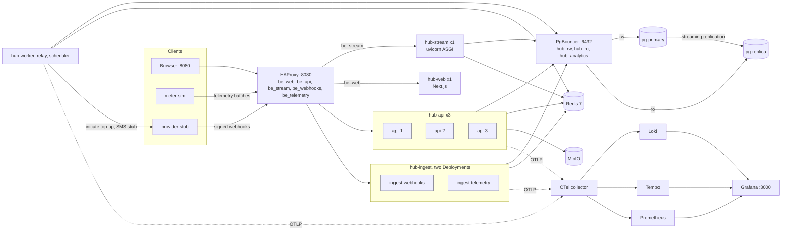
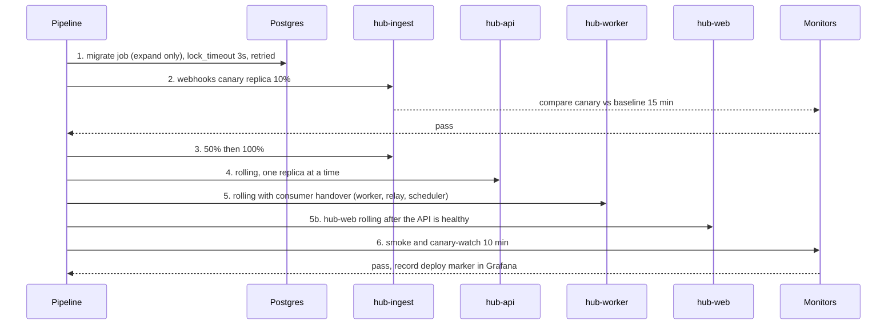

# 09. DevOps and SRE design: Soleil Grid Hub

Owner: SRE / DevOps engineer. Status: design phase, nothing built. Every number is an assumption derived from `00-shared-context.md` unless marked measured. Ids (FR-nn, NFR-nn) follow the contract; this document elaborates NFR-01 to NFR-04, NFR-09, NFR-12 and NFR-14 and supports NFR-05, NFR-06 and NFR-13.

## 0. Summary of decisions

| Topic | Decision | Reason |
|---|---|---|
| Stack (D-42 to D-44, ADR-0019 to 0021) | Django 5 + DRF images (gunicorn for api, webhooks, telemetry; uvicorn workers for the stream pool), `manage.py migrate` applying numbered SQL (RunSQL), Next.js `hub-web` Node image | One Python image with several process types plus one Node image; five balancer pools |
| Edge load balancer | **HAProxy 3.x** locally and on VM or Kubernetes self-hosted; cloud L7 balancer in managed clouds | Active health checks, `leastconn`, runtime drain and L7 retry rules in the open-source build. Open-source nginx has no active health checks, so an nginx variant is given only as an alternative sketch |
| Runtime | Container images only. T0: Docker on 2 VMs managed by Uncloud or Compose. T1/T2: managed Kubernetes or managed container service | NFR-12: no cloud lock-in. The manifests are the same images; only the "runtime" Terraform module changes |
| Branching | Trunk-based, short branches, SemVer tags, release branches only for hotfixes | Small team, fast feedback |
| Deploy strategy | `hub-api` rolling, `hub-ingest` as two Deployments (webhooks canary on the payment path, telemetry rolling), `hub-worker` rolling with consumer handover, `hub-web` rolling | Section 3 |
| Migrations | Expand/contract, run as a pipeline job before app rollout, never down-migrated in production | Ledger data cannot be "rolled back" |
| Observability | OpenTelemetry everywhere, Prometheus, Loki, Tempo, Grafana; vendor swappable | NFR-09, NFR-12 |
| SLOs | Payment-confirmation availability 99.9% (NFR-01) and webhook-ack latency (NFR-02) with multi-window burn-rate alerts | Section 6 |
| DR | WAL archiving to a second account with object lock, monthly restore drill | NFR-04 |

---

## 1. Environments

### 1.1 What differs

| Aspect | Local | CI (ephemeral) | Staging | Perf (ephemeral) | Production |
|---|---|---|---|---|---|
| Purpose | Daily development, demos | Prove each commit | Prod-like rehearsal, UAT, operator training | Load and chaos tests at T2 scale | Real customers |
| Runtime | Docker Compose | CI runner with service containers or Compose | Same runtime as production, smaller | Terraform-created, destroyed after the run | Managed or self-hosted per tier |
| hub-api / hub-ingest webhooks / hub-ingest telemetry / hub-worker | 3 / 1 / 1 / 1 | 1 / 1 / 1 / 1 | 2 / 2 / 2 / 1 | 6 / 3 / 6 / 4 | 3+ / 3+ / 3+ / 2+ (N+1) |
| hub-web (Next.js) | 1 | 1 (build and Playwright only) | 2 | 3 | 2+ (N+1) |
| Postgres | primary + async replica + PgBouncer (no synchronous standby) | one container, no replica | primary + synchronous standby + async replica + PgBouncer | production topology | primary + synchronous HA standby + async read replica + PgBouncer (D-26) |
| Mobile money | provider stub | provider stub | provider stub (sandbox of a real provider only if contract exists) | stub with latency profile | real provider |
| Claude API | recorded fixtures or key from developer budget project | recorded fixtures only | real API, own workspace, low spend cap | stub, plus one capped real run | real API, production workspace, NFR-13 budgets |
| Data | synthetic seed (about 200 customers) | synthetic fixtures | synthetic, 3,000 meters, never copied from production | synthetic, 300,000 meters | real |
| Secrets | `.env.local` with dummy values, gitignored; pre-commit blocks real-looking keys | CI secret store, OIDC, short-lived | secrets manager, separate from prod | secrets manager | secrets manager, rotation (section 4.5) |
| TLS | none (HTTP on 8080), optional mkcert | none | real certificate, internal DNS name | none | real certificate, public DNS |
| Observability | full stack in Compose | test logs only | full stack, 7-day retention | full stack | full stack, retention per section 5.6 |
| Access | developer | pipeline | developers and operators (staging) | SRE | pipeline plus audited break-glass |

Rules: production data never flows downward (no dumps to staging); staging has its own provider sandbox credentials and its own Claude workspace so that cost and data are separate; the only way to change production is the pipeline.

### 1.2 One-command local environment

`make up` runs `docker compose up -d --wait`, then a one-shot `migrate` job (`python manage.py migrate`, which applies the numbered SQL files through `RunSQL`, ADR-0020), then `seed` (the `python manage.py load_fixtures` command) (fixtures: 200 customers, 5 sites, KB articles in EN and FR, staff users with every role, test TOTP secrets recorded in the seed file for local use only). `make down` stops, `make reset` removes volumes. Target cold start under 4 minutes on a 16 GB laptop; `make up-lite` starts a profile without the observability stack and with one replica each, for 8 GB machines (NFR-14).



PgBouncer runs in transaction mode with `max_prepared_statements = 200` (PgBouncer 1.21 or later) so psycopg 3 prepared statements survive pooling (Django settings: `DISABLE_SERVER_SIDE_CURSORS = True`, `CONN_MAX_AGE = 60`, `CONN_HEALTH_CHECKS = True`; no `ATOMIC_REQUESTS`, D-42). It exposes three logical databases: `hub_rw` (primary), `hub_ro` (replica, dashboards and reports) and `hub_analytics` (replica, login roles `analytics_support`, `analytics_finance`, `analytics_ops`, a pool of 10, PgBouncer `query_timeout = 6` as a second line behind the role's `statement_timeout = 5s`) which isolates "ask the data" (FR-12) from everything else.

### 1.3 Compose sketch (`deploy/compose/docker-compose.yml`)

```yaml
name: soleil
x-py-ready: &py-ready
  test: ["CMD", "python", "-c", "import urllib.request as u; u.urlopen('http://127.0.0.1:8000/api/v1/health/ready', timeout=2)"]
  interval: 5s
  timeout: 3s
  retries: 3
x-app: &app
  image: soleil/hub:${TAG:-dev}           # one Python image, several process types (section 2.5)
  environment: &app-env
    # DATABASE_URL differs per deployable (D-22): hub_api, hub_ingest and hub_worker each have their own role
    REDIS_URL: redis://redis:6379/0
    S3_ENDPOINT: http://minio:9000
    PROVIDER_BASE_URL: http://provider-stub:9100
    AI_MODE: ${AI_MODE:-fixtures}          # fixtures | live
    OTEL_EXPORTER_OTLP_ENDPOINT: http://otel-collector:4317
    OTEL_RESOURCE_ATTRIBUTES: deployment.environment=local
    SHUTDOWN_GRACE_SECONDS: "30"
  depends_on:
    migrate: { condition: service_completed_successfully }
    redis:   { condition: service_healthy }
  stop_grace_period: 40s                    # > SHUTDOWN_GRACE_SECONDS
  restart: unless-stopped
  read_only: true
  tmpfs: [/tmp]
  cap_drop: [ALL]
  security_opt: ["no-new-privileges:true"]

services:
  lb:
    image: haproxy:3.0-alpine
    ports: ["8080:8080", "8404:8404"]       # 8404 = stats and Prometheus exporter
    volumes: ["./haproxy.cfg:/usr/local/etc/haproxy/haproxy.cfg:ro", "haproxy-run:/var/run"]
    depends_on: [hub-api, hub-stream, hub-web, hub-ingest-webhooks, hub-ingest-telemetry]
    healthcheck: { test: ["CMD", "wget", "-qO-", "http://localhost:8404/healthz"], interval: 5s }

  hub-api:
    <<: *app
    command: ["/entrypoint-drain.sh", "gunicorn", "hub.wsgi:application", "-c", "deploy/gunicorn.py"]
    # gunicorn.py: bind 0.0.0.0:8000, workers 4, threads 4, worker_class gthread, graceful_timeout 30, timeout 30, keepalive 5
    deploy: { replicas: 3 }
    environment:
      <<: *app-env
      DJANGO_SETTINGS_MODULE: hub.settings.api
      DATABASE_URL: postgresql+psycopg://hub_api:${PG_API_PW:-dev}@pgbouncer:6432/hub_rw
      DATABASE_RO_URL: postgresql+psycopg://hub_api:${PG_API_PW:-dev}@pgbouncer:6432/hub_ro
      ANALYTICS_URL: postgresql+psycopg://${ANALYTICS_LOGIN:-analytics_ops}:${PG_AN_PW:-dev}@pgbouncer:6432/hub_analytics
    healthcheck: *py-ready

  hub-ingest-webhooks:        # one hub-ingest image, Deployment 1: /api/v1/webhooks/providers/*
    <<: *app
    command: ["/entrypoint-drain.sh", "gunicorn", "hub.wsgi:application", "-c", "deploy/gunicorn.py"]
    # sync workers, 5 workers x 1 thread: bounded concurrency for the one-transaction webhook path (D-09)
    deploy: { replicas: 1 }   # make up SCALE_WEBHOOKS=2 to rehearse a canary
    environment:
      <<: *app-env
      DJANGO_SETTINGS_MODULE: hub.settings.ingest
      DATABASE_URL: postgresql+psycopg://hub_ingest:${PG_INGEST_PW:-dev}@pgbouncer:6432/hub_rw
    healthcheck: *py-ready

  hub-ingest-telemetry:       # Deployment 2: /api/v1/telemetry/* and /api/v1/gateway/*
    <<: *app
    command: ["/entrypoint-drain.sh", "gunicorn", "hub.wsgi:application", "-c", "deploy/gunicorn.py"]
    # gthread, 3 workers x 8 threads: batch ingest is I/O bound
    deploy: { replicas: 1 }
    environment:
      <<: *app-env
      DJANGO_SETTINGS_MODULE: hub.settings.ingest
      DATABASE_URL: postgresql+psycopg://hub_ingest:${PG_INGEST_PW:-dev}@pgbouncer:6432/hub_rw
    healthcheck: *py-ready

  hub-stream:           # dashboard SSE pool (be_stream): the only ASGI process type, async views (D-42)
    <<: *app
    command: ["uvicorn", "hub.asgi:application", "--host", "0.0.0.0", "--port", "8000", "--workers", "2",
              "--timeout-graceful-shutdown", "30", "--timeout-keep-alive", "75"]
    deploy: { replicas: 1 }
    environment:
      <<: *app-env
      DJANGO_SETTINGS_MODULE: hub.settings.stream
      DATABASE_URL: postgresql+psycopg://hub_api:${PG_API_PW:-dev}@pgbouncer:6432/hub_ro
    healthcheck: *py-ready

  hub-web:              # Next.js standalone, pool be_web; no database, no Redis, no secrets (D-44)
    image: soleil/hub-web:${TAG:-dev}
    environment:
      NEXT_PUBLIC_API_BASE: /api/v1        # relative, so one image serves every environment
      NEXT_PUBLIC_DEFAULT_LOCALE: fr
      HOSTNAME: 0.0.0.0
      PORT: "3000"
      OTEL_EXPORTER_OTLP_ENDPOINT: http://otel-collector:4317
    deploy: { replicas: 1 }
    stop_grace_period: 20s
    read_only: true
    tmpfs: [/tmp, /app/.next/cache]
    cap_drop: [ALL]
    security_opt: ["no-new-privileges:true"]
    healthcheck: { test: ["CMD", "wget", "-qO-", "http://127.0.0.1:3000/web/health"], interval: 5s, timeout: 3s, retries: 3 }

  hub-worker:           # three management commands, one container each, same image
    <<: *app
    command: ["python", "manage.py", "run_consumers"]       # Redis Streams consumers, consumer_inbox dedupe
    deploy: { replicas: 1 }
    environment: &worker-env
      <<: *app-env
      DJANGO_SETTINGS_MODULE: hub.settings.worker
      DATABASE_URL: postgresql+psycopg://hub_worker:${PG_WORKER_PW:-dev}@pgbouncer:6432/hub_rw
    healthcheck: { test: ["CMD", "python", "manage.py", "worker_health"], interval: 10s, timeout: 5s, retries: 3 }
  hub-relay:
    <<: *app
    command: ["python", "manage.py", "run_outbox_relay"]    # outbox to Redis Streams, replay window 10 min
    environment: *worker-env
  hub-scheduler:
    <<: *app
    command: ["python", "manage.py", "run_scheduler"]       # sweepers, partitions, audit verifier; singleton by advisory lock
    environment: *worker-env

  migrate:
    image: soleil/hub:${TAG:-dev}
    command: ["python", "manage.py", "migrate", "--noinput"]   # applies numbered SQL files via RunSQL (ADR-0020)
    environment: { DJANGO_SETTINGS_MODULE: hub.settings.worker, DATABASE_URL: "postgresql+psycopg://migrator:${PG_MIGRATOR_PW:-dev}@pg-primary:5432/hub" }
    depends_on: { pg-primary: { condition: service_healthy } }
    restart: "no"

  pg-primary:
    image: postgres:16
    command: ["postgres", "-c", "wal_level=replica", "-c", "max_wal_senders=5", "-c", "hot_standby=on",
              "-c", "archive_mode=on", "-c", "archive_command=test ! -f /wal/%f && cp %p /wal/%f",
              "-c", "archive_timeout=60", "-c", "shared_preload_libraries=pg_stat_statements"]
    environment: { POSTGRES_DB: hub, POSTGRES_PASSWORD: "${PG_OWNER_PW:-dev}" }
    volumes: ["pgdata:/var/lib/postgresql/data", "pgwal:/wal", "./pg/init:/docker-entrypoint-initdb.d:ro"]
    healthcheck: { test: ["CMD-SHELL", "pg_isready -U postgres -d hub"], interval: 5s, retries: 10 }

  pg-replica:
    image: postgres:16
    entrypoint: ["/bin/bash", "/replica-entrypoint.sh"]   # pg_basebackup -R if the data dir is empty, then exec postgres
    volumes: ["pgreplica:/var/lib/postgresql/data", "./pg/replica-entrypoint.sh:/replica-entrypoint.sh:ro"]
    depends_on: { pg-primary: { condition: service_healthy } }
    healthcheck: { test: ["CMD-SHELL", "pg_isready -U postgres"], interval: 5s, retries: 20 }

  pgbouncer:
    image: edoburu/pgbouncer:1.23.1
    volumes: ["./pgbouncer/pgbouncer.ini:/etc/pgbouncer/pgbouncer.ini:ro", "./pgbouncer/userlist.txt:/etc/pgbouncer/userlist.txt:ro"]
    depends_on: { pg-primary: { condition: service_healthy }, pg-replica: { condition: service_healthy } }

  redis:
    image: redis:7-alpine
    command: ["redis-server", "--appendonly", "yes", "--appendfsync", "everysec",
              "--maxmemory", "512mb", "--maxmemory-policy", "volatile-lru"]
    healthcheck: { test: ["CMD", "redis-cli", "ping"], interval: 5s }

  minio:
    image: minio/minio:latest
    command: ["server", "/data", "--console-address", ":9001"]
    volumes: ["miniodata:/data"]
    healthcheck: { test: ["CMD", "mc", "ready", "local"], interval: 10s }

  provider-stub:        # mobile-money simulator: initiate, signed webhooks, duplicates, delays, failures
    build: ./tools/provider-stub
    environment: { WEBHOOK_TARGET: "http://lb:8080/api/v1/webhooks/providers/momo", DUP_RATE: "0.10", DELAY_MS_P50: "400", FAIL_RATE: "0.02" }

  meter-sim:            # N simulated meters, hourly batches, jitter, late and duplicate readings
    build: ./tools/meter-sim
    environment: { TARGET: "http://lb:8080/api/v1/telemetry/batches", METERS: "3000", SPEEDUP: "60" }
    profiles: ["sim"]

  otel-collector:
    image: otel/opentelemetry-collector-contrib:0.110.0
    volumes: ["./otel/collector.yaml:/etc/otelcol-contrib/config.yaml:ro"]
  prometheus: { image: prom/prometheus:v2.55.0, volumes: ["./prom:/etc/prometheus:ro"] }
  loki:       { image: grafana/loki:3.2.0 }
  tempo:      { image: grafana/tempo:2.6.0, command: ["-config.file=/etc/tempo.yaml"] }
  grafana:
    image: grafana/grafana:11.3.0
    ports: ["3000:3000"]
    volumes: ["./grafana/provisioning:/etc/grafana/provisioning:ro", "./grafana/dashboards:/var/lib/grafana/dashboards:ro"]

volumes: { pgdata: {}, pgwal: {}, pgreplica: {}, miniodata: {}, haproxy-run: {} }
```

Tempo is added to the requested list because traces need a backend; the OTel collector fans logs to Loki (OTLP endpoint), traces to Tempo and span-derived RED metrics plus app metrics to Prometheus. `meter-sim` is in a `sim` profile so the default start is quiet; `make demo` enables it.

### 1.4 Load balancer configuration (`deploy/compose/haproxy.cfg`)

```haproxy
global
  log stdout format raw local0
  maxconn 20000
  stats socket /var/run/haproxy.sock mode 660 level admin expose-fd listeners

resolvers docker
  nameserver dns 127.0.0.11:53
  accepted_payload_size 8192
  hold valid 5s

defaults
  mode http
  log global
  option httplog
  option forwardfor
  option redispatch
  retries 2
  timeout connect 3s
  timeout client 30s
  timeout server 30s
  timeout http-request 10s
  timeout http-keep-alive 15s
  default-server init-addr libc,none resolvers docker

frontend fe_main
  bind :8080                         # prod: bind :443 ssl crt /etc/haproxy/certs alpn h2,http/1.1
  http-request set-header X-Request-ID %[uuid()] unless { req.hdr(X-Request-ID) -m found }
  http-request set-header traceparent 00-%[uuid(),regsub(-,,g)]-0000000000000001-01 unless { req.hdr(traceparent) -m found }
  http-request set-var(txn.reqid) req.hdr(X-Request-ID)
  http-response set-header X-Request-ID %[var(txn.reqid)]
  # D-18: log the path only, so the single-use stream ticket in the query string never reaches logs
  log-format "%ci:%cp [%tr] %ft %b/%s %TR/%Tw/%Tc/%Tr/%Ta %ST %B %[var(txn.reqid)] %HM %HPO"
  acl is_webhooks  path_beg /api/v1/webhooks/providers/
  acl is_telemetry path_beg /api/v1/telemetry/ /api/v1/gateway/
  acl is_sse       path /api/v1/dashboard/stream     # note: /api/v1/webhook-events (staff log) is NOT ingest, it stays on be_api
  acl is_api       path_beg /api/
  acl is_static    path_beg /_next/static/
  # edge security headers on every response; the HTML CSP with nonces comes from Next.js middleware (section 4.8)
  http-response set-header Strict-Transport-Security "max-age=15552000; includeSubDomains"
  http-response set-header X-Content-Type-Options nosniff
  http-response set-header Referrer-Policy strict-origin-when-cross-origin
  http-response set-header Permissions-Policy "camera=(), microphone=(), geolocation=()"
  http-response set-header Content-Security-Policy "default-src 'none'; frame-ancestors 'none'" if is_api
  http-response del-header X-Powered-By
  http-response del-header Server
  # caching: immutable hashed assets cached for a year; any web response without an explicit Cache-Control is never cached
  http-response set-header Cache-Control "public, max-age=31536000, immutable" if is_static { status 200 }
  http-response set-header Cache-Control "no-store" if !is_api !is_static !{ res.hdr(Cache-Control) -m found }
  use_backend be_webhooks  if is_webhooks
  use_backend be_telemetry if is_telemetry
  use_backend be_stream    if is_sse
  use_backend be_api       if is_api
  default_backend be_web                              # / and /_next/* and everything that is not /api/

backend be_web                       # Next.js hub-web: / and /_next/*
  balance roundrobin
  option httpchk
  http-check send meth GET uri /web/health hdr Host hub
  http-check expect status 200
  default-server check inter 2s fall 2 rise 3 slowstart 10s maxconn 300
  server-template web 4 hub-web:3000

backend be_api
  balance leastconn
  option httpchk
  http-check send meth GET uri /api/v1/health/ready hdr Host hub
  http-check expect status 200
  default-server check inter 2s fall 2 rise 3 slowstart 20s maxconn 200
  server-template api 6 hub-api:8000

backend be_stream                    # long-lived streams: separate pool so streams do not skew leastconn
  balance leastconn
  option httpchk
  http-check send meth GET uri /api/v1/health/ready hdr Host hub
  http-check expect status 200
  timeout server 75s                 # heartbeat comment every 20 s, so 75 s is three missed beats
  timeout tunnel 1h
  no option http-buffer-request
  http-response set-header X-Accel-Buffering no
  http-response set-header Cache-Control no-cache
  default-server check inter 2s fall 2 rise 3 slowstart 20s maxconn 1000
  server-template stream 4 hub-stream:8000

backend be_webhooks
  balance roundrobin                 # short, uniform requests
  option httpchk
  http-check send meth GET uri /api/v1/health/ready hdr Host hub
  http-check expect status 200
  http-request allow-l7-retry if METH_POST   # safe: (provider, event_id) uniqueness in PostgreSQL makes replays no-ops
  retry-on conn-failure empty-response 503
  default-server check inter 2s fall 2 rise 3 slowstart 10s maxconn 400
  server-template webhooks 4 hub-ingest-webhooks:8000

backend be_telemetry
  balance roundrobin
  option httpchk
  http-check send meth GET uri /api/v1/health/ready hdr Host hub
  http-check expect status 200
  http-request allow-l7-retry if METH_POST   # safe: batch idempotency via reading_batches
  retry-on conn-failure empty-response 503
  default-server check inter 2s fall 2 rise 3 slowstart 10s maxconn 600
  server-template telemetry 4 hub-ingest-telemetry:8000

frontend fe_stats
  bind :8404
  http-request return status 200 content-type text/plain string ok if { path /healthz }
  http-request use-service prometheus-exporter if { path /metrics }
  stats enable
  stats uri /stats
```

Notes:

- **Health checks.** `/api/v1/health/ready` is distinct from `/api/v1/health/live`: ready means the process can reach PgBouncer and Redis (Redis failure degrades, it does not make the service unready, see section 8.2) and is not draining. Two failed checks (4 s) remove a server; three passes plus 20 s slow-start bring it back.
- **Least connections** for `hub-api` because request cost is uneven (a dashboard aggregate versus a ledger lookup); round robin for ingest because requests are small and uniform.
- **Graceful drain.** On SIGTERM the app (1) flips `/api/v1/health/ready` to 503, (2) keeps serving in-flight requests, (3) sends SSE clients a final `retry: 3000` event and closes their streams after a random 0-10 s jitter (streams live at most 10 minutes anyway and each heartbeat re-checks role and `tv`, D-18) so reconnects spread over the pool, (4) exits after at most 30 s. Orchestrators wait for the grace period (`stop_grace_period 40s`). For a pinned deploy script, drain explicitly first: `echo "set server be_api/api1 state drain" | socat stdio /var/run/haproxy.sock`, wait until `scur` is 0, then replace the instance.
- **SSE** is a plain streamed HTTP response, so the settings that matter are: no response buffering, no compression, `timeout server` greater than the heartbeat interval, a heartbeat comment every 20 s, `Last-Event-ID` resumption in the app, and a per-user cap of 3 concurrent streams in Redis.
- **L7 retries of POST** are enabled only on `be_webhooks` and `be_telemetry`, where idempotency is a design guarantee (FR-03, D-25).
- **nginx alternative** for people who prefer it: `upstream hub_api { least_conn; server hub-api-1:8000 max_fails=2 fail_timeout=10s; ... keepalive 64; }`, `location /api/v1/webhooks/providers/ { proxy_pass http://hub_webhooks; proxy_next_upstream error timeout http_503 non_idempotent; }` and `location /api/v1/dashboard/stream { proxy_pass http://hub_api; proxy_http_version 1.1; proxy_set_header Connection ""; proxy_buffering off; proxy_cache off; proxy_read_timeout 75s; }`, with separate `upstream hub_webhooks`, `hub_telemetry`, `hub_stream` and `hub_web` (`location / { proxy_pass http://hub_web; }`, `location /_next/static/ { proxy_pass http://hub_web; add_header Cache-Control "public, max-age=31536000, immutable"; }`, `location /api/ { proxy_pass http://hub_api; }`) blocks and `add_header ... always` for the headers of section 4.8, and the log format stripping `$args` (`log_format main '... $uri ...'`, never `$request` or `$request_uri`). Passive health only (open-source), so a dead replica costs a few failed requests before it is ejected, which is why HAProxy is the default.

---

## 2. Repository and CI/CD

### 2.1 Repository layout (single repository, company-owned)

```
soleil-grid-hub/
  backend/            # Django 5 + DRF, Python 3.12: manage.py, src/hub/{identity,customers,payments,ledger,...,shared},
                      #   src/hub/settings/{api,ingest,worker,stream}.py, sql/migrations/NNNN_*.sql, tests/
  web/                # Next.js (App Router), TypeScript strict: hub-web, openapi-typescript client, next-intl, Playwright
  api/openapi.yaml    # contract, source of truth for clients and contract tests
  db/schema.sql       # reference schema (checked against migrations)
  deploy/
    compose/          # local and CI stack
    terraform/        # section 4
    k8s/ or helm/     # runtime manifests for the Kubernetes option
    observability/    # dashboards-as-code, alert rules, otel config
  tools/              # provider-stub, meter-sim, k6 scripts
  docs/ , docs/runbooks/
  Makefile            # up, down, test, lint, seed, load-smoke
  renovate.json
```

CODEOWNERS routes `backend/src/hub/ledger`, `payments`, `deploy/terraform` and `backend/sql/` to two named reviewers each; the ledger and migration paths require two approvals.

### 2.2 Pipeline stages

```mermaid
flowchart LR
  PR[Pull request] --> L[Lint and format]
  L --> T[Type check]
  T --> U[Unit tests]
  U --> I[Integration with containers]
  I --> C[Contract tests vs openapi.yaml]
  C --> M[Migration check]
  M --> S[Security scans]
  S --> B[Build images]
  B --> SG[Sign + SBOM + provenance]
  SG --> MG{Merge to main}
  MG --> DS[Deploy staging]
  DS --> SM[Smoke + canary-watch]
  SM --> PR2{Promote gate}
  PR2 --> CA[Production canary]
  CA --> RO[Production rollout]
```



| Stage | Tools (cloud-neutral) | Gate |
|---|---|---|
| Lint and format | `ruff` (check and format), `import-linter` (module boundaries: modules talk through service interfaces, not each other's tables; nothing but `ai_gateway` imports `anthropic`), ESLint, Prettier, `hadolint`, `tflint`, `terraform fmt`, `spectral` (OpenAPI), `shellcheck` | zero warnings |
| Types | `mypy` with `django-stubs` and `djangorestframework-stubs` (`--strict` on `hub.ledger`, `hub.payments`); TypeScript `strict` (`tsc --noEmit`) in `web/` | no errors |
| Unit | `pytest` with `pytest-django` and `pytest-xdist`; coverage 80% overall, 95% on `ledger` and `payments`; Vitest (or Jest) for `web/`, coverage 80% | coverage and mutation-test smoke on ledger (`mutmut`, nightly) |
| Django policy checks | `tests/test_settings_policy.py` runs for each settings module (`api`, `ingest`, `worker`, `stream`): `django.contrib.admin` is **not** in `INSTALLED_APPS` (D-42), every `DATABASES` entry has `ATOMIC_REQUESTS` false, no `managed = True` model exists, DRF renderers are JSON only (no browsable API), `DEBUG` is false; and `manage.py check --deploy --fail-level WARNING` passes with the explicit `SILENCED_SYSTEM_CHECKS` list of section 4.8 | all green |
| Integration | `pytest -m integration` with Testcontainers or the Compose `ci` profile: real Postgres 16, Redis 7, MinIO, provider-stub; includes webhook replay, outbox relay, consumer-group crash tests | green; flaky tests quarantined with an owner and a 14-day expiry |
| Contract | `schemathesis run api/openapi.yaml` (the specification is not generated from code, D-42) against a running `hub-api` and both `hub-ingest` Deployments; `oasdiff breaking` against the last release tag; the `web/` client generated by openapi-typescript must compile; `tests/test_alignment.py` stays in the next row | no 5xx, no schema violations, no unapproved breaking change |
| Migration check | `python manage.py migrate` on an empty database and on a snapshot restored from the previous release (schema with data); the **migration-equivalence test** (empty database migrated with `manage.py migrate` versus a database loaded from `db/schema.sql`: normalised `pg_dump --schema-only` and the grants and role-setting catalogs must be identical); the **model-versus-database introspection test** (every `managed = False` model matches its table and columns); `squawk` lint for unsafe DDL (non-concurrent index, `NOT NULL` without default, table rewrite); each numbered SQL file carries `-- phase: expand` or `-- phase: contract`, and the pipeline rejects a `contract` file unless the previous release is the one running in production | pass; timed on a 100M-row telemetry fixture so lock time is visible |
| Frontend | ESLint (with `jsx-a11y` and the `next` config), TypeScript strict, Vitest, **Playwright with axe** (WCAG 2.2 AA on login, top-up, ticket, dashboard, in `/fr` and `/en`), `next build`, then a **bundle size check** (`tools/check_bundle_budget.mjs`) that sums the gzipped first-load JavaScript per route group from `.next` build output and fails above **130 KB for the customer portal and 250 KB for the staff app** (D-44), and **Lighthouse CI** on a throttled profile (simulated slow 4G, 4x CPU slowdown, mobile emulation) asserting performance, accessibility and best-practice score thresholds and LCP/TBT budgets for the portal | all green; budget breach blocks the merge |
| Alignment and permissions | `tests/test_alignment.py` (OpenAPI enums and state machines versus `db/schema.sql`, D-01; `api/permissions.yaml` versus `x-roles` and the role-permission seed, D-14); `tests/test_schema_in_postgres.py` (the SQL job) loads the schema into a real PostgreSQL 16 and checks: PUBLIC has no CONNECT or TEMP, immutability triggers are `ENABLE ALWAYS`, RLS is `FORCE`d on customers, tickets and ticket messages, definer functions pin `search_path`, application roles cannot write `wallet_balances` or `ledger_accounts`, and **each analytics login role** (`analytics_support`, `analytics_finance`, `analytics_ops`) has `statement_timeout`, `default_transaction_read_only = on`, idle timeout, temp-file limit (read from `pg_db_role_setting`) and a `CONNECTION LIMIT`; `tools/check_traceability.py` (every FR and NFR has at least one `TC-` test and a runbook or design reference) | all green; a missing setting on a login role fails the build |
| Security | `gitleaks` (history and diff), `pip-audit`, `npm audit --omit=dev` (production dependencies of `web/`), a check that no `NEXT_PUBLIC_*` variable name matches `SECRET|KEY|TOKEN|PASSWORD|PRIVATE` and that `web/` never imports a server secret (section 4.8), `semgrep` (OWASP rules, a rule that fails any log format containing `$request_uri`, `%HU` or the stream-ticket query string, custom rule "no raw SQL string formatting", "no `anthropic` import outside `ai_gateway`"), `bandit`, `trivy image` on **both** images (`soleil/hub` Python and `soleil/hub-web` Node; fail on fixable HIGH and CRITICAL; the Node image also gets a `trivy fs` of `package-lock.json`), `trivy config` on Terraform and manifests, licence check | no new HIGH findings; exceptions expire in 30 days |
| Build | two multi-stage images (section 2.5): `soleil/hub` (Python, several process types) and `soleil/hub-web` (Node standalone); digest-pinned slim bases, non-root user, read-only root filesystem; Next.js static assets hashed and immutable | reproducible build check on main |
| Sign, SBOM, provenance | `syft` produces CycloneDX SBOM attached to the image; `cosign` keyless signing via the CI OIDC identity; SLSA provenance attestation; admission policy (Kyverno or a deploy-script check) only runs images with a valid signature from this repository | unsigned image cannot deploy |
| Deploy staging | pipeline runs Terraform plan (no-op expected), then the migration job, then rollout | automatic on main |
| Smoke | `make smoke`: Playwright smoke through the load balancer (`/web/health`, `/fr` and `/en` login shell render, portal login, staff login, `/_next/static` returns the immutable header, authenticated HTML returns `no-store`), then API flows: login, create customer, initiate top-up via stub, receive webhook, check ledger, token issued, dashboard SSE heartbeat (stream ticket flow), ask-the-data fixture; end-to-end setup uses the fixtures command (`python manage.py load_fixtures`) against the test database, never a test-only HTTP endpoint (D-38); `canary-watch` style checks for HTTP status, SSE initial event, static assets and error counts for 10 minutes | all green |
| Promote | manual approval by the release owner (two-person for ledger changes), then production canary then rollout (section 3) | approval recorded in the audit trail |

Pipeline time budget: PR stages under 12 minutes (parallel jobs, cached layers), main to staging under 20 minutes. Required checks are enforced by branch protection; there is no bypass for administrators except the audited break-glass flow.

### 2.3 Branch and release strategy

- **Trunk-based:** short branches (target under 2 days), squash merge to `main`, conventional commits; every merge produces a signed, deployable image tagged `sha-<git>`.
- **Release:** a tag `vMAJOR.MINOR.PATCH` is cut from `main` after a successful staging smoke; the same image digest is promoted, never rebuilt. MINOR for features, PATCH for fixes, MAJOR only for breaking `/api/v2`.
- **Hotfix:** branch from the production tag, cherry-pick the fix to `main` first, then release `PATCH`; the pipeline is the same, only the soak time shortens.
- **Release cadence:** weekly production release (Tuesday morning local time, outside payday windows and the 1st, 5th, 25th to 30th of the month where top-up volume peaks, assumption). A deploy freeze runs on paydays and during a burned error budget (section 6.4).
- **Feature flags** decouple deploy from release (section 3.5); a changelog is generated from commits, and the release notes name migrations and flags.

### 2.4 Automated dependency and security updates (NFR-14)

| Mechanism | Detail |
|---|---|
| Renovate (self-hostable, host-neutral; Dependabot is an acceptable equivalent on GitHub) | Grouped weekly PRs for Python, npm, Docker base images (digests), GitHub Actions, Terraform providers and modules; security updates immediately, outside the schedule |
| Auto-merge policy | Patch and minor of dev-dependencies and linters auto-merge on green CI; runtime minor updates need one human review; majors never auto-merge; anything touching `cryptography`, `pyjwt`, `sqlalchemy`, `fastapi`, `anthropic`, Postgres or Redis major versions needs the owner and a staging soak of 3 days |
| Vulnerability SLA | CRITICAL fixable: patched in production within 48 hours; HIGH within 7 days; MEDIUM within 30 days |
| Base images | Rebuilt weekly even without code change to pick up OS patches; Trivy scans production images daily and opens an issue on new findings |
| Runtime versions | Postgres 16 minor updates monthly via the managed service or rolling replica-first upgrade; Python 3.12 until the 3.13 trigger (all dependencies support it plus a month on staging) |
| Evidence | The SBOM per release and the Renovate dashboard issue are the audit trail handed to operators |

---

### 2.5 Images and process types (what the implementing agent builds)

Two images are built from one repository and promoted by digest. Environment differences are runtime configuration only: the Next.js image uses a relative API base (`NEXT_PUBLIC_API_BASE=/api/v1`) so the same digest runs in staging and production.

| Process type | Image | Command | Settings module and DB role | Pool |
|---|---|---|---|---|
| api | `soleil/hub` | `gunicorn hub.wsgi:application -c deploy/gunicorn.py` (gthread, 4 workers x 4 threads per 2 vCPU) | `hub.settings.api`, `hub_api` | `be_api` |
| webhooks | `soleil/hub` | same, sync workers (2 x vCPU + 1, one thread each) | `hub.settings.ingest`, `hub_ingest` | `be_webhooks` |
| telemetry and gateway | `soleil/hub` | same, gthread (3 workers x 8 threads) | `hub.settings.ingest`, `hub_ingest` | `be_telemetry` |
| stream | `soleil/hub` | `uvicorn hub.asgi:application --workers 2` (async views) | `hub.settings.stream`, `hub_api` (read replica) | `be_stream` |
| worker | `soleil/hub` | `python manage.py run_consumers` | `hub.settings.worker`, `hub_worker` | none |
| relay | `soleil/hub` | `python manage.py run_outbox_relay` | `hub.settings.worker`, `hub_worker` | none |
| scheduler | `soleil/hub` | `python manage.py run_scheduler` (advisory-lock singleton) | `hub.settings.worker`, `hub_worker` | none |
| migrate (one-shot job) | `soleil/hub` | `python manage.py migrate --noinput` | migrator login | none |
| web | `soleil/hub-web` | `node server.js` (Next.js standalone) | no database, no secrets | `be_web` |

```dockerfile
# backend/Dockerfile (sketch)
FROM python:3.12-slim@sha256:<pin> AS build
RUN pip install --require-hashes -r requirements.txt --target /opt/deps
FROM python:3.12-slim@sha256:<pin>
COPY --from=build /opt/deps /opt/deps
COPY backend/ /app
ENV PYTHONPATH=/opt/deps:/app/src PYTHONUNBUFFERED=1 PYTHONDONTWRITEBYTECODE=1
USER 10001
COPY deploy/entrypoint-drain.sh /entrypoint-drain.sh   # SIGTERM: touch /tmp/draining (readiness 503), sleep 6, forward SIGTERM
# web/Dockerfile (sketch)
FROM node:22-alpine@sha256:<pin> AS build
WORKDIR /w
COPY web/package*.json ./
RUN npm ci
COPY web/ ./
RUN npm run build && node tools/check_bundle_budget.mjs        # output: 'standalone'
FROM node:22-alpine@sha256:<pin>
WORKDIR /app
COPY --from=build /w/.next/standalone ./
COPY --from=build /w/.next/static ./.next/static
COPY --from=previous-release /app/.next/static ./.next/static   # skew protection: carry forward the last release's hashed chunks
ENV NODE_ENV=production NEXT_TELEMETRY_DISABLED=1 HOSTNAME=0.0.0.0 PORT=3000
USER 10001
CMD ["node", "server.js"]
```

Graceful drain for gunicorn: the wrapper script writes `/tmp/draining` on SIGTERM; the readiness view returns 503 while the file exists, the balancer removes the replica within two checks (4 s), then the wrapper forwards SIGTERM and gunicorn finishes in-flight requests within `graceful_timeout 30`. Next.js drains on SIGTERM through the Node server and the `be_web` check.

---

## 3. Deployment strategy

### 3.1 Strategy per deployable

| Deployable | Strategy | Why | Rollout detail | Automatic rollback trigger |
|---|---|---|---|---|
| `hub-api` | **Rolling**, `maxSurge 1`, `maxUnavailable 0`, one replica at a time with readiness gate and 20 s slow-start | Stateless, backward-compatible by the expand/contract rule; cheap | Drain via `/api/v1/health/ready`, wait for SSE shed, replace, verify error rate for 2 minutes before the next replica | 5xx ratio over 1% for 2 minutes or p95 above 400 ms for 5 minutes on new replicas |
| `hub-ingest` (two Deployments) | **Webhooks Deployment: canary** then rolling; the pool has 3+ replicas in production and the canary is one replica at HAProxy weight 10 (about 10% of traffic), then 50%, then 100%. **Telemetry Deployment: rolling** (idempotent batches, 5-minute tolerance) | The webhooks Deployment carries the payment-confirmation path (NFR-01), so a bad release is the expensive failure | Hold 15 minutes at each step (30 minutes if the window overlaps payday); compare canary against baseline: 5xx ratio, ack p95, signature rejections, `provider_events` transaction errors, duplicate ratio | any canary-versus-baseline regression above 2x on 5xx or ack p95 above 300 ms, or a reconciliation exception raised by the canary |
| `hub-worker` | **Rolling with consumer-group handover** (3.4), one replica at a time; scheduled jobs are protected by Postgres advisory locks so two versions never run the same singleton job | Queue consumers are at-least-once and idempotent, so overlapping versions are safe if message and event schemas are additive | Stop reading, finish in-flight, ack, exit, start new | `outbox_oldest_unpublished_age` above 120 s or DLQ growth after rollout |
| Database schema | Pipeline job before app rollout (3.3) | Expand/contract | Online, lock-timeout guarded | Migration failure aborts the release before any app changes |
| `hub-web` (Next.js) | **Rolling**, `maxSurge 1`, `maxUnavailable 0`, minimum 2 replicas, readiness `/web/health`, 10 s slow-start | Stateless, no database, no secrets; blue/green and canary add little because rollback by digest takes minutes | One replica at a time; the generated API client works with API N and N-1 because API changes are additive, so web deploys **after** `hub-api`; skew protection: the image carries the previous release's hashed `/_next/static` chunks (section 2.5) and Next.js `deploymentId` is the release sha so open tabs keep working and reload on the next navigation | 5xx ratio over 1% for 2 minutes on `be_web`, or the Playwright smoke fails after the step |

Blue/green is deliberately not the default: it doubles capacity for every deploy and gives little extra safety for stateless services that already roll back by image digest in minutes. It is used for **two cases**: a Postgres major-version upgrade (logical replication to a new "green" cluster, cutover in a maintenance window, "blue" kept 7 days), and the Redis replacement by a new instance (green Redis warms, services switch by config flag).

### 3.2 Standard deploy sequence



Order is deliberate: schema first (compatible with N-1), the **ingest tier next** so webhooks keep working on the newest code path with the earliest feedback, then API, then workers (workers consume events that the new ingest and API may already produce; consumers therefore must tolerate unknown optional event fields and must ship **before** any producer starts emitting a new event version in a later release).

### 3.3 Database migrations in the pipeline (expand/contract)

| Phase | Allowed in one release | Examples | Never in the same release |
|---|---|---|---|
| Expand | Add nullable columns, new tables, new indexes (`CREATE INDEX CONCURRENTLY`), new enum values appended, triggers for dual write | add `payments.provider_fee_minor` nullable; add `ledger_postings.correlation_id` | drop, rename, type change, `NOT NULL` without a backfilled default |
| Migrate | Backfill in batches from the worker (resumable job, 1,000 rows per batch, throttled on replica lag), app writes both old and new | backfill `provider_fee_minor` | long transactions |
| Switch | App reads the new column behind a flag | flag `payments.fee_column_v2` | |
| Contract | Next release or later, after N-1 no longer runs: drop old column, set `NOT NULL`, add the foreign key as `NOT VALID` then `VALIDATE CONSTRAINT` | drop `payments.fee_text` | |

Mechanics: the migration is the `manage.py migrate` one-shot job (it applies the next numbered SQL files through `RunSQL`, ADR-0020) with the `migrator` role (apps use a non-owner role); `lock_timeout = 3s` and `statement_timeout = 15min` with retries and jitter; the job refuses to start if replica lag exceeds 30 s or a long transaction older than 60 s exists; partition management for telemetry (create future monthly partitions, detach old) is a scheduled job, not a migration. The ledger tables are append-only by trigger; no migration may update or delete ledger rows, and the migration check greps for it. If a migration fails, the release stops, nothing else has changed, and runbook RB-08 applies. **Production never runs a reverse migration (`manage.py migrate <app> <previous>` is blocked in the deploy job)**; reversal is a forward migration.

### 3.4 Redis Streams consumer-group handover during deploys

Facts that make this safe: the outbox in Postgres is the source of truth, a relay publishes rows to Redis Streams and marks them published only after `XADD` succeeds, consumers are idempotent (a `consumer_inbox(consumer, event_id)` unique key written in the same transaction as the effect, D-27), and delivery is at-least-once.

1. **Naming.** Consumer name equals the instance hostname (`hub-worker-7f9c`); the group name is stable per module (`ledger-posting`, `notifications`, `token-issuance`, `reconciliation`).
2. **Shutdown (SIGTERM).** The worker stops calling `XREADGROUP` immediately, lets in-flight handlers finish (up to 25 s), `XACK`s completed entries, then exits. Entries read but not finished stay in the pending entries list (PEL).
3. **Reclaim.** Every surviving worker runs `XAUTOCLAIM <stream> <group> <self> 60000 0-0 COUNT 50` every 15 s, so entries idle for over 60 s move to a live consumer; the 60 s idle threshold is above the longest handler time (token issuance retry has its own backoff schedule and does not block in the handler).
4. **Cleanup.** A scheduled job runs `XGROUP DELCONSUMER` for consumers with an empty PEL and idle over 10 minutes so the group list does not grow with every deploy.
5. **Poison messages.** If an entry's delivery count (from `XPENDING`) reaches 5, it is moved to `dlq.<stream>` with the error and a trace id, acked on the original, and an alert fires (`RB-06`).
6. **Mixed versions.** During a rolling update the old and new workers share a group. A message handler version is part of the event (`event.v`); a new consumer reads old and new versions, and an old consumer **negatively acks** unknown major versions by leaving them pending (not acked) so a new worker claims them. New event majors only ship after the consuming workers have fully rolled out (two-release rule).
7. **Redis loss.** If Redis is lost or flushed, the relay republishes every outbox row published in the last **10 minutes** (the replay window, D-27) and the business sweepers (unconfirmed top-ups, pending tokens, unsent notifications, stuck reconciliation items) pick up anything older; `consumer_inbox` drops duplicates. No `consumed_at` marker is needed on the outbox. Streams are trimmed with `XTRIM MINID` by age (48 h), never by count alone.
8. **Recreation of groups** uses `XGROUP CREATE ... MKSTREAM` with id `0` on first deploy only; ids are never reset to `$` in production, which would silently drop events.

### 3.5 Feature flags

Flags use the OpenFeature API in the backend; the v1 provider is a Postgres table `feature_flags` cached in Redis for 5 seconds, with environment-variable defaults so the system boots with Redis and flag storage unavailable. This avoids another service; replacement with Unleash or flagd later needs no code change. Every change is written to the audit log (FR-15) and requires the administrator role.

| Class | Examples | Rule |
|---|---|---|
| Release flag | `payments.fee_column_v2`, `support.new_triage_prompt` | default off, removed within 30 days of full rollout |
| Ops kill switch | `ai.enabled`, `ai.ask_the_data.enabled`, `notifications.sms.enabled`, `telemetry.shed_noncritical`, `dashboard.sse.enabled` | persistent, tested monthly, documented in runbooks |
| Gradual rollout | `ai.model_routing_v2` at 10% of tickets | percentage by stable hash of ticket id |

Kill switches are what the on-call uses for the Claude outage and telemetry storm runbooks; they must flip within 5 seconds and be reflected on the status panel operators see.

### 3.6 Rollback procedure

1. **Decide** (on-call, 5 minutes max): is the symptom tied to the release? Check the Grafana deploy marker versus the symptom start.
2. **Flag first.** If the change is behind a flag, turn it off. This takes seconds and needs no deploy.
3. **Redeploy the previous image digest.** `deployctl rollback <service> --to <digest>` re-runs the same rollout steps with the last known-good signed image (digest recorded in the release manifest). Rolling back `hub-ingest` uses the same canary mechanics in reverse (new = old digest at 100% in two steps if the system is healthy, immediately if not).
4. **Schema.** Because only expand migrations ship with a release, N-1 code runs on schema N. A rollback never touches the schema. If a contract migration was the problem, follow RB-08 (forward fix, or restore from PITR for data damage).
5. **Data.** Wrong ledger effects are corrected by compensating postings approved by the finance officer (never by edits); reconciliation (FR-14) finds anything missed.
6. **Verify** the same smoke suite and the SLI dashboard for 15 minutes, then write a blameless note within two working days; the error-budget policy (6.4) decides whether the freeze applies.

### 3.7 Zero-downtime webhook handling

| Risk during a deploy | Mechanism |
|---|---|
| Replica removed mid-request | Drain keeps the connection open to completion; HAProxy redispatch and `allow-l7-retry` on ingest retry connection failures and empty responses on another replica |
| Handler partially done at kill | The handler is synchronous (D-09): verify the signature (signed string `timestamp.event_id.body`) and timestamp window, then in **one transaction** insert `provider_events` (unique `(provider, event_id)` and `(provider, provider_txn_id)`), post to the ledger through `post_ledger_transaction`, write the outbox row, commit (synchronous commit to the standby), and only then return 200. A kill before commit means nothing happened and no ack, so the provider retries; a kill after commit means the money is already in the ledger. Invalid signatures go to the quarantine log only |
| Provider retries during the deploy | Duplicates hit the unique key and are acknowledged with 200 (and counted as `webhook_duplicate`), so retries are harmless (invariant 3) |
| Secret rotation | Two webhook secrets are accepted concurrently (`current`, `previous`) during rotation; deployment and provider-side change are decoupled |
| Version skew in verification code | The signature scheme and payload parser are in `shared` and covered by golden tests with captured provider payloads in CI; canary compares signature-reject counters |
| Provider IP addresses | Allowlist at the edge as defence in depth only; signature is the authority |
| Maintenance windows | None needed. In the worst case (database failover, chaos experiment C4 in section 8.1) ingest returns 503 with `Retry-After: 30`, which the provider's retry policy treats as retryable (confirmed per provider contract during onboarding) |

---

## 4. Infrastructure as code

### 4.1 Terraform layout

```
deploy/terraform/
  modules/
    network/            # VPC, subnets, NAT, firewall rules, private DNS
    kubernetes/         # OR container-platform/ OR vm-docker/  (the "runtime" module; one is selected per env)
    postgres/           # primary, replica, backups, parameter groups, PITR
    redis/              # managed Redis or container, persistence settings
    object-store/       # buckets, versioning, lifecycle, object lock for backups
    edge/               # load balancer, certificates, DNS records, WAF rules
    secrets/            # secrets manager entries and access bindings (values never in state)
    iam/                # roles, workload identity, CI OIDC trust, break-glass
    observability/      # Prometheus, Loki, Tempo, Grafana, alert routing, uptime probes
    budgets/            # cost budgets and alerts
  envs/
    staging/{main.tf,variables.tf,staging.tfvars,backend.tf}
    production/{main.tf,variables.tf,production.tfvars,backend.tf}
    perf/               # ephemeral, same modules with T2 sizing, destroyed after the run
  providers/{gcp,aws,selfhosted}/   # thin adapter modules implementing the module interfaces
```

Design rules: modules expose cloud-neutral inputs (`cpu`, `memory_gb`, `storage_gb`, `ha`, `retention_days`) and outputs (`connection_string_secret_ref`, `endpoint`); provider adapters translate them. State is remote, encrypted and per environment, in a bucket in the company-owned account with locking; production state is readable only by the pipeline role and SRE. `terraform plan` runs on every pull request touching `deploy/terraform` (comment with the diff and the Infracost delta); `apply` runs from the pipeline only, staging first, production behind approval. Drift detection runs nightly (`plan -detailed-exitcode`) and alerts on change. Sensitive values are references to the secrets manager, never literals.

### 4.2 Managed service mapping

| Capability | GCP | AWS | Self-hosted option |
|---|---|---|---|
| Runtime | GKE Autopilot or Cloud Run (T0/T1) | EKS or ECS Fargate | Docker on VMs with Uncloud or Compose (T0), k3s or kubeadm (T1/T2) |
| Load balancer and TLS | External Application LB with Google-managed cert | ALB with ACM, or NLB in front of HAProxy | HAProxy pair with keepalived or provider floating IP, Let's Encrypt via `certbot` or cert-manager |
| PostgreSQL | Cloud SQL for PostgreSQL (HA, read replica, PITR) | RDS for PostgreSQL Multi-AZ plus read replica, or Aurora | Patroni + pgBackRest on 3 VMs (primary, sync standby, async replica) |
| PgBouncer | Sidecar or a small VM pair (Cloud SQL managed pooling is optional) | RDS Proxy is **not** used (session-pinning with prepared statements); PgBouncer on the runtime | PgBouncer alongside Patroni (HAProxy to the leader) |
| Redis | Memorystore for Redis (standard tier) | ElastiCache for Redis with replica and AOF-like persistence via MemoryDB if durability needed | Redis 7 with replica and Sentinel |
| Object storage | Cloud Storage | S3 | MinIO (distributed mode, 4 nodes) |
| Secrets | Secret Manager | Secrets Manager or SSM | HashiCorp Vault (or OpenBao) |
| Observability | Managed Prometheus and Cloud Logging, or the self-hosted Grafana stack | AMP, CloudWatch, or self-hosted stack | Prometheus, Loki, Tempo, Grafana |
| Container registry | Artifact Registry | ECR | Harbor or the CI host registry |
| CI identity | Workload Identity Federation | IAM OIDC role | OIDC to Vault |

The application depends only on: a Postgres endpoint, a Redis endpoint, an S3 API, OTLP, and a secrets reference mechanism (environment variables injected at start). This is the NFR-12 line.

### 4.3 Network design

| Zone | Contents | Inbound | Outbound |
|---|---|---|---|
| Public | Load balancer, WAF, CDN | 443 from the internet | to app zone |
| App (private) | `hub-api`, `hub-ingest`, `hub-worker`, PgBouncer | from LB only | to data zone; to the internet through NAT with an FQDN allowlist (the Claude API host, the mobile-money provider host, SMS and email providers, package mirrors only during build) |
| Data (private, no route to the internet) | Postgres, Redis, object store | from app zone on 5432, 6379, 9000 only | none (backups through a private endpoint) |
| Ops (private) | Prometheus, Loki, Tempo, Grafana, CI runners (if self-hosted) | staff via SSO proxy | to app and data metrics ports |

Firewall rules are deny-by-default and expressed in Terraform. Staff reach administration only through identity-aware access (IAP, SSM Session Manager or WireGuard with SSO); there are no public SSH ports and no bastion with shared keys. Staging and production live in **separate accounts or projects** (blast radius and cost) with no network peering. Gateways and integrators use disjoint API key kinds (D-19); gateway keys are bound to sites and a mandatory source address range, one key per physical gateway (D-20), enforced at the edge and in the app. Private service connectivity to managed databases uses private IPs only. DDoS and rate protection: provider L3/L4 protection, a coarse per-IP limit at the edge, and the precise per-key limits in Redis, with values taken from the tier table in `05-api-design.md` (authoritative, D-19) and not repeated here.

### 4.4 Access model (company-owned accounts, least privilege)

| Principal | Rights | Controls |
|---|---|---|
| CI pipeline (build) | push images, sign, read dependencies | OIDC federation, no stored keys, repository-scoped |
| CI deploy role (per env) | apply Terraform, deploy workloads, run migrations job | only from `main`/tags, environment protection, production needs approval |
| Developer | read staging, read-only production metrics and logs without payload fields; no database shell in production | SSO with MFA, group-based |
| SRE | production operate, no ability to read secret values except through the rotation tool | MFA, session recording, just-in-time elevation (4 h) |
| Break-glass | database superuser and cloud admin for an emergency | two-person release of credentials, alert on use, automatic rotation after use, review within 1 working day |
| Operators (non-technical) | the web application only (roles from FR-15), a read-only Grafana "Operations" folder, the status page, the runbook site | no cloud console access |
| Auditor | read-only audit log export and Terraform state outputs | time-boxed |
| Application runtime identities | one per deployable; `hub-ingest` cannot read AI keys, `hub-api` cannot write backups, only `hub-worker` holds the SMS and AI keys | secrets bindings by identity |

Database roles (D-22): one login role **per deployable** (`hub_api`, `hub_ingest`, `hub_worker`), each with its own connection URL and secret; `audit_writer`; `ledger_owner` (no login, owns the `SECURITY DEFINER` functions such as `post_ledger_transaction`, with `search_path` pinned to `pg_catalog, hub, pg_temp`); `migrator` (migrations only); three analytics **login** roles `analytics_support`, `analytics_finance`, `analytics_ops` (SELECT on their own view schema only, no administrator equivalent), plus `replicator` and `backup`. Application roles cannot write `wallet_balances` or `ledger_accounts` directly, and PUBLIC has CONNECT and TEMP revoked. Because `ALTER ROLE ... SET` applies only to the role it names, the read-only default, `statement_timeout = 5s`, idle timeout, temp-file limit and `CONNECTION LIMIT` are set on **each analytics login role**; the CI check in section 2.2 and a nightly production query against `pg_db_role_setting` (alert `AnalyticsRoleSettingsDrift`, sev2) fail if any is missing; the PgBouncer `hub_analytics` pool adds `query_timeout`. This implements invariants 1 and 5.

### 4.5 Secrets: management and rotation

Secrets live in the secrets manager, are injected as environment variables or mounted tmpfs files at start, and are never in images, Terraform state, repository history, logs or CI output (masked, and the `gitleaks` stage protects the repository).

| Secret | Rotation | Method |
|---|---|---|
| Database passwords (`hub_api`, `hub_ingest`, `hub_worker`, the three analytics logins) | 90 days | Dual-user rotation: create `_b`, deploy, switch, retire `_a`; automated job |
| JWT signing keys | 90 days | Key id in the JWT header; JWKS publishes two keys; old key verifies for the 15-minute access-token lifetime plus a safety margin (refresh tokens are opaque, unaffected) |
| Webhook shared secrets | 180 days or on request | Two active secrets (3.7) |
| Claude API key | 90 days | One key per environment and workspace, spend cap on the provider side matching NFR-13; rotate by adding the new key then removing the old |
| Integrator API keys | Customer-driven, expiry 12 months | Stored hashed (FR-18); show-once; revoke endpoint |
| SMS and email provider keys | 180 days | Same add-then-remove pattern |
| TLS certificates | Automatic (60 days renewal for 90-day certificates) | Section 4.6 |
| Backup encryption keys (KMS) | Annual with key versioning, old versions kept for restores | KMS key policy separate from the application account |
| CI and registry tokens | OIDC, none stored | n/a |

A scheduled check lists secrets older than their maximum age and raises a ticket-severity alert (`SecretRotationOverdue`). RB-10 covers a leak.

### 4.6 TLS and certificates

Public TLS terminates at the edge (managed load balancer certificate in cloud, HAProxy with `certbot` or cert-manager in self-hosted). TLS 1.2 minimum, 1.3 preferred, HSTS with a 6-month max-age after staging validation, OCSP stapling, and an HTTP-to-HTTPS redirect except for `/healthz`. In-cluster traffic between services in the same private zone is plain on the cluster network in v1 (a documented risk with the mitigation of network policies and private subnets); service-mesh mTLS is a later measured option. Postgres and Redis connections use TLS (`sslmode=verify-full`, Redis `tls` where managed). Monitoring: a blackbox probe reports `probe_ssl_earliest_cert_expiry`; alerts at 21 days (ticket), 7 days (page during business hours) and 3 days (page). RB-07 covers expiry.

### 4.7 Cost estimation approach and rough monthly cost

**Approach.** A unit-cost model in the repository (`docs/cost-model.csv`) multiplies the capacity drivers from the shared context by unit prices: compute vCPU-hours from the measured per-replica throughput (section 7.7), Postgres size from rows per day times bytes per row plus index overhead plus 7 days of WAL, Redis from key estimates (about 2 KB per cached dashboard object, 500 KB for rate limit and idempotency keys per 10k active customers), egress from API payload sizes, observability from log bytes and active metric series. Infracost runs on Terraform pull requests to show cost delta before merge; resources are labelled by `env`, `module`, `tier`; budgets alert at 80% and 100%; the SRE reviews the model against the invoice monthly and updates the unit prices.

Telemetry sizing used below: 28.8 million readings a day at about 120 bytes per row plus indexes about 7 GB a day; 30 days raw (about 210 GB) then hourly rollups kept 2 years (about 10 GB a year); WAL and bloat margin 40%.

Tiers: **A** today, 3,000 meters. **B** 30,000. **C** 300,000 (NFR-03). USD per month, single region, list prices, one cloud's managed services (GCP and AWS land within about 15% of each other). Excluded: Claude API tokens, SMS, mobile-money fees, staff.

| Item | A: 3,000 | B: 30,000 | C: 300,000 |
|---|---|---|---|
| Compute (api, stream, ingest, worker, relay, scheduler; N+1) | 150 | 450 | 1,500 |
| hub-web Node pool (arithmetic below) | 25 | 45 | 120 |
| Postgres primary plus sync standby (from B) plus async read replica | 330 | 900 | 3,600 |
| Postgres storage (SSD) | 20 | 80 | 250 |
| Redis (HA at B and C) | 40 | 120 | 400 |
| Object storage and attachments | 10 | 30 | 100 |
| Load balancer, NAT, egress | 70 | 150 | 600 |
| Observability (self-hosted stack or managed ingest) | 60 | 250 | 1,200 |
| Backups and DR (second account, object lock, small standby at C) | 20 | 80 | 900 |
| **Production subtotal** | **725** | **2,105** | **8,670** |
| Staging (scaled down, nights off, includes hub-web) | 175 | 420 | 1,240 |
| Perf environment (two 8-hour runs a month at T2 size) | n/a | n/a | 150 |
| **Total** | **900** | **2,525** | **10,060** |
| Self-hosted on rented VMs (about 45% of the managed total, plus more staff time) | 410 | 1,150 | 4,550 |

**hub-web arithmetic** (compute priced at about $35 per vCPU-month and $5 per GB-month, the same unit price as the rest of the table): A is 2 pods x 0.25 vCPU x 0.5 GB = 0.5 vCPU + 1 GB, about $18 + $5 = $25 (rounded). B is 2 pods x 0.5 vCPU x 1 GB = 1 vCPU + 2 GB, about $35 + $10 = $45. C is 3 pods x 1 vCPU x 1 GB (two carry the peak, one is the N+1) = 3 vCPU + 3 GB, about $105 + $15 = $120. Static assets are served from the edge cache after the first request, so the Node pool mostly renders public pages and the application shell; the S8 load test (section 7.2) confirms or revises the pod count.

AI spend is governed separately by NFR-13: the budget configuration and the Claude workspace spend cap are set per environment; at C the design assumption is about 18,000 calls a month (6,000 tickets times 3) and a monthly cap agreed with finance, shown on the AI dashboard. Cost levers, in order: cache hit ratio and dashboard cache TTL, telemetry raw retention (30 versus 14 days saves about 100 GB), read replica sizing, observability log verbosity and sampling, committed-use discounts once B is reached.

---

### 4.8 Web and application hardening in deployment

| Control | Rule |
|---|---|
| `manage.py check --deploy` | Runs in CI and as a startup gate in staging and production for every settings module with `--fail-level WARNING`. Production settings: `DEBUG = False`, `ALLOWED_HOSTS` from configuration, `SECURE_PROXY_SSL_HEADER = ("HTTP_X_FORWARDED_PROTO", "https")` (HAProxy overwrites any client-supplied value), `SECURE_HSTS_SECONDS` set, `SECURE_CONTENT_TYPE_NOSNIFF = True`. Explicitly silenced and documented: `security.W008` (TLS redirect happens at the edge), and the CSRF and session middleware warnings (the API does not use Django's CSRF or sessions, D-46) |
| Django surface | No admin, no browsable API, no `staticfiles`, JSON renderers only, `ATOMIC_REQUESTS` off (CI check, section 2.2); `SECRET_KEY` comes from the secrets manager and is used only by Django internals, never for tokens (EdDSA keys sign JWTs) |
| Security headers at the edge | HAProxy (and the cloud LB in managed clouds) sets `Strict-Transport-Security`, `X-Content-Type-Options: nosniff`, `Referrer-Policy`, `Permissions-Policy`, removes `Server` and `X-Powered-By`; API responses carry `Content-Security-Policy: default-src 'none'; frame-ancestors 'none'` |
| Security headers from Next.js | `web/middleware.ts` generates a per-request nonce and sets a strict CSP on HTML (`default-src 'self'`; `script-src 'self' 'nonce-<n>' 'strict-dynamic'`; `style-src 'self' 'nonce-<n>'`; `connect-src 'self'`; `img-src 'self' data:`; `frame-ancestors 'none'`; `form-action 'self'`; `base-uri 'none'`), plus `X-Frame-Options: DENY`; Server Actions are disabled and the image optimiser is off (D-44, D-46). Because the CSP varies per request, authenticated and nonce-bearing HTML is never cached (`Cache-Control: no-store`), while `/_next/static/*` is immutable for a year |
| Environment variable policy | `hub-web` receives **no secrets, no database or Redis URL**. Only non-secret `NEXT_PUBLIC_*` values are allowed (`NEXT_PUBLIC_API_BASE`, `NEXT_PUBLIC_DEFAULT_LOCALE`, `NEXT_PUBLIC_RELEASE`); they are inlined at build time, so they are identical in every environment (relative URLs). A CI rule fails the build if a `NEXT_PUBLIC_*` name or value looks like a secret, and the gitleaks stage scans the built `.next` output. Backend secrets reach only the process types that need them (section 4.4) and never appear in a `NEXT_`-prefixed variable |
| Image scanning | Both images are scanned in CI and daily in the registry (Trivy: OS packages and language dependencies; `pip-audit` and `npm audit` as a second source); both are rebuilt weekly for base-image patches; admission requires a valid cosign signature for either image |
| Runtime hardening | Non-root user 10001, read-only root filesystem with tmpfs for `/tmp` (and `/app/.next/cache` for the web image), all capabilities dropped, no privilege escalation, resource requests and limits, no service account token mounted in Kubernetes |

## 5. Observability

### 5.1 Principles

Every request carries a trace, a log line and a metric sample, and all three share ids (NFR-09). Telemetry is vendor neutral: applications speak OTLP to a collector; backends can be swapped (Prometheus to a managed service, Loki to a cloud log product) without code change.

### 5.2 Logs

Structured JSON on stdout, collected by the OTel collector (or the platform agent) and shipped to Loki. Required fields:

| Field | Meaning |
|---|---|
| `ts`, `level`, `service`, `version`, `env`, `host` | basics |
| `request_id` | generated at the load balancer (`X-Request-ID`), returned to clients, used in support tickets |
| `trace_id`, `span_id` | W3C trace context |
| `correlation_id` | business correlation that survives async hops: the provider event id for a payment, ticket id for support flows |
| `actor_type`, `actor_id` | `staff`, `customer`, `integrator`, `system`, using internal ids only |
| `module`, `route`, `status`, `duration_ms` | for filtering |
| `event`, `error.kind`, `error.message` | machine-searchable names such as `payment.confirmed.applied` |

Levels: INFO for state changes, WARN for handled anomalies (duplicate webhook, retry), ERROR for failures needing action, DEBUG off in production and enabled per request with a signed header for a limited time.

### 5.3 Metrics

RED for requests, USE for resources, plus domain metrics. Low cardinality rule: labels `service`, `route` (templated path), `method`, `code`, `module`, `feature`, `provider`; never user ids, phone numbers or ticket ids as labels.

| Metric | Type | Purpose |
|---|---|---|
| `http_requests_total{service,route,code}` and `http_request_duration_seconds` | counter, histogram (buckets include 0.1, 0.2, 0.3, 0.5, 1, 2, 5, 8) | golden signals, SLIs |
| `webhook_received_total{provider,outcome}` (`accepted`, `duplicate`, `bad_signature`, `replay`) | counter | FR-03 health |
| `ledger_effect_freshness_seconds` | histogram | end-to-end freshness SLI |
| `ledger_postings_total`, `ledger_unbalanced_total` (must be 0), `ledger_apply_errors_total` | counter | NFR-05 |
| `recon_open_exceptions`, `recon_unmatched_amount_minor` | gauge | FR-14 |
| `token_issue_pending`, `token_issue_age_seconds_max`, `token_issue_retries_total` | gauge, counter | FR-05 |
| `telemetry_batches_total{outcome}`, `telemetry_ingest_lag_seconds` (now minus max reading timestamp accepted), `telemetry_meters_silent` | counter, gauge | FR-06, FR-07 |
| `outbox_oldest_unpublished_age_seconds`, `stream_pending_entries{group}`, `stream_length{stream}`, `stream_dlq_length`, `consumer_lag_seconds{group}` | gauge | queue depth |
| `cache_requests_total{cache,result}` (hit, miss, stale) | counter | hit ratio |
| `pg_replication_lag_seconds`, `pg_connections{pool}`, `pgbouncer_pools_cl_waiting` | gauge | replica and pooler |
| `ai_request_duration_seconds{feature,model}`, `ai_tokens_total{feature,kind}` (input, output, cache_read), `ai_cost_usd_total{feature}`, `ai_refusals_total{feature}`, `ai_fallbacks_total{feature}`, `ai_budget_remaining_ratio{scope}`, `ai_errors_total{feature,kind}` | histogram, counter, gauge | NFR-09, NFR-13 |
| `sse_connections`, `sse_events_sent_total` | gauge, counter | dashboard stream |
| `notifications_outbox_pending`, `notifications_failed_total{channel}` | gauge, counter | FR-19 |

### 5.4 Traces

OpenTelemetry auto-instrumentation for Django, DRF, psycopg, Redis and HTTPX in Python, and the Node OpenTelemetry SDK in `hub-web` (server-side only; the browser sends no traces and the Next.js server forwards `traceparent` and `X-Request-ID` untouched), plus manual spans for ledger posting, signature verification, token issuance and `ai_gateway` calls. Head sampling 10% in production for ordinary requests; **tail sampling in the collector** keeps 100% of errors, anything slower than the NFR-02 thresholds, and all payment and webhook traces (low volume, high value). The trace context is written into outbox event headers; a consumer starts a new span **linked** to the producer span so a payment can be followed from webhook receipt to ledger posting to token issuance to notification. Span attributes carry ids and categories only (section 5.6). Tempo retains 7 days (14 in staging for training).

### 5.5 Standard dashboards (Grafana as code, `deploy/observability/dashboards/`)

| Dashboard | Panels |
|---|---|
| Golden signals per service (`hub-api`, `hub-stream`, `hub-ingest` webhooks and telemetry, `hub-worker`, `hub-web` with HTML TTFB and static cache hit ratio at the edge) | request rate, error ratio, p50/p95/p99 by route group, saturation (CPU, memory, event loop lag, DB pool waiters), restarts, current version and deploy markers |
| Payments and ledger health | webhooks by outcome, duplicate ratio, bad-signature rate, confirm-to-credit p50/p95/p99, unbalanced postings (stat, red above 0), suspense balance, today's revenue versus the last 4 same weekdays, provider initiate latency and error rate, reconciliation open exceptions and age |
| Token issuance | pending tokens, oldest pending age, retries, meters unreachable |
| Telemetry | batches per second, readings per second, ingest lag, late-reading ratio, duplicate ratio, silent meters by site, partition size growth, `COPY`/insert latency |
| Queues | outbox oldest age, relay lag, per-group pending entries, consumer lag, DLQ length, redeliveries, workers alive |
| Cache | hit ratio by cache (dashboard summary, KB, rate limit), evictions, memory, key count, stampede indicator (misses per second on the same key), Redis latency |
| Postgres | replica lag, connections by pool, PgBouncer waits, slow queries (pg_stat_statements top 10), locks and long transactions, WAL archive lag, checkpoint stats, bloat, table and partition sizes, vacuum age, disk forecast |
| AI | cost per feature per day and per ticket, tokens by kind with cache-read share, p50/p95 latency per feature, refusal and fallback rate, errors by kind, budget remaining, ask-the-data success rate (valid SQL, timeouts, rejected statements) |
| SLO overview | SLI, remaining error budget, burn rate per window for NFR-01 and NFR-02 |
| Operations (for non-technical operators) | green/amber/red tiles: payments flowing, meters online, tokens delivered, support backlog, AI available, backups OK; each tile links to its runbook |

### 5.6 Correlation ids and log data hygiene

- **Correlation**: the LB sets `X-Request-ID`; the API returns it in every response and in error bodies so support can quote it; it is copied into the ticket when a customer reports a problem. Webhook handling sets `correlation_id` to the provider event id, copies it to the inbox row, the outbox event, the ledger posting metadata and every log line of the saga, so one search shows the whole payment story. Meters carry a batch id.
- **Allow-list logging**: loggers accept only declared fields from a typed schema; free-form request or response bodies are never logged. A redaction processor masks phone numbers (keep the last 3 digits), emails (first character and domain), tokens, authorization headers, API keys and anything matching meter token patterns, as a second line of defence.
- **No prompts or outputs in logs.** Prompts and model outputs are stored only in the access-controlled AI audit table (NFR-08); logs and traces carry the audit row id, model name and token counts.
- **No personal data in labels, span attributes or URLs.** Phone numbers are never path or query parameters.
- **Tests**: CI replays fixtures with synthetic personal data through the app and fails if any log, metric label or span attribute matches the personal-data patterns. A weekly Loki query audit greps production logs for the same patterns and pages the security owner on a hit.
- **Retention and access**: the single retention table is owned by `04-data-model.md` (D-28); the observability values follow it: logs 30 days hot and 90 days cold (staging 7), traces 7 days, metrics 13 months at 5-minute downsampling after 15 days. Production log access is role-restricted and itself audited. Erasure requests (FR-20) do not need log scrubbing because logs hold internal ids only, which is a design reason for that rule. **SSE ticket scrubbing (D-18):** `GET /api/v1/dashboard/stream?ticket=` carries a single-use 30-second ticket in the query string; the load balancer log format logs the path only (section 1.4), the application access log and the OTel HTTP instrumentation drop the `ticket` parameter (`url.query` is not recorded), and the CI rule in section 2.2 plus the weekly Loki audit grep for `ticket=`.

---

## 6. SLOs, alerting and on-call

### 6.1 SLIs and SLOs

| SLO | SLI (good event / valid event) | Target | Window | Maps to |
|---|---|---|---|---|
| **SLO-1** Payment-confirmation availability | Valid, correctly signed webhook calls and synthetic probes to the `hub-ingest` webhooks Deployment that return 2xx (accepted or duplicate) divided by all such calls; 4xx for bad signatures or malformed payloads are excluded as invalid events; provider-side outages are excluded because no request arrives | 99.9% | 30 days rolling (monthly reporting); probe every 30 s | NFR-01 |
| **SLO-1b** Ledger-effect freshness | Confirmed payments whose ledger effect is committed within 5 s of webhook receipt (the PRD's p95 target), divided by all confirmed payments; because processing is synchronous this equals the ack path, and it also catches late or retried confirmations | 95% within 5 s | 30 days | supports NFR-01 and FR-03, FR-04 |
| **SLO-2** Webhook ack latency | Webhook calls acked in 300 ms or less divided by all valid webhook calls | 95% (this is exactly "p95 under 300 ms") | 30 days | NFR-02 |
| SLO-2b Read API latency | Read requests answered in 200 ms or less (`GET` under `/api/v1`, excluding dashboard and ask-the-data) | 95% | 30 days | NFR-02 |
| SLO-2c Cached dashboard | Dashboard summary under 500 ms | 95% | 30 days | NFR-02 |
| SLO-2d Ask-the-data | Question answered in 8 s or less | 95%, reported separately by model effort level | 30 days | NFR-02 |

Only SLO-1, SLO-1b and SLO-2 page; the others create tickets (their budgets are 5%, so a page would be noise).

### 6.2 Error budgets

SLO-1: 0.1% of 30 days = **43.2 minutes** of full outage equivalent a month (about 0.5 hours at 99.9% of a 30-day month, 1 in 1,000 requests). At the expected 0.5 webhooks per second average, a month has about 1.3 million webhook and probe events, so the budget is about 1,300 failed events. A single failed Postgres failover of 5 minutes spends 12% of the monthly budget; a bad canary caught within 15 minutes at 10% traffic spends about 1% of it, which is the reason for the canary.

### 6.3 Multi-window burn-rate alerts (Prometheus)

Recording rules (`deploy/observability/rules/slo-payment.yml`):

```yaml
groups:
- name: slo_payment_recording
  interval: 30s
  rules:
  - record: sli:webhook_error_ratio:rate5m
    expr: |
      sum(rate(http_requests_total{service="hub-ingest",route="/api/v1/webhooks/providers/{provider}",code=~"5.."}[5m]))
      / clamp_min(sum(rate(http_requests_total{service="hub-ingest",route="/api/v1/webhooks/providers/{provider}",code!~"4.."}[5m])), 1e-9)
  # identical rules for 30m, 1h, 2h, 6h, 1d, 3d windows (names sli:webhook_error_ratio:rate30m, ...)
  - record: sli:webhook_slow_ratio:rate5m
    expr: |
      1 - (
        sum(rate(http_request_duration_seconds_bucket{service="hub-ingest",route="/api/v1/webhooks/providers/{provider}",le="0.3"}[5m]))
        / sum(rate(http_request_duration_seconds_count{service="hub-ingest",route="/api/v1/webhooks/providers/{provider}"}[5m])) )
```

The synthetic probe (a signed event for a registered `synthetic` provider sent to the real `/api/v1/webhooks/providers/synthetic` handler, every 30 s from two regions outside the platform, crediting a dedicated synthetic wallet excluded from revenue; it is a configured provider, not a test-only endpoint, D-38) guarantees a minimum traffic floor, so a silent night cannot hide an outage and low traffic cannot cause false burn.

```yaml
- name: slo_payment_alerts
  rules:
  # SLO-1, budget 0.001. Burn 14.4 = 2% of monthly budget in 1 hour.
  - alert: PaymentPathBudgetBurnFast
    expr: sli:webhook_error_ratio:rate1h > (14.4 * 0.001) and sli:webhook_error_ratio:rate5m > (14.4 * 0.001)
    for: 2m
    labels: { severity: sev1, slo: payment_availability }
    annotations:
      summary: "Webhook availability burning 14.4x budget (1h and 5m windows)"
      runbook_url: "https://runbooks.soleil.example/RB-01-payment-not-credited"
  # Burn 6 = 5% of budget in 6 hours.
  - alert: PaymentPathBudgetBurnMedium
    expr: sli:webhook_error_ratio:rate6h > (6 * 0.001) and sli:webhook_error_ratio:rate30m > (6 * 0.001)
    for: 5m
    labels: { severity: sev2, slo: payment_availability }
    annotations: { runbook_url: "https://runbooks.soleil.example/RB-01-payment-not-credited" }
  # Burn 3 = 10% of budget in 1 day: ticket.
  - alert: PaymentPathBudgetBurnSlow
    expr: sli:webhook_error_ratio:rate1d > (3 * 0.001) and sli:webhook_error_ratio:rate2h > (3 * 0.001)
    labels: { severity: sev3, slo: payment_availability }
  # Burn 1 = on track to exhaust the budget at the window end: ticket.
  - alert: PaymentPathBudgetBurnTrend
    expr: sli:webhook_error_ratio:rate3d > 0.001 and sli:webhook_error_ratio:rate6h > 0.001
    labels: { severity: sev3, slo: payment_availability }

  # SLO-2, budget 0.05 (so the maximum burn rate is 20): page at 6x (30% slow) over 1h and 5m.
  - alert: WebhookLatencyBudgetBurnFast
    expr: sli:webhook_slow_ratio:rate1h > (6 * 0.05) and sli:webhook_slow_ratio:rate5m > (6 * 0.05)
    for: 5m
    labels: { severity: sev2, slo: webhook_latency }
    annotations: { runbook_url: "https://runbooks.soleil.example/RB-13-webhook-latency" }
  - alert: WebhookLatencyBudgetBurnSlow
    expr: sli:webhook_slow_ratio:rate6h > (2 * 0.05) and sli:webhook_slow_ratio:rate30m > (2 * 0.05)
    labels: { severity: sev3, slo: webhook_latency }

  # Freshness (SLO-1b) and the invariant alert
  - alert: LedgerEffectStale
    expr: histogram_quantile(0.95, sum by (le) (rate(ledger_effect_freshness_seconds_bucket[10m]))) > 5
    for: 10m
    labels: { severity: sev2 }
    annotations: { runbook_url: "https://runbooks.soleil.example/RB-01-payment-not-credited" }
  - alert: LedgerUnbalanced            # invariant 4: zero tolerance
    expr: increase(ledger_unbalanced_total[5m]) > 0
    labels: { severity: sev1 }
    annotations: { runbook_url: "https://runbooks.soleil.example/RB-12-reconciliation-mismatch" }
```

Supporting infrastructure alerts (selection): `ReplicaLagHigh` (`pg_replication_lag_seconds > 30` for 5 minutes, sev3; above 120 sev2; RB-03), `RedisDown` (sev2, RB-04), `OutboxStuck` (`outbox_oldest_unpublished_age_seconds > 120`, sev2, RB-06), `DLQNonEmpty` (sev3), `ClaudeErrorRate` (`rate(ai_errors_total[10m]) / rate(ai_request_duration_seconds_count[10m]) > 0.2`, sev3, RB-05), `AIBudgetNearLimit` (`ai_budget_remaining_ratio < 0.1`, sev3), `CertExpiry21d`, `CertExpiry7d`, `CertExpiry3d` (RB-07), `MetersOfflineSite` (`telemetry_meters_silent / meters_total > 0.2` per site, sev3, RB-11), `TelemetryLag` (`telemetry_ingest_lag_seconds > 900` for 15 minutes, sev3), `BackupMissing` (`time() - wal_archive_last_success_timestamp > 600`, sev2, RB-09), `RestoreDrillOverdue` (sev3), `SecretRotationOverdue` (sev3, RB-10), `DiskFill4Days` (`predict_linear` forecast, sev3), `AuditChainBroken` (the hourly verifier job reports `audit_chain_verify_failures_total` above 0, sev1, RB-18), `AuditChainVerifyStale` (no successful verifier run for 2 hours, sev2, RB-18), `AuditAnchorMissing` (no signed daily anchor for 26 hours, sev2, RB-18), `AnalyticsRoleSettingsDrift` (sev2, RB-18 appendix and section 4.4), `TelemetryExitTrigger` (section 7.4, sev3), `HubWebUnready` (all `be_web` servers failing `/web/health` for 2 minutes, or `be_web` 5xx ratio above 5% for 5 minutes, sev2, RB-19), `WebAssetMissing` (`_next/static` 404 ratio above 1% for 5 minutes, usually a bad release, sev2, RB-20), `ErasureReplayPending` (a restore happened and the erasure log replay has not completed, sev2, RB-09).

### 6.4 Error budget policy

- Under 50% of the monthly budget spent: normal operations.
- Over 50% spent before the 20th of the month: the release owner reviews risk and prefers flag-gated, canary-only releases.
- Budget exhausted: feature deploys freeze (reliability fixes and security patches exempt) until the 30-day trailing figure recovers or the product owner and SRE sign an exception.
- Every sev1 or sev2 produces a written post-incident review with at least one tracked prevention item.

### 6.5 On-call model and severity levels

Primary and secondary engineers rotate weekly (2 or 3 engineers on the team; with only 2, the primary is paged first and the secondary after 10 minutes). Alerts go through a routing tool (PagerDuty, Opsgenie or self-hosted Grafana OnCall) with phone and push, escalating to the engineering lead after 15 minutes of no acknowledgement. Sev3 and sev4 are handled in business hours (no night paging) except where noted. Operators (non-technical) are the first line for the Operations dashboard tiles and the support queue; they escalate through a single "Report an incident" form that pages the on-call.

| Severity | Definition | Examples | Ack | First update | Mitigate | Comms |
|---|---|---|---|---|---|---|
| Sev1 | Payments cannot be confirmed or credited, ledger invariant violated, data exposure suspected | ingest 5xx above 5%, `LedgerUnbalanced`, secret leak | 5 min, 24/7 | 15 min | 1 h | status page, finance and operations leads informed, hourly updates |
| Sev2 | Major feature degraded or budget burning fast | token issuance delayed, Redis down, replica lag above 120 s, Postgres failover | 15 min, 24/7 | 30 min | 4 h | operators informed, 2-hourly updates |
| Sev3 | Limited impact, workaround exists | Claude outage (flag off, tickets triaged manually), certificate at 21 days, meter fleet offline at one site | next business day, within 4 working hours | end of day | 3 days | ticket and daily note |
| Sev4 | Minor, cosmetic, tracked | dashboard panel wrong | backlog | n/a | planned | n/a |

### 6.6 Alert-to-runbook mapping

| Alert | Severity | Runbook |
|---|---|---|
| PaymentPathBudgetBurnFast / Medium, LedgerEffectStale | sev1 / sev2 | RB-01 Payment not credited |
| TokenIssuePending, TokenAgeHigh | sev2 | RB-02 Token not delivered |
| ReplicaLagHigh | sev3 / sev2 | RB-03 Replica lag |
| RedisDown, RedisMemoryHigh | sev2 | RB-04 Redis outage |
| ClaudeErrorRate, AIBudgetNearLimit | sev3 | RB-05 Claude outage or budget |
| OutboxStuck, DLQNonEmpty, ConsumerLagHigh | sev2 / sev3 | RB-06 Queue backlog |
| CertExpiry21d/7d/3d | sev3 / sev2 | RB-07 Certificate expiry |
| MigrationJobFailed | sev2 | RB-08 Failed migration |
| BackupMissing, RestoreDrillOverdue | sev2 / sev3 | RB-09 Restore from backup |
| SecretRotationOverdue, gitleaks hit, anomalous key use | sev3 / sev1 | RB-10 Secret leak |
| MetersOfflineSite, TelemetryLag | sev3 | RB-11 Meter fleet offline |
| LedgerUnbalanced, ReconUnmatchedHigh | sev1 / sev3 | RB-12 Reconciliation mismatch |
| WebhookLatencyBudgetBurnFast | sev2 | RB-13 Webhook latency |
| DiskFill4Days, PartitionMissing, TelemetryExitTrigger | sev3 | RB-14 Storage and partition maintenance |
| AuditChainBroken, AuditChainVerifyStale, AuditAnchorMissing | sev1 / sev2 | RB-18 Audit chain verification failure |
| HubWebUnready | sev2 | RB-19 hub-web failure |
| WebAssetMissing, Playwright smoke failure after a web deploy | sev2 | RB-20 Bad frontend release and rollback |

Every alert annotation must include a `runbook_url`; a CI rule check fails a rule without one.

---

## 7. Capacity and load testing

### 7.1 Test environment

The **perf environment** is created by Terraform with the production topology at tier C sizing (6 api, 3 webhooks and 6 telemetry ingest, 4 worker, primary 16 vCPU/64 GB with a synchronous standby and one async replica, PgBouncer, Redis HA) and destroyed afterward (cost: section 4.7). The database is seeded with 300,000 customers and meters, 7 days of telemetry (about 200 million rows, partition-aware) and 12 months of ledger history at the expected volume (about 14 million payments, 28 million postings) so index and cache behaviour is realistic. The provider stub models latency (p50 400 ms, p99 3 s), duplicate and retry bursts; Claude is a latency-faithful stub (3 to 6 s, configurable) for volume and one capped real-API run (200 calls) to check real latency and refusal behaviour. k6 runs from separate load generator nodes (at least two) outside the SUT, with `k6-operator` or plain VMs, results to Prometheus remote write so the dashboards show SUT and load side by side. A smaller **staging smoke** (`make load-smoke`, 5 minutes at 10% load) runs on every release candidate.

### 7.2 Scenarios and thresholds

| Scenario | Shape | Thresholds (fail the run if breached) | Maps to |
|---|---|---|---|
| S1 Webhook burst with duplicates | `ramping-arrival-rate`: 30/s (payday peak with 3x provider retries) held 10 min, then 100/s for 5 min (3x headroom), then a 500-in-5-seconds spike; 30% of requests are duplicates of earlier event ids, 5% have bad signatures, 2% replays outside the time window | `http_req_duration{scenario:s1,expected:true}` p95 < 300 ms; webhook 5xx rate < 0.1%; after the run, **ledger postings = distinct valid event ids (checked by SQL, zero tolerance)**; `ledger_unbalanced_total` = 0; confirm-to-credit p99 < 60 s | NFR-01, NFR-02, NFR-05, invariant 3 |
| S2 Telemetry batch storm | 83 batches/s average steady for 20 min (target), then 417 batches/s (5x) for 10 min, then a thundering herd of 100,000 meters reconnecting within 2 minutes with 24 h of backlog each; 10% late and 10% duplicate readings | batch ack p95 < 300 ms at steady, p95 < 1 s at 5x; no 5xx above 0.5%; `telemetry_ingest_lag_seconds` returns under 60 s within 10 minutes after the herd; **concurrent S1 payments keep p95 < 300 ms** (telemetry must not hurt payments) | NFR-03 |
| S3 Dashboard concurrency | 200 virtual users (staff) with a mix of summary, site detail, alerts list; 20% open SSE streams; run twice: **cold** (Redis flushed, stampede protection under test) and **warm** | warm p95 < 500 ms and hit ratio above 90%; cold p95 < 1.5 s for the first 30 s then < 500 ms; origin queries per second for the summary key at most 1 per TTL window (single-flight working); replica lag < 5 s | NFR-02, NFR-03 |
| S8 Web pool: portal first load and static assets | Ramp to 60 portal first loads per second (about 3x the payday portal peak, assumption) for 10 minutes: each iteration fetches the `/fr/` or `/en/` HTML plus the first-load JavaScript and CSS (`/_next/static/*`, about 10 requests, 90% edge cache hit once warm) and sums the transferred gzipped JavaScript; a second phase with the edge cache bypassed (cold) at 15 loads per second; 20% requests with `Accept-Encoding: identity` excluded from the size check | public HTML p95 < 300 ms at the origin and application-shell HTML p95 < 200 ms; `/_next/static` p95 < 100 ms warm; error rate < 0.1%; **first-load JavaScript for the portal route at most 130 KB gzipped (measured from real responses, pass/fail)**; `hub-web` pod CPU < 60% at 3x; zero `_next/static` 404s during a rolling deploy run in parallel | NFR-02, NFR-03, D-44 |
| S4 Read API | 400 requests per second mixed reads (customers, meters, tickets) | p95 < 200 ms, error rate < 0.1%, PgBouncer waiting clients < 5 | NFR-02 |
| S5 Ask-the-data under load | 20 concurrent users, one question each every 30 s for 15 min; stub model latency drawn from 2 to 6 s with 3% timeouts; mix of valid, ambiguous and hostile questions (attempted writes, cross-role requests) | p95 end to end < 8 s; 100% of hostile statements rejected; analytics login pool never exceeds its size 10; all other scenarios keep their thresholds while S5 runs; statement timeouts (5 s) fire cleanly | NFR-02, invariants 1 and 5 |
| S6 Payday spike (composite) | S1 at 30 to 100/s, S4 at 400/s, S3 with 200 users, S8 at 20 to 60 loads/s, S2 at 83 to 417 batches/s, S5 at 10 users, 5 tickets per minute with AI triage, all at once for 60 minutes | all above thresholds simultaneously, CPU on api and ingest below 70% at target load, Postgres primary CPU below 65%, no replica lag above 15 s, zero DLQ entries | NFR-02, NFR-03 |
| S7 Soak | 8 hours at 50% of S6 | no memory growth above 10%, no connection leaks, p95 drift below 10%, vacuum keeps up, disk growth matches the model | NFR-03 |

k6 sketch for S1 and S2 (`tools/k6/payday.js`):

```javascript
import http from 'k6/http';
import { check } from 'k6';
import { hmacSha256, sign } from './lib/provider.js';   // test signing helper using the stub secret

export const options = {
  scenarios: {
    s1_webhooks: {
      executor: 'ramping-arrival-rate', startRate: 5, timeUnit: '1s',
      preAllocatedVUs: 200, maxVUs: 1000, exec: 'webhook',
      stages: [
        { target: 30, duration: '2m' }, { target: 30, duration: '10m' },
        { target: 100, duration: '1m' }, { target: 100, duration: '5m' },
        { target: 5, duration: '2m' },
      ],
    },
    s8_web: {
      executor: 'ramping-arrival-rate', startRate: 5, timeUnit: '1s', preAllocatedVUs: 100, maxVUs: 400, exec: 'portal',
      stages: [{ target: 20, duration: '2m' }, { target: 60, duration: '10m' }, { target: 5, duration: '2m' }],
    },
    s2_telemetry: {
      executor: 'constant-arrival-rate', rate: 417, timeUnit: '1s', duration: '10m',
      preAllocatedVUs: 400, maxVUs: 2000, exec: 'telemetry', startTime: '20m',
    },
  },
  thresholds: {
    'http_req_duration{scenario:s1_webhooks}': ['p(95)<300'],
    'http_req_failed{scenario:s1_webhooks}': ['rate<0.001'],
    'http_req_duration{scenario:s2_telemetry}': ['p(95)<1000'],
    'checks{scenario:s1_webhooks}': ['rate>0.999'],
    'http_req_duration{scenario:s8_web,kind:html}': ['p(95)<300'],
    'http_req_duration{scenario:s8_web,kind:static}': ['p(95)<100'],
    'portal_first_load_js_bytes': ['p(95)<133120'],     // 130 KB gzipped budget as a pass criterion
  },
};

import { Trend } from 'k6/metrics';
const firstLoad = new Trend('portal_first_load_js_bytes');
export function portal() {
  const html = http.get(`${__ENV.BASE}/${Math.random() < 0.7 ? 'fr' : 'en'}/`, { headers: { 'Accept-Encoding': 'gzip' }, tags: { kind: 'html' } });
  const assets = (html.body.match(/\/_next\/static\/[^"']+\.js/g) || []).slice(0, 12);
  const rs = http.batch(assets.map(a => ['GET', `${__ENV.BASE}${a}`, null, { headers: { 'Accept-Encoding': 'gzip' }, tags: { kind: 'static' } }]));
  firstLoad.add(rs.reduce((n, r) => n + Number(r.headers['Content-Length'] || 0), 0));
}

const seen = [];
export function webhook() {
  const dup = seen.length > 100 && Math.random() < 0.30;
  const id = dup ? seen[Math.floor(Math.random() * seen.length)] : `evt_${__VU}_${__ITER}_${Date.now()}`;
  if (!dup) { seen.push(id); if (seen.length > 5000) seen.shift(); }
  const body = JSON.stringify({ event_id: id, amount_minor: 500, currency: 'USD', msisdn_ref: 'cust_ref_17', status: 'SUCCESS' });
  const res = http.post(`${__ENV.BASE}/api/v1/webhooks/providers/momo`, body, {
    headers: { 'Content-Type': 'application/json', 'X-Signature': sign(body, __ENV.WEBHOOK_SECRET), 'X-Timestamp': `${Math.floor(Date.now()/1000)}` },
    tags: { expected: 'true' },
  });
  check(res, { 'acked 200': r => r.status === 200 });
}

export function telemetry() {
  const readings = [0, 1, 2, 3].map(i => ({ meter_id: `m_${__VU}_${__ITER % 1000}`, ts: Date.now() - i * 900000, kwh_x1000: 1200 + i }));
  const res = http.post(`${__ENV.BASE}/api/v1/telemetry/batches`, JSON.stringify({ batch_id: `${__VU}-${__ITER}`, readings }),
    { headers: { 'Content-Type': 'application/json', 'X-Api-Key': __ENV.METER_GW_KEY } });
  check(res, { 'accepted': r => r.status === 202 });
}
```

After S1 a post-run SQL check (a `k6` teardown or a pipeline step) confirms `count(distinct event_id)` in `provider_events` equals the count of ledger payment transactions and that every transaction sums to zero.

### 7.3 Pass and fail criteria

A run **passes** only if every threshold holds, the invariants checks are clean, no sev1-equivalent alert fires on the SUT, and the saturation limits (CPU below 70% on app tiers and below 65% on the Postgres primary at target load) hold. A run **fails** with a written finding if any threshold is missed; a performance regression of more than 10% in p95 or throughput versus the last baseline (stored as JSON in `.ecc/benchmarks/` style files, per the benchmark practice: before and after comparison) blocks the release candidate until explained.

### 7.4 How results feed capacity decisions

1. From S4 and S1, derive **measured requests per second per replica at 60% CPU** for each deployable (design assumptions before measurement: `hub-api` 250 req/s for cached reads, `hub-ingest` 150 acked webhooks per second, both at 2 vCPU; to be replaced by measured values).
2. Replicas required = peak load divided by (per-replica capacity at 60% CPU), plus one (N+1). Example: 100 webhooks per second divided by 150 gives 1, plus 1 gives 2, and the floor of 3 for availability governs.
3. Postgres: record primary CPU, IOPS, WAL rate and connection waits at S6; the **upgrade triggers** are CPU above 60% at normal peak, replica lag above 15 s in S6, `pgbouncer` waits, or storage growth projecting under 30 days of headroom.
4. **Telemetry exit triggers (D-25)**, evaluated by recording rules and the `TelemetryExitTrigger` alert, and re-checked after every load test: leave PostgreSQL for a dedicated telemetry store when (a) hot telemetry data exceeds **500 GB**, (b) sustained ingest exceeds **3,000 rows per second** (30-minute average), or (c) telemetry batch insert latency breaks its target (p95 of the batch transaction above 250 ms at normal load, or S2 running with S1 pushes the primary above 65% CPU or payment ack p95 above 300 ms). Until then telemetry has its own pool, role and kill switch. Partitions are monthly, weekly above 50,000 meters.
5. Results are kept in the repository with the infra sizing sheet; the cost model (section 4.7) is updated from them, and a quarterly re-run plus a run before each tier step (B to C) is mandatory.

---

## 8. Resilience

### 8.1 Chaos experiments

Run in staging first, then in production during a low-traffic window with the on-call present and a stop switch, for the experiments marked P. Steady state is the SLI dashboard: webhook error ratio under 0.1%, ack p95 under 300 ms, credit freshness within 60 s, outbox age under 30 s, zero DLQ.

| # | Experiment | Hypothesis | Steady-state check | Expected behaviour and acceptance | Abort when |
|---|---|---|---|---|---|
| C1 P | Kill one `hub-api` replica (SIGKILL under S4 load) | Users see at most a few failed requests; the LB ejects the replica in 4 s | Read API error ratio, p95, SSE reconnects | Error spike under 1% for under 10 s; SSE clients reconnect with `Last-Event-ID` within 15 s and miss no events; replacement started automatically; no alert beyond a sev4 note | error ratio over 5% for 30 s |
| C2 Stop Redis for 10 minutes | The system degrades but pays correctly: cache falls back to the database, rate limits fail open for staff and closed for unauthenticated routes, idempotency uses the database unique key, SSE pauses, outbox relay waits | Payments confirmed, ledger exact, dashboard served at origin cost with stale banner | Webhook ack p95 (may rise toward 300 ms), outbox age, DB CPU | Ack p95 under 400 ms; zero lost or duplicate ledger effects (verified by SQL); relay catches up in under 5 minutes after Redis returns; RedisDown alert fires; RB-04 steps reproduce recovery | DB CPU above 85% |
| C3 Force replica lag (pause replay for 3 minutes with `pg_wal_replay_pause`) | Dashboards show a staleness indicator; staff reads keep working; no read-your-writes bug on payment screens, which use the primary | Replica lag gauge, "data as of" banner, reconciliation queries pinned to the primary | No wrong balances displayed on the customer wallet and payment status pages; `ReplicaLagHigh` fires; cache keys carry the data time | Any money value from a stale replica shown without a banner |
| C4 P Fail over Postgres (promote the synchronous standby while S1 runs at 30/s; at tier A promote the async replica and accept an RPO of seconds, D-26) | Ingest returns 503 with `Retry-After`, or delays under the retry budget; no event lost; the provider retries after recovery | Webhook count in versus `provider_events` rows | Recovery within the 30-minute RTO (target under 5 minutes at the HA level); no committed ledger transaction lost (synchronous commit, RPO 0 at tier B and above); `provider_events` rows equal the distinct valid provider events (provider stub re-sends 503s); zero unbalanced postings; PgBouncer reconnects without restart; 12% of monthly SLO-1 budget accepted | failover exceeds 10 minutes |
| C5 Block the Claude API (egress denial to the host for 30 minutes) | AI features fail closed with a clear UI message; tickets are still created and queued; nothing is auto-sent; payments unaffected | Ticket creation rate, AI error and fallback metrics | Circuit breaker opens after 5 consecutive failures; `ai.enabled` auto-flag off after the threshold; tickets triaged manually; the queue of pending AI jobs drains after unblocking within the per-day budget; sev3 alert, RB-05; no effect on SLO-1 | any customer-facing message sent without approval (invariant 2) |
| C6 Delay the provider (stub adds 20 s to initiate and to webhooks arriving late, plus 30% duplicates) | Initiate calls time out gracefully at 10 s with a pending state; late webhooks still credit exactly once; customers are not double-credited by retried top-ups | Payments pending gauge, recon exceptions | Pending top-ups resolve on webhook arrival; reconciliation shows zero mismatches after the run; no thread starvation in the API (circuit breaker and bulkhead per provider) | worker pool saturation above 90% |
| C7 Poison message (inject an event the consumer cannot process into `token-issuance` and `ledger-posting` streams) | After 5 deliveries the message moves to the DLQ; the group continues; healthy messages are not blocked | Stream pending count, DLQ length | DLQ gets exactly one entry with trace id; consumer lag stays under 30 s for other messages; `DLQNonEmpty` alert sev3; RB-06 replay or discard procedure documented and tested | the consumer loops on the same message |

Schedule: C1, C2, C5, C7 monthly in staging and quarterly in production; C3, C4, C6 quarterly in staging; C4 yearly in production within a declared window. Findings become tracked reliability work. A game day with operators (non-technical) happens twice a year using RB-01, RB-02 and RB-11.

### 8.2 Degradation behaviour summary

Expected degradation per failed dependency is the "expected behaviour" column of experiments C1 to C7 (Redis: cache falls back to the database and idempotency uses PostgreSQL uniqueness; replica: stale banner and money screens on the primary; primary: 503 with `Retry-After` and no loss; Claude: kill switch and manual support; provider: late webhooks credit once). The payment path depends only on ingest, PgBouncer and the primary with its synchronous standby.

### 8.3 Backup and restore (NFR-04: RPO 5 minutes, RTO 30 minutes)

| Asset | Method | Frequency | Retention | Location | Verified |
|---|---|---|---|---|---|
| Postgres | Continuous WAL archiving (pgBackRest or the managed PITR) with `archive_timeout = 60s`, plus a base backup | WAL continuous (RPO about 1 to 2 minutes, alert at 10 minutes of silence), full weekly, differential daily | 35 days PITR window, monthly full for 12 months (D-28, awaiting legal sign-off) | Second account or project and second region, bucket with versioning and object lock, separate KMS key | monthly automated restore, quarterly PITR drill |
| Object storage | Versioning plus cross-account replication | continuous | 90 days of versions | second region | quarterly spot restore |
| Redis | not a source of truth; AOF `everysec` only to shorten warm-up | n/a | n/a | n/a | outbox replay test (C2) |
| Infrastructure | Terraform in git, state bucket versioned | per change | 1 year | second region | DR rebuild test |
| Secrets | Secrets manager replication and an offline sealed break-glass envelope held by two named people | on change | n/a | second region | annual |
| Observability config and dashboards | in git | n/a | n/a | n/a | n/a |

**RTO and RPO (D-26).** Topology: primary, **synchronous HA standby** (required from the 30,000-customer tier), asynchronous read replica; ledger transactions commit synchronously. Targets: **RTO 30 minutes and RPO 0 for instance and zone failure** (standby promotion, typically 2 to 5 minutes); **RTO 2 hours for logical corruption or region loss**, restoring from base backup plus WAL (45 to 90 minutes of replay for 400 to 500 GB, plus verification and cutover). At tier A (3,000 customers) there is no standby: the replica is promoted and the documented RPO is seconds (asynchronous lag). If the managed HA degrades to asynchronous when the standby is lost, `SyncStandbyLost` pages sev2 because RPO is no longer 0. Telemetry exit triggers (section 7.4) keep the critical restore path small.

**PITR drill checklist (quarterly, with a monthly lighter automated restore):**

1. Announce the drill; the target is a fresh ephemeral environment in the DR account, never the production cluster.
2. Pick a restore target time (a random time in the last 7 days, and once a year a time just before a deliberately inserted marker transaction).
3. Start the clock. Restore the latest base backup before the target; configure `recovery_target_time`; replay WAL to the target; promote.
4. Record: time to first connection, time to consistency, WAL replay rate, total elapsed time.
5. Replay the **erasure log** (D-29): every erasure executed since the restore point is re-applied to the restored database before it serves traffic, and the drill checks that an erased test customer stays erased. Then verify integrity with the scripted checks: every ledger transaction sums to zero; per-currency sums of all accounts equal zero; wallet balances equal the sum of postings; the latest `provider_events` row before the target is present and none after it; the row counts of key tables are within the expected range; the marker transaction is present or absent as designed; migrations table head equals the expected version.
6. Boot the application release that was in production against the restored database in the DR environment; run `make smoke` (excluding provider calls).
7. Compare the elapsed time with the RTO and the data loss window with the RPO; open a work item for any miss.
8. Destroy the environment; confirm no personal data remains in drill artifacts; record the result in the drill log with the names of the person who ran it and the reviewer; update RB-09.

### 8.4 Disaster recovery runbook outline (region or account loss)

1. **Declare** (incident commander, sev1): criteria, who may declare, communications to finance, operations and the mobile-money provider contact.
2. **Freeze**: disable the webhook endpoint at DNS (return 503 with `Retry-After`) so the provider retries, and pause outgoing top-up initiation and SMS.
3. **Rebuild infrastructure** in the DR region by Terraform (network, runtime, edge) from the same modules and the signed images (the registry is replicated).
4. **Restore data**: Postgres PITR to the latest recoverable time from the DR bucket; restore object storage replicas; restore secrets from the replicated secrets manager (break-glass for the first access).
5. **Verify** with the integrity checks of the drill (8.3 step 5) and run the reconciliation job against the provider statement for the loss window.
6. **Cut over** DNS and certificates; re-enable webhooks (the provider re-delivers; idempotency absorbs duplicates); re-enable initiation and notifications.
7. **Reconcile** the gap window (RPO up to 5 minutes): provider statement versus ledger, create missing credits through the normal approved exception queue, apply tokens, notify affected customers through approved messages.
8. **Review**: timeline, RPO and RTO achieved, follow-ups. RTO for region loss or logical corruption is 2 hours at every tier (the 30 minutes of NFR-04 applies to instance and zone failure, D-26). After any restore, replay the erasure log (D-29) and the audit chain verifier before reopening.

---

## 9. Runbook index and handover

### 9.1 Runbook index

Runbooks live in `docs/runbooks/` as one page each with the fixed template: **Symptoms and alerts, Impact, Severity, First five minutes, Diagnosis (with queries), Mitigation, Verification, Escalation, Prevention, Last drilled**. Operator-facing steps use the application screens; engineer steps give commands. Each is drilled at least yearly.

| ID | Title | Contents outline |
|---|---|---|
| RB-01 | Payment not credited | Customer or alert reports a paid top-up with no credit. Check by provider reference in the inbox: absent (provider side or ingest outage), present but unapplied (worker or outbox stuck), applied but token pending (RB-02), rejected (bad signature, amount mismatch). Queries by `correlation_id`; Grafana payments dashboard; safe re-apply is the idempotent replay button for finance (never a manual ledger edit); reconcile against the provider statement; customer message template (approved) |
| RB-02 | Token not delivered | Meter has not received credit. Check token queue age, meter reachability from last telemetry, gateway errors; retry schedule and manual retry; escalation to field technicians with the meter id and site; when the credit is on the ledger but not on the meter, the customer is made whole by a documented goodwill process; verify by telemetry acknowledgement |
| RB-03 | Replica lag | Lag thresholds, find the cause (long query on replica, WAL volume, network, I/O, replay conflict), kill the offending query, route dashboards to the primary with the flag `reads.primary_only` for up to 1 hour, check cache staleness banner, recover, resize if recurring |
| RB-04 | Redis outage | Confirm degraded mode, check the memory or eviction cause, restart or fail over, warm the cache gradually (stampede guard), confirm outbox relay catch-up, confirm rate limits restored, post-check for stuck consumer groups |
| RB-05 | Claude outage or AI budget exhausted | Confirm provider status versus our egress; turn on `ai.enabled=false` or per-feature switches; staff work tickets manually (triage macros); confirm no pending AI draft was sent; handle `refusal` spikes; restore and drain the backlog by priority; budget breach procedure with finance |
| RB-06 | Queue backlog and poison messages | Outbox age, stream lag per group, which consumer is slow; scale workers; inspect `dlq.<stream>` entries by trace id; fix and replay or discard with audit note; confirm `XAUTOCLAIM` functioning; capacity follow-up |
| RB-07 | Certificate expiry | Why renewal failed (DNS, rate limit, permissions), manual issue, deploy to the edge, verify with the external probe, check clients with pinned chains (meter gateway), add the missed-renewal cause to prevention |
| RB-08 | Failed migration | Release halted, identify the failing statement and lock holders, safe retry with lower timeouts, never force; if partially applied, forward-fix migration; app version unchanged; restore from PITR only for data damage; update migration lint rules |
| RB-09 | Restore from backup (PITR) | Decision criteria, choose target time, steps and commands from the drill checklist, verification queries, cutover and reconciliation, communication |
| RB-10 | Secret leak | Classify (which secret, exposure window), rotate immediately using the dual-secret procedure, revoke sessions and API keys as needed, search logs and provider consoles for misuse, review commit history cleaning (rewrite only with the owner), notify per the privacy policy and DRC and GDPR duties, post-incident control |
| RB-11 | Meter fleet offline | Alert per site: gateway, power, network, firmware batch; distinguish a real outage from an ingest problem by synthetic meter; operations contacts the site team; customer notices through approved templates; backfill expectations (late readings accepted) |
| RB-12 | Reconciliation mismatch | Provider statement versus ledger; classify (missing credit, duplicate, amount, fee, timing); suspense account handling; finance approval for compensating postings; two-person review for amounts above a threshold; close the exception with evidence; `LedgerUnbalanced` is an engineering sev1 with the transaction ids |
| RB-13 | Webhook latency high | Check ingest saturation, database commit latency, PgBouncer waits, provider network path, noisy telemetry sharing the pool; shed telemetry via `telemetry.shed_noncritical`; scale ingest; verify against SLO-2 |
| RB-14 | Storage and partition maintenance | Disk forecast, missing telemetry partition, detach and archive old partitions, vacuum and bloat, resize procedures |
| RB-15 | Failover Postgres | Managed or Patroni failover, verify promotion, repoint PgBouncer, rebuild the replica, confirm WAL archiving from the new primary, review lost writes (none expected) |
| RB-16 | Region or account loss | The DR outline (8.4) in full |
| RB-17 | Onboarding a mobile-money or SMS provider change | Credentials, sandbox tests, webhook secret dual-activation, canary traffic, reconciliation baseline |
| RB-18 | Audit chain verification failure | The hourly verifier recomputes the per-stream hash chain (`stream`, `seq`, `prev_hash`, `hash`) of the audit log and compares the head with the last signed daily anchor (a signature by a key held in the secrets manager, stored in the object store with object lock and sent to a second account). On `AuditChainBroken`: freeze the affected stream, identify the first bad `seq` and the row range, compare with the replica and the latest backup, treat as a suspected tamper or database-role compromise (start RB-10 in parallel), preserve evidence, escalate to the security owner. On a stale verifier or a missing anchor: check the job, the signing key access and the object-store write, rerun, and record the gap. Includes the `AnalyticsRoleSettingsDrift` fix (re-apply `ALTER ROLE ... SET` and connection limit through a migration, never by hand) |
| RB-19 | hub-web failure | Symptom: portal or staff app does not load while the API and payments still work (so sev2, not sev1). Check `be_web` server states in the balancer stats, `/web/health` per pod, pod restarts and memory (Node out-of-memory is the usual cause), the last deploy marker, and whether the failure is only HTML or also `/_next/static`. Mitigate: restart or scale the pool, roll back to the previous digest (RB-20) if tied to a release. Remember the API stays reachable for integrators and providers; tell operators that webhooks and meters are unaffected. Public status page text in EN and FR. Verify with the Playwright smoke |
| RB-20 | Bad frontend release and rollback | Symptoms: white screen, hydration errors, CSP violations blocking scripts, `_next/static` 404s, broken login, bundle over budget in production, wrong locale. Decide within 10 minutes; disable the affected feature flag first if the change is flag-gated; otherwise `deployctl rollback hub-web --to <previous digest>` (the previous image already contains the carried-forward static chunks, so open tabs recover); confirm `/web/health`, run the Playwright smoke, check CSP report volume and the `WebAssetMissing` alert; keep the API at its current version (additive changes keep N-1 web compatible); record the cause and add a test that would have caught it (bundle budget, axe, Lighthouse CI, CSP check) |

### 9.2 Handover and training checklist for non-technical operators (ToR deliverables)

Handover is complete when each line is checked, with a name and a date, at the final acceptance session.

| # | Item | Evidence |
|---|---|---|
| 1 | Operator guide in English and French: dashboard tiles, what red/amber/green means, who to call | published, reviewed by two operators |
| 2 | Role-based training sessions: support agent, finance officer, operations engineer, administrator (2 hours each, hands-on in staging with synthetic data) | attendance sheet, short practical test passed |
| 3 | RB-01, RB-02, RB-11, RB-12 rehearsed (and RB-19 for the operations engineers) by operators in a game day | recorded result, time to resolve |
| 4 | "Report an incident" form tested; on-call phone tree confirmed | test page acknowledged |
| 5 | Status page and incident communication templates (EN and FR) approved by the operations lead | templates stored |
| 6 | Accounts: every operator has an individual account with MFA; no shared logins; joiner and leaver procedure | access review signed |
| 7 | Admin tasks documented with screenshots: user and role management, API key issue and revoke, knowledge-base publishing, kill switches, notification templates, data export and erasure | checklist per task |
| 8 | Release process explained: weekly window, freeze rules, how to read release notes | session held |
| 9 | Backup and restore explained to the owner: what is backed up, how often, the last drill report | drill report handed over |
| 10 | Cost and budget view: AI spend, cloud budget alerts, the owner and thresholds | dashboard access, alert recipients confirmed |
| 11 | Repository, cloud accounts, registry, secrets manager and DNS confirmed company-owned; admin credentials in the sealed break-glass procedure held by two named people | ownership register |
| 12 | Documentation set: architecture, runbooks, ADRs, the dependency update policy, the SBOM of the final release, the cost model, the load-test baseline | index with links |
| 13 | 30-day support period defined: response times, escalation, channel, what is out of scope | signed support terms |
| 14 | Training recordings and a FAQ in EN and FR; an operator champion per site identified | recordings stored |
| 15 | A final readiness review: all sev1 and sev2 alerts have a runbook, the last restore drill passed, SLO dashboards are live, on-call rota covers the next 8 weeks | sign-off by the owner and the technical lead |

---

## 10. Resolutions in revision 1

| Earlier challenge | Resolution |
|---|---|
| 1. RTO 30 minutes versus a large primary | **Accepted as D-26.** Synchronous HA standby from 30,000 customers; RTO 30 minutes for instance and zone failure, 2 hours for logical corruption or region loss; the telemetry split is now D-25's explicit triggers (section 7.4) |
| 2. Telemetry shares the primary with the ledger | **Accepted as D-25.** Exit triggers 500 GB hot, 3,000 rows per second sustained, insert latency target; separate pool, role and kill switch until then |
| 3. NFR-01 wording | **Accepted in effect.** SLO-1 stays as defined (valid webhooks, provider outages excluded); D-09 makes processing synchronous and the PRD's 5 s p95 defines SLO-1b; D-26 makes zone-redundant HA a requirement from tier B; probe every 30 s over 30 days (D-30, C-43) |
| 4. Percentile SLOs and burn rates | **Kept** (design choice: multipliers 6x and 2x for 5% budgets); window aligned to 30 days |
| 5. Ask-the-data 8 s | **Accepted as D-24** (model 3 s, query 5 s, outer 8 s, PgBouncer query timeout); the one real-API run still gates the effort level |
| 6. Redis on the queue path | **Accepted as D-27.** `consumer_inbox`, a 10-minute replay window plus business sweepers, no `consumed_at`; dead letters `dlq.<stream>` (D-02) |
| 7. Self-hosting versus managed | **Kept** as the exit plan; not a contract change |
| 8. Load figures | **Accepted.** 83 batches per second average, about 417 at 5x, used everywhere |
| New in revision 1 | Routing and pools (D-04), synchronous webhooks (D-09), per-deployable and analytics login roles (D-22), audit-chain verifier and daily anchor with RB-18, alignment and permissions CI gates, erasure-log replay after restore (D-29), no test-only endpoint (D-38), SSE ticket scrubbing (D-18), rate limits by reference to `05-api-design.md` (D-19) |

Unresolved: the synthetic provider for the SLO probe needs the product and finance owners to accept a dedicated synthetic wallet in production (the alternative is a probe that stops before the ledger, which weakens SLO-1); the confirmation-pull threshold of D-09 and the retention table remain **[open]** items for finance and legal and do not change this design.

### Stack change (after revision 1)

The owner's stack (D-42 to D-46, ADR-0019 to ADR-0021) replaced FastAPI, SQLAlchemy, Alembic and the Vite single-page app. Effects in this document: Django 5 + DRF images with gunicorn for api, webhooks and telemetry and uvicorn workers for the stream pool only; `manage.py migrate` applying numbered SQL through `RunSQL`, with a migration-equivalence test and a model-versus-database introspection test in CI; management commands for the worker, relay and scheduler; the Next.js `hub-web` deployable as a fifth balancer pool `be_web` with rolling deploys, `/web/health`, immutable `/_next/static` caching and no caching of authenticated HTML; frontend CI jobs with the 130 KB and 250 KB bundle budgets, Playwright with axe and throttled Lighthouse CI; deployment hardening (section 4.8); the S8 web load scenario; runbooks RB-19 and RB-20; the cost table gains a small Node pool. Unresolved: the bundle budgets are still **[open]** until the spike confirms them; D-43 lists four settings modules, so the migrate job reuses `hub.settings.worker` with the `migrator` URL (an explicit `hub.settings.migrate` would be cleaner and needs the tech lead's agreement); the stream pool uses the `hub_api` role because D-22 defines no `hub_stream` role; the Next.js `deploymentId` and carried-forward static chunks are this document's skew-protection design, not yet in an ADR.
